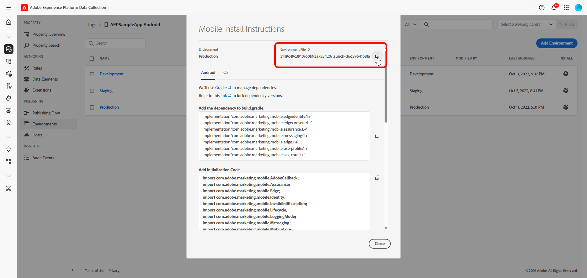

# Extension Flags pour Android {#android-extension-integration-guide}

Ce guide décrit comment intégrer l’extension Flags à Adobe Experience Platform Mobile SDK sur Android.

## Conditions préalables {#prerequisites}

Avant d’implémenter l’extension Flags, vérifiez que vous disposez des éléments suivants :

* Propriété mobile configurée dans la collecte de données Adobe Experience Platform [&#128279;](https://experience.adobe.com/#/data-collection)
* Extension Adobe Flags installée et configurée dans votre propriété mobile
* Un identifiant d’organisation Adobe Experience Cloud
* Un flux de données Edge Network configuré dans votre propriété mobile pour recevoir les analyses d’exposition
* API Android 21 (Android 5.0 Lollipop) ou ultérieure
* Mobile Core 3.6.0 ou version ultérieure (inclus dans `sdk-bom` 3.17.0 et version ultérieure)

## Dépendances d’extension {#extension-dependencies}

L’extension Flags nécessite les extensions Adobe Experience Platform suivantes :

| Extension | Description | Requis |
|---|---|---|
| [&#x200B; Mobile Core &#x200B;](https://developer.adobe.com/client-sdks/home/base/mobile-core/) | Permet la configuration, le traitement des événements et l’initialisation de SDK | Oui |
| [Cycle de vie](https://developer.adobe.com/client-sdks/home/base/mobile-core/lifecycle/) | Indique quand l’application est déplacée au premier plan ou en arrière-plan. | Oui |
| [&#128279;](https://developer.adobe.com/client-sdks/edge/edge-network/) | Envoie les analyses d’exposition à Adobe Experience Platform | Oui |
| [&#x200B; Identité pour Edge Network &#x200B;](https://developer.adobe.com/client-sdks/edge/identity-for-edge-network/) | Fournit les identités utilisées pour affecter des utilisateurs à des variantes | Oui |

Assurez-vous que ces extensions sont installées dans votre propriété mobile de collecte de données et incluses dans vos dépendances d’application.

## Configurer l’extension Flags dans la collecte de données {#configure}

### Installation de l’extension {#install-extension}

1. Connectez-vous à [Collecte de données &#x200B;](https://experience.adobe.com/#/data-collection).

1. Sélectionnez le menu **[!UICONTROL Balises]** et choisissez votre propriété mobile.

1. Accédez à **[!UICONTROL Extensions]** > **[!UICONTROL Catalogue]**.

1. Recherchez **[!DNL Adobe Flags]** et sélectionnez **[!UICONTROL Installer]**.

   

1. Configurez les paramètres d’extension :

   * **[!UICONTROL Sandbox]** : sandbox Adobe Experience Platform contenant votre configuration Indicateurs.
   * **[!UICONTROL Identifiant de l’application]** : l’identifiant de votre application dans Flags.

1. Sélectionnez **[!UICONTROL Enregistrer]**.

1. Suivez le [processus de publication](https://experienceleague.adobe.com/en/docs/experience-platform/tags/publish/overview) pour mettre à jour votre configuration.

### Obtention de l’identifiant du fichier d’environnement {#environment-file-id}

1. Dans votre propriété mobile, accédez à **[!UICONTROL Environnements]**.

1. Sélectionnez l’icône en forme de boîte dans la colonne **[!UICONTROL Installer]** de l’environnement sélectionné.

   

1. Dans la boîte de dialogue **[!UICONTROL Instructions d’installation mobile]**, copiez le **[!UICONTROL ID du fichier d’environnement]**.

   

## Ajouter l’extension Flags à votre application {#add-to-app}

### Ajouter des dépendances {#add-dependencies}

>[!IMPORTANT]
>
>L’extension Flags ne fait pas partie de la nomenclature Mobile SDK. Remplacez `<latest-version>` par la dernière version de Maven Central. Sans version, Gradle ne peut pas résoudre la dépendance.
>
></br>
>&gt;Pour les applications de production, Adobe recommande d’utiliser des numéros de version explicites plutôt que des versions dynamiques telles que « 3.+ ». Voir [Gestion des dépendances Gradle](https://docs.gradle.org/current/userguide/dependency_management.html) pour plus d’informations.

Ajoutez les dépendances suivantes au fichier `build.gradle.kts` (Kotlin) ou `build.gradle` (Groovy) de votre application :

>[!BEGINTABS]

>[!TAB  Kotlin ]

```kotlin
dependencies {
    // Adobe Experience Platform Mobile SDK BOM (3.17.0 or later)
    implementation(platform("com.adobe.marketing.mobile:sdk-bom:3.+"))

    // Required extensions (versions managed by the BOM)
    implementation("com.adobe.marketing.mobile:core")
    implementation("com.adobe.marketing.mobile:lifecycle")
    implementation("com.adobe.marketing.mobile:edge")
    implementation("com.adobe.marketing.mobile:edgeidentity")

    // Flags extension (not managed by the BOM; specify the version)
    implementation("com.adobe.marketing.mobile:flags:<latest-version>")
}
```

>[!TAB  Groovy ]

```groovy
dependencies {
    // Adobe Experience Platform Mobile SDK BOM (3.17.0 or later)
    implementation platform('com.adobe.marketing.mobile:sdk-bom:3.+')

    // Required extensions (versions managed by the BOM)
    implementation 'com.adobe.marketing.mobile:core'
    implementation 'com.adobe.marketing.mobile:lifecycle'
    implementation 'com.adobe.marketing.mobile:edge'
    implementation 'com.adobe.marketing.mobile:edgeidentity'

    // Flags extension (not managed by the BOM; specify the version)
    implementation 'com.adobe.marketing.mobile:flags:<latest-version>'
}
```

>[!ENDTABS]

### Initialiser le SDK {#initialize-sdk}

>[!IMPORTANT]
>
>Pour les applications de production, utilisez `LoggingMode.ERROR` uniquement. N’utilisez ni `DEBUG` ni `VERBOSE` dans les builds de version.

Initialisez Mobile SDK dans votre classe `Application` avant d’appeler les API d’extension Flags. Utilisez l’identifiant du fichier d’environnement de votre propriété mobile afin que l’application récupère les paramètres Flags que vous avez publiés dans la collecte de données.

`MobileCore.initialize` enregistre chaque extension Adobe incluse dans vos dépendances Gradle, y compris l’extension Flags.

Notez que lorsque vous utilisez `MobileCore.initialize`, n’appelez pas également `MobileCore.registerExtensions`, `MobileCore.lifecycleStart` ou `MobileCore.lifecyclePause`. Ils sont gérés pour vous.

>[!BEGINTABS]

>[!TAB  Kotlin ]

```kotlin
import android.app.Application
import com.adobe.marketing.mobile.LoggingMode
import com.adobe.marketing.mobile.MobileCore

class MainApplication : Application() {

    override fun onCreate() {
        super.onCreate()

        MobileCore.setLogLevel(LoggingMode.ERROR)

        // Initialize with your Environment File ID from Data Collection
        MobileCore.initialize(this, "YOUR_ENVIRONMENT_FILE_ID")
    }
}
```

>[!TAB Java]

```java
import android.app.Application;
import com.adobe.marketing.mobile.LoggingMode;
import com.adobe.marketing.mobile.MobileCore;

public class MainApplication extends Application {

    @Override
    public void onCreate() {
        super.onCreate();

        MobileCore.setLogLevel(LoggingMode.ERROR);

        // Initialize with your Environment File ID from Data Collection
        MobileCore.initialize(this, "YOUR_ENVIRONMENT_FILE_ID");
    }
}
```

>[!ENDTABS]

### Enregistrer la classe d’application {#register-application}

Enregistrez votre classe `Application` dans `AndroidManifest.xml` :

```xml
<application
    android:name=".MainApplication"
    ... >
</application>
```

### Si vous enregistrez les extensions manuellement {#register-manually}

Si votre application ne peut pas utiliser `MobileCore.initialize` et enregistre les extensions avec `MobileCore.registerExtensions`, ajoutez `Flag.EXTENSION` à la liste. Utilisez la classe Identity for Edge Network, `com.adobe.marketing.mobile.edge.identity.Identity`, et non l’`com.adobe.marketing.mobile.Identity` héritée.

```kotlin
import com.adobe.marketing.mobile.Edge
import com.adobe.marketing.mobile.Lifecycle
import com.adobe.marketing.mobile.MobileCore
import com.adobe.marketing.mobile.edge.identity.Identity
import com.adobe.marketing.mobile.flags.Flag

MobileCore.setApplication(this)
MobileCore.configureWithAppID("YOUR_ENVIRONMENT_FILE_ID")
MobileCore.registerExtensions(
    listOf(Lifecycle.EXTENSION, Identity.EXTENSION, Edge.EXTENSION, Flag.EXTENSION)
) { }
```

Dans cette configuration, le cycle de vie n’est pas automatiquement suivi. Appelez `MobileCore.lifecycleStart(null)` dans les `onResume` de chaque activité et `MobileCore.lifecyclePause()` dans ses `onPause`. Sans ces appels, l’extension actualise constamment les indicateurs pendant que l’application est en arrière-plan et les analyses d’exposition sont envoyées ultérieurement.

## Contexte d’évaluation {#evaluation-context}

`FeatureEvaluationContext` contient les attributs de ciblage utilisés par vos règles d’indicateur. Vous ne transmettez pas d’identité : l’extension la lit à partir d’Identité pour Edge Network à chaque évaluation. Voir [&#x200B; Identité personnalisée &#x200B;](#custom-identity).

| Méthode | Requis | Description |
|---|---|---|
| `withAttributes(map)` | Non | `Map<String, List<String>>`. Chaque clé est un nom d’attribut utilisé par vos règles d’indicateur (par exemple, `locale` ou `appVersion`). Chaque valeur correspond à la liste de valeurs de l’utilisateur actuel (par exemple, `["en_US"]`). |

* Un contexte est nécessaire à chaque évaluation. Si vous ne disposez d’aucun attribut, transmettez `FeatureEvaluationContext.builder().build()`.
* Appelez `withAttributes` au plus une fois par créateur.
* Un contexte créé ne peut pas être modifié, vous pouvez donc le réutiliser dans plusieurs évaluations.

### Usage {#evaluation-context-usage}

>[!BEGINTABS]

>[!TAB  Kotlin ]

```kotlin
import com.adobe.marketing.mobile.flags.FeatureEvaluationContext

val ctx = FeatureEvaluationContext.builder()
    .withAttributes(
        mapOf(
            "locale" to listOf("en_US"),
            "platform" to listOf("ANDROID")
        )
    )
    .build()
```

>[!TAB Java]

```java
import com.adobe.marketing.mobile.flags.FeatureEvaluationContext;
import java.util.Arrays;
import java.util.HashMap;
import java.util.List;
import java.util.Map;

Map<String, List<String>> attrs = new HashMap<>();
attrs.put("locale", Arrays.asList("en_US"));
attrs.put("platform", Arrays.asList("ANDROID"));

FeatureEvaluationContext ctx = FeatureEvaluationContext.builder()
        .withAttributes(attrs)
        .build();
```

>[!ENDTABS]

### Exemples d’attributs de ciblage {#sample-attributes}

| Attribut | Description | Exemples de valeurs |
|---|---|---|
| `locale` | Paramètres régionaux de l’utilisateur | `["en_US"]`, `["fr_FR"]` |
| `platform` | Plateforme | `["ANDROID"]` |
| `appVersion` | Version de l’application | `["3.0.0"]` |
| `deviceType` | Type de périphérique | `["phone"]`, `["tablet"]` |

Les noms et valeurs des attributs doivent correspondre à ceux utilisés dans vos règles d’indicateur.

## Identité personnalisée {#custom-identity}

L’extension Flags utilise l’extension Identity for [&#128279;](https://developer.adobe.com/client-sdks/edge/identity-for-edge-network/) pour la résolution d’identité. Un indicateur de fonctionnalité peut être associé à une identité personnalisée, par exemple un identifiant CRM ou un identifiant de fidélité, de sorte que les divisions de variantes et les analyses soient liées à l’identité qui importe pour votre application.

L’espace de noms d’identité personnalisée doit être sélectionné dans l’interface utilisateur des indicateurs lorsque l’indicateur de fonctionnalité est créé. Pour évaluer un indicateur par rapport à cette identité, la même identité doit être présente dans le `identityMap` d’identité Edge sur l’appareil, à l’aide de l’espace de noms correspondant. Fournissez-le au moment de l’exécution avec l’API Identity for Edge Network `updateIdentities`.

### Ajouter l’identité personnalisée au mappage d’identités {#add-identity}

Ajoutez l&#39;identité sous le même espace de noms configuré sur l&#39;indicateur de fonctionnalité avant d&#39;évaluer l&#39;indicateur.

Notez ce qui suit lorsque vous ajoutez l’identité :

* L’espace de noms doit correspondre exactement, casse incluse.
* Si l’espace de noms comporte plusieurs identités, celle marquée comme principale est utilisée. Sinon, le premier est utilisé.
* Si l’identité est manquante lors de l’évaluation de l’indicateur , l’utilisateur est affecté par un ID temporaire qui change chaque fois que l’application démarre. La variante de l’utilisateur peut ensuite changer entre les lancements d’application. Définissez toujours l’identité avant d’évaluer les indicateurs qui l’utilisent.

>[!BEGINTABS]

>[!TAB  Kotlin ]

```kotlin
import com.adobe.marketing.mobile.edge.identity.AuthenticatedState
import com.adobe.marketing.mobile.edge.identity.Identity
import com.adobe.marketing.mobile.edge.identity.IdentityItem
import com.adobe.marketing.mobile.edge.identity.IdentityMap

val identityMap = IdentityMap()
identityMap.addItem(
    IdentityItem("1111", AuthenticatedState.AUTHENTICATED, true),
    "userCRMId" // must match the namespace configured on the feature flag
)
Identity.updateIdentities(identityMap)
```

>[!TAB Java]

```java
import com.adobe.marketing.mobile.edge.identity.AuthenticatedState;
import com.adobe.marketing.mobile.edge.identity.Identity;
import com.adobe.marketing.mobile.edge.identity.IdentityItem;
import com.adobe.marketing.mobile.edge.identity.IdentityMap;

IdentityMap identityMap = new IdentityMap();
identityMap.addItem(
        new IdentityItem("1111", AuthenticatedState.AUTHENTICATED, true),
        "userCRMId"); // must match the namespace configured on the feature flag
Identity.updateIdentities(identityMap);
```

>[!ENDTABS]

## Référence d’API {#api-reference}

### Rappels et gestion des erreurs {#callbacks-errors}

Ces règles s’appliquent aux `isFeatureEnabled` et aux `getFeature` :

* Fournissez toujours une expérience par défaut. Transmettez une `AdobeCallbackWithError` et affichez votre expérience par défaut dans `fail`. Avec une `AdobeCallback` simple, rien n’est appelé lorsqu’une erreur se produit.

* L’extension précharge les définitions d’indicateur au démarrage de l’application. Ensuite, les indicateurs sont évalués sur l’appareil.

* Autres erreurs : `fail` est appelé avec `AdobeError.UNEXPECTED_ERROR` lorsque :

  * la clé de fonctionnalité est vide,
  * les paramètres Flags ou l’ID d’organisation Experience Cloud sont absents de la configuration publiée, ou
  * les définitions d’indicateur n’ont pas pu être téléchargées au démarrage de l’application (par exemple, l’appareil était hors ligne). L’extension réessaye lors de la prochaine mise à jour de la configuration, généralement le prochain lancement de l’application.

### isFeatureEnabled {#is-feature-enabled}

Renvoie si une fonctionnalité est activée pour l’utilisateur actuel.

**Signature**

>[!BEGINTABS]

>[!TAB  Kotlin ]

```kotlin
Flag.isFeatureEnabled(
    featureKey: String,
    evaluationContext: FeatureEvaluationContext,
    callback: AdobeCallback<Boolean>
)
```

>[!TAB Java]

```java
Flag.isFeatureEnabled(
    String featureKey,
    FeatureEvaluationContext evaluationContext,
    AdobeCallback<Boolean> callback);
```

>[!ENDTABS]

**Paramètres**

| Paramètre | Type | Description |
|---|---|---|
| `featureKey` | Chaîne | Clé de la fonctionnalité à évaluer |
| `evaluationContext` | FeatureEvaluationContext | Attributs de ciblage. Utilisez `FeatureEvaluationContext.builder().build()` si vous n’en avez pas. Voir [&#x200B; Contexte d’évaluation &#x200B;](#evaluation-context). |
| `callback` | AdobeCallback&lt;Boolean> | Appelé avec `true` si la fonctionnalité est activée pour l’utilisateur. Appelé avec `false` si la fonctionnalité est introuvable, si les règles de ciblage ne correspondent pas ou si l’utilisateur se trouve dans la population témoin. Transmettez un `AdobeCallbackWithError<Boolean>` pour recevoir également des erreurs. |

**Exemples**

>[!BEGINTABS]

>[!TAB  Kotlin ]

```kotlin
import com.adobe.marketing.mobile.AdobeCallbackWithError
import com.adobe.marketing.mobile.AdobeError
import com.adobe.marketing.mobile.flags.Flag

Flag.isFeatureEnabled(
    "new-checkout",
    ctx,
    object : AdobeCallbackWithError<Boolean> {
        override fun call(isEnabled: Boolean?) {
            runOnUiThread {
                if (isEnabled == true) showNewCheckout() else showDefaultCheckout()
            }
        }

        override fun fail(error: AdobeError?) {
            runOnUiThread { showDefaultCheckout() }
        }
    }
)
```

>[!TAB Java]

```java
import com.adobe.marketing.mobile.AdobeCallbackWithError;
import com.adobe.marketing.mobile.AdobeError;
import com.adobe.marketing.mobile.flags.Flag;

Flag.isFeatureEnabled(
    "new-checkout",
    ctx,
    new AdobeCallbackWithError<Boolean>() {
        @Override
        public void call(Boolean isEnabled) {
            runOnUiThread(() -> {
                if (Boolean.TRUE.equals(isEnabled)) {
                    showNewCheckout();
                } else {
                    showDefaultCheckout();
                }
            });
        }

        @Override
        public void fail(AdobeError error) {
            runOnUiThread(() -> showDefaultCheckout());
        }
    }
);
```

>[!ENDTABS]

### getFeature {#get-feature}

Renvoie la fonction évaluée pour l’utilisateur actuel, y compris ses métadonnées. Utilisez cette API lorsque vous avez besoin de plus que activés ou désactivés.

**Signature**

>[!BEGINTABS]

>[!TAB  Kotlin ]

```kotlin
Flag.getFeature(
    featureKey: String,
    evaluationContext: FeatureEvaluationContext,
    callback: AdobeCallback<FeatureEvaluationResult>
)
```

>[!TAB Java]

```java
Flag.getFeature(
    String featureKey,
    FeatureEvaluationContext evaluationContext,
    AdobeCallback<FeatureEvaluationResult> callback);
```

>[!ENDTABS]

**Paramètres**

| Paramètre | Type | Description |
|---|---|---|
| `featureKey` | Chaîne | Clé de la fonctionnalité à évaluer |
| `evaluationContext` | FeatureEvaluationContext | Attributs de ciblage. Utilisez `FeatureEvaluationContext.builder().build()` si vous n’en avez pas. Voir [&#x200B; Contexte d’évaluation &#x200B;](#evaluation-context). |
| `callback` | AdobeCallback&lt;FeatureEvaluationResult> | Appelé avec la fonctionnalité évaluée ou avec `null` lorsque la fonctionnalité n’est pas diffusée à l’utilisateur ou l’utilisatrice : la clé est inconnue, les critères de ciblage ne sont pas remplis ou l’utilisateur ou l’utilisatrice se trouve dans une cohorte de contrôle. `null` est un résultat normal, pas une erreur. Les expositions de la cohorte témoin sont toujours rapportées à Analytics. Transmettez une `AdobeCallbackWithError<FeatureEvaluationResult>` pour recevoir des `fail(...)` pour les échecs réels tels que les dépassements de délai. |

Traiter un résultat `null` comme « fonctionnalité désactivée » et afficher votre expérience par défaut. Affichez également l’expérience par défaut lors de l’appel de `fail`, qui ne se produit que lors d’échecs réels tels que les dépassements de délai.

**Réponse**

*FeatureEvaluationResult*

| Champ | Type | Description |
|---|---|---|
| `id` | Int | Identifiant de la fonctionnalité |
| `key` | Chaîne | Clé de fonctionnalité |
| `featureGroupKey` | Chaîne ? | Clé du groupe de fonctions, si la fonction appartient à un groupe |
| `meta` | Chaîne ? | Métadonnées configurées pour la fonction, en texte brut ou `null` si aucune métadonnée n’est définie. Si vous avez stocké du code JSON, analysez la chaîne dans votre application. |
| `analyticsParam` | AnalyticsParam ? | Détails d’analyse pour l’évaluation |

*AnalyticsParam*

| Champ | Type | Description |
|---|---|---|
| `featureGroupId` | Int | Identifiant du groupe de fonctionnalités |
| `featureId` | Int | Identifiant de la fonctionnalité |
| `variantId` | Chaîne ? | ID de la variante à laquelle l’utilisateur a été affecté |

**Exemples**

>[!BEGINTABS]

>[!TAB  Kotlin ]

```kotlin
import com.adobe.marketing.mobile.AdobeCallbackWithError
import com.adobe.marketing.mobile.AdobeError
import com.adobe.marketing.mobile.flags.FeatureEvaluationResult
import com.adobe.marketing.mobile.flags.Flag

Flag.getFeature(
    "new-checkout",
    ctx,
    object : AdobeCallbackWithError<FeatureEvaluationResult> {
        override fun call(feature: FeatureEvaluationResult?) {
            val meta = feature?.meta
            runOnUiThread {
                if (!meta.isNullOrEmpty()) applyExperience(meta) else showDefaultExperience()
            }
        }

        override fun fail(error: AdobeError?) {
            runOnUiThread { showDefaultExperience() }
        }
    }
)
```

>[!TAB Java]

```java
import com.adobe.marketing.mobile.AdobeCallbackWithError;
import com.adobe.marketing.mobile.AdobeError;
import com.adobe.marketing.mobile.flags.FeatureEvaluationResult;
import com.adobe.marketing.mobile.flags.Flag;

Flag.getFeature(
    "new-checkout",
    ctx,
    new AdobeCallbackWithError<FeatureEvaluationResult>() {
        @Override
        public void call(FeatureEvaluationResult feature) {
            final String meta = feature != null ? feature.getMeta() : null;
            runOnUiThread(() -> {
                if (meta != null && !meta.isEmpty()) {
                    applyExperience(meta);
                } else {
                    showDefaultExperience();
                }
            });
        }

        @Override
        public void fail(AdobeError error) {
            runOnUiThread(() -> showDefaultExperience());
        }
    }
);
```

>[!ENDTABS]

### extensionVersion {#extension-version}

Renvoie la version de l’extension Flags.

**Syntaxe**

```kotlin
Flag.extensionVersion(): String
```

**Exemple &#x200B;**

*Kotlin*

```kotlin
val version = Flag.extensionVersion()
```

*Java*

```java
String version = Flag.extensionVersion();
```

## Résumé des API {#api-summary}

| Visiteur | Retours |
|---|---|
| `isFeatureEnabled(featureKey, evaluationContext, callback)`. Voir [isFeatureEnabled](#is-feature-enabled). | Booléen via le rappel |
| `getFeature(featureKey, evaluationContext, callback)`. Voir [getFeature](#get-feature). | FeatureEvaluationResult via le rappel |
| `extensionVersion()` | Chaîne |

## Débogage {#debugging}

Pour déboguer, définissez `MobileCore.setLogLevel(LoggingMode.DEBUG)` dans une version de débogage et filtrez Logcat par `Flags`. Un message `Discovered extension` de MobileCore doit s’afficher pour `com.adobe.marketing.mobile.flags.FlagExtension`.


