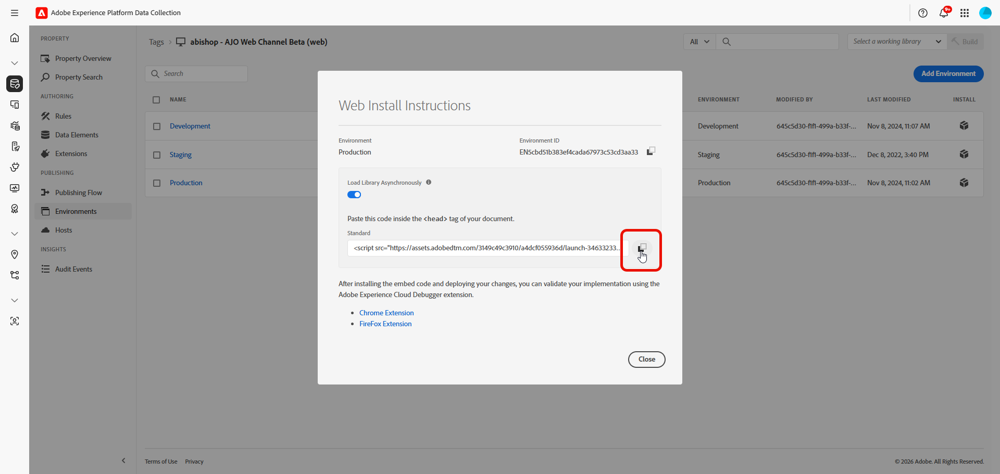

# Extension Flags pour le Web {#web-extension-integration-guide}

Ce guide décrit comment intégrer l’extension Flags à Adobe Experience Platform Web SDK (Alloy) pour les applications web. L’extension Flags permet la gestion des indicateurs de fonctionnalité et les déploiements contrôlés pour les expériences web.

## Conditions préalables {#prerequisites}

Avant d’implémenter l’extension Flags, vérifiez que vous disposez des éléments suivants :

* Propriété web configurée dans la collecte de données Adobe Experience Platform [&#128279;](https://experience.adobe.com/#/data-collection)
* Extension Adobe Experience Platform Web SDK installée
* Un identifiant d’organisation Adobe Experience Cloud
* Accès aux indicateurs dans votre organisation

### Autorisations requises {#required-permissions}

Vérifiez que vous disposez des droits de propriété suivants :

* Développer
* Gérer les extensions

## Dépendances d’extension {#extension-dependencies}

L’extension Flags nécessite l’extension Adobe Experience Platform suivante :

| Extension | Description | Requis |
|---|---|---|
| Adobe Experience Platform Web SDK | Fournit des fonctionnalités de base, notamment la communication Edge Network et la gestion des identités | Oui |

Assurez-vous que cette extension est installée dans la propriété web de votre collecte de données avant d’installer l’extension Flags.

## Configurer l’extension Flags dans la collecte de données {#configure}

### Installation de l’extension {#install-extension}

1. Connectez-vous à [Collecte de données &#x200B;](https://experience.adobe.com/#/data-collection).

1. Sélectionnez l’onglet **[!UICONTROL Balises]** et choisissez votre propriété mobile.

1. Accédez à **[!UICONTROL Extensions]** > **[!UICONTROL Catalogue]**.

1. Recherchez **[!DNL Adobe Flags]** et sélectionnez **[!UICONTROL Installer]**.

   

1. Configurez les paramètres d’extension :

* Identifiant client : un identifiant unique pour votre application dans Flags.

1. Sélectionnez **[!UICONTROL Enregistrer]**.

1. Suivez le [processus de publication](https://experienceleague.adobe.com/fr/docs/experience-platform/tags/publish/overview) pour mettre à jour votre configuration.

   1. Ajoutez l’extension à une bibliothèque.

   1. Créez dans votre environnement de développement.

   1. Validez avec [&#128279;](https://experienceleague.adobe.com/docs/experience-platform/debugger/home.html?lang=fr).

   1. Promouvoir l’évaluation et la production.

## Ajout du code intégré aux balises à votre site web {#embed-code}

Après avoir publié votre bibliothèque de balises, vous devez ajouter le code incorporé à votre site web. Le code incorporé est une balise `<script>` qui charge la bibliothèque de balises et toutes les extensions configurées, y compris l’extension Flags.

### Copiez le code intégré {#copy-embed-code}

1. Dans Collecte de données, accédez à votre propriété web.

1. Accédez au menu **[!UICONTROL Environnements]**.

1. Sélectionnez l’icône en forme de boîte dans la colonne **[!UICONTROL Installer]** de l’environnement sélectionné.

   

1. Dans la boîte de dialogue **[!UICONTROL Instructions d’installation web]**, les balises utilisent par défaut le code intégré asynchrone.

1. Sélectionnez l’icône **[!UICONTROL Copier]** pour copier le code incorporé dans le presse-papiers.

   >[!NOTE]
   >
   >Chaque environnement possède une URL de code incorporé unique. Consultez la documentation [&#x200B; Environnements &#x200B;](https://experienceleague.adobe.com/docs/experience-platform/tags/publish/environments/environments.html?lang=fr) pour plus d’informations.

   

### Implémenter le code intégré {#implement-embed-code}

>[!NOTE]
>
>Remplacez l’URL `src` par le code incorporé de la page Environnements . L’URL contient l’identifiant de votre société, l’identifiant de la propriété et l’identifiant de l’environnement (par exemple, `launch-EN123456789abcdef.min.js`).

Ajoutez le code incorporé dans l’élément `<head>` de vos pages HTML. Le code incorporé doit être placé avant les autres scripts qui dépendent de la bibliothèque de balises :

```html
<!DOCTYPE html>
<html>
<head>
  <title>My Website</title>

  <!-- Adobe Experience Platform Tags embed code -->
  <script src="https://assets.adobedtm.com/your-company/your-property/launch-ENxxxxxxxxxxx.min.js" async></script>
</head>
<body>
  <!-- Your page content -->
</body>
</html>
```

### Évaluation des indicateurs avec les composants Balises {#tags-components}

L’extension Flags fournit des surfaces d’évaluation natives aux balises.

| Composant | Type | Description |
|---|---|---|
| La Fonction Est Activée | Condition | Renvoie si une fonction est activée pour l’utilisateur/le contexte actuel |
| Indicateur de fonctionnalité | Élément de données | Renvoie un objet de type booléen ou complet |

## Initialiser le SDK {#initialize-sdk}

L’extension Flags s’initialise automatiquement au chargement de la bibliothèque de balises. L’extension expose le client sur :

```javascript
window._flagClient
```

### Attendre que le client soit prêt {#client-readiness}

Les balises se chargent de manière asynchrone. Avant d’appeler des méthodes SDK à partir de code personnalisé, attendez que le client soit initialisé :

```javascript
window.flagClientReady
  .then(function () {
    const enabled = window._flagClient.isFeatureEnabled('my-feature', context);
    // Use enabled to select the feature or fallback behavior.
  })
  .catch(function (error) {
    console.error('Flags initialization failed:', error);
  });
```

## Contexte d’évaluation {#evaluation-context}

`FeatureEvaluationContext` inclut les attributs d’identité (requis pour l’évaluation, le regroupement A/B et l’analyse) et de ciblage facultatifs (utilisés pour la correspondance de règles).

| Propriété | Requis | Description |
|---|---|---|
| `identityNamespace` | Oui | Espace de noms d’identité (voir [Espaces de noms d’identité &#x200B;](https://experienceleague.adobe.com/fr/docs/experience-platform/identity/features/namespaces)). Valeurs courantes : `ECID`, `Email`, `CRMId`. |
| `identityId` | Oui | Valeur d’identité de l’utilisateur actuel. |
| `attributes` | Non | `Record<string, string[]>`. Clé est le nom de l’attribut de contexte utilisé par vos règles d’indicateur (par exemple, `locale`, `platform`). Valeur correspond à la liste des valeurs d’attribut candidates pour cette clé. |

Dans les composants Balises, définissez les valeurs d’identité par défaut dans l’interface utilisateur de la condition ou de l’élément de données. L’élément de données Indicateur de fonctionnalité accepte également les attributs d’exécution via `getVar(name, attributes)` lorsque le deuxième argument est un mappage d’attributs aplati.

### Usage {#usage}

```javascript
const context = {
  identityNamespace: 'ECID',
  identityId: 'your-visitor-ecid',
  attributes: {
    locale: ['en-US'],
    platform: ['web']
  }
};
```

## Référence d’API {#api-reference}

### Évaluation des fonctionnalités {#is-feature-enabled}

`isFeatureEnabled` indique si la fonction Indicateurs est activée ou désactivée pour le contexte donné. `featureKey` et `FeatureEvaluationContext`. Voir [&#x200B; Contexte d’évaluation &#x200B;](#evaluation-context). Utilisez la condition **La fonction est activée** Balises ou appelez `window._flagClient.isFeatureEnabled(...)` à partir de code personnalisé après l’initialisation.

**Signature**

```javascript
isFeatureEnabled(featureKey: string, context: FeatureEvaluationContext): boolean
```

**Paramètres**

| Paramètre | Type | Description |
|---|---|---|
| `featureKey` | string | Clé de fonctionnalité à évaluer dans Flags |
| `context` | FeatureEvaluationContext | Attributs d’identité (obligatoire) et de ciblage facultatifs. Voir [&#x200B; Contexte d’évaluation &#x200B;](#evaluation-context). |

## Créer un élément de données Indicateur de fonctionnalité {#create-data-element}

Utilisez un élément de données lorsque vous avez besoin d’une valeur d’indicateur disponible comme `%Data Element Name%` dans les règles ou le code personnalisé.

1. Dans votre propriété, accédez au menu **[!UICONTROL Éléments de données]** et sélectionnez **[!UICONTROL Ajouter un élément de données]**.

   

1. Sur l’écran **Créer un élément de données**, configurez les champs Balises :

   * **[!UICONTROL Name]** : nom explicite (par exemple `checkout flag`)
   * **[!UICONTROL Extension]** : Flags
   * **[!UICONTROL Type d’élément de données]** : indicateur de fonctionnalité

1. Configurez les champs d’extension **Flags** :

   * **[!UICONTROL Clé de fonction]** : clé d’indicateur unique (par exemple, `checkout_flag`), obligatoire.
   * **[!UICONTROL Type de valeur renvoyée]** : **booléen (true/false)** — activé/désactivé, ou **Objet de fonctionnalité (détails complets)** — payload complète, y compris `meta`, obligatoire.

     | Type de valeur renvoyée | Résout sur |
     |---|---|
     | Booléen (true/false) | `true` si activé, `false` dans le cas contraire |
     | Feature Object (détails complets) | Payload de fonction évaluée lorsque l’indicateur est activé et que le contexte correspond à son audience ; `null` lorsque l’indicateur est désactivé, introuvable ou que le contexte ne correspond pas |

1. Sélectionnez **Enregistrer**.

### Utiliser l’élément de données {#use-data-element}

Dans une règle, référencez par nom, par exemple `%Test Flag%`.

Dans le code personnalisé, utilisez `_satellite.getVar`. Avec les attributs d’exécution, transmettez un mappage d’attributs plat comme deuxième argument à évaluer :

```javascript
var isEnabled = _satellite.getVar('Test Flag', {
  locale: ['en-US'],
  platform: ['web']
});
```

**Code personnalisé**

```javascript
var isEnabled = _satellite.getVar('Test Flag', {
  locale: ['en-US'],
  platform: ['web']
});
if (isEnabled) {
  // your custom code
} else {
  // your default code
}
```

### getFeature {#get-feature}

`getFeature` renvoie la payload de la fonctionnalité évaluée lorsque vous avez besoin de métadonnées au-delà de activées/désactivées.

Utilisez un élément de données **Indicateur de fonctionnalité** avec **Type de retour : objet de fonctionnalité (détails complets)**, consultez [Création d’un élément de données Indicateur de fonctionnalité](#create-data-element) ou appelez un `window._flagClient.getFeature(...)` à partir d’un code personnalisé après la résolution de l’`flagClientReady`.

**Signature**

```javascript
getFeature(featureKey: string, context: FeatureEvaluationContext): FeatureResult | null
```

**Paramètres**

| Paramètre | Type | Description |
|---|---|---|
| `featureKey` | string | Clé de fonctionnalité à évaluer dans Flags |
| `context` | FeatureEvaluationContext | Attributs d’identité (obligatoire) et de ciblage. Voir [&#x200B; Contexte d’évaluation &#x200B;](#evaluation-context). |

**Réponse**

`getFeature` évalue un indicateur uniquement lorsqu’il est activé et que le contexte fourni correspond aux critères d’audience de l’indicateur. Dans ce cas, elle renvoie un objet de résultat ; dans le cas contraire, elle renvoie `null`.

*FeatureResult*

| Champ | Type | Description |
|---|---|---|
| `id` | nombre | Identifiant numérique de la fonction. `-1` pour la sentinelle de contrôle au niveau des fonctionnalités. |
| `key` | chaîne \| null | Clé de la fonctionnalité. `null` pour la sentinelle de contrôle au niveau des fonctionnalités. |
| `featureGroupKey` | chaîne \| null | Clé du groupe de fonctionnalités si disponible |
| `meta` | chaîne \| null | Métadonnées des fonctionnalités, le cas échéant |
| `analyticsParam` | AnalyticsParam \| null | Détails Analytics pour la fonctionnalité évaluée |

*AnalyticsParam*

| Champ | Type | Description |
|---|---|---|
| `featureGroupId` | nombre | Identifiant numérique du groupe de caractéristiques |
| `featureId` | nombre | Identifiant numérique de la caractéristique |
| `variantId` | nombre \| nul | Identifiant de la variante (`0` si l’utilisateur se trouve dans la population témoin) |

**Comportement de la population témoin**

| Scénario | isFeatureEnabled | getFeature | Événement Analytics isFeatureEnabled | Événement Analytics getFeature |
|---|---|---|---|---|
| Traitement | `true` | Résultat normal | Oui | Oui |
| Contrôle au niveau des fonctionnalités | `false` | Sentinelle (`id: -1`, `key: null`) | Oui (`variantId: 0`) | Oui |
| Non-correspondance des critères / introuvable | `false` | `null` | Non | Non |

**Exemples**

*Élément de données Balises*

Référencez votre élément de données (par exemple, `%Test Feature%`) dans une règle et récupérez-le via `_satellite.getVar`.

*Code personnalisé*

```javascript
var feature = _flagClient.getFeature('new-test-flag', {
  identityNamespace: 'ECID',
  identityId: visitorEcid,
  attributes: {
    locale: ['en-US']
  }
});

var meta = feature && feature.meta;
if (meta) {
  // your custom code
} else {
  // your default code
}
```

### extensionVersion {#extension-version}

Renvoie la chaîne de version de l’extension Flags.

**Signature**

```javascript
_flagClient.extensionVersion(): string
```

**Exemple &#x200B;**

```javascript
const version = _flagClient.extensionVersion();
console.log(`Flags extension version: ${version}`);
```

## Résumé des API {#api-summary}

| Visiteur | Retours |
|---|---|
| Indicateur de fonctionnalité (élément de données Balises, booléen) | Booléen |
| Indicateur de fonctionnalité (élément de données Balises, objet) | Objet ou `null` de la fonctionnalité |
| `window.flagClientReady` | Promise — Attend l&#39;initialisation de l&#39;extension |
| `window._flagClient.isFeatureEnabled(featureKey, context)` | Booléen |
| `window._flagClient.getFeature(featureKey, context)` | Objet ou `null` de la fonctionnalité |
| `window._flagClient.extensionVersion()` | Chaîne de version de l’extension |

## Gestion des erreurs {#error-handling}

L’extension gère les erreurs avec élégance :

| Scénario | Comportement |
|---|---|
| Réseau indisponible à l&#39;initialisation | Le SDK tente à nouveau la récupération initiale 3 fois avec interruption et l’initialisation échoue. `window.flagClientReady` et `_satellite.getVar(...)` sont rejetés avec `Failed to initialize Flag` ; `window._flagClient` reste `undefined`. |
| Identité manquante dans le contexte | L’évaluation renvoie une erreur ; fournissez à la fois `identityNamespace` et `identityId` |
| Fonction introuvable | `getFeature` renvoie `null` ; `isFeatureEnabled` renvoie `false` |

**Exemple &#x200B;**

```javascript
try {
  const isEnabled = _flagClient.isFeatureEnabled('my-feature', context);
  // Use the result
} catch (error) {
  console.error('Evaluation failed:', error.message);
  // Use default value
}
```

## Bonnes pratiques {#best-practices}

### Fournir une identité cohérente {#consistent-identity}

Utilisez le même espace de noms d’identité et le même identifiant dans toutes les évaluations pour un regroupement cohérent dans les déploiements en pourcentage.

**Exemple &#x200B;**

```javascript
const context = {
  identityNamespace: 'ECID',
  identityId: identity,
  attributes: {
    locale: ['en-US'],
    platform: ['web']
  }
};

const isEnabled = _flagClient.isFeatureEnabled('my-feature', context);
```

### Gestion des fonctionnalités manquantes avec élégance {#handle-missing}

Fournissez toujours un comportement de secours lorsqu’une fonctionnalité est introuvable ou que l’évaluation échoue.

```javascript
const feature = _flagClient.getFeature('new-test-flag', context);

if (feature && feature.meta) {
  // your custom code
} else {
  // Feature not enabled - use default code
}
```

### Évaluer après le chargement de la page {#evaluate-after-load}

Assurez-vous que la bibliothèque de balises et l’extension Flags ont été initialisés avant d’appeler les API. Utilisez l’événement **Library Loaded** (Bibliothèque chargée) dans les règles, un élément de données **Indicateur de fonctionnalité** ou attendez la `flagClientReady` :

```javascript
window.flagClientReady.then(function () {
  var isEnabled = window._flagClient.isFeatureEnabled('my-feature', context);
  // Use the result
});
```

## Voir également {#see-also}

* [Créer votre premier indicateur de fonctionnalité](../../feature-flags/create-your-first-feature-flag.md)
* [Audience dans les indicateurs de fonctionnalité et les groupes de fonctionnalités](../../audience/audience-in-feature-flags-and-feature-groups.md)
* [Création de rapports](../../feature-flags/reporting.md)

