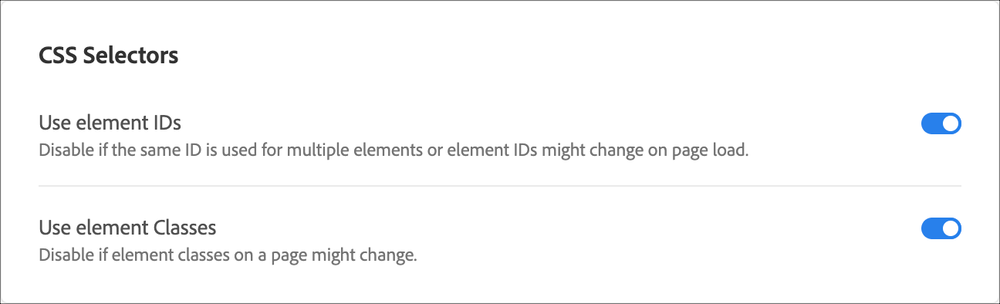

# Configuration du compositeur d’expérience visuelle (VEC)

Utilisez l’onglet **[!UICONTROL Compositeur d’expérience visuelle]** sous **[!UICONTROL Administration]** pour définir les valeurs par défaut à l’échelle du compte pour le [!DNL Adobe Target] [!UICONTROL Compositeur d’expérience visuelle] (VEC). Ces paramètres s’appliquent chaque fois que les auteurs créent ou prévisualisent des expériences dans le compositeur d’expérience visuelle.

**Aperçu de la configuration**

1. [Paramètres généraux](#general-settings) : URL par défaut, compositeur d’expérience amélioré, contenu mixte et instantanés d’expérience.
1. [Configuration des fenêtres d’affichage mobiles](#mobile-viewport-configuration) : prévisualisez les appareils pour les expériences réactives ([Target Premium](/help/main/c-intro/intro.md#premium) uniquement).
1. [Sélecteurs CSS](#css) : méthode de Target pour générer des sélecteurs pour la diffusion de contenu.

Pour ouvrir la page de configuration, cliquez sur **[!UICONTROL Administration]** > **[!UICONTROL Compositeur d’expérience visuelle]**.

>[!NOTE]
>
>Les paramètres de cette page s&#39;appliquent à l&#39;ensemble du compte [!DNL Target].

## Paramètres généraux {#general-settings}

Dans la section **[!UICONTROL Paramètres généraux]**, configurez les valeurs par défaut utilisées lors de l’ouverture du compositeur d’expérience visuelle.

Les méthodes suivantes sont disponibles :

* **URL par défaut**

  Définissez l’URL par défaut utilisée par le [!UICONTROL compositeur d’expérience visuelle]. Il s’agit de la page par défaut, par exemple votre page d’accueil, utilisée lorsque vous configurez une expérience pour chaque nouvelle activité. Si vous ne définissez pas d’URL par défaut, vous devez saisir une URL pour chaque activité lors de sa création.

* **Activer Le Compositeur D’Expérience Amélioré**

  Autorise la modification des sites avec des iFrames ou avec un contenu mixte. Certains sites peuvent ne pas être compatibles avec la version améliorée. Désélectionnez cette option pour revenir au [!UICONTROL compositeur d’expérience visuelle] d’origine. La répartition des activités sur les sites n’est pas affectée par ce choix.

  Notez que le [!UICONTROL compositeur d’expérience amélioré] n’est pas pris en charge dans [!DNL Safari].

  Pour plus d’informations, voir [Résolution des problèmes du compositeur d’expérience visuelle](/help/main/c-experiences/c-visual-experience-composer/r-troubleshoot-composer/troubleshoot-composer.md).

  Vous pouvez également activer le [!UICONTROL compositeur d’expérience amélioré] au niveau de l’activité. Voir [Découvrez comment activer le compositeur d’expérience avancé au niveau de l’activité](/help/main/c-experiences/c-visual-experience-composer/experience-composer-best-practices.md).

* **Charger du contenu mixte**

  Activez le contenu mixte lors de l’ouverture d’un site web à l’aide du [!UICONTROL Enhanced Experience Composer] (EEC). L&#39;activation de cette option évite la surcharge supplémentaire liée au chargement de ressources statiques via [!DNL Target] serveurs proxy.

  Cette option s’avère utile si, par exemple :

  * Les en-têtes de votre politique de sécurité du contenu (CSP) permettent de charger du contenu mixte sans utiliser de serveurs proxy avec le compositeur d’expérience amélioré activé.
  * Votre site web HTTP est confronté à un temps de chargement accru dans l’EEC, où le chargement de JavaScript, d’images, etc. prend plus de temps via proxy.

* **Générer des instantanés d’expérience dans le diagramme de flux d’activités**

  L’activation des instantanés d’expérience génère des miniatures pour vos expériences dans le diagramme de processus de l’activité. Pour certains utilisateurs, la désactivation des instantanés peut permettre d’obtenir des performances plus rapides.

## Configuration des fenêtres d’affichage mobiles {#mobile-viewport-configuration}

>[!NOTE]
>
>Les paramètres **[!UICONTROL Configuration de la fenêtre d’affichage mobile]** sont une fonctionnalité [Target Premium](/help/main/c-intro/intro.md#premium).

Ajoutez des appareils à utiliser lors de la prévisualisation d’expériences. Chaque périphérique est associé à une audience.

Procédez comme suit pour ajouter une fenêtre d’affichage mobile :

1. Cliquez sur **[!UICONTROL Ajouter]**.
1. Indiquez un nom explicite pour la fenêtre d’affichage mobile, spécifiez la largeur et la hauteur, puis sélectionnez le système d’exploitation souhaité.
1. Cliquez sur **[!UICONTROL Enregistrer]**.

Pour obtenir un aperçu et connaître les détails de l’audience, consultez [Découvrez comment utiliser les fenêtres d’affichage mobiles pour les expériences réactives](/help/main/c-experiences/c-visual-experience-composer/mobile-viewports.md).

## Sélecteurs CSS {#css}

Spécifiez comment [!DNL Target] génère des sélecteurs CSS.

Ces options aident [!DNL Target] à comprendre la structure de votre site afin de générer de meilleurs sélecteurs CSS pour la distribution de contenu. Par défaut, [!DNL Target] génère les sélecteurs selon les identifiants d’élément de la page. Si votre site utilise peu d’ID, ou des ID en double sur la même page, l’utilisation de classes peut être une meilleure option.

Vous pouvez sélectionner une des options suivantes ou les deux :

* **Utiliser des identifiants d’élément**

  Désélectionnez cette option si le même ID est utilisé pour plusieurs éléments ou si l’ID d’élément peut changer au chargement de la page.

* **Utiliser des classes d’éléments**

  Par défaut, [!DNL Target] utilise uniquement les identifiants d’élément. Cependant, si votre page est conçue pour utiliser des classes pour identifier des éléments, comme une page créée avec [!DNL Adobe Experience Manager], vous devez également sélectionner **[!UICONTROL Utiliser des classes d’éléments]**. La précision du sélecteur est généralement plus élevée lors de l’utilisation d’identifiants, plus faible lors de l’utilisation de classes et plus faible lorsqu’aucune option n’est sélectionnée. Testez votre page dans le VEC pour vérifier que les sélecteurs sont corrects.

  Vous pouvez remplacer ce paramètre par activité en cliquant sur l’icône d’engrenage **[!UICONTROL Paramètres]** et en sélectionnant **[!UICONTROL Sélecteurs CSS]**, ce qui est utile lorsque les sites du même compte sont configurés différemment. Les remplacements par activité ne sont pas disponibles dans les activités **[!UICONTROL Automated Personalization]** ou **[!UICONTROL Multivariate Testing]**. Pour le comportement du sélecteur et la résolution des problèmes, voir [Sélecteurs d’éléments utilisés dans le compositeur d’expérience visuelle](/help/main/c-experiences/c-visual-experience-composer/vec-selectors.md).

## Vidéo de formation : Préférences du compte (7:33) 

>[!BEGINSHADEBOX]

L’interface utilisateur du menu [!DNL Target] **[!UICONTROL Administration]** (anciennement **[!UICONTROL Configuration]**) a été repensée afin d’améliorer les performances, de réduire le temps de maintenance requis lors de la publication de nouvelles fonctionnalités et d’améliorer l’expérience utilisateur sur l’ensemble du produit. Les informations de la vidéo suivante sont généralement correctes. Toutefois, les options peuvent se trouver à des emplacements légèrement différents. Des vidéos mises à jour seront bientôt publiées.

>[!ENDSHADEBOX]

Cette vidéo comporte des informations sur les préférences de compte.

* Description des paramètres du compte disponibles dans [!DNL Target Standard]

>[!VIDEO](https://video.tv.adobe.com/v/17379)
