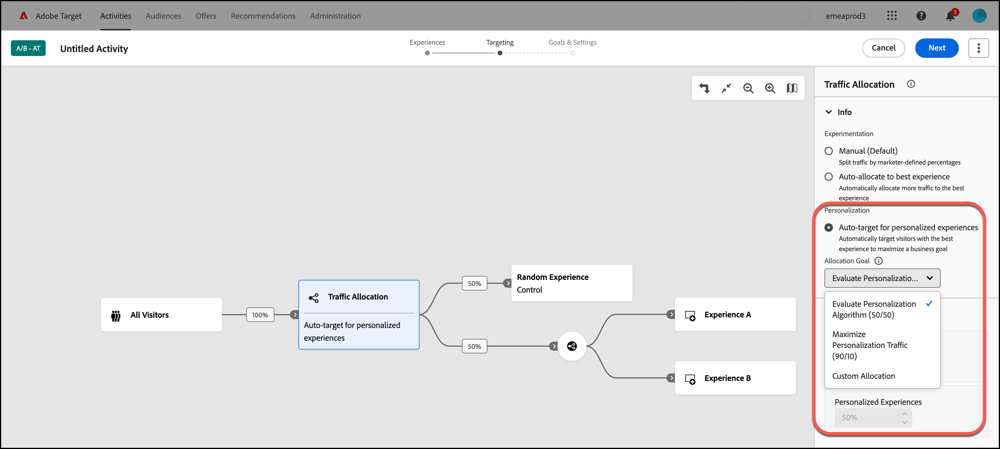

# Aperçu du ciblage automatique [!UICONTROL 1&rbrace;] {#auto-target-overview}

>[!BEGINSHADEBOX]

**Sur cette page :** Découvrez comment une activité de **[!UICONTROL ciblage automatique]** offre l’expérience la plus adaptée à chaque visiteur, comment elle fonctionne, comment choisir l’affectation du trafic et en quoi elle se compare à **[!UICONTROL Automated Personalization]**.

>[!ENDSHADEBOX]

Les activités de **[!UICONTROL ciblage automatique]** dans [!DNL Adobe Target] utilisent le machine learning avancé pour sélectionner plusieurs expériences hautement performantes définies par des spécialistes marketing afin de personnaliser le contenu et de générer des conversions. Le **[!UICONTROL ciblage automatique]** offre à chaque visiteur l’expérience la plus adaptée en fonction du profil client individuel et du comportement des visiteurs précédents dotés de profils similaires.

>[!NOTE]
>
>* Le **[!UICONTROL ciblage automatique]** est disponible dans le cadre de la solution [!DNL Target Premium]. Cette fonctionnalité n’est pas disponible dans [!DNL Target Standard] sans une licence [!DNL Target Premium]. Pour plus d’informations sur les fonctionnalités avancées de cette licence, voir [Target Premium](/help/main/c-intro/intro.md).
>
>* **[!UICONTROL Analytics for Target]** (A4T) prend en charge les activités de **[!UICONTROL ciblage automatique]**. Pour plus d’informations, consultez Prise en charge de [A4T pour les activités d’affectation automatique et de ciblage automatique](/help/main/c-integrating-target-with-mac/a4t/a4t-at-aa.md).

Lorsque vous [créez une activité A/B](/help/main/c-activities/t-test-ab/t-test-create-ab/test-create-ab.md) avec le workflow guidé en trois étapes, choisissez l’option **[!UICONTROL Ciblage automatique pour les expériences personnalisées]** sur la page **[!UICONTROL Ciblage]** (étape 2). Pour connaître les étapes, voir [Créer une activité de ciblage automatique](/help/main/c-activities/auto-target/create-auto-target.md).

Cette option dans le flux d’activités A/B vous permet d’utiliser le machine learning pour personnaliser du contenu en un seul clic, en fonction d’un ensemble d’expériences définies par les spécialistes marketing. Le **[!UICONTROL ciblage automatique]** est conçu pour offrir une optimisation maximale, par rapport aux tests A/B traditionnels ou à l’**[!UICONTROL affectation automatique]**, en déterminant l’expérience à afficher pour chaque visiteur. Contrairement à une activité A/B, dans laquelle l’objectif est de trouver un gagnant unique, le **[!UICONTROL ciblage automatique]** détermine automatiquement la meilleure expérience pour un visiteur donné. La meilleure expérience est basée sur le profil du visiteur et d’autres informations contextuelles.

Tout comme **[!UICONTROL Automated Personalization]**, le **[!UICONTROL ciblage automatique]** utilise un [algorithme Forêt aléatoire](/help/main/c-activities/t-automated-personalization/algo-random-forest.md), une méthode d’ensemble de science des données de premier plan, pour déterminer la meilleure expérience à présenter à un visiteur. Le **[!UICONTROL ciblage automatique]** peut s’adapter aux changements de comportement des visiteurs, de sorte qu’il peut s’exécuter perpétuellement pour fournir un effet élévateur. Cette méthode est parfois appelée mode « toujours actif ».

Contrairement à une activité A/B, dans laquelle l’affectation d’expérience pour un visiteur donné est persistante, le **[!UICONTROL ciblage automatique]** optimise l’objectif commercial spécifié pour chaque visite. Comme dans **[!UICONTROL Automated Personalization]**, le **[!UICONTROL ciblage automatique]** réserve une partie du trafic d’activité en tant que population témoin par défaut, pour mesurer l’effet élévateur. Les visiteurs du groupe de contrôle reçoivent une expérience aléatoire dans l’activité.

## Considérations {#considerations}

Gardez les points suivants à l’esprit lorsque vous utilisez le **[!UICONTROL ciblage automatique]** :

* Prêtez attention à la forme de l’activité. Les performances dépendent davantage du nombre d’emplacements × d’offres que du nombre d’expériences brutes. Les combinaisons cartésiennes volumineuses peuvent ralentir le chargement et la modification du **[!UICONTROL compositeur d’expérience visuelle]**, même en dessous des limites d’expérience documentées.

  Il est recommandé de conserver les activités de **[!UICONTROL ciblage automatique]** et **[!UICONTROL Automated Personalization]** dans 4 à 6 emplacements avec 4 à 6 offres par emplacement. Les configurations plus volumineuses ne sont pas recommandées. Ces activités sont créées directement dans l’étape **[!UICONTROL Expériences]**. Par conséquent, l’interface utilisateur [!DNL Target] peut afficher des avertissements intégrés ou bloquer l’enregistrement lorsque la configuration dépasse les seuils pris en charge.

* Vous ne pouvez pas passer d’une activité spécifique de **[!UICONTROL Ciblage automatique]** à **[!UICONTROL Automated Personalization]**, ou inversement.
* Vous ne pouvez pas passer de l’affectation **[!UICONTROL manuelle]** du trafic (test **[!UICONTROL A/B traditionnel]**) au **[!UICONTROL ciblage automatique]**, ou inversement, après l’enregistrement d’une activité en tant que brouillon.
* Un modèle est conçu pour identifier les performances de la stratégie personnalisée par rapport au trafic diffusé de manière aléatoire par rapport à l’envoi de tout le trafic vers l’expérience gagnante globale. Ce modèle prend uniquement en compte les accès et les conversions dans l’environnement par défaut.

  Un second ensemble de modèles est créé pour chaque groupe de modélisation (AP) ou expérience (AT). Pour chacun de ces modèles, les accès et les conversions dans tous les environnements sont pris en compte.

  Les requêtes sont diffusées avec le même modèle, quel que soit l’environnement. Cependant, la pluralité du trafic doit provenir de l’environnement par défaut pour s’assurer que l’expérience gagnante globale identifiée est cohérente avec le comportement réel.

* Utilisez au moins deux expériences.

## Terminologie {#section_A309B7E0B258467789A5CACDC1D923F3}

Les termes suivants sont utiles pour aborder le **[!UICONTROL ciblage automatique]** :

| Terme | Définition |
|---|---|
| [Bandit manchot](https://en.wikipedia.org/wiki/Multi-armed_bandit){target=_blank} | Une approche du type bandit à plusieurs bras de l’optimisation équilibre l’apprentissage exploratoire et l’exploitation de cet apprentissage. |
| [Random Forest](/help/main/c-activities/t-automated-personalization/algo-random-forest.md) | La forêt aléatoire est l’une des approches les plus utilisées dans le domaine de l’apprentissage automatique. En termes de science des données, il s’agit d’une classification d’ensemble, ou méthode de régression, qui fonctionne en construisant de nombreux arbres de décision en fonction des attributs du visiteur et de la visite. Dans [!DNL Target], la forêt aléatoire est utilisée pour déterminer quelle expérience devrait avoir la plus forte probabilité de conversion (ou le chiffre d’affaires le plus élevé par visite) pour chaque visiteur spécifique. |
| [Échantillonnage De Thompson](https://en.wikipedia.org/wiki/Thompson_sampling){target=_blank} | L’objectif de l’échantillonnage de Thompson est de déterminer quelle expérience est la meilleure globalement (non personnalisée), tout en réduisant le « coût » de la recherche de cette expérience. L’échantillonnage de Thompson sélectionne toujours un gagnant, même s’il n’existe aucune différence statistique entre deux expériences. |

## Fonctionnement du ciblage automatique [!UICONTROL 1&rbrace;] {#section_77240E2DEB7D4CD89F52BE0A85E20136}

Les pages suivantes décrivent les données et algorithmes sous-jacents au **[!UICONTROL ciblage automatique]** et à l’**[!UICONTROL Automated Personalization]** :

| Rubrique | Détails |
|--- |--- |
| [Algorithme Forêt aléatoire](/help/main/c-activities/t-automated-personalization/algo-random-forest.md) | Le principal algorithme de personnalisation de [!DNL Target], utilisé à la fois dans **[!UICONTROL le ciblage automatique]** et **[!UICONTROL Automated Personalization]**, est Forêt aléatoire. Des méthodes d&#39;ensemble, telles que Random Forest, utilisent de multiples algorithmes d&#39;apprentissage pour obtenir de meilleures performances prédictives que celles qui pourraient être obtenues à partir de n&#39;importe lequel des algorithmes d&#39;apprentissage constitutifs. L’algorithme Forêt aléatoire dans les activités **[!UICONTROL Automated Personalization]** et **[!UICONTROL Ciblage automatique]** est une classification, ou méthode de régression, qui fonctionne en construisant une multitude d’arbres de décision au moment de l’entraînement. |
| [Chargement Des Données Pour [!DNL Target] Les Algorithmes Personalization](/help/main/c-activities/t-automated-personalization/uploading-data-for-the-target-personalization-algorithms.md) | Il existe plusieurs façons de saisir des données pour les modèles de **[!UICONTROL ciblage automatique]** et **[!UICONTROL Automated Personalization]**. |
| [Collecte de données pour [!DNL Target] les algorithmes Personalization](/help/main/c-activities/t-automated-personalization/ap-data.md) | Les algorithmes de personnalisation de [!DNL Target] collectent automatiquement diverses données. |

## Détermination de l’affectation du trafic {#section_AB3656F71D2D4C67A55A24B38092958F}

Selon l’objectif de votre activité, vous pouvez choisir une affectation du trafic différente entre les expériences de contrôle et personnalisées. Une règle de bonne pratique consiste à déterminer cet objectif avant de lancer votre activité en direct.

La liste déroulante **[!UICONTROL Affectation personnalisée]** vous permet de choisir parmi les options suivantes :

* **[!UICONTROL Évaluer l&#39;algorithme Personalization (50/50)]**
* **[!UICONTROL Maximiser Le Trafic Personalization (90/10)]**
* **[!UICONTROL Affectation personnalisée]**

Le tableau suivant explique les trois options :

| Objectif de l’activité | Suggestion d’affectation du trafic | Compromis |
|--- |--- |--- |
| **[!UICONTROL Évaluer l’algorithme de personnalisation (50/50)]** : Si votre objectif est de tester l’algorithme, utilisez une répartition à 50/50 des visiteurs entre le contrôle et l’algorithme ciblé. Cette répartition produira l’estimation de l’effet élévateur la plus précise. Suggérée pour une utilisation avec des « expériences aléatoires » comme contrôle. | Répartition entre contrôle à 50 % et expérience personnalisée à 50 % | <ul><li>Maximise la précision de l’effet élévateur entre le contrôle et la personnalisation</li><li>Moins de visiteurs ont une expérience personnalisée</li></ul> |
| **[!UICONTROL Maximiser le trafic Personalization (90/10)]** : si votre objectif est de créer une activité « toujours active », placez 10 % des visiteurs dans le contrôle pour vous assurer qu’il y a suffisamment de données pour que les algorithmes continuent à apprendre au fil du temps. Le compromis ici est qu&#39;en échange de la personnalisation d&#39;une plus grande proportion de votre trafic, vous avez moins de précision dans ce qu&#39;est exactement l&#39;ascenseur. Quel que soit votre objectif, il s’agit du trafic recommandé lors de l’utilisation d’une expérience spécifique comme contrôle. | Une règle de bonne pratique consiste à répartir le trafic entre le contrôle de 10 à 30 % et l’expérience personnalisée de 70 à 90 %. | <ul><li>Optimise le nombre de visiteurs et visiteuses qui disposent d’une expérience personnalisée</li><li>Maximise l’effet élévateur</li><li>Moins de précision quant à la nature de l’effet élévateur vis-à-vis de l’activité</li></ul> |
| **[!UICONTROL Affectation personnalisée]** | Répartir manuellement le pourcentage suivant les besoins. | <ul><li>Il se peut que vous n’obteniez pas les résultats souhaités. En cas d’incertitude, suivez les suggestions indiquées pour l’une des options précédentes.</li></ul> |

Pour ajuster le pourcentage **[!UICONTROL Contrôle]**, cliquez sur **[!UICONTROL Expériences]** dans le volet **[!UICONTROL Affectation du trafic]**, puis ajustez les pourcentages selon vos besoins. Vous ne pouvez pas diminuer le groupe de contrôle à moins de 10 %.

Vous pouvez [sélectionner une expérience spécifique à utiliser comme contrôle](/help/main/c-activities/t-automated-personalization/experience-as-control.md) ou utiliser l’option **[!UICONTROL Expérience aléatoire]**.

## Comparer [!UICONTROL le ciblage automatique] et [!UICONTROL Automated Personalization] {#compare-at-ap}

Le **[!UICONTROL ciblage automatique]** et **[!UICONTROL Automated Personalization]** partagent le même algorithme et les mêmes données, mais ils diffèrent dans la manière dont les expériences sont créées et dans le volume de trafic dont les modèles ont besoin.

### Ce que les deux types d’activité ont en commun {#section_2A601F482F9A44E38D4B694668711319}

* **Optimisation pour chaque visite.** L’algorithme prédit la propension d’un visiteur à effectuer une conversion (ou le chiffre d’affaires estimé de la conversion) pour offrir la meilleure expérience. Un visiteur est éligible pour une nouvelle expérience à la fin d’une session existante. L’exception est un visiteur de la population témoin qui conserve l’expérience affectée lors de la première visite. Au cours d’une session, la prédiction ne change pas afin de maintenir la cohérence visuelle.
* **Adaptation aux changements de comportement des visiteurs.** Le bandit manchot « passe » toujours une petite fraction du trafic pour continuer à apprendre tout au long de la vie de l&#39;activité et pour éviter la surexploitation des tendances apprises précédemment. Les modèles sous-jacents sont reconstruits toutes les 24 heures à l’aide des dernières données de comportement des visiteurs. Si l’algorithme ne peut pas déterminer les expériences gagnantes pour les individus, il passe automatiquement à l’affichage de l’expérience globale la plus performante, trouvée à l’aide de l’[Échantillonnage de Thompson](https://en.wikipedia.org/wiki/Thompson_sampling), tout en continuant à rechercher des expériences gagnantes personnalisées.
* **Une mesure d’objectif unique.** L’algorithme s’optimise en continu pour une mesure, qui peut être basée sur la conversion ou sur le chiffre d’affaires (plus précisément, **[!UICONTROL Chiffre d’affaires par visite]**).
* **Collecte automatique des données.** [!DNL Target] collecte automatiquement des informations sur les visiteurs afin de créer les modèles de personnalisation. Pour plus d’informations sur les paramètres utilisés, voir [Collecte de données Automated Personalization](/help/main/c-activities/t-automated-personalization/ap-data.md).
* **Audiences partagées.** [!DNL Target] utilise automatiquement toutes les audiences partagées [!DNL Adobe Experience Cloud] pour créer les modèles de personnalisation. Vous n’avez rien à faire de spécifique pour ajouter des audiences au modèle. Pour plus d’informations sur l’utilisation de [!DNL Experience Cloud Audiences] avec [!DNL Target], voir [Audiences d’Experience Cloud](/help/main/c-integrating-target-with-mac/mmp.md).
* **Données personnalisées.** Les marketeurs peuvent charger des données hors ligne, des scores de propension ou d’autres données personnalisées pour créer des modèles de personnalisation. En savoir plus sur le [chargement de données pour le ciblage automatique et Automated Personalization](/help/main/c-activities/t-automated-personalization/uploading-data-for-the-target-personalization-algorithms.md).

### Différences entre les deux types d’activité {#section_BA4D83BE40F14A96BE7CBC7C7CF2A8FB}

Envisagez le **[!UICONTROL ciblage automatique]** au lieu du **[!UICONTROL Automated Personalization]** lorsque vous souhaitez définir l’ensemble de l’expérience, utiliser l’ensemble des fonctionnalités du **[!UICONTROL compositeur d’expérience visuelle]** (VEC) ou apporter des modifications structurelles à votre page.

| | [!UICONTROL ciblage automatique] | [!UICONTROL Automated Personalization] |
|---|---|---|
| **Définition de l’expérience** | Vous définissez l’expérience entière, qui peut contenir plusieurs modifications. | Les offres individuelles sont automatiquement combinées pour former une expérience. |
| **[!UICONTROL Fonctionnalités du compositeur d’expérience visuelle]** | Le **[!UICONTROL ciblage automatique]** est incorporé dans le workflow d’activité A/B, afin de bénéficier du compositeur d’expérience visuelle plus mature et complet. Vous pouvez également utiliser les [liens d’assurance qualité](/help/main/c-activities/c-activity-qa/activity-qa.md). | L’éditeur de code personnalisé, plusieurs audiences d’expérience et d’autres fonctionnalités ne sont pas pris en charge. |
| **Modifications structurelles de la page** | Plus approprié. Vous pouvez, par exemple, réorganiser les éléments de votre page d’accueil. | Moins approprié. |
| **Nombre d’expériences** | Généralement moins, car une expérience peut contenir plusieurs modifications. | Généralement plus, car les expériences sont toutes des combinaisons d’offres et de lieux. |
| **Trafic nécessaire à la création des modèles** | Fréquemment moins au total. | Fréquemment plus au total. |

La quantité de trafic *par expérience* requise pour créer les modèles est la même pour les deux types d’activité. Le **[!UICONTROL ciblage automatique]** nécessite souvent moins de trafic total, car il a généralement moins d’expériences.

Par exemple, dans une activité **[!UICONTROL Automated Personalization]** avec deux offres par emplacement et deux emplacements, il y a quatre (2 × 2 = 4) expériences totales dans l’activité (sans exclusion). Dans **[!UICONTROL le ciblage automatique]**, vous pouvez définir l’expérience 1 pour inclure l’offre 1 à l’emplacement 1 et l’offre 2 à l’emplacement 2, et l’expérience 2 pour inclure l’offre 2 à l’emplacement 1 et l’offre 1 à l’emplacement 2. Le **[!UICONTROL ciblage automatique]** permet de modifier plusieurs éléments au sein d’une même expérience, ce qui vous permet de réduire le nombre total d’expériences dans votre activité.

### Exigences de trafic pour le [!UICONTROL ciblage automatique] {#traffic-requirements}

Les règles de base suivantes permettent de comprendre les exigences de trafic :

* **Lorsque [!UICONTROL Conversion] est votre mesure de succès :** 1 000 visites et au moins 50 conversions par jour et par expérience. En outre, l’activité doit avoir au moins 7 000 visites et 350 conversions.
* **Lorsque [!UICONTROL Le chiffre d’affaires par visite] est votre mesure de succès :** 1 000 visites et au moins 50 conversions par jour et par expérience. En outre, l’activité doit avoir au moins 1 000 conversions par expérience. **[!UICONTROL Chiffre d’affaires par visite]** nécessite généralement plus de données pour créer des modèles, car l’écart dans le chiffre d’affaires des visites est généralement plus élevé que dans le taux de conversion.

Le **[!UICONTROL ciblage automatique]** fournit également un cadre de test en ligne complet. Le bandit manchot fait partie d&#39;un cadre de test en ligne plus vaste qui permet aux chercheurs et aux spécialistes des données [!DNL Adobe] de comprendre les avantages de leurs améliorations continues dans des conditions réelles. À l’avenir, ce banc d’essai permettra à [!DNL Adobe] d’ouvrir sa plateforme de machine learning aux clients qui maîtrisent les données, afin qu’ils puissent importer leurs propres modèles pour compléter les modèles [!DNL Target].

Pour plus d&#39;informations sur les rapports, voir [Rapports et ciblage automatique](/help/main/c-activities/auto-target/reporting-and-auto-target.md).
