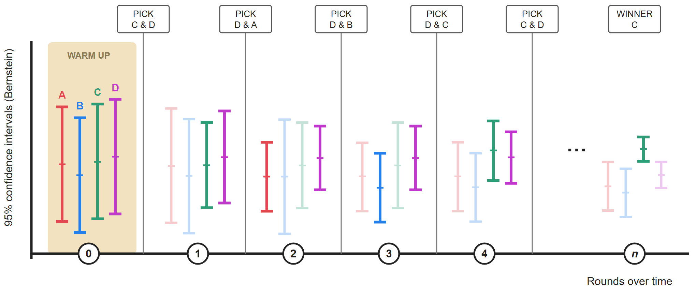

# Aperçu de l’affectation automatique [!UICONTROL 1}] {#auto-allocate-overview}

>[!BEGINSHADEBOX]

**Sur cette page :** Découvrez comment une activité **[!UICONTROL Affectation automatique]** identifie une expérience gagnante et y réaffecte le trafic, quand l’utiliser, comment fonctionne l’algorithme et ce qu’il faut prendre en compte avant de l’utiliser.

>[!ENDSHADEBOX]

Une activité **[!UICONTROL Affectation automatique]** dans [!DNL Adobe Target] identifie un gagnant parmi plusieurs expériences et réaffecte automatiquement davantage de trafic au gagnant pour augmenter les conversions pendant que le test continue à s’exécuter et à apprendre.

Vous créez une activité **[!UICONTROL Affectation automatique]** avec le workflow guidé en trois étapes d’une activité A/B : choisissez l’option **[!UICONTROL Affectation automatique à la meilleure expérience]** sur la page **[!UICONTROL Ciblage]** (étape 2). Pour connaître les étapes, voir [Créer une activité d’affectation automatique](/help/main/c-activities/automated-traffic-allocation/create-auto-allocate-activity.md).

## Pourquoi utiliser l’affectation automatique [!UICONTROL 1}] {#why-auto-allocate}

Les tests A/B standard ont un coût. Vous devez dépenser le trafic pour mesurer les performances de chaque expérience, et la distribution du trafic reste fixe même lorsque certaines expériences en surpassent d’autres. La taille de l’échantillon est difficile à déterminer, l’activité doit suivre son cours complet avant que vous puissiez agir sur un gagnant, et il reste une chance que le gagnant identifié ne soit pas un vrai gagnant.

Une activité **[!UICONTROL Affectation automatique]** réduit ce coût et les frais généraux :

* Il surveille les performances de la mesure d’objectif de toutes les expériences et envoie proportionnellement plus de nouveaux entrants vers les expériences hautement performantes. Suffisamment de trafic est réservé à l’exploration des autres expériences.
* L’optimisation se produit en parallèle de l’apprentissage. Vous pouvez ainsi voir les avantages de vos résultats pendant l’exécution de l’activité.
* Les visiteurs se dirigent progressivement vers des expériences gagnantes, de sorte que vous n’avez pas besoin d’attendre la fin de l’activité. Vous bénéficiez de l’effet élévateur plus rapidement, car les participants à l’activité qui auraient été envoyés vers des expériences moins performantes sont dirigés vers des expériences potentiellement gagnantes.

Avantages clés :

* Conserve la rigueur d’un test A/B.
* Trouve un gagnant statistiquement significatif plus rapidement qu’un test A/B manuel.
* Fournit une augmentation moyenne de la campagne plus élevée qu’un test A/B manuel.

### Comment l’[!UICONTROL affectation automatique] identifie un gagnant {#true-winner}

Un test A/B normal dans [!DNL Target] compare chaque challenger uniquement avec le contrôle. Par exemple, si une activité possède les expériences A, B, C et D, où A est le contrôle, le test compare A à B, A à C, et A à D. La plupart des produits, y compris [!DNL Target], utilisent un [test en t de Welch](https://en.wikipedia.org/wiki/Welch%27s_t-test){target=_blank} pour ces comparaisons afin de produire un degré de confiance basé sur la valeur de p. Cependant, [!DNL Target] n’effectue pas automatiquement les comparaisons implicites (B par rapport à C, B par rapport à D et C par rapport à D) qui sont requises pour trouver la « meilleure » expérience. Vous devez donc analyser les résultats manuellement.

L’**[!UICONTROL affectation automatique]** supprime cette étape manuelle :

* Elle effectue toutes les comparaisons implicites entre les expériences et produit un « vrai » gagnant. La notion d’expérience de « contrôle » disparaît donc totalement du test.
* Elle affecte de nouveaux visiteurs aux expériences jusqu’à ce que l’intervalle de confiance de la meilleure expérience ne chevauche celui d’aucune autre expérience.
* Il utilise des intervalles de confiance basés sur l’[inégalité de Bernstein](https://en.wikipedia.org/wiki/Bernstein_inequalities_%28probability_theory%29){target=_blank}, qui compense les évaluations répétées qui produiraient normalement des faux positifs.
* Lorsqu’il s’arrête, à condition qu’il n’y ait aucune dépendance temporelle substantielle aux visiteurs qui arrivent sur la page, il y a au moins 95 % de chances qu’il renvoie une expérience dont la réponse réelle n’est pas inférieure de moins de 1 % (relatif) à la réponse réelle de l’expérience gagnante.

## Quand utiliser l’[!UICONTROL affectation automatique] {#when-to-use}

Choisissez entre les activités d’**[!UICONTROL affectation automatique]**, de **[!UICONTROL test A/B]** et de **[!UICONTROL Automated Personalization]** en fonction de votre objectif :

| Activité | Utilisez-le lorsque | Différences |
|---|---|---|
| **[!UICONTROL Affectation automatique]** | Vous souhaitez optimiser votre activité dès le départ et identifier les expériences gagnantes le plus rapidement possible. | En diffusant plus souvent des expériences hautement performantes, les performances globales de l’activité augmentent. |
| [**[!UICONTROL Test A/B]**](/help/main/c-activities/t-test-ab/test-ab.md#test-ab) | Vous souhaitez caractériser les performances de toutes les expériences avant d’optimiser votre site. | Un test A/B vous aide à classer toutes vos expériences, tandis que l’**[!UICONTROL Affectation automatique]** trouve les meilleures performances, mais ne garantit pas la différenciation entre les moins performantes. |
| [**[!UICONTROL Automated Personalization]**](/help/main/c-activities/t-automated-personalization/automated-personalization.md#automated-personalization-overview) | Vous souhaitez des algorithmes d’optimisation de la plus grande complexité, tels que des modèles de machine learning qui créent des prédictions en fonction d’attributs de profil individuels. | L’**[!UICONTROL affectation automatique]** examine le comportement agrégé des expériences (comme les tests A/B standard) et ne fait pas de distinction entre les visiteurs. |

## Fonctionnement de l’algorithme {#how-it-works}

L’algorithme d’**[!UICONTROL affectation automatique]** est une approche de type [bandit manchot](https://en.wikipedia.org/wiki/Multi-armed_bandit){target=_blank} de l’optimisation, qui équilibre l’apprentissage exploratoire et l’exploitation de cet apprentissage. Il incorpore à la fois les performances mesurées (comme le taux de conversion) et les intervalles de confiance des données cumulées. Contrairement à un test A/B standard, où le trafic est réparti équitablement entre les expériences, l’**[!UICONTROL affectation automatique]** modifie l’affectation du trafic entre les expériences :

* 80 % des visiteurs sont affectés à l’aide de la logique décrite dans cette section.
* 20 % des visiteurs sont affectés de manière aléatoire à toutes les expériences afin de s’adapter aux changements de comportement des visiteurs.

L’approche du bandit manchot conserve une partie du trafic libre pour l’exploration, tout en exploitant les expériences qui se comportent bien. Davantage de nouveaux visiteurs bénéficient d’expériences plus performantes, tout en préservant leur capacité à réagir aux conditions changeantes. Les modèles sont mis à jour au moins une fois par heure pour s’assurer qu’ils réagissent aux dernières données.

À mesure que davantage de visiteurs et visiteuses rejoignent l’activité, certaines expériences réussissent mieux et reçoivent plus de trafic. 20 % du trafic reste réparti de manière aléatoire pour explorer toutes les expériences. Si l’une des expériences moins performantes commence à augmenter ses performances, plus de trafic est affecté à cette expérience. Si le succès d’une expérience plus performante diminue, moins de trafic lui est alloué. Cela peut se produire, par exemple, lorsqu’un événement pousse les visiteurs à rechercher différentes informations sur votre site multimédia ou lorsque les ventes de week-end sur votre site de vente au détail fournissent des résultats différents.

L’illustration suivante représente les performances possibles de l’algorithme au cours d’un test avec quatre expériences (cliquez pour développer l’illustration) :

{width="600" zoomable="yes"}

L’illustration montre l’évolution du trafic affecté à chaque expérience sur plusieurs tours pendant la durée de vie de l’activité, jusqu’à ce que l’expérience gagnante puisse être déterminée.

| Arrondi | Description |
|--- |--- |
| {width="200" zoomable="yes"} | **Phase d’échauffement (0)** : chaque expérience reçoit un trafic égal jusqu’à ce que chaque expérience de l’activité ait au moins 1 000 visiteurs et 50 conversions.<ul><li>Expérience A = 25 %</li><li>Expérience B = 25 %</li><li>Expérience C = 25 %</li><li>Expérience D = 25 %</li></ul>Une fois que chaque expérience a atteint 1 000 visiteurs et 50 conversions, [!DNL Target] lance l’affectation automatisée du trafic. Toutes les allocations sont allouées par cycle, et deux expériences sont sélectionnées pour chaque cycle. Seules deux expériences passent au tour suivant : D et C.<ul><li>À l’avenir, les deux expériences se verront attribuer 80 % du trafic de manière égale.</li><li>Les deux autres expériences continuent à participer, mais sont diffusées uniquement dans le cadre de l’affectation aléatoire de 20 % du trafic au fur et à mesure que de nouveaux visiteurs entrent dans l’activité.</li><li>Toutes les allocations sont mises à jour toutes les heures (représentées par les arrondis le long de l’axe X ci-dessus). Après chaque tour, les données cumulées sont comparées.</li></ul> |
| {width="200" zoomable="yes"} | **Première session** : 80 % du trafic est alloué aux expériences C et D (40 % chacune). 20 % du trafic est affecté de manière aléatoire aux expériences A, B, C et D (5 % à chaque expérience). Au cours de ce tour, l’expérience A enregistre de bonnes performances.<ul><li>L’algorithme sélectionne l’expérience D pour passer à la ronde suivante, car elle présente le taux de conversion le plus élevé (comme indiqué par l’échelle verticale de chaque activité).</li><li>L’algorithme sélectionne également l’expérience A pour progresser, puisqu’elle présente la limite supérieure la plus élevée de l’intervalle de confiance de 95 % de Bernstein pour les expériences restantes.</li></ul>Les expériences D et A passent au tour suivant. |
| {width="200" zoomable="yes"} | **Round 2** : 80 % du trafic est alloué aux expériences A et D (40 % chacune). 20 % du trafic est alloué de manière aléatoire, de sorte que les expériences A, B, C et D obtiennent chacune 5 % du trafic. Au cours de ce tour, l’expérience B enregistre de bonnes performances.<ul><li>L’algorithme sélectionne l’expérience D pour passer à la ronde suivante, car elle présente le taux de conversion le plus élevé (comme indiqué par l’échelle verticale de chaque activité).</li><li>L’algorithme sélectionne également l’expérience B pour progresser, puisqu’elle présente la limite supérieure la plus élevée de l’intervalle de confiance de 95 % de Bernstein pour les expériences restantes.</li></ul>Les expériences D et B passent au tour suivant. |
| {width="200" zoomable="yes"} | **Round 3** : 80 % du trafic est alloué aux expériences B et D (40 % chacune). 20 % du trafic est alloué de manière aléatoire, de sorte que les expériences A, B, C et D obtiennent chacune 5 % du trafic. Au cours de ce tour, l’expérience D continue d’enregistrer de bonnes performances, de même que l’expérience C.<ul><li>L’algorithme sélectionne l’expérience D pour passer à la ronde suivante, car elle présente le taux de conversion le plus élevé (comme indiqué par l’échelle verticale de chaque activité).</li><li>L’algorithme sélectionne également l’expérience C pour progresser, puisqu’elle présente la limite supérieure la plus élevée de l’intervalle de confiance de 95 % de Bernstein pour les expériences restantes.</li></ul>Les expériences D et C passent au tour suivant. |
| {width="200" zoomable="yes"} | **Round 4** : 80 % du trafic est alloué aux expériences C et D (40 % chacune). 20 % du trafic est alloué de manière aléatoire, de sorte que les expériences A, B, C et D obtiennent chacune 5 % du trafic. Au cours de ce tour, l’expérience C enregistre de bonnes performances.<ul><li>L’algorithme sélectionne l’expérience C pour passer à la ronde suivante, car elle présente le taux de conversion le plus élevé (comme indiqué par l’échelle verticale de chaque activité).</li><li>L’algorithme sélectionne également l’expérience D pour progresser, puisqu’elle présente la limite supérieure la plus élevée de l’intervalle de confiance de 95 % de Bernstein pour les expériences restantes.</li></ul>Les expériences C et D passent au tour suivant. |
| {width="200" zoomable="yes"} | **Tour *n*** : au fur et à mesure que l’activité progresse, une expérience hautement performante commence à émerger et le processus se poursuit jusqu’à ce qu’une expérience gagnante soit disponible. Lorsque l’intervalle de confiance de l’expérience présentant le taux de conversion le plus élevé ne chevauche celui d’aucune autre expérience, il est considéré comme le gagnant. Un badge [s&#39;affiche sur la page de l&#39;activité gagnante](/help/main/c-activities/automated-traffic-allocation/determine-winner.md) et dans la liste**[!UICONTROL  Activité&#x200B;]**.<ul><li>L’algorithme désigne l’expérience C comme gagnante définitive.</li></ul>À ce stade, l’algorithme diffuse 80 % du trafic vers l’expérience C, tandis que 20 % du trafic continue d’être diffusé de manière aléatoire à toutes les expériences (A, B, C et D). Au total, l’expérience C récupère 85 % du trafic. Dans le cas peu probable où l&#39;intervalle de confiance du gagnant recommence à se chevaucher, l&#39;algorithme revient au comportement du tour 4. **Important** : si vous avez choisi manuellement un gagnant plus tôt dans le processus, il serait facile de choisir la mauvaise expérience. C’est pourquoi il est recommandé d’attendre que l’algorithme détermine l’expérience gagnante. |

>[!NOTE]
>
>Si une activité ne comporte que deux expériences, les deux expériences obtiennent un trafic égal jusqu’à ce que [!DNL Target] trouve une expérience gagnante avec un degré de confiance de 75 %. À ce stade, les deux tiers du trafic sont attribués au gagnant et un tiers au perdant. Ensuite, lorsqu’une expérience atteint un degré de confiance de 95 %, 90 % du trafic est attribué au gagnant et 10 % au perdant. [!DNL Target] envoie toujours du trafic vers l’expérience « perdue » pour éviter les faux positifs à la fin (c’est-à-dire pour conserver une partie de l’exploration).

Une fois qu’une activité **[!UICONTROL Affectation automatique]** est activée, les opérations suivantes ne sont pas autorisées dans l’interface utilisateur [!DNL Target] :

* Basculement du mode **[!UICONTROL Affectation du trafic]** sur **[!UICONTROL Manuel]**.
* Modification du type de mesure d’objectif.
* Modification des options dans le panneau **[!UICONTROL Paramètres avancés]**.

Pour plus d&#39;informations, consultez [Comment l&#39;affectation automatique surpasse un test manuel](/help/main/c-activities/automated-traffic-allocation/faster-results-higher-revenue.md).

## Avertissements {#caveats}

Tenez compte des informations suivantes lorsque vous utilisez l’**[!UICONTROL affectation automatique]**.

### Un seul paramètre de mesure avancé est pris en charge

La fonctionnalité d’**[!UICONTROL affectation automatique]** fonctionne avec un seul paramètre de mesure avancé : **[!UICONTROL Incrémenter le nombre et maintenir l’utilisateur dans l’activité]**. Les paramètres de mesure avancés suivants ne sont pas pris en charge : **[!UICONTROL Incrémenter le décompte]**, **[!UICONTROL Libérer l’utilisateur]**, **[!UICONTROL Autoriser la reprise et incrémenter le décompte]**, et **[!UICONTROL Libérer l’utilisateur et interdire la reprise]**.

### Les visiteurs réguliers peuvent gonfler les taux de conversion {#return-visitors}

Si un visiteur qui voit l’expérience A revient fréquemment et effectue plusieurs conversions, le taux de conversion (CR) de l’expérience A est artificiellement augmenté. Comparez ce résultat à l’expérience B, où les visiteurs effectuent une conversion, mais ne reviennent pas souvent. Par conséquent, le CR de l’expérience A semble meilleur que le CR de l’expérience B, de sorte que les nouveaux visiteurs sont plus susceptibles d’être affectés à A qu’à B. Si vous choisissez de compter une fois par participant, le CR de A et le CR de B peuvent être identiques.

La logique favorise les visiteurs qui convertissent rapidement leur expérience ou visitent plus souvent, car ces visiteurs gonflent temporairement le taux de conversion global de l’expérience à laquelle ils appartiennent. L’algorithme s’ajuste fréquemment, de sorte que l’augmentation du taux de conversion est amplifiée à chaque instantané.

Si les visiteurs récurrents sont distribués de manière aléatoire, leur effet sur les taux de conversion sera a priori nivelé. Pour atténuer cet effet, vous pouvez changer la méthode de comptabilisation de la mesure d’objectif pour ne compter qu’une fois par participant.

### La distinction se fait entre les entreprises les plus performantes et non entre les moins performantes

L’**[!UICONTROL affectation automatique]** permet de faire la distinction entre les expériences hautement performantes (et de trouver un gagnant). Il peut arriver que vous n’ayez pas assez de différenciation entre les expériences peu performantes.

Si vous souhaitez produire une différenciation statistiquement significative entre toutes les expériences, pensez à utiliser le mode d’affectation manuelle du trafic.

### Les taux de conversion corrélés au temps peuvent fausser l’affectation

Certains facteurs qui peuvent être ignorés au cours d’un test A/B standard, car ils affectent toutes les expériences de la même manière, ne peuvent pas être ignorés dans une activité **[!UICONTROL Affectation automatique]**. L’algorithme est sensible aux taux de conversion observés. Les facteurs suivants peuvent avoir une incidence inégale sur les performances de l’expérience :

* Expériences présentant une pertinence contextuelle variable (heure, lieu, sexe, etc.).

  Par exemple :

  * « Dieu merci, c’est vendredi » entraîne des conversions plus élevées le vendredi.
  * « Démarrez votre lundi » a une conversion plus élevée le lundi.
  * « Préparez-vous pour un hiver sur la côte Est » offre une conversion plus élevée dans les endroits de la côte Est ou touchés par l&#39;hiver.

  L’utilisation d’expériences avec une pertinence contextuelle variable peut fausser les résultats d’un test d’**[!UICONTROL affectation automatique]** plus que d’un test A/B, car le test A/B analyse les résultats sur une plus longue période.

* Expériences avec des délais variables de conversion (probablement à cause de l’urgence du message).

  Par exemple, « 30 % de la vente se termine aujourd’hui » indique au visiteur de procéder à la conversion dès aujourd’hui, mais « 50 % de réduction sur le premier achat » ne crée pas le même sentiment d’urgence.

## Questions fréquentes {#faq}

Consultez les questions et réponses suivantes lorsque vous utilisez des activités d’**[!UICONTROL affectation automatique]**.

+++ [!UICONTROL Analytics for Target] (A4T) prend-il en charge les activités d’[!UICONTROL affectation automatique] ?

Oui. Pour plus d’informations, consultez Prise en charge de [A4T pour les activités d’affectation automatique et de ciblage automatique](/help/main/c-integrating-target-with-mac/a4t/a4t-at-aa.md).

+++

+++ Les visiteurs récurrents sont-ils automatiquement réaffectés à des expériences hautement performantes ?

Non. Seuls les nouveaux visiteurs sont affectés automatiquement. Les visiteurs récurrents continuent de voir leur expérience originale pour protéger la validité du test A/B.

+++

+++ Comment l’algorithme traite-t-il les faux positifs ?

L’algorithme garantit un taux de confiance de 95 % ou de faux positifs de 5 % si vous attendez que le badge du gagnant apparaisse.

+++

+++ Quand l’[!UICONTROL affectation automatique] commence-t-elle à allouer le trafic ?

L’algorithme commence à fonctionner quand toutes les expériences de l’activité atteignent un minimum de 1 000 visiteurs et 50 conversions.

+++

+++ Comment l’algorithme exploite-t-il de manière agressive ?

80 % du trafic est diffusé à l’aide de l’**[!UICONTROL affectation automatique]** et 20 % du trafic est diffusé de manière aléatoire. Lorsqu’un gagnant a été identifié, 80 % du trafic y est envoyé, tandis que toutes les expériences continuent à recevoir du trafic dans le cadre des 20 %, y compris l’expérience gagnante.

+++

+++ Les expériences perdues s’affichent-elles ?

Oui. Le bandit à plusieurs bras s’assure qu’au moins 20 % du trafic est réservé à l’exploration des taux de conversion ou des modèles changeants sur l’ensemble des expériences.

+++

+++ Qu’advient-il des activités qui présentent de longs délais de conversion ?

Tant que toutes les expériences en cours d’optimisation font face à des délais similaires, le comportement est le même que pour une activité présentant un cycle de conversion plus rapide. Cependant, il faut plus de temps pour atteindre le seuil de 50 conversions avant que le processus d’affectation du trafic ne commence.

+++

+++ En quoi l’[!UICONTROL affectation automatique] est-elle différente d’[!UICONTROL Automated Personalization] ?

**[!UICONTROL Automated Personalization]** utilise les attributs de profil de chaque visiteur pour déterminer la meilleure expérience. Ce faisant, il optimise, mais aussi personnalise l’activité pour ce visiteur.

**[!UICONTROL L’affectation automatique]**, en revanche, est un test A/B qui produit un gagnant agrégé (l’expérience la plus populaire, mais pas nécessairement l’expérience la plus efficace pour chaque visiteur).

+++

+++ Les visiteurs qui reviennent gonflent-ils le taux de conversion de ma mesure de succès ?

Oui, ils le peuvent. Voir [Les visiteurs fréquents et réguliers peuvent gonfler les taux de conversion](#return-visitors) pour obtenir une explication et une méthode permettant d’atténuer cet effet.

+++

+++ Puis-je utiliser le calculateur de taille d’échantillon avec [!UICONTROL Affectation automatique] pour estimer la durée de l’activité nécessaire pour identifier le gagnant ?

Vous pouvez utiliser le [!DNL Adobe Target] [Calculateur de taille d’échantillon](/help/main/c-activities/t-test-ab/sample-size-determination.md#section_6B8725BD704C4AFE939EF2A6B6E834E6) existant pour obtenir une estimation de la durée d’exécution du test. Comme pour les tests A/B traditionnels, appliquez la correction de Bonferroni si vous testez plus de deux offres ou plusieurs mesures de conversion ou hypothèses. Ce calculateur est conçu pour les tests A/B traditionnels à horizon fixe et fournit une estimation uniquement. L’utilisation du calculateur pour une activité d’**[!UICONTROL affectation automatique]** est facultative, car l’**[!UICONTROL affectation automatique]** vous déclare gagnant. Il n’est pas nécessaire de choisir un moment précis pour consulter les résultats du test. Les valeurs fournies sont toujours statistiquement valides.

Les expériences internes [!DNL Adobe] ont révélé ce qui suit :

* Lors du test d’exactement deux expériences, l’**[!UICONTROL affectation automatique]** trouve un gagnant plus rapidement que les tests à horizon fixe (c’est-à-dire la période suggérée par le calculateur de taille d’échantillon) lorsque la différence de performance entre les expériences est importante. Cependant, l’**[!UICONTROL affectation automatique]** peut nécessiter un temps supplémentaire pour identifier un gagnant lorsque la différence de performance entre les expériences est faible. Dans ces cas, les tests à horizon fixe se seraient généralement terminés sans résultat statistiquement significatif.
* Lorsque vous testez plus de deux expériences, l’**[!UICONTROL affectation automatique]** trouve une expérience gagnante plus rapidement que les tests à horizon fixe (c’est-à-dire la période suggérée par le calculateur de taille d’échantillon) lorsqu’une seule expérience dépasse nettement toutes les autres expériences. Lorsque deux expériences ou plus « gagnent » toutes les deux par rapport à d’autres, mais sont étroitement liées les unes aux autres, l’**[!UICONTROL affectation automatique]** peut nécessiter un temps supplémentaire pour déterminer laquelle est supérieure. Dans ces cas, les tests à horizon fixe se seraient généralement terminés par la conclusion que les expériences « gagnantes » étaient meilleures que les expériences moins performantes, mais n’auraient pas permis d’identifier laquelle était supérieure.

+++

+++ Dois-je supprimer une expérience peu performante d’une activité d’[!UICONTROL affectation automatique] afin d’accélérer le processus de détermination d’un gagnant ?

Il n’existe aucune raison réelle de supprimer une expérience peu performante. L’**[!UICONTROL Affectation automatique]** diffuse automatiquement plus souvent les expériences hautement performantes et moins souvent les expériences sous-performantes. Le fait de laisser une expérience peu performante dans l’activité n’affecte pas considérablement la vitesse à déterminer un gagnant.

20 % des visiteurs sont affectés de manière aléatoire à toutes les expériences. Le volume de trafic diffusé vers une expérience peu performante est minimal (20 % divisé par le nombre d’expériences).

+++

+++ Puis-je modifier la mesure d’objectif au cours d’une activité d’[!UICONTROL affectation automatique] ?

[!DNL Adobe] ne recommande pas de modifier la mesure d’objectif au cours d’une activité. Bien qu’il soit possible de modifier la mesure d’objectif au cours d’une activité dans l’interface utilisateur [!DNL Target], vous devez toujours démarrer une nouvelle activité. [!DNL Adobe] ne garantit pas ce qui se produit si vous modifiez la mesure d’objectif dans une activité après son exécution.

Cette recommandation s’applique aux activités d’**[!UICONTROL affectation automatique]**, de **[!UICONTROL ciblage automatique]** et d’**[!UICONTROL Automated Personalization]** qui utilisent [!DNL Target] ou [!DNL Analytics] (A4T) comme source de création de rapports.

+++

+++ Puis-je modifier la source de création de rapports au cours d’une activité d’[!UICONTROL affectation automatique] ?

[!DNL Adobe] ne recommande pas de modifier la source de création de rapports au cours d&#39;une activité. Bien qu’il soit possible de modifier la source de création de rapports (de [!DNL Target] à A4T ou l’inverse) au cours d’une activité dans l’interface utilisateur de [!DNL Target], vous devez toujours démarrer une nouvelle activité. [!DNL Adobe] ne garantit pas ce qui se produit si vous modifiez la source de création de rapports dans une activité après son exécution.

Cette recommandation s’applique aux activités d’**[!UICONTROL affectation automatique]**, de **[!UICONTROL ciblage automatique]** et d’**[!UICONTROL Automated Personalization]** qui utilisent [!DNL Target] ou [!DNL Analytics] (A4T) comme source de création de rapports.

+++

+++ Puis-je utiliser l’option [!UICONTROL Réinitialiser les données du rapport] lors de l’exécution d’une activité [!UICONTROL Affectation automatique] ?

Il n’est pas recommandé d’utiliser l’option **[!UICONTROL Réinitialiser les données du rapport]** pour les activités d’**[!UICONTROL Affectation automatique]**. Bien qu’elle supprime les données de rapports visibles, cette option ne supprime pas tous les enregistrements d’identification du modèle **[!UICONTROL Affectation automatique]**. Au lieu d’utiliser l’option **[!UICONTROL Réinitialiser les données du rapport]**, créez une activité et désactivez l’activité d’origine. Ces conseils s’appliquent également aux activités de **[!UICONTROL ciblage automatique]** et **[!UICONTROL Automated Personalization]**.

+++

+++ Comment l’[!UICONTROL affectation automatique] crée-t-elle des modèles en ce qui concerne les environnements ?

L’affectation automatique **[!UICONTROL 1]** crée des modèles en fonction du trafic et du comportement de conversion enregistrés dans l’environnement par défaut uniquement. Par défaut, **[!UICONTROL Production]** est l’environnement par défaut, mais l’environnement par défaut peut être modifié dans [!DNL Target] ([Administration > Environnements](/help/main/administrating-target/environments.md)).

Si un accès se produit dans un autre environnement (autre que l’environnement par défaut), le trafic est distribué en fonction du comportement de conversion observé dans l’environnement par défaut. Le résultat de cet accès (conversion ou non-conversion) est enregistré à des fins de création de rapports, mais n’est pas pris en compte dans le modèle d’**[!UICONTROL affectation automatique]**.

Lorsque vous sélectionnez un autre environnement, le rapport affiche le trafic et les conversions pour cet environnement. L’environnement sélectionné par défaut pour un rapport est l’environnement par défaut à l’échelle du compte. L’environnement par défaut ne peut pas être défini sur une base par activité.

+++

+++ Une activité [!UICONTROL Affectation automatique] peut-elle ajuster l’intervalle de recherche arrière au cours d’un test pour prendre en compte les modifications de tendances au fil du temps ?

Par exemple, l’activité peut-elle prendre en compte le mois de décembre pour décider comment allouer le trafic, plutôt que d’examiner les données des visiteurs de septembre (lorsque le test a commencé) ?

Non. L’**[!UICONTROL affectation automatique]** prend en compte les performances de l’ensemble de l’activité.

+++

+++ Une activité [!UICONTROL Affectation automatique] présente-t-elle une expérience gagnante à un visiteur récurrent si l’expérience gagnante est différente de ce que le visiteur a vu lors de la qualification pour l’activité ?

L’**[!UICONTROL affectation automatique]** utilise la prise de décision persistante pour les mêmes raisons que les activités de **[!UICONTROL test A/B]** sont persistantes. L’affectation du trafic fonctionne uniquement pour les nouveaux visiteurs.

+++

## Vidéos de formation {#section_893E5B36DC4A415C9B1D287F51FCCB83}

Les vidéos suivantes contiennent davantage d’informations sur les concepts abordés dans cet article.

### Workflow d’activité - Ciblage (2:14) 

Cette vidéo comprend des informations sur la configuration de l’affectation du trafic.

* Affecter une audience à votre activité
* Augmenter ou ralentir le trafic
* Sélectionner votre méthode d’affectation du trafic
* Affecter du trafic entre différentes expériences

>[!VIDEO](https://video.tv.adobe.com/v/17385)

### Création de tests A/B (8:36) 

Cette vidéo explique comment créer un test A/B à l’aide du processus assisté en trois étapes de Target. L’affectation automatique **[!UICONTROL 1} est discutée à partir de 4 h 45.]**

* Créer une activité A/B dans [!DNL Adobe Target]
* Affecter du trafic à l’aide d’un fractionnement manuel ou de l’affectation automatique du trafic

>[!VIDEO](https://video.tv.adobe.com/v/17391)
