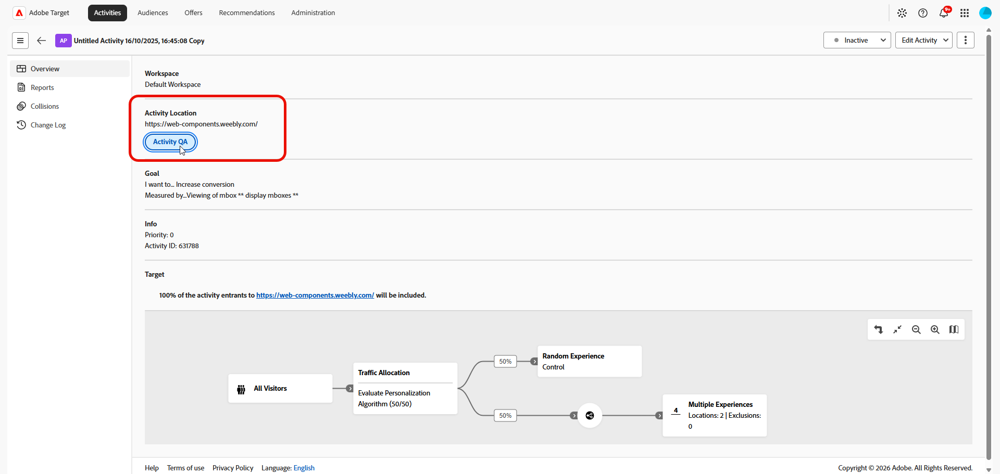

# Prise en main de l’AQ d’activité {#activity-qa}

>[!BEGINSHADEBOX]

**Sur cette page :** Découvrez comment utiliser les liens d’AQ d’activité pour tester une activité de bout en bout, vérifier les rapports d’AQ et vous libérer du mode AQ.

>[!ENDSHADEBOX]

**[!UICONTROL Le QA d’activité]** vous permet de tester entièrement vos activités [!DNL Adobe Target] avant de les lancer en direct, avec des liens d’aperçu qui ne changent jamais, un ciblage d’audience facultatif et un compte rendu des performances d’assurance qualité qui reste distinct des données d’activité en direct. La fonctionnalité **[!UICONTROL AQ d’activité]** inclut :

* **Liens permanents :** partagez des liens avec les membres de l’équipe qui ne changent jamais ou ne nécessitent aucune régénération, quelles que soient les mises à jour apportées aux expériences ou aux activités.
* **Ciblage d’audience facultatif :** testez les critères de ciblage ou ignorez-les pour vérifier l’apparence des expériences sans avoir à remplir les conditions d’audience.
* **Créer des rapports d’assurance qualité distincts :** Vérifiez que les mesures s’incrémentent comme prévu. Les données du rapport d’assurance qualité sont séparées des rapports de production (pour les rapports autres que A4T).
* **Prévisualiser avec d’autres activités :** prévisualiser une expérience de manière isolée ou avec d’autres activités actives qui répondent aux critères de diffusion (page/[!DNL Target] requête/audience).
* **parcours utilisateur complet :** accédez à votre site une fois avec le lien d’assurance qualité, puis parcourez l’ensemble du site pendant que vous êtes dans **[!UICONTROL AQ d’activité]**. Vous restez dans l’**[!UICONTROL AQ d’activité]** jusqu’à la fin de la session ou jusqu’à ce que vous utilisiez le [signet d’AQ Target](/help/main/c-activities/c-activity-qa/activity-qa-bookmark.md) pour vous forcer à quitter la session. Cette fonctionnalité est utile si une activité s’étend sur plusieurs pages web.

  >[!NOTE]
  >
  >Cette fonctionnalité s’applique aux implémentations d’at.js avec la version 2.*x* ou ultérieure. Pour les implémentations d’at.js 1.*x*, cette fonctionnalité n’est effective que si le navigateur du visiteur ne bloque pas les cookies tiers.

## Accéder à une URL d’assurance qualité et la partager {#section_1C59BAA247B247BDB125D1BE8EAD4547}

Les liens d’AQ d’activité vous permettent, à vous et à votre équipe, d’afficher chaque expérience d’une activité sur votre site avant que l’activité ne soit activée. Le trafic d’assurance qualité est signalé séparément du trafic réel. Le test n’a donc aucune incidence sur vos rapports dynamiques.

1. Dans la page **[!UICONTROL Aperçu]** de l’activité, cliquez sur **[!UICONTROL AQ d’activité]**.

   

1. Définissez **[!UICONTROL Règles de correspondance d’audience pour afficher les expériences]** afin de choisir si les testeurs doivent être qualifiés pour l’audience. Activez-la pour confirmer que la correspondance d’audience fonctionne ou désactivez-la pour vérifier l’aspect de l’activité.

   * **Activé :** les testeurs doivent répondre aux exigences de ciblage pour afficher les expériences. Pour les activités de ciblage d’expérience (XT), une seule URL d’activité est fournie et l’expérience qui s’affiche dépend de la règle de ciblage à laquelle vous répondez.
   * **Désactivé :** les liens affichent les expériences, que vous soyez admissible ou non. Vous pouvez basculer entre les deux paramètres à tout moment pendant l’assurance qualité.

   

1. Définissez **[!UICONTROL Afficher le contenu par défaut pour toutes les autres activités]** pour choisir si d’autres activités en direct apparaîtront sur la page.

   * **Activé :** Le contenu par défaut est affiché pour toutes les autres activités. L&#39;aperçu s&#39;affiche de manière isolée, sans tenir compte des autres activités actives sur la même requête de page/[!DNL Target].
   * **Désactivé :** En cas de collisions entre l’activité que vous testez et d’autres activités actives, [les règles de priorité normales](/help/main/c-activities/priority.md#priority) s’appliquent, de sorte que vous ne verrez peut-être pas l’activité pour laquelle vous avez l’intention d’effectuer un contrôle qualité. Les mesures s’incrémentent pour les activités vues, mais uniquement dans l’environnement de création de rapports d’AQ.

1. Cliquez sur **[!UICONTROL Terminé]** pour enregistrer les modifications.

1. Partagez les URL de lien d’activité avec des membres de votre organisation à des fins de test.

   Chaque URL de lien (pour l’expérience A, l’expérience B, etc.) lance le parcours utilisateur à partir de l’expérience correspondante. Une seule URL est générée par expérience, même si celle-ci s’étend sur plusieurs pages (tests de modèle ou tests de plusieurs pages).

   Les liens n’expirent jamais et les modifications apportées à une activité ou à une expérience ne vous obligent pas à les renvoyer. Cependant, si vous appliquez une audience différente de la **[!UICONTROL Bibliothèque d’audiences]** au lieu de modifier l’activité, un nouveau lien est généré et vous devez le partager à nouveau.

1. Cliquez sur l’URL d’une expérience, puis parcourez normalement votre site pour afficher les expériences sur plusieurs pages (s’il en existe plusieurs).

   Vous pouvez parcourir le site pour afficher les autres pages, car le mode **[!UICONTROL AQ d’activité]** persiste sur plusieurs pages. C’est le cas pour les implémentations d’at.js avec la version 2.*x* ou ultérieure. Pour les implémentations at.js 1.*x*, cela s’applique uniquement si le navigateur du visiteur ne bloque pas les cookies tiers.

1. Pour afficher les rapports générés à partir des URL de lien d’activité, accédez à la page **[!UICONTROL Rapports]** de l’activité, cliquez sur l’icône **[!UICONTROL Paramètres]** (  ), puis sélectionnez **[!UICONTROL Trafic du mode QA]** dans la liste déroulante **[!UICONTROL Environnement]**.

   

## Quitter le mode AQ d’activité

Le mode **[!UICONTROL AQ d’activité]** persiste jusqu’à ce que vous le quittiez. Après avoir parcouru un site web dans **[!UICONTROL AQ d’activité]**, vous restez en mode AQ jusqu’à l’expiration de votre session [!DNL Target] ou vous forcez à quitter le site. Vous devez quitter avant de pouvoir afficher votre site comme un visiteur standard.

### at.js 2.*x*

Si at.js 2.*x* est déployé sur votre site, utilisez le [signet de l’assurance qualité de Target](/help/main/c-activities/c-activity-qa/activity-qa-bookmark.md) pour vous forcer à quitter le **[!UICONTROL contrôle qualité d’activité]**. Le chargement d’une page de votre site avec une valeur vide, comme décrit dans la section suivante, *ne supprime pas* le cookie d’assurance qualité du navigateur lorsqu’at.js 2.*x* est déployé.

### at.js 1.*x*

Si at.js 1.*x* est déployé sur votre site, en plus d’utiliser le [signet de l’assurance qualité de Target](/help/main/c-activities/c-activity-qa/activity-qa-bookmark.md), vous pouvez vous forcer manuellement à quitter le site en chargeant une page sur votre site avec le paramètre `at_preview_token` défini sur une valeur vide. Par exemple :

`https://www.mysite.com/?at_preview_token=`

### [!DNL Adobe Experience Platform Web SDK]

Si [[!UICONTROL Platform Web SDK]](https://experienceleague.corp.adobe.com/docs/target-dev/developer/client-side/aep-web-sdk.html?lang=fr){target=_blank} est déployé sur votre site, vous pouvez forcer manuellement à quitter ce site en chargeant une page de votre site avec le paramètre `at_qa_mode` défini sur une valeur vide. Par exemple :

`https://www.mysite.com/?at_qa_mode=`

## Considérations {#section_B256EDD7BFEC4A6DA72A8A6ABD196D78}

### Disponibilité et limites {#availability}

+++ URL de prévisualisation de l’expérience Automated Personalization

**[!UICONTROL Le contrôle qualité d’activité]** est désormais disponible pour tous les types d’activité [!DNL Target]. La fonctionnalité « Prévisualiser les activités Automated Personalization avec les URL de prévisualisation d’expérience » n’est donc plus nécessaire.

+++

+++ Analytics comme source de création de rapports (A4T)

**[!UICONTROL Les URL d’AQ d’activité]** sont disponibles avec les activités dont la source de création de rapports est [Analytics](/help/main/c-integrating-target-with-mac/a4t/a4t.md) (A4T). Les accès générés lors de l’assurance qualité à l’aide de **[!UICONTROL l’assurance qualité d’activité]** se dirigent vers la même suite de rapports que celle où les données d’activité circulent même après la mise en ligne de l’activité.

+++

+++ Activités archivées ou terminées

**[!UICONTROL Le contrôle qualité d’activité]** n’affiche pas le contenu des activités archivées ou des activités dont les dates de fin sont dépassées. Si vous désactivez une activité terminée, vous devez enregistrer à nouveau l’activité pour que **[!UICONTROL QA d’activité]** fonctionne.

+++

+++ Activités importées

Les activités importées dans [!DNL Target Standard/Premium] (à partir de [!DNL Target Classic], par exemple) ne prennent pas en charge les URL d’assurance qualité.

+++

+++ Modèles d’affectation automatique et de recommandations

Dans les activités **[!UICONTROL Affectation automatique]** et **[!UICONTROL Recommandations]**, le modèle n’est pas affecté par les visites capturées dans **[!UICONTROL AQ d’activité]**.

+++

### Liens et navigation {#links-and-browsing}

+++ Activités avec une condition « URL is »

Si vous avez spécifié « URL is » lors de la création de l’activité dans les [améliorations du compositeur basé sur les formulaires](/help/main/c-experiences/form-experience-composer.md) ou les [options de diffusion de page dans le compositeur d’expérience visuelle](/help/main/c-experiences/c-visual-experience-composer/viztarget-options.md), l’URL d’assurance qualité ne fonctionne pas, car **[!UICONTROL l’assurance qualité d’activité]** ajoute des paramètres d’URL. Pour résoudre ce problème, cliquez sur l’URL AQ pour accéder à votre site, supprimez les paramètres ajoutés depuis l’URL, puis chargez la nouvelle URL.

+++

+++ Navigateurs qui bloquent les cookies tiers (at.js 1.*x*)

Si vous disposez d’at.js 1.*x*, le mode **[!UICONTROL QA d’activité]** ne persiste pas sur plusieurs pages si vous utilisez Safari ou un autre navigateur qui bloque les cookies tiers. Dans ce cas, vous devez ajouter les paramètres de prévisualisation à chaque URL à laquelle vous accédez. Il en va de même si vous avez implémenté [CNAME](https://experienceleague.adobe.com/docs/target-dev/developer/implementation/implement-cname-support-in-target.html){target=_blank}.

+++

+++ Activités avec plusieurs audiences d’expérience

Si une activité utilise plusieurs audiences d’expérience (par exemple, un site des États-Unis et du Royaume-Uni qui est inclus dans la même activité), les liens d’assurance qualité ne sont pas générés pour les quatre combinaisons (site Experience A/US, site Experience A/UK, site Experience B/US, site Experience B/UK). Seuls deux liens d’assurance qualité (expérience A et expérience B) sont créés et les utilisateurs doivent être qualifiés pour que l’audience appropriée voie la page. Un responsable du contrôle qualité au Royaume-Uni ne peut pas voir le site américain.

+++

+++ Activités multi-pages

L’interface utilisateur **[!UICONTROL Mode d’assurance qualité de Target]** affiche uniquement la première URL d’une expérience dans une activité de plusieurs pages. L’hypothèse est que vous créez un test de parcours et que vous passez de URL1 à URL2. Cependant, si vous souhaitez accéder à URL2 indépendamment, copiez tous les paramètres d’URL fournis pour URL1 et appliquez-les à URL2 après avoir placé un « ? » comme vous pouvez le voir dans URL1.

+++

### Liens d’aperçu qui ne se chargent pas {#preview-not-loading}

+++ Trop d’activités enregistrées

**[!UICONTROL Les liens d’aperçu de l’AQ d’activité]** pour les activités enregistrées peuvent ne pas se charger si votre compte comporte trop d’activités enregistrées. Réessayez les liens d’aperçu. Pour éviter que ce problème ne se reproduise, archivez les activités enregistrées qui ne sont plus utilisées activement.

+++

+++ Paramètres de prévisualisation à double encodage

Tous les paramètres et toutes les valeurs `at_preview` sont déjà encodés sous forme d’URL. La plupart du temps, tout fonctionne comme prévu. Cependant, certains clients utilisent des répartitions de charge ou des serveurs web qui tentent de recoder les paramètres de chaîne de requête.

Avec ce double encodage, [!DNL Target] ne peut pas extraire la valeur de jeton correcte lorsqu’il tente de décoder `at_preview_token`. L’aperçu ne fonctionne donc pas.

[!DNL Adobe] vous recommande de consulter votre équipe informatique pour vous assurer que tous les paramètres de prévisualisation sont bien placés sur la liste autorisée afin que ces valeurs ne soient en aucun cas transformées.

Le tableau suivant répertorie les paramètres qui peuvent être traités dans votre domaine :

| Paramètre | Type | Valeur | Description |
|--- |--- |--- |--- |
| `at_preview_token` | Chaîne chiffrée | Obligatoire ; aucune valeur par défaut | Entité chiffrée contenant la liste des identifiants de campagne pouvant être exécutés en mode assurance qualité. |
| `at_preview_index` | Chaîne | Vide | Le format du paramètre est `<campaignIndex>` ou `<campaignIndex>_< experienceIndex>` Les deux index commencent par 1. |
| `at_preview_listed_activities_only` | Booléen (true/false) | Valeur par défaut : false | Si la valeur est définie sur « true », toutes les campagnes spécifiées dans les paramètres `at_preview_index` seront traitées. Si « false », toutes les campagnes de la page sont traitées, même si elles n’ont pas été spécifiées dans le jeton d’aperçu. |
| `at_preview_evaluate_as_true_audience_ids` | Chaîne | Vide | Liste d&#39;identifiants de segment séparés par des traits de soulignement (« _ ») qui doivent toujours (au niveau du ciblage et des rapports) être évalués comme « true » dans la portée de la requête [!DNL Target]. |
| `_AT_Debug` | Chaîne | Fenêtre ou console | Journalisation de console ou nouvelle fenêtre. |
| `adobe_mc_ref` |  |  | Transmet l’URL de référence de la page par défaut à la nouvelle page. Lorsqu’utilisé avec la version 2.1 (ou ultérieure) de `AppMeasurement.js`, [!DNL Adobe Analytics] utilise cette valeur de paramètre comme URL de référence sur la nouvelle page. |
| `adobe_mc_sdid` |  |  | Transmet le [!DNL Supplemental Data Id] (SDID) et le [!DNL Experience Cloud Org Id] de la page par défaut à la nouvelle page. La transmission de ces identifiants permet à [!UICONTROL Analytics for Target] (A4T) de « regrouper » la requête [!DNL Target] sur la page par défaut avec la requête [!DNL Analytics] sur la nouvelle page. |

+++

## Compatibilité de la bibliothèque JavaScript Target [!UICONTROL Mode AQ] {#compatibility}

[!DNL Target] prend en charge les bibliothèques JavaScript suivantes :

* [at.js 1.x](https://experienceleague.adobe.com/docs/target-dev/developer/client-side/at-js-implementation/at-js/how-atjs-works.html)
* [at.js 2.x](https://experienceleague.adobe.com/docs/target-dev/developer/client-side/at-js-implementation/at-js/how-atjs-works.html)
* [Adobe Experience Platform Web SDK](https://experienceleague.corp.adobe.com/docs/target-dev/developer/client-side/aep-web-sdk.html?lang=fr)

Le tableau suivant répertorie les différents types d’activité et indique si le mode **[!UICONTROL AQ d’activité]** est pris en charge pour chaque bibliothèque :

| Type d’activité | at.js 1.x | at.js 2.x | SDK web de Platform |
| --- | --- | --- | --- |
| [!UICONTROL Test A/B] | Oui | Oui | Oui |
| [!UICONTROL affectation automatique] | Oui | Oui | Oui |
| [!UICONTROL ciblage automatique] | Oui | Oui | Oui |
| [!UICONTROL Automated Personalization] (AP) | Oui | Oui | Oui |
| [!UICONTROL Ciblage d’expérience] (XT) | Oui | Oui | Oui |
| [!UICONTROL Test multivarié] (MVT) | Oui | Oui | Oui |
| [!UICONTROL Recommandations] | Oui | Oui | Oui |
