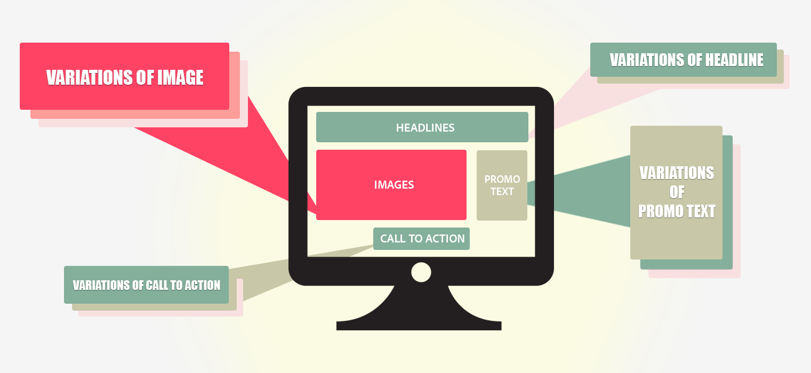

# Prise en main du [!UICONTROL test multivarié] {#get-started-mvt}

>[!BEGINSHADEBOX]

**Sur cette page :** Découvrez le fonctionnement d’un **[!UICONTROL test multivarié]**, les termes utilisés par [!DNL Target], quand l’utiliser au lieu d’un test A/B et comment le test factoriel partiel réduit les exigences de trafic.

>[!ENDSHADEBOX]

Une activité de **[!UICONTROL test multivarié]** (MVT) dans [!DNL Adobe Target] compare les combinaisons d’offres dans les éléments d’une page afin de déterminer la combinaison la plus performante pour une audience spécifique. Cela permet également d’identifier l’élément qui impacte le plus le succès de l’activité. Les tests multivariés vous permettent de découvrir l’influence relative d’éléments spécifiques sur la conversion par rapport aux autres éléments de la page, et peuvent vous aider à affiner une combinaison d’éléments qui se sont avérés efficaces.

Un **[!UICONTROL test multivarié]** offre deux avantages par rapport à un test A/B :

* Il indique les éléments de votre page qui ont la plus grande influence sur la conversion, également appelée « effet principal ». Ces informations sont utiles, par exemple, pour vous aider à déterminer où placer le contenu qui doit recevoir le plus d’attention.
* Il vous permet de trouver des effets composés entre plusieurs éléments d’une page, également appelé « effet d’interaction ». Par exemple, une publicité spécifique peut produire plus de conversions lorsqu’elle est combinée avec une bannière spécifique ou l’image d’un héros.

[!DNL Target] utilise des tests multivariés factoriels complets pour vous permettre d’optimiser le contenu. Un test multivarié full-factoriel examine toutes les combinaisons possibles de contenu avec une probabilité égale. Par exemple, en présence de deux éléments de page comportant trois offres chacun, vous obtenez neuf combinaisons possibles (3x3). Trois éléments, dont deux contiennent trois offres possibles et un deux offres, fournissent 18 options (3x3x2).

Dans [!DNL Target], chaque combinaison représente une expérience. Le **[!UICONTROL test multivarié]** compare chaque expérience afin que vous puissiez identifier les combinaisons les plus réussies. Dans le même temps, [!DNL Target] collecte et analyse des données pour comprendre comment chaque emplacement et les offres influencent la mesure de succès.

En raison du nombre de combinaisons pouvant être générées, un **[!UICONTROL test multivarié]** nécessite plus de temps et de trafic qu’un test A/B. La page doit recevoir un volume suffisant de trafic pour produire des résultats statistiquement significatifs pour chaque expérience. Pour obtenir des résultats utiles, comprenez la quantité de trafic que votre page reçoit et testez le nombre optimal de combinaisons pour le bon laps de temps.

L&#39;[estimateur de trafic](/help/main/c-activities/c-multivariate-testing/t-create-multivariate-test/traffic-estimator.md#traffic-estimator) peut vous aider à concevoir un test qui fonctionne avec votre trafic. Avant de l’utiliser, vous devez disposer de statistiques fiables indiquant le nombre d’impressions et de conversions que votre site reçoit normalement et tenir compte de vos niveaux de trafic par jour. Plus une activité a d’expériences, plus elle doit inclure de trafic ou son exécution doit durer. Si le volume de trafic n’est pas élevé, testez quelques combinaisons. Dans le cas contraire, le temps nécessaire à la production de résultats de test significatifs pourrait être trop long pour être utile.

## Terminologie MVT {#mvt-terminology}

Plusieurs termes sont utilisés de différentes manières dans l’industrie. Le tableau suivant définit les termes que [!DNL Target] utilise lorsque vous configurez un test multivarié.

| Terme | Définition |
|--- |--- |
| Combinaison | Variations de contenu créées lorsque vous testez plusieurs options de contenu à plusieurs emplacements. Par exemple, si vous testez trois emplacements, chacun avec trois options de contenu, il existe 27 combinaisons possibles (3x3x3). Un visiteur ou une visiteuse de votre site voit une combinaison, également appelée expérience. |
| Contenu | Texte ou image qui constitue une variation de test au sein d’un emplacement. Dans un test multivarié, plusieurs options de contenu à plusieurs emplacements sont comparées. Dans la méthodologie du test multivarié, le contenu est parfois référencé en tant que *niveau*. |
| Élément | Un élément DOM contenant des variations de contenu à tester dans le test MVT. Voir aussi *Emplacement*. |
| Emplacement | Zone de contenu spécifique sur une page, souvent contenue par un seul élément DOM. Dans la méthodologie du test multivarié, un emplacement est parfois référencé en tant que *facteur*. Un test multivarié factoriel complet compare toutes les combinaisons possibles d’offres dans vos emplacements. |

## Quand utiliser le [!UICONTROL test multivarié] par rapport à A/B {#when-to-use-mvt}

Le tableau suivant indique quand utiliser un **[!UICONTROL test multivarié]**, un test A/B ou les deux ensemble pour optimiser votre page.

| Situation | Que faire | Détails |
|--- |--- |--- |
| Vous avez moins de trois éléments à tester. | Exécutez une série de tests A/B. | Utilisez un test multivarié lorsque vous avez au moins trois éléments à tester. |
| Vous souhaitez optimiser à la fois la mise en page et le contenu de votre page. | Utilisez un test A/B pour optimiser la mise en page, suivi d’un test MVT pour déterminer le meilleur contenu dans chaque élément de la page. | Un test A/B peut fournir des commentaires importants sur la mise en page et les tests MVT excellent dans le test du contenu dans les éléments de votre conception de page. L’exécution d’un test A/B sur la mise en page avant de tester plusieurs options de contenu vous permet de déterminer la meilleure mise en page et le contenu le plus pertinent. |
| Le nombre d’expériences différentes dépasse cinq et s’étend sur deux éléments ou plus. | Utilisez un test multivarié pour déterminer l’élément qui est le plus important, puis exécutez un test A/B plus ciblé sur cet élément. | Le test MVT indique les zones de la page qui sont les plus susceptibles d’améliorer la conversion. Il s’agit des éléments sur lesquels un spécialiste du marketing doit se concentrer. Par exemple, le test multivarié peut indiquer que l’incitation à l’action est l’élément le plus important pour atteindre vos objectifs. Vous pouvez ensuite exécuter un test A/B pour affiner davantage les résultats, par exemple en testant deux images spécifiques l’une par rapport à l’autre ou en comparant le libellé ou les couleurs d’un call to action. En suivant un test MVT avec un ou plusieurs tests A/B, vous pouvez déterminer le meilleur contenu possible pour les résultats que vous souhaitez. |

Pour plus d’informations, telles que le nombre d’éléments à inclure et la planification du test, consultez [Bonnes pratiques en matière de test multivarié](/help/main/c-activities/c-multivariate-testing/best-practices.md).

## Test factoriel partiel {#partial-factorial}

[!DNL Target] propose des tests multivariés factoriels complets comme option d’activité intégrée. En statistique, la « conception d’expériences » propose de nombreuses approches, ou conceptions, pour déterminer les facteurs qui influencent les résultats. Une telle approche est la [méthode Taguchi](https://en.wikipedia.org/wiki/Taguchi_methods) pour les tests partiels factoriels. La méthode Taguchi permet aux marketeurs de faire un ensemble d’hypothèses qui réduisent le nombre de permutations d’expériences qui doivent être testées, ce qui réduit les exigences de trafic pour un test multivarié. Vous pouvez appliquer cette approche dans [!DNL Target] en utilisant cette [feuille de calcul hors ligne](/help/main/assets/MVT-Taguchi-Partial-Factorial-Design-02102017.xlsx).

Si votre équipe utilise d’autres approches de conception d’expériences, vous pouvez utiliser la feuille de calcul comme implémentation de référence pour les conceptions d’expériences personnalisées.

Lorsque vous utilisez la feuille de calcul hors ligne, tenez compte des conseils suivants :

* Sélectionnez les éléments à modifier et le nombre de versions de chaque élément (3x2, 4x3, etc.).
* Gardez une numérotation cohérente. Par exemple, si le bouton est l’élément 1 et que les options sont Bleu, Vert et Jaune, le bouton bleu correspond à 1-1, le bouton vert à 1-2 et le bouton jaune à 1-3.
* La feuille de calcul hors ligne propose le nombre approprié d’expériences nécessaires (quatre pour un 3 x 2, neuf pour un 4 x 3, etc.).
* Créez les expériences dans le workflow A/B avec le [Compositeur d’expérience visuelle (VEC)](/help/main/c-experiences/experiences.md). Vous pouvez utiliser du code personnalisé, modifier du HTML, WYSIWYG ou toute combinaison.
* Une fois l’activité terminée (en fonction du calculateur de taille d’échantillon), exécutez les résultats dans la feuille de calcul pour obtenir les autres détails.

## Vidéos de formation {#training-videos}

Les vidéos suivantes contiennent davantage d’informations sur les concepts abordés sur cette page.

### Types d’activités (9:03) 

Cette vidéo de présentation explique les types d’activités disponibles dans [!DNL Target]. Les tests multivariés sont abordés dans la vidéo à partir de 4:20. Dans cette vidéo, vous apprendrez à :

* Décrivez les types d&#39;activités inclus dans [!DNL Adobe Target].
* Sélectionnez le type d’activité approprié pour atteindre vos objectifs.
* Décrivez le workflow guidé en trois étapes qui s’applique à tous les types d’activité.

>[!VIDEO](https://video.tv.adobe.com/v/17386)

### Création de tests multivariés (9:25) 

Cette vidéo explique comment comprendre, planifier et créer un test multivarié à l’aide du workflow guidé en trois étapes [!DNL Target]. Dans cette vidéo, vous apprendrez à :

* Définissez et concevez un test multivarié.
* Créez un test multivarié.

>[!VIDEO](https://video.tv.adobe.com/v/17395)
