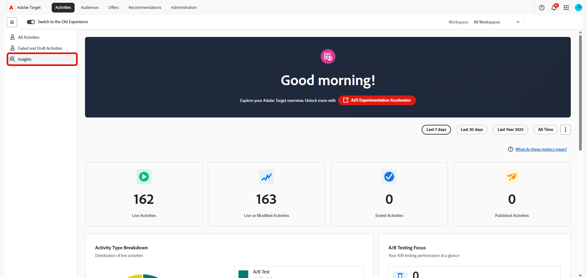
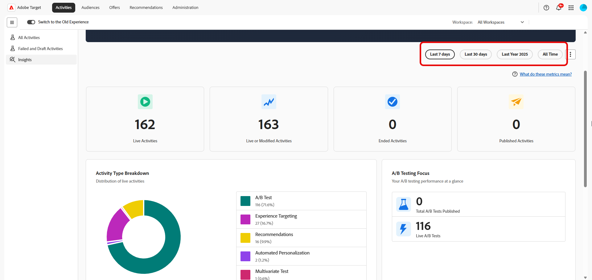
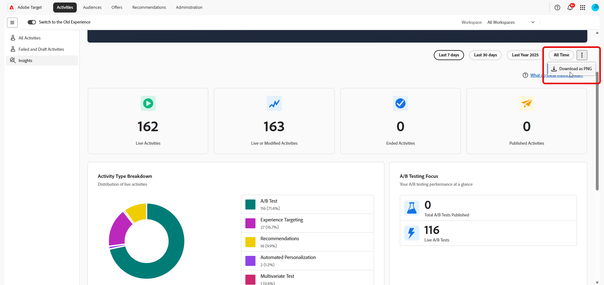
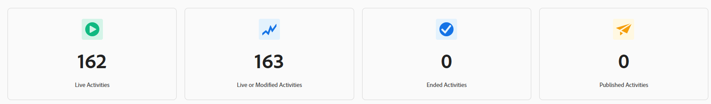
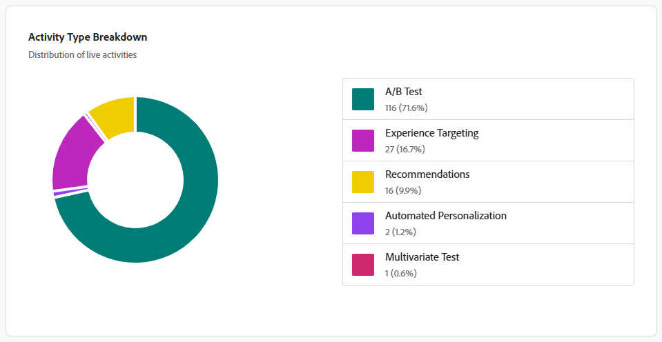
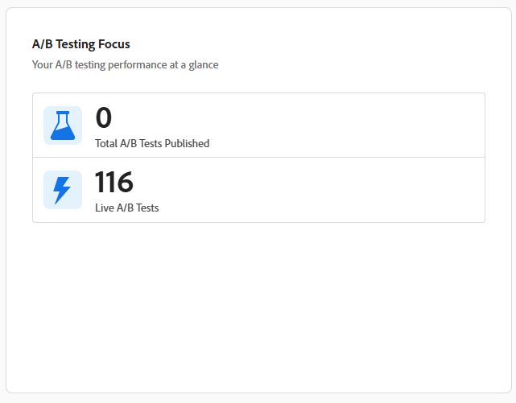
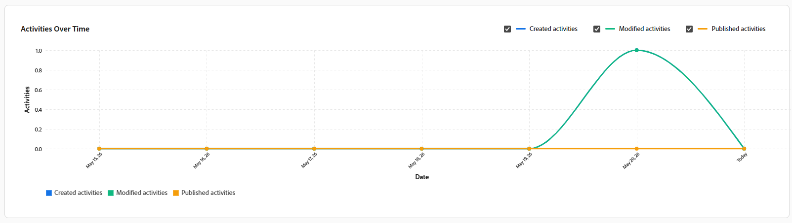

# Tableau de bord des informations Adobe Target {#insights-dashboard}

>[!BEGINSHADEBOX]

**Sur cette page :** Découvrez comment lire le **[!UICONTROL tableau de bord Adobe Target]** : comment sélectionner une période et ce que montrent les indicateurs clés de performance, la répartition des types d’activités, les mesures des tests A/B et le graphique des activités au fil du temps.

>[!ENDSHADEBOX]

Le tableau de bord **[!UICONTROL Adobe Target]** donne une vue d’ensemble de la manière dont votre organisation utilise [!DNL Adobe Target] au fil du temps. Cela permet aux équipes de comprendre en un coup d’œil l’adoption, le volume d’activités et l’utilisation des expériences.

Le tableau de bord est conçu à la fois pour les utilisateurs et les parties prenantes qui souhaitent une visibilité rapide sur l’utilisation de [!DNL Target] sans avoir à consulter les rapports d’activité individuels.

Lorsque vous consultez ce tableau de bord, tenez compte des points suivants :

* Les mesures peuvent inclure des activités ayant commencé avant ou se terminant après la période sélectionnée.
* Une activité peut être comptabilisée dans plusieurs mesures en fonction de son cycle de vie (par exemple, publiée et terminée).
* Le tableau de bord se concentre sur l’utilisation et l’adoption, et non sur les résultats de performances.

Pour des résultats détaillés, l’effet élévateur ou les performances statistiques, reportez-vous aux [rapports d’activité individuels](../c-reports/reports.md) dans [!DNL Adobe Target].

## [!UICONTROL Experimentation Accelerator]

La bannière de votre tableau de bord permet d’accéder directement à **[!UICONTROL Experimentation Accelerator]**, un point d’entrée léger vers des outils qui rationalisent les workflows d’expérimentation et simplifient la configuration, l’analyse et la prise de décision des expériences.

## Sélection de la période

Pour définir la portée des données affichées sur le tableau de bord, sélectionnez une période, par exemple la semaine dernière, l’année dernière ou toute l’heure. La période sélectionnée s’applique de manière cohérente à toutes les mesures et à tous les graphiques du tableau de bord.

Gardez les points suivants à l’esprit lors de l’interprétation des mesures sur la période sélectionnée :

* Certaines mesures reflètent des activités qui étaient actives à tout moment au cours de la période.

* D’autres reflètent les activités qui ont été créées, publiées ou terminées au cours de la période.

* Par conséquent, les totaux des mesures peuvent ne pas s’additionner exactement. Par exemple, de nombreuses activités peuvent être démarrées et terminées dans la même période.

Vous pouvez également exporter un instantané du tableau de bord en sélectionnant **[!UICONTROL Télécharger au format PNG]** dans le menu avancé.

## Mesures

Le tableau de bord organise ses mesures en quatre vues complémentaires, chacune répondant à une question différente sur votre utilisation de [!DNL Target] : [les indicateurs de performance clés](#kpis) fournissent un résumé d’un coup d’œil du nombre d’activités, la [répartition des types d’activités](#activity-type-breakdown) indique les fonctionnalités sur lesquelles vous vous appuyez le plus, [les mesures de test A/B](#ab-testing-metrics) effectuent un zoom avant sur l’utilisation de l’expérimentation et [les activités au fil du temps](#activities-over-time) révèlent des tendances sur la période sélectionnée.

### KPI

Les cartes d’indicateurs de performance clés en haut de la page résument en un coup d’œil le nombre d’activités clés pour la période sélectionnée. Chaque carte est axée sur une étape différente du cycle de vie de l’activité : en ligne, modifiée, terminée ou publiée, afin que vous puissiez rapidement évaluer l’utilisation globale et l’impulsion.

La mesure **[!UICONTROL Total des activités actives]** détaille le nombre d’activités qui étaient actives à tout moment au cours de la période sélectionnée. Une activité est considérée comme active si elle diffusait activement du trafic, même si elle a commencé avant ou s’est terminée après la période sélectionnée. Utilisez cette mesure pour :

* Comprenez à quel point [!DNL Target] a été utilisé de manière active pendant la période.
* Évaluez l’échelle globale de vos efforts de personnalisation et de test.

La mesure **[!UICONTROL Activités actives ou modifiées]** représente le nombre total d’activités de votre organisation qui ont été actives, créées ou modifiées au cours de la période sélectionnée. Utilisez cette mesure pour :

* Comprenez la taille globale de votre bibliothèque d’activités [!DNL Target] et le nombre d’activités en cours d’utilisation.

* Suivez la croissance à long terme de vos programmes d’expérimentation et de personnalisation.

La mesure **[!UICONTROL Activités terminées]** représente le nombre d’activités ayant atteint une date d’achèvement ou d’arrêt au cours de la période sélectionnée. Utilisez cette mesure pour :

* Comprenez le nombre d’activités terminées au cours de la période.
* Suivre le volume d’achèvement au fil du temps.

La mesure **[!UICONTROL Activités publiées]** détaille le nombre d’activités qui ont été publiées au cours de la période sélectionnée. Une activité est considérée comme publiée lorsqu’elle est mise en ligne pour la première fois. Si une activité est activée, arrêtée, puis réactivée, seule la première occurrence est comptabilisée dans cette mesure. Utilisez cette mesure pour :

* Mesurez le nombre de nouvelles activités qui ont été lancées.
* Comprenez la vitesse de création et de publication des activités.

### Répartition du type d’activité

Le graphique **[!UICONTROL Type d’activité]** présente la répartition des activités actives par type au cours de la période sélectionnée, notamment :

* **[!UICONTROL Test A/B]**
* **[!UICONTROL Ciblage d’expérience]**
* **[!UICONTROL Recommandations]**
* **[!UICONTROL Automated Personalization]**
* **[!UICONTROL Test multivarié]**

Utilisez ce graphique pour identifier les [!DNL Target] fonctionnalités sur lesquelles votre organisation repose le plus et pour repérer les opportunités afin d’élargir la combinaison de types d’activités que vous exécutez.

### Mesures de test A/B

{align="center"}

Cette section présente l’utilisation spécifiquement liée aux activités de **[!UICONTROL test A/B]**.

La mesure **[!UICONTROL Nombre total d’activités de test A/B actives]** affiche le nombre de **[!UICONTROL activités de test A/B]** qui étaient actives à tout moment au cours de la période sélectionnée.

Le **[!UICONTROL total des tests A/B publiés]** affiche le nombre de **[!UICONTROL tests A/B]** activités qui ont été publiés pendant la période sélectionnée.

Utilisez ces mesures pour comprendre la fréquence d’utilisation des tests A/B et pour suivre le volume et l’adoption des expériences au fil du temps.

### Activités dans le temps {#activities-over-time}

{align="center"}

Le graphique **[!UICONTROL Activités au fil du temps]** effectue le suivi du nombre d’activités créées, modifiées et publiées sur la période sélectionnée, ce qui facilite la détection des tendances, des pics ou des périodes calmes dans votre programme d’expérimentation.

