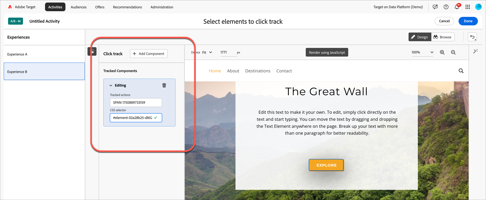
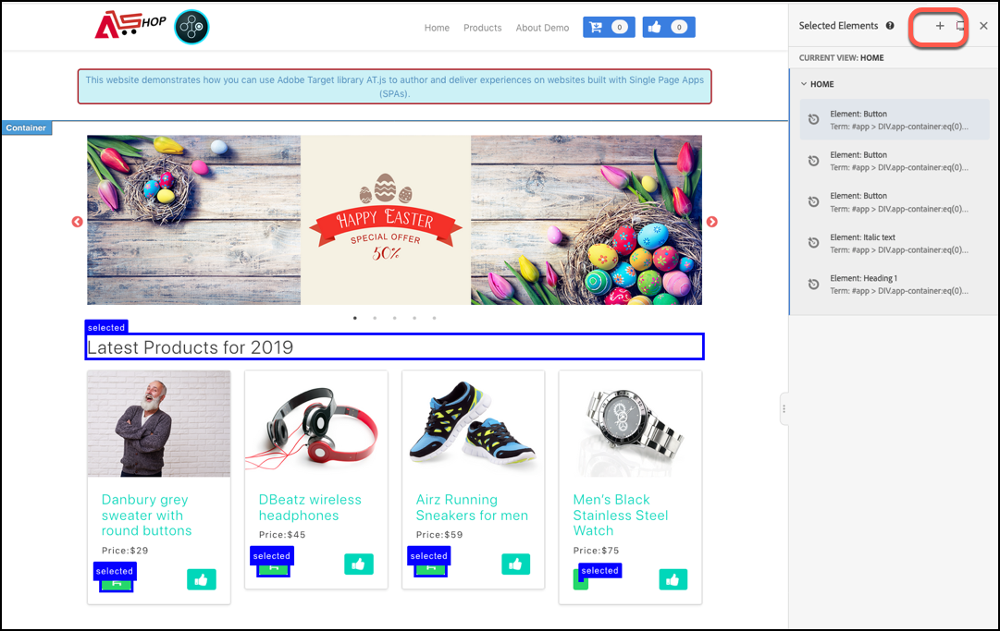
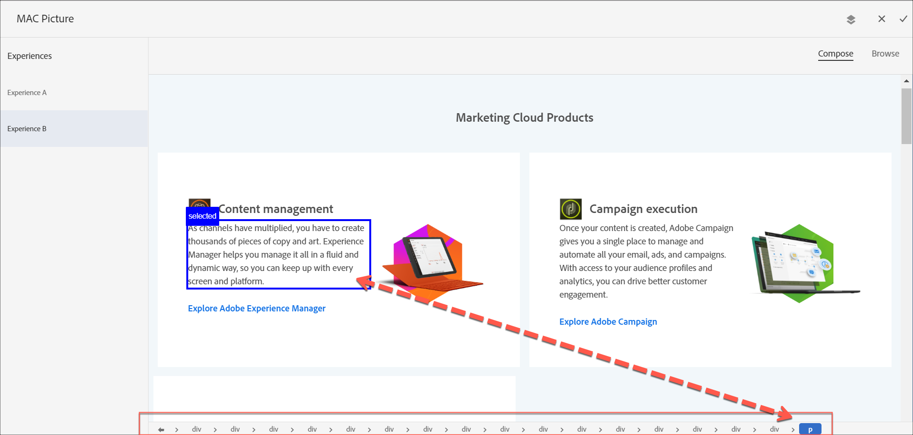
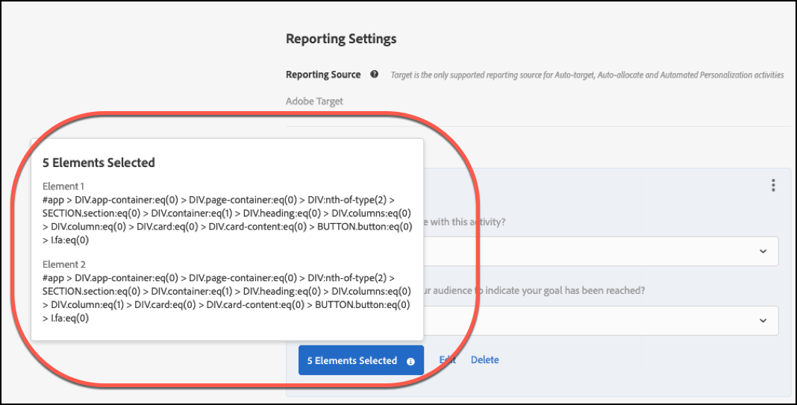

# Suivi des clics {#click-tracking}

>[!BEGINSHADEBOX]

**Sur cette page :** Découvrez comment effectuer le suivi des clics sur les éléments de page en tant que mesure de succès, comment gérer les éléments sélectionnés et ce qui doit être pris en compte lorsque vous sélectionnez des éléments.

>[!ENDSHADEBOX]

[!DNL Adobe Target] vous permet d’effectuer le suivi des clics sur n’importe quel élément en tant que mesure de succès. Le suivi des clics fait référence au processus de surveillance et d’enregistrement des interactions utilisateur, en particulier des clics, sur les éléments d’une page web ou d’une expérience. Il s’agit d’un élément clé pour mesurer l’engagement et les performances dans les tests A/B, les tests multivariés et les activités de personnalisation.

>[!NOTE]
>
>Le suivi des clics n’est pas pris en charge sur la requête [!DNL Target] globale lorsqu’il est utilisé comme emplacement dans une activité basée sur les formulaires.

* [Configuration du suivi des clics](#section_5540C5A533114E57BAE022A600B02E72)
* [Panneau Éléments sélectionnés](#selected-elements)
* [Considérations](#considerations) : la sélection d’éléments, le comptage des clics, Analytics et at.js, et les limites

## Configuration du suivi des clics {#section_5540C5A533114E57BAE022A600B02E72}

1. Lorsque vous définissez vos objectifs sur la page **[!UICONTROL Objectifs et paramètres]** pour votre activité, sélectionnez la mesure de succès **[!UICONTROL Conversion]**.

1. Pour l’action, sélectionnez **[!UICONTROL A cliqué sur un élément]**, puis cliquez sur **[!UICONTROL Sélectionner un élément]**.

   La page s’ouvre dans le **[!UICONTROL compositeur d’expérience visuelle]** (VEC).

1. Sélectionnez l’élément pour lequel vous souhaitez effectuer le suivi.

   Consultez les [Considérations](#considerations) pour obtenir des conseils sur la sélection d’éléments.

1. Cliquez sur **[!UICONTROL Terminé]** en haut de l’écran pour enregistrer vos sélections.

Lorsqu’un participant à une activité clique sur un élément sélectionné, le clic est comptabilisé comme une conversion.

## Panneau Éléments sélectionnés {#selected-elements}

Pour les activités **[!UICONTROL Test A/B]**, **[!UICONTROL Ciblage d’expérience]** (XT), **[!UICONTROL Automated Personalization]** (AP) et **[!UICONTROL Test multivarié]** (MVT), un panneau **[!UICONTROL Éléments sélectionnés]** répertorie les éléments sélectionnés pour le suivi des clics sur le côté gauche.

Plusieurs actions peuvent être appliquées lorsque vous cliquez sur un élément dans le panneau **[!UICONTROL Composants suivis]**. Le tableau suivant décrit chaque action pouvant être exécutée sur un élément :

| Action | Description |
| --- | --- |
| **[!UICONTROL Actions suivies]** | Affiche l’action de l’élément. |
| **[!UICONTROL Sélecteur CSS]** | Permet de modifier le sélecteur CSS. |
| [!DNL Delete] | Supprime l’élément. |

### Ajoute un élément

Si vous connaissez déjà le chemin d’accès DOM vers le sélecteur, vous pouvez l’ajouter manuellement en cliquant sur l’icône **[!UICONTROL Ajouter un composant]** en haut du panneau.

## Considérations {#considerations}

Tenez compte des points suivants lors de la configuration du suivi des clics.

### Sélectionner des éléments

* La fonction de chemin d’accès DOM est disponible lorsque vous définissez le suivi des clics. Lorsque vous cliquez sur un élément de la page, le menu des options du VEC s’affiche. En outre, le chemin d’accès DOM correspondant s’affiche au bas de la page. Vous pouvez utiliser le chemin d’accès DOM pour afficher rapidement les informations sur l’élément sélectionné (type, ID et classe). Vous pouvez monter ou descendre le chemin d’accès DOM pour sélectionner l’élément souhaité.

  Comme lors de la création d’expériences à l’étape 1 dans le workflow de création de l’activité, le sélecteur de chemin d’accès DOM au bas de la page vous permet de choisir un élément. Lorsque vous sélectionnez un élément dans le chemin d’accès DOM, l’élément correspondant dans le VEC s’affiche sous la forme « Sélectionné ». Pour désélectionner un élément sélectionné, vous pouvez de nouveau cliquer sur l’élément dans le sélecteur de chemin d’accès DOM ou cliquer sur la case « Sélectionné » dans le VEC.

  

  Pour plus d’informations, voir [Navigation dans les éléments à l’aide du chemin d’accès DOM](/help/main/c-experiences/c-visual-experience-composer/viztarget-options.md#dom-path) dans *Options du compositeur d’expérience visuelle*.

* Vous pouvez accéder à une autre page pour effectuer le suivi des clics sur une page pour laquelle vous ne modifiez pas le contenu. Cette autre page doit être incluse dans l’activité à l’aide de la fonction [multipage](/help/main/c-experiences/c-visual-experience-composer/multipage-activity.md#concept_277E096063E14813AC5D8EDFA1D2ED48) et [!DNL at.js] doit y être implémentée.
* Veillez à sélectionner le niveau de l’élément dont vous souhaitez effectuer le suivi. Par exemple, lorsque vous spécifiez un bouton, veillez à sélectionner le lien et non le texte du bouton.
* Si vous sélectionnez plusieurs éléments et si un participant clique sur l’un d’entre eux, le clic est comptabilisé. Pour comptabiliser séparément chaque élément, configurez des mesures de succès distinctes pour chacun d’entre eux. Pour comptabiliser un élément en cliquant sur plusieurs éléments d’une page, modifiez le sélecteur d’éléments CSS pour qu’il corresponde à plusieurs éléments.
* Pour les activités **[!UICONTROL Automated Personalization]** (AP) et de ciblage automatique sur les applications monopages (SPA), vous pouvez sélectionner des éléments pour le suivi des clics qui appartiennent à une vue [!DNL Target] spécifique. Pour plus d’informations sur les vues, voir [Vues Adobe Target et applications sur une seule page](/help/main/c-experiences/spa-visual-experience-composer.md).

Après avoir cliqué sur **[!UICONTROL Terminé]**, le nombre d’éléments sélectionnés s’affiche dans la mesure d’objectif sur la page **[!UICONTROL Objectifs et paramètres]**. Pointez la souris dessus pour afficher les éléments sélectionnés.

### Comptage des clics

* Les événements de clic sont envoyés à [!DNL Target] sur la même page que le clic.
* Les mesures de suivi des clics ne sont liées à aucune expérience spécifique dans une activité.
* Utilisez les audiences s’il est nécessaire de restreindre la portée des mesures de suivi des clics.
* Plusieurs activités peuvent définir une mesure de suivi des clics pour le même sélecteur. Si tel est le cas, lorsqu’un visiteur remplit les conditions de l’une de ces activités et clique sur ce sélecteur, la mesure de suivi des clics augmente pour toutes les activités associées pour lesquelles les conditions sont également remplies.

### Analytics et at.js

* Si la mesure de suivi des clics est la mesure de l’objectif d’une activité **[!UICONTROL Analytics for Target]** (A4T), le visiteur doit cliquer sur cet élément dans les 60 secondes suivant le chargement de la page pour que la mesure puisse être suivie.
* Si vous utilisez le [!DNL at.js] suivi des clics et [!DNL Analytics] AppMeasurement, le [!DNL at.js] suivi des clics annule tous les autres gestionnaires d’événements de clics. En conséquence, le gestionnaire de clics AppMeasurement ne s’exécute jamais.

  [!DNL at.js] une façon particulière de gérer le suivi des clics lorsque l’élément sous-jacent est une balise (lien) `A`A (link) ou `FORM`. Lorsque l’événement de suivi des clics est associé à une balise (lien) [!DNL at.js] ou `A`, `FORM` effectue les étapes suivantes :

  1. Invoquez `event.preventDefault()`.

  1. Déclenchez la requête [!DNL Target].

  1. En cas de succès de la requête [!DNL Target] ou de rappel d’erreur, exécutez le comportement par défaut :

     * Balise (lien) `A` : le comportement par défaut consiste à accéder à l’URL définie par l’attribut HREF.
     * Balise `FORM` : le comportement par défaut consiste à soumettre le formulaire.

  Ce comportement par défaut peut interférer avec le suivi des clics d’[!DNL Analytics]. Si vous utilisez [!DNL Analytics], fiez-vous à [!DNL Analytics] pour le suivi des clics plutôt qu’à [!DNL Target].

### Limites

* Le suivi des clics ne fonctionne pas pour des éléments dont les sélecteurs contiennent des caractères d’échappement, y compris pour les éléments suivants :

  | Caractère | Description |
  |---|---|
  | # | Signe numérique ou hachage |
  | : | Deux-points |
  | . | Point |
  | $ | Symbole du dollar |
  | `[ ]` | Crochets |

* Le suivi des clics n’est pas enregistré sur les pages où l’URL de page et d’activité appartient à des propriétés différentes. Les autorisations utilisateur d’entreprise sont une fonctionnalité [!DNL Target Premium]. Pour plus d’informations, voir [Autorisations des utilisateurs d’Enterprise](/help/main/administrating-target/c-user-management/property-channel/property-channel.md).

## Vidéo de formation {#section_36607204DAE146E3B8E2C609D244EDB1}

Cette vidéo comporte des informations sur la création de mesures de suivi des clics.

* Comprendre les mesures d’« objectif »
* Comprendre et créer les mesures **[!UICONTROL Conversion]**, **[!UICONTROL Chiffre d’affaires]** et **[!UICONTROL Engagement]**
* Créer une mesure de suivi des clics

>[!VIDEO](https://video.tv.adobe.com/v/17380)
