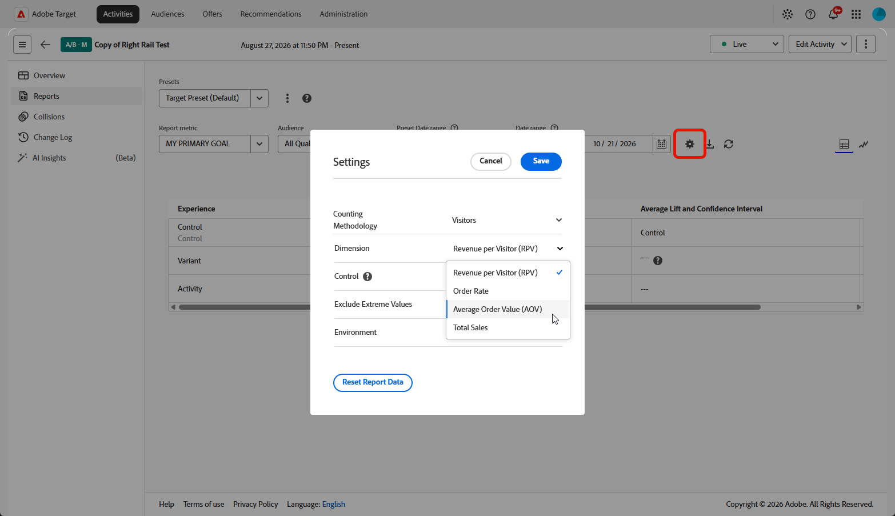
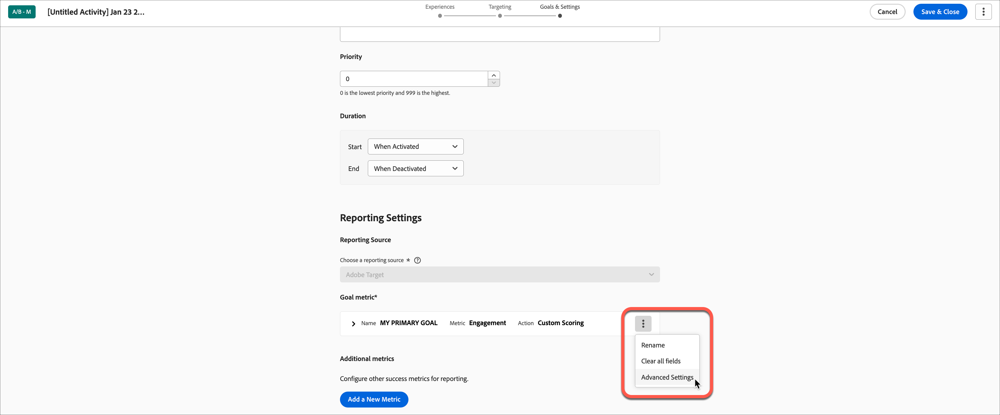

# [!UICONTROL Mesures de succès] {#success-metrics}

>[!BEGINSHADEBOX]

**Sur cette page :** Découvrez les mesures de succès disponibles dans [!DNL Adobe Target] (Conversion, Chiffre d’affaires et Engagement), comment créer des mesures personnalisées et comment les paramètres avancés modifient la façon dont une mesure est comptabilisée.

>[!ENDSHADEBOX]

Les mesures de succès dans [!DNL Adobe Target] sont des indicateurs clés qui permettent de mesurer les performances de vos activités. Ces mesures capturent des résultats commerciaux importants, tels que les conversions, le chiffre d’affaires par visiteur et l’engagement client, ce qui vous permet d’évaluer l’impact d’expériences ou d’offres spécifiques.

Vous pouvez, par exemple, déterminer si une nouvelle promotion augmente les recettes par visiteur ou entraîne l’ajout d’articles supplémentaires au panier. Les mesures de succès permettent également d’identifier les problèmes dans les flux d’utilisateurs comme les processus d’enregistrement, de passage en caisse ou d’achat, tout en fournissant des informations sur le comportement global des visiteurs.

* [Mesures de succès disponibles](#overview) : conversion, chiffre d’affaires et engagement
* [Mesures de succès personnalisées](#custom-metrics)
* [Paramètres avancés](#section_7CE95A2FA8F5438E936C365A6D43BC5B) : les dépendances, ce qui se passe après un objectif et comment le nombre est incrémenté

## Mesures de succès disponibles {#overview}

Dans [!DNL Target], les mesures de succès sont préconfigurées avec les paramètres recommandés pour garantir un reporting précis et un suivi efficace.

Par défaut, les événements de conversion utilisent le paramètre **[!UICONTROL Incrémenter le décompte et maintenir l’utilisateur dans l’activité].** Ce paramètre signifie que chaque visiteur est comptabilisé comme une conversion une seule fois. Aucune conversion répétée n’est comptabilisée. Ces visiteurs et visiteuses continuent à voir le contenu de l’activité tout au long de leur session.

Pour les mesures de recettes qui utilisent le même paramètre, seule la première commande d’un visiteur consigne les détails de la commande. Bien que les commandes suivantes augmentent le nombre de conversions, elles ne contribuent pas aux mesures basées sur le chiffre d’affaires telles que **[!UICONTROL Chiffre d’affaires par visiteur (RPV)]**, **[!UICONTROL Valeur de commande moyenne (AOV)]** ou [!DNL Total Sales]. Ces commandes supplémentaires sont également exclues du rapport **[!UICONTROL Détails de la commande]**.

>[!NOTE]
>
>Pour les activités utilisant [Analytics comme source de création de rapports](/help/main/c-integrating-target-with-mac/a4t/a4t.md) (A4T), la mesure d’objectif utilise toujours les paramètres « **[!UICONTROL Incrémenter le décompte et conserver l’utilisateur dans l’activité]** » et « **[!UICONTROL À chaque impression]** ». Ces paramètres ne sont *pas* configurables.

Les mesures de succès suivantes peuvent être configurées dans la section **[!UICONTROL Paramètres de création de rapports]** de la page **[!UICONTROL Paramètres d’activité]**, sous l’étape **[!UICONTROL Objectifs et paramètres]**.

| Mesure de succès | Approche de mesure | Définition |
|--- |--- |--- |
| **[!UICONTROL Conversion]** | Basée sur les conversions | La conversion survient lorsqu’un visiteur effectue sur votre site une action que vous avez définie, telle que <ul><li>A affiché une page</li><li>A affiché une mbox</li><li>A cliqué sur un élément</li></ul>Une conversion peut être comptabilisée une fois par visiteur ou chaque fois qu’un visiteur effectue une conversion. |
| **[!UICONTROL Recettes]** | Basée sur les conversions | Recettes générées par la visite. Vous ne pouvez choisir qu’une seule mesure de chiffre d’affaires, en fonction d’une mbox affichée. La vue du chiffre d&#39;affaires (RPV, AOV, ventes totales ou commandes) est sélectionnée dans la section **[!UICONTROL Rapports]** plutôt que lors de la configuration de l&#39;activité. Voir [Basculer entre les vues de rapports de revenus](#revenue-views). |
| **[!UICONTROL Engagement]** | Basée sur les engagements | Engagement généré par la visite. Vous pouvez choisir parmi les mesures d’engagement suivantes :<ul><li>**[!UICONTROL Pages vues]** : chaque visite unique est comptabilisée comme une conversion.</li><li>**[!UICONTROL Note personnalisée]** : note agrégée basée sur la valeur affectée aux pages visitées sur le site, à partir du moment où le visiteur voit pour la première fois la demande [!DNL Target] d’affichage de l’activité. Voir [Score De Capture](/help/main/c-activities/r-success-metrics/capture-score.md).</li><li>**[!DNL Time on Site]** : durée de la visite (en secondes) entre le moment où le visiteur voit la première demande d’affichage [!DNL Target] de l’activité et le chargement de la page finale avec une demande dans la session.</li></ul> |

Pour les mesures basées sur l’engagement (contrairement aux mesures basées sur la conversion et sur les recettes), les visiteurs doivent se requalifier pour l’activité à chaque visite afin d’incrémenter le nombre pour cette session. La mesure associée commence l’incrémentation après la requalification et s’arrête à la fin de la session de chaque visiteur. Une session s’arrête au bout de 30 minutes d’inactivité. Par conséquent, vous ne voyez pas les résultats immédiatement pendant le test. Cependant, tous les résultats de cette session sont disponibles quelques minutes après la fin de la session.

## Mesures de succès personnalisées {#custom-metrics}

Vous pouvez également créer des mesures de succès personnalisées. Une fois la mesure de succès sélectionnée, sélectionnez l’action effectuée par un visiteur pour atteindre l’objectif. Par exemple, choisissez une mesure **[!UICONTROL Conversion]**, définissez-la pour qu’elle soit comptabilisée une fois par visiteur, puis indiquez si le succès est obtenu lorsqu’un visiteur consulte une certaine page (ou un ensemble de pages), consulte une requête [!DNL Target] spécifique ou clique sur un lien spécifique. Pour connaître les étapes, voir [Définir des mesures](/help/main/c-activities/t-test-ab/t-test-create-ab/ab-set-metrics.md).

Si cette option est activée, le champ **[!UICONTROL Valeur estimée d’une conversion]** fournit une valeur pour votre objectif, mais pas pour d’autres mesures :

* La valeur permet à [!DNL Target] de calculer une augmentation estimée du chiffre d’affaires.
* Le champ est facultatif. Toutefois, les revenus incrémentiels pour toute mesure sans revenus ne peuvent pas être calculés sans celui-ci.
* Le champ n’est pas disponible pour les mesures **[!UICONTROL Score de page]**.
* Pour toutes les mesures de chiffre d’affaires (**[!UICONTROL Chiffre d’affaires par visiteur]**, **[!UICONTROL Valeur de commande moyenne]**, **[!UICONTROL Total des ventes]** et **[!UICONTROL Commandes]**), l’estimation utilise **[!UICONTROL Chiffre d’affaires par visiteur]**. Les données sont de type devise.

Voir [Estimation de l’effet élévateur dans les recettes](/help/main/administrating-target/r-target-account-preferences/estimating-lift-in-revenue.md) pour plus d’informations.

Les mesures de succès que vous choisissez pour votre activité sont disponibles dans les paramètres de rapport lorsque vous affichez un rapport pour l’activité. Certaines mesures, telles que la **[!UICONTROL notation personnalisée]** et le **[!UICONTROL chiffre d’affaires par visiteur]**, nécessitent une implémentation personnalisée qui transmet des informations, telles que les totaux des commandes et les ID de commande.

### Basculer entre les vues de rapports de chiffre d’affaires {#revenue-views}

Les rapports de chiffre d’affaires s’ouvrent dans la vue **[!UICONTROL Chiffre d’affaires par visite (RPV)]** par défaut. Aucune sélection n’est donc nécessaire lors de la configuration de l’activité. Vous pouvez basculer vers une autre vue à tout moment pendant que vous examinez les résultats.

Pour basculer entre les vues de rapports de chiffre d’affaires :

1. Ouvrez votre **[!UICONTROL activité]** et accédez à la section **[!UICONTROL Rapports]**.

1. Cliquez sur  et sélectionnez la vue de mesure requise :

   * **[!UICONTROL Chiffre d’affaires par visiteur (RPV)]**
   * **[!UICONTROL Valeur de commande moyenne (AOV)]**
   * **[!UICONTROL Total Des Ventes]**
   * **[!UICONTROL Taux de commande]**

   

**[!UICONTROL Chiffre d’affaires par visite (RPV)]** reste la vue affichée, sauf si une autre option est sélectionnée. Cette sélection affecte uniquement la mesure affichée dans le rapport et n’a aucune incidence sur les mesures de diffusion.

## Paramètres avancés {#section_7CE95A2FA8F5438E936C365A6D43BC5B}

Utilisez les paramètres avancés pour gérer la façon dont vous mesurez le succès. Les options incluent l’ajout de dépendances, le choix de conserver l’utilisateur dans l’activité ou de le supprimer, et le comptage de la mesure une fois par participant ou à chaque impression.

Pour accéder aux options **[!UICONTROL Paramètres avancés]**, cliquez sur l&#39;icône **[!UICONTROL Plus d&#39;actions]** (  ), puis cliquez sur **[!UICONTROL Paramètres avancés]**.

>[!NOTE]
>
>Si vous utilisez [!DNL Adobe Analytics] en tant que source de reporting, les paramètres sont gérés par le serveur [!DNL Analytics]. L&#39;option **[!UICONTROL Paramètres avancés]** n&#39;est pas disponible. Pour plus d’informations, consultez [Adobe Analytics comme source de création de rapports pour Adobe Target (A4T)](/help/main/c-integrating-target-with-mac/a4t/a4t.md).

Pour plus d’informations sur les options « **[!UICONTROL Que se passera-t-il une fois qu’un utilisateur aura atteint cet objectif]** » et « **[!UICONTROL Comment le décompte sera-t-il incrémenté]** », voir [Que se passera-t-il une fois qu’un utilisateur aura atteint cette mesure d’objectif ?](#what-happens).

### Ajouter une dépendance {#add-dependency}

Vous pouvez utiliser les paramètres avancés pour créer des mesures de succès dépendantes, en incrémentant une mesure uniquement si un visiteur atteint une autre mesure en premier. Par exemple, une conversion de test peut être valide uniquement si un visiteur clique sur l’offre ou atteint une page spécifique avant la conversion.

La fonctionnalité de dépendance *n&#39;est pas* prise en charge pour les éléments suivants :

* **[!UICONTROL Activités de recommandations]**. Cette fonctionnalité est prise en charge pour tous les autres types d’activité.
* Si vous utilisez [Analytics comme source de création de rapports](/help/main/c-integrating-target-with-mac/a4t/a4t.md) (A4T).
* Le type de mesure « A affiché une page ».
* Le type de mesure « Clic sur un élément » pour les activités du Compositeur d’expérience visuelle (VEC).
* Une mesure de succès dont l’option avancée **[!UICONTROL Comment le décompte sera-t-il incrémenté]** est définie sur « à chaque impression » ou « à chaque impression (actualisations de page exclues) », lorsqu’une autre mesure en dépend.

  Lorsqu’une mesure de succès est définie pour incrémenter à chaque impression, [!DNL Target] comptabilise à nouveau le visiteur à chaque fois qu’il visite cette mesure de succès. [!DNL Target] réinitialise ensuite la mesure de succès « appartenance » sur 0 afin qu’elle puisse être comptabilisée à nouveau à la prochaine impression. Ainsi, si une autre mesure nécessite que cette mesure ait été vue au préalable, [!DNL Target] ne reconnaît jamais que l’utilisateur a vu la première mesure.

Les mesures de succès dépendantes ne sont pas converties dans les cas suivants :

* Si vous créez une dépendance circulaire dans laquelle mesure1 dépend de mesure2 et mesure2 dépend de mesure1, aucune mesure ne peut être convertie.
* Les activités **[!UICONTROL Automated Personalization]** libèrent les utilisateurs et redémarrent l’activité lorsque les mesures de conversion sont atteintes. De ce fait, aucune mesure dépendante de la mesure de conversion n’est convertie.

### Que se passe-t-il une fois qu’un utilisateur atteint cette mesure d’objectif ? {#what-happens}

Utilisez les paramètres avancés pour déterminer ce qu’il se produit une fois qu’un utilisateur atteint la mesure d’objectif. Le tableau suivant présente les options disponibles :

| Une fois que l’utilisateur a rencontré cette mesure d’objectif | Options |
|--- |--- |
| **[!UICONTROL Incrémenter le décompte et maintenir l&#39;utilisateur dans l&#39;activité]** | Indiquez comment le décompte est incrémenté :<ul><li>Une fois par participant (par défaut)</li><li>À chaque impression (actualisations de page exclues)</li><li>À chaque impression</li></ul> |
| **[!UICONTROL Incrémenter le nombre, libérer l&#39;utilisateur et autoriser la rentrée]** | Sélectionnez l’expérience que voit le visiteur s’il entre à nouveau dans l’activité :<ul><li>Même expérience (par défaut)</li><li>Expérience aléatoire</li><li>Expérience non vue</li></ul> |
| **[!UICONTROL Incrémenter le décompte, libérer l&#39;utilisateur et interdire la rentrée]** | Déterminez ce que l’utilisateur voit à la place du contenu de l’activité :<ul><li>Même expérience, sans suivi (par défaut)</li><li>Par défaut/autre contenu d’activité</li></ul> |

>[!NOTE]
>
>Si vous configurez une mesure pour l’une des options **[!UICONTROL Incrémenter le nombre]** (mentionnées ci-dessus), le nombre de mesures est correctement incrémenté d’une seule fois par participant au niveau du visiteur uniquement. Le nombre de mesures est incrémenté une fois par visite pour chaque nouvelle session au niveau des visites.

### Comment le nombre est-il incrémenté ? {#count-increment}

Choisissez le comportement souhaité :

* Une fois par participant
* À chaque impression (à l’exclusion des actualisations de page)
* À chaque impression
