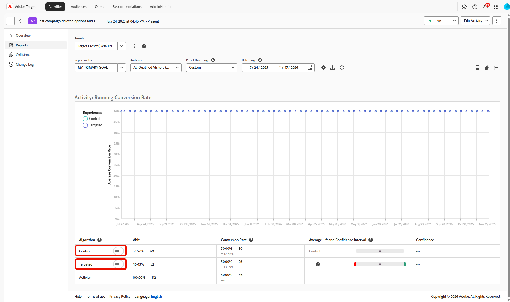

# Offrir des groupes de génération de rapports dans [!UICONTROL Automated Personalization] {#offer-reporting-groups}

>[!BEGINSHADEBOX]

**Sur cette page :** Découvrez le fonctionnement des groupes de génération de rapports d’offre dans les **[!UICONTROL activités Automated Personalization]**, comment les configurer et comment les afficher dans les rapports.

>[!ENDSHADEBOX]

Les groupes de création de rapports vous permettent d&#39;organiser les offres d&#39;une activité [!DNL Adobe Target] [Automated Personalization](/help/main/c-activities/t-automated-personalization/automated-personalization.md) (AP) en groupes. Les groupes de génération de rapports effectuent deux fonctions clés :

* Ils vous permettent de voir vos offres regroupées dans les rapports d’activité AP.
* Ils jouent un rôle clé dans le fonctionnement des modèles de personnalisation [!DNL Target].

Lorsque vous utilisez des groupes de génération de rapports, [!DNL Target] crée un modèle de personnalisation pour chaque groupe de génération de rapports, en utilisant les données de toutes les offres de ce groupe. Sans groupes de génération de rapports, [!DNL Target] crée un modèle de personnalisation pour chaque offre de votre activité AP.

Les groupes de création de rapports réduisent également les exigences en matière de données pour utiliser **[!UICONTROL Automated Personalization]** lorsque la configuration de votre activité ne dispose pas de suffisamment de données pour créer un modèle de personnalisation par offre. Ils aident à résoudre le problème du « démarrage à froid » des nouvelles offres, qui sont regroupées avec des offres similaires afin que chaque modèle ait plus de données sur lesquelles s’entraîner.

Cette approche fonctionne bien lorsque les visiteurs répondent de la même manière à toutes les offres d’un groupe, afin de regrouper les offres avec des taux de conversion similaires. Ne regroupez jamais toutes les offres dans un seul groupe de rapports et ne regroupez pas les offres avec des taux de conversion différents, car les deux choix sont susceptibles de réduire l&#39;efficacité des modèles de personnalisation [!DNL Target].

>[!NOTE]
>
>Si une offre est supprimée ou remplacée dans un groupe de rapports, l’historique du trafic qui a vu cette offre est également supprimé du groupe, de sorte que les offres supprimées ne contribuent pas aux données que les modèles de personnalisation [!DNL Target] utilisent pour apprendre.

## Considérations

### Utilisation de groupes de génération de rapports pour les activités dynamiques

Les groupes de génération d&#39;états affectent la manière dont [!DNL Target] crée ses modèles. Par conséquent, [!DNL Adobe] vous recommande d’utiliser les groupes de génération de rapports uniquement si vous prévoyez de remplacer ou d’ajouter des offres pendant qu’une activité est active. Si une nouvelle offre est introduite dans une activité active, la mise en groupe de la nouvelle offre avec des offres similaires existantes permet à [!DNL Target] d&#39;utiliser les données déjà collectées pour les autres offres du groupe afin d&#39;en savoir plus sur la nouvelle offre.

### Comment les données sont enregistrées pour les offres et les emplacements

Les activités AP combinent emplacement et offre (variables modèles). Lorsque [!DNL Target] enregistre des données dans des rapports, il prend en compte ces combinaisons afin de déterminer clairement de quel événement (affichage, clic, etc.) l’offre provient.

Par exemple, une activité peut avoir plusieurs emplacements et plusieurs offres qui peuvent se chevaucher. Si un visiteur voit plusieurs de ces offres à différents emplacements, [!DNL Target] enregistre des données pour ces offres uniquement. Si le même visiteur clique ultérieurement sur une offre, [!DNL Target] enregistre un événement de cette combinaison uniquement (pas pour toutes les combinaisons).

De même, si le clic provient d’un autre emplacement présent dans une mesure mais n’affiche pas d’offre, l’événement est consigné sous l’activité, mais pas pour une combinaison d’offre et d’emplacement. Par conséquent, cette offre n’apparaît pas dans le groupe de génération de rapports d’offre. Ce comportement se produit, car le clic peut être effectué à partir d’une mbox différente de celle qui a diffusé l’offre. Dans ce cas, la mesure est associée à l’activité, mais pas à l’offre.

## Configurer des groupes de génération de rapports

L&#39;affectation d&#39;offres à des groupes de génération de rapports détermine la manière dont [!DNL Target] crée ses modèles de personnalisation et la manière dont les offres s&#39;affichent dans les rapports d&#39;activité. Configurez les groupes lors de la création de l’activité ou ultérieurement si vous ajoutez de nouvelles offres à une activité active.

1. Sur la page **[!UICONTROL Expériences]** d’une activité AP, cliquez sur l’icône **[!UICONTROL Gérer le contenu]** (  ).

1. Cliquez sur l’onglet **[!UICONTROL Offres]** dans la partie supérieure de la boîte de dialogue **[!UICONTROL Gérer le contenu]**.

   

1. (Conditionnel) Choisissez les offres à ajouter à un groupe de reporting.

   * Pour ajouter une seule offre, cliquez sur l’icône **[!UICONTROL Autres actions]** ( ) de l’offre, puis cliquez sur **[!UICONTROL Groupe de rapports]**.
   * Pour ajouter plusieurs offres à la fois, cochez les cases correspondantes, puis cliquez sur **[!UICONTROL Groupe de rapports]** au bas de la boîte de dialogue.

1. Affectez les offres sélectionnées à un groupe de génération de rapports.

   * Pour affecter les offres à un groupe de rapports existant, sélectionnez **[!UICONTROL Existant]**, sélectionnez le groupe de rapports dans la liste déroulante, puis cliquez sur **[!UICONTROL Confirmer]**.
   * Pour créer un groupe de rapports pour les offres, sélectionnez **[!UICONTROL Nouveau]**, nommez le nouveau groupe de rapports, puis cliquez sur **[!UICONTROL Confirmer]**.

Pour limiter la liste des offres, filtrez-la par emplacement avec la liste **[!UICONTROL Emplacement]** ou par groupe de rapports avec la liste **[!UICONTROL Groupe de rapports]**. La liste **[!UICONTROL Groupe de rapports]** propose également l’option **[!UICONTROL Offres non affectées]**, qui affiche les offres qui n’appartiennent encore à aucun groupe de rapports, afin que vous puissiez les affecter à un groupe.

Pour plus d’informations sur le ciblage d’une offre vers des audiences spécifiques, consultez [Cibler **[!UICONTROL les offres Automated Personalization]**](/help/main/c-activities/t-automated-personalization/ap-target-offers.md#set-up-targeting-rules).

## Afficher les offres dans un groupe de génération de rapports

Le rapport **[!UICONTROL Niveau d’offre]** montre les performances des offres d’une activité, regroupées par groupe de rapports, afin que vous puissiez comparer les groupes ainsi que les offres individuelles.

1. Cliquez sur **[!UICONTROL Activités]**, sur l’activité **[!UICONTROL Automated Personalization]** dans la liste, puis sur l’onglet **[!UICONTROL Rapports]** pour afficher le rapport [Niveau d’offre](/help/main/c-reports/personalization-reports/reports-ap.md).

   Si vous avez de nombreuses activités, cliquez sur l’icône **[!UICONTROL Afficher les filtres]** (funnel), puis cochez la case **[!UICONTROL Automated Personalization]** pour afficher uniquement les **[!UICONTROL activités Automated Personalization]**.

1. Cliquez sur **[!UICONTROL Contrôle]** ou **[!UICONTROL Ciblé]** dans le tableau pour afficher les offres non groupées et les offres à l&#39;intérieur des groupes de génération de rapports.

   

Pour plus d’informations sur l’utilisation des rapports **[!UICONTROL Automated Personalization]** (y compris le rapport **[!UICONTROL Niveau d’offre]**), voir [Rapports de synthèse Automated Personalization](/help/main/c-reports/personalization-reports/reports-ap.md).
