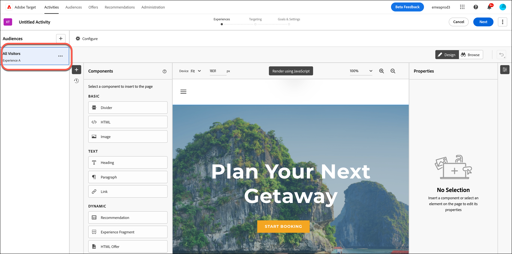
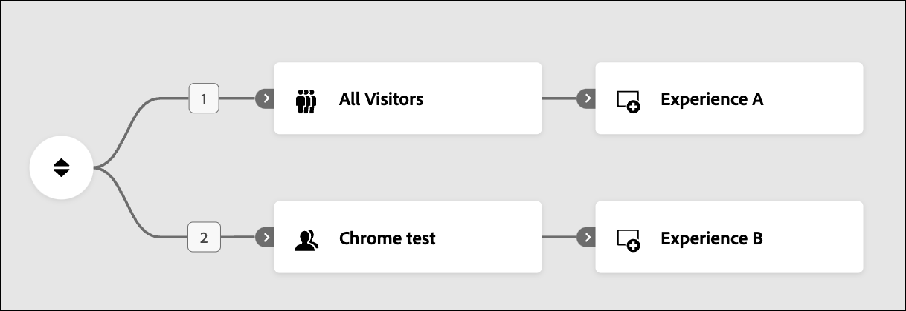
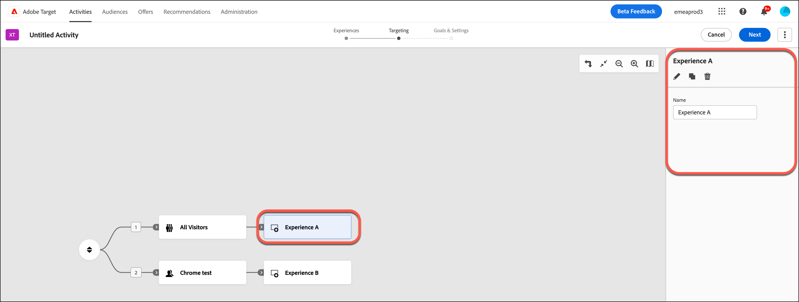

# Créer une expérience dans des activités de [!UICONTROL Ciblage d’expérience] (XT) {#xt-add-experience}

>[!BEGINSHADEBOX]

**Sur cette page :** Découvrez comment créer des expériences et les cibler sur des audiences dans une activité de ciblage d’expérience, comment les classer et comment les renommer, les modifier, les dupliquer ou les supprimer.

>[!ENDSHADEBOX]

Le **[!UICONTROL compositeur d’expérience visuelle]** (VEC) dans [!DNL Adobe Target] fournit une interface visuelle pour modifier les expériences sur votre page dans une activité de **[!UICONTROL ciblage d’expérience]** (XT).

* [Création d’expériences ciblées](#create-experiences)
* [Réorganiser les expériences](#reorder-experiences)
* [Renommer, modifier, dupliquer ou supprimer une expérience](#manage-experiences)

## Création d’expériences ciblées {#create-experiences}

Lors de la [création d’une **[!UICONTROL activité de ciblage d’expérience]**](/help/main/c-activities/t-experience-target/t-xt-create/xt-create.md), la première étape du workflow guidé en trois parties (**[!UICONTROL Expériences]**) affiche l’**[!UICONTROL expérience A]** par défaut avec une audience **[!UICONTROL Tous les visiteurs]**.

1. Sélectionnez les éléments à modifier et apportez les modifications souhaitées. Toutes les modifications que vous apportez maintenant s’appliquent à **[!UICONTROL Experience A]**.

   Lorsque vous passez la souris sur les éléments de la page, les éléments sont mis en surbrillance. Vous pouvez modifier un élément en surbrillance à l’aide du VEC. Pour obtenir la liste des actions pouvant être exécutées sur un élément pour modifier l’expérience, voir [Options du compositeur d’expérience visuelle](/help/main/c-experiences/c-visual-experience-composer/viztarget-options.md).

   >[!NOTE]
   >
   >Par défaut, le VEC n’autorise pas la modification d’éléments contenant du code JavaScript tels que les bannières rotatives. Vous pouvez désactiver JavaScript pour modifier ces éléments à l’aide du compositeur d’expérience visuelle.

1. Pour créer des expériences supplémentaires, cliquez sur **[!UICONTROL Ajouter]** (  ).

   La boîte de dialogue **[!UICONTROL Ajouter une audience]** s’affiche. Pour cibler une expérience sur une audience, sélectionnez l’audience avant d’ajouter l’expérience.

   +++ En savoir plus sur les audiences

   La bibliothèque d’audiences contient les audiences qui ont été précédemment définies ainsi que les audiences courantes préconfigurées dans [!DNL Target]. Vous pouvez sélectionner une audience dans la bibliothèque ou [créer une audience](/help/main/c-target/c-audiences/audiences.md#concept_65BE870D290E412D8BBF557EEA67C271).

   Outre la sélection d’une audience existante, vous pouvez combiner plusieurs audiences pour créer des audiences combinées à la demande plutôt que de créer une nouvelle audience. Pour plus d’informations, voir [Combinaison de plusieurs audiences](/help/main/c-target/combining-multiple-audiences.md#concept_A7386F1EA4394BD2AB72399C225981E5).

   Lors de la création d’une audience, vous pouvez sélectionner un emplacement et spécifier des paramètres pour cet emplacement. Sous **[!UICONTROL Personnalisé]** (**[!UICONTROL Créer une audience]** > **[!UICONTROL Personnalisé]**), sélectionnez l’emplacement, puis spécifiez les paramètres souhaités.

   Les audiences importées sont automatiquement importées en arrière-plan lorsque vous ouvrez la liste des audiences et qu’elles datent de plus de dix minutes.

   +++

1. Sélectionnez une ou plusieurs audiences à cibler avec l’expérience, puis cliquez sur **[!UICONTROL Attribuer l’audience]**.

   **[!UICONTROL L’expérience B]** s’affiche désormais dans l’illustration précédente et cette expérience est ciblée sur l’audience appropriée.

1. Sélectionnez les éléments à modifier pour cette expérience et apportez les modifications souhaitées, comme expliqué à l’étape 1.

1. Répétez les étapes précédentes pour créer d’autres expériences ciblées, si nécessaire.

1. Cliquez sur **[!UICONTROL Suivant]** lorsque vous avez terminé de concevoir vos expériences.

   Le diagramme des activités affiche :

   

>[!NOTE]
>
>Vous pouvez diffuser une image à partir d’une source autre que votre page principale (par exemple, une image hébergée sur `akamai.net` et diffusée sur `adobe.com`). Les images hébergées ailleurs ne s’affichent pas dans la miniature de la page affichée dans le diagramme de flux.

## Réorganiser les expériences {#reorder-experiences}

Lors de la création ou de la modification d’une activité de **[!UICONTROL Ciblage d’expérience]**, vous pouvez faire glisser et déposer des paires d’audience et d’expérience afin de les classer dans l’ordre souhaité. Les expériences des visiteurs sont évaluées dans l’ordre, du haut vers le bas. **[!UICONTROL Le ciblage d’expérience]** suppose que l’ordre importe. Si un visiteur appartient à la première paire audience-expérience, la première expérience est diffusée.

Pour réorganiser les paires, cliquez sur l’icône Réorganiser (  ) pour afficher la colonne **[!UICONTROL Expériences]** sur le côté droit, puis réorganisez les expériences selon vos besoins.

+++ Exemple : audiences qui ne s’excluent pas mutuellement

Supposons que vous ne soyez pas conscient que l’ordre importe lors de la création d’une activité de **[!UICONTROL Ciblage d’expérience]**. Vous réalisez plus tard lors du test que les visiteurs qui, selon vous, devraient être qualifiés pour les expériences B ou C le sont plutôt pour l’expérience A. Cette situation peut être due au fait que les audiences ne s’excluent pas mutuellement et ne sont pas dans le bon ordre (par exemple, expérience A = États-Unis, expérience B = San Francisco et expérience C = Californie).

Dans ce scénario, tous les utilisateurs originaires des États-Unis peuvent bénéficier de l’expérience A, même s’ils se trouvent à San Francisco ou ailleurs en Californie. Vous pouvez réorganiser les paires d’audience et d’expérience du plus restrictif au moins restrictif (San Francisco > Californie > États-Unis) sans recréer l’activité entière.

+++

Si vous avez une audience **[!UICONTROL Tous les visiteurs]**, assurez-vous qu’il ne s’agit pas de la première audience du diagramme. Une expérience ciblée sur « **[!UICONTROL Tous les visiteurs]** » peut être utilisée comme dernière expérience dans l’activité de **[!UICONTROL Ciblage d’expérience]** pour « attraper » les visiteurs qui n’ont acquis aucune autre expérience.

## Renommer, modifier, dupliquer ou supprimer une expérience {#manage-experiences}

Cliquez sur une expérience dans le diagramme d’une activité de **[!UICONTROL Ciblage d’expérience]** pour afficher la colonne **[!UICONTROL Expériences]** sur le côté droit.

Choisissez l’une des options suivantes, si nécessaire :

* **[!UICONTROL Renommer]** : saisissez le nom souhaité dans le champ **[!UICONTROL Nom]**.
* **[!UICONTROL Modifier]** : cliquez sur l’icône Modifier (  ), puis apportez les modifications souhaitées.
* **[!UICONTROL Dupliquer]** : copiez une expérience dans une activité de **[!UICONTROL ciblage d’expérience]** afin de pouvoir y apporter des modifications mineures sans avoir à recréer l’expérience entière. Cliquez sur l’icône **[!UICONTROL Dupliquer]** (  ), puis modifiez l’expérience selon vos besoins.
* **[!UICONTROL Supprimer]** : cliquez sur l’icône **[!UICONTROL Supprimer]** ( ), puis confirmez votre suppression.

## Vidéo de formation : Utilisation du compositeur d’expérience visuelle

Cette vidéo fournit des informations sur l’utilisation des options de **[!UICONTROL ciblage d’expérience]** (VEC).

* Modification du contenu d’une page
* Modification de la mise en page d’une page

>[!VIDEO](https://video.tv.adobe.com/v/17399)
