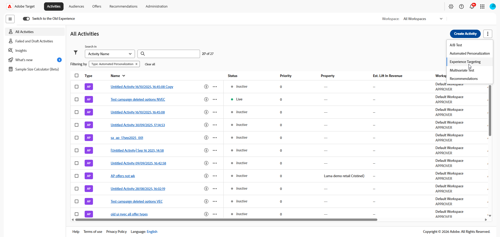
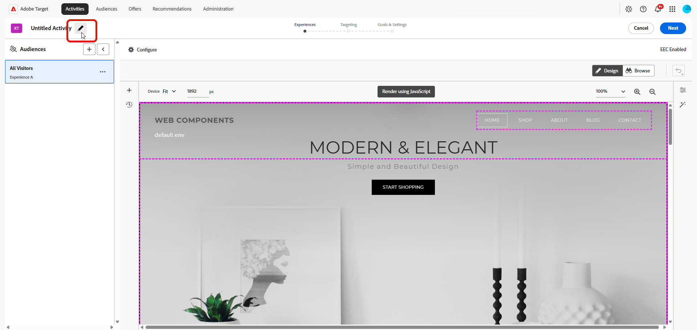

# Créer une activité de [!UICONTROL Ciblage d’expérience] (XT) {#create-xt-activity}

>[!BEGINSHADEBOX]

**Sur cette page :** Découvrez comment créer une activité de **[!UICONTROL ciblage d’expérience]** (XT) dans le **[!UICONTROL compositeur d’expérience visuelle]** (VEC). Créez l’activité, ajoutez des expériences ciblées sur différentes audiences, puis configurez les objectifs et les paramètres.

>[!ENDSHADEBOX]

Utilisez le **[!UICONTROL compositeur d’expérience visuelle]** (VEC) pour créer une activité de **[!UICONTROL ciblage d’expérience]** (XT) sur une page compatible avec [!DNL Target] et pour modifier des parties de la page dans [!DNL Adobe Target].

**[!UICONTROL Le ciblage d’expérience]** (XT) diffuse du contenu à une audience spécifique selon un ensemble de règles et de critères définis par les spécialistes marketing. Il est utile pour définir des règles qui ciblent une expérience ou un contenu spécifique sur une audience particulière, y compris le [géociblage](/help/main/c-target/c-audiences/c-target-rules/geo.md). Plusieurs règles peuvent être définies au sein d’une même activité afin de fournir différentes variations de contenu à des audiences différentes.

Pour plus d’informations sur le **[!UICONTROL ciblage d’expérience]**, un scénario d’utilisation et des vidéos de formation, consultez [Ciblage d’expérience](/help/main/c-activities/t-experience-target/experience-target.md).

1. Dans la liste **[!UICONTROL Activités]**, cliquez sur **[!UICONTROL Créer une activité]** > **[!UICONTROL Ciblage d’expérience]**.

   >[!NOTE]
   >
   >Les types d’activité disponibles dépendent de votre [!DNL Target] compte. Certains types d’activité peuvent ne pas apparaître dans votre liste. Par exemple, **[!UICONTROL Automated Personalization]** est une fonctionnalité [Target Premium](/help/main/c-intro/intro.md#premium).
   >
   >Pour plus d’informations sur les différents types d’activité disponibles dans [!DNL Target] et leurs différences, voir [Activités](/help/main/c-activities/activities.md#concept_D317A95A1AB54674BA7AB65C7985BA03). Reportez-vous à la section [Types d’activité Target](/help/main/c-activities/target-activities-guide.md) pour déterminer les types d’activité qui conviennent le mieux à vos besoins.

   

1. Dans la boîte de dialogue **[!UICONTROL Créer une activité de ciblage d’expérience]**, choisissez votre compositeur d’expérience :

   * **[!UICONTROL Visuel]**.
   * **[!UICONTROL Compositeur d’expérience d’après les formulaires]**, voir [Compositeur d’expérience d’après les formulaires](/help/main/c-experiences/form-experience-composer.md) pour plus d’informations.

   >[!NOTE]
   >
   >Outre le compositeur d’expérience visuelle et le **[!UICONTROL compositeur d’expérience d’après les formulaires]**, [!DNL Target] propose le compositeur d’expérience visuelle d’application d’une seule page. Pour plus d’informations sur les divers compositeurs, voir [Offres et expériences](/help/main/c-experiences/experiences.md).
   >
   >Pour obtenir des informations de dépannage sur le VEC, voir [Dépannage du compositeur d’expérience visuelle](/help/main/c-experiences/c-visual-experience-composer/r-troubleshoot-composer/troubleshoot-composer.md).

1. (Conditionnel) Si vous êtes un client [!DNL Target Premium], [choisissez un espace de travail](/help/main/administrating-target/c-user-management/property-channel/property-channel.md).

1. Spécifiez votre [URL d&#39;activité](/help/main/c-activities/t-test-ab/t-test-create-ab/ab-activity-url.md#ab-activity-url), puis cliquez sur **[!UICONTROL Créer]**. Le VEC s’ouvre, affichant la page indiquée dans l’URL.

   Si votre compte est [configuré avec une URL par défaut](/help/main/administrating-target/visual-experience-composer-set-up.md), cette URL apparaît par défaut. Vous pouvez passer de la valeur par défaut à une autre URL, si nécessaire.

1. Pour nommer l’activité, cliquez sur l’icône **[!UICONTROL Modifier]** (  ) et spécifiez un nom explicite pour l’activité, puis cliquez sur **[!UICONTROL Enregistrer]**.

   {{activity-name-rules}}

   

1. Créez de nouvelles expériences ciblées sur différentes audiences. Pour obtenir des instructions pas à pas, voir [Ajouter une expérience](/help/main/c-activities/t-experience-target/t-xt-create/xt-add-experience.md#xt-add-experience).

1. Spécifiez les [objectifs et paramètres](/help/main/c-activities/t-test-ab/t-test-create-ab/ab-goals-and-settings.md#ab-goals-and-settings) pour l’activité.
