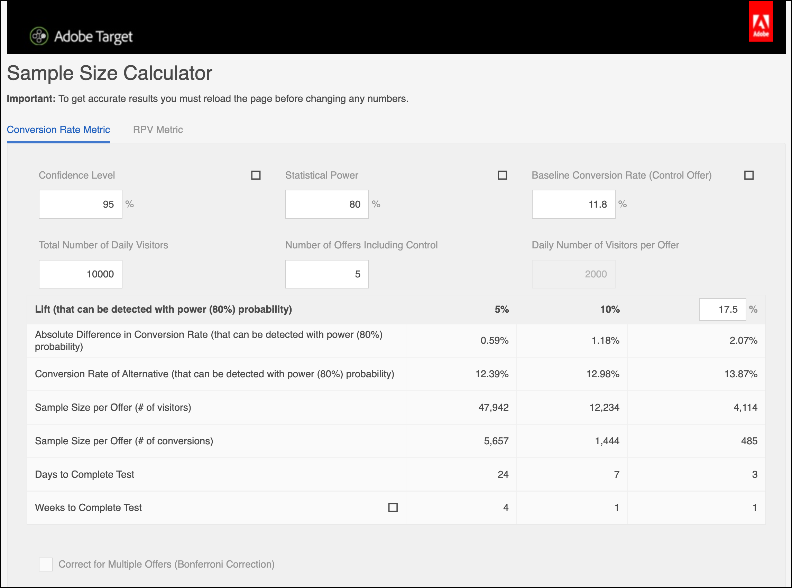
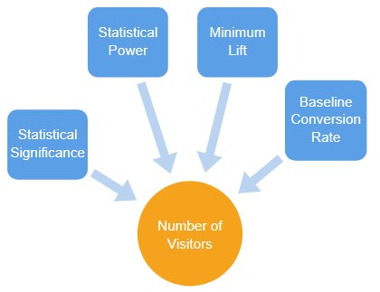
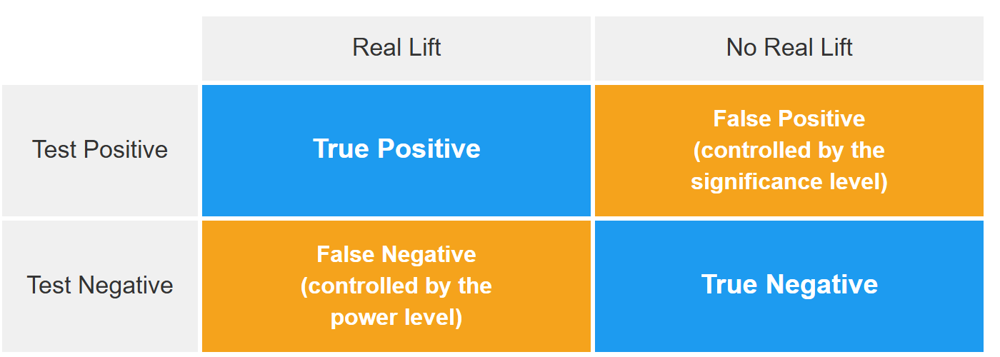
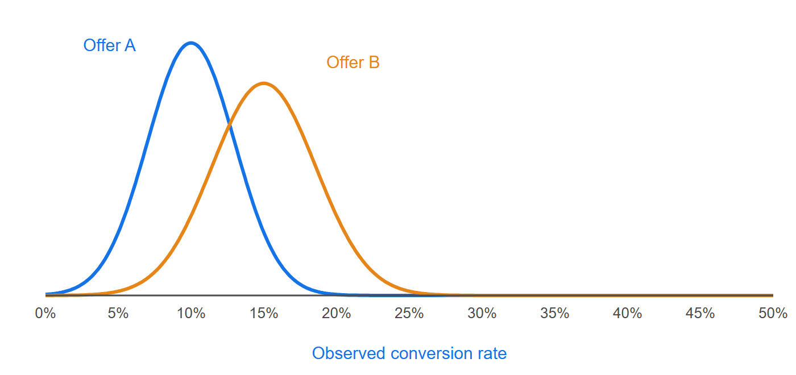
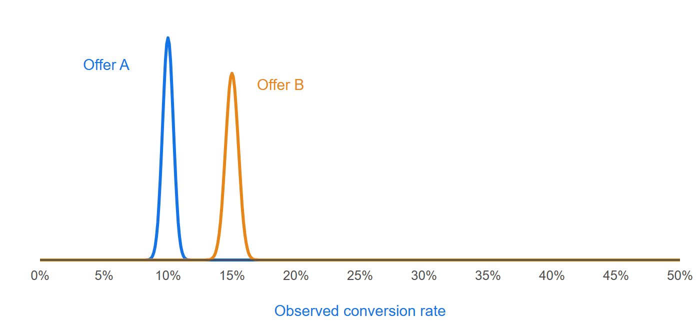
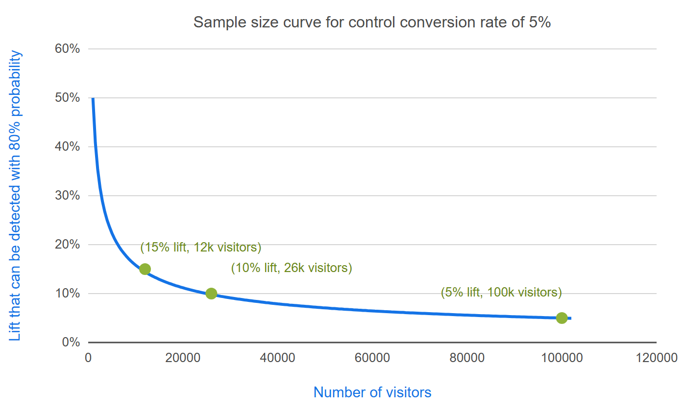

# Quelle doit être la durée d’exécution d’un test A/B ? {#sample-size-determination}

>[!BEGINSHADEBOX]

**Sur cette page :** Découvrez comment décider de la durée d’exécution d’un test A/B : pourquoi ne pas arrêter une activité plus tôt que prévu, en quoi l’affectation automatique est utile et comment les cinq paramètres de la variable Calculateur de taille d’échantillon fonctionnent ensemble.

>[!ENDSHADEBOX]

Une activité de test A/B **[!UICONTROL 1&rbrace; réussie dans [!DNL Adobe Target] nécessite suffisamment de visiteurs (taille de l’échantillon) pour améliorer votre taux de conversion.]** Comment savez-vous combien de temps il faut exécuter un test A/B ? Cet article contient des informations sur les activités d’**[!UICONTROL affectation automatique]** et le Calculateur de taille d’échantillon **[!UICONTROL Adobe Target]** pour vous aider à vous assurer que votre activité comporte suffisamment de visiteurs pour atteindre vos objectifs.

## Pourquoi ne pas arrêter une activité plus tôt {#stop-early}

>[!IMPORTANT]
>
>L’arrêt prématuré d’une activité est l’un des dix écueils importants auxquels vous pourriez être confronté lors de l’exécution de tests A/B. Pour plus d&#39;informations, consultez [Dix pièges courants des tests A/B et comment les éviter](/help/main/c-activities/t-test-ab/common-ab-testing-pitfalls.md#section_DF01A97275E44CA5859D825E0DE2F49F).

Il est tentant d&#39;arrêter une activité si l&#39;une des offres est plus performante ou moins performante que les autres dans les premiers jours de l&#39;activité. Toutefois, si le nombre d’observations est faible, il existe une forte probabilité que vous observiez par hasard un effet élévateur positif ou négatif, puisque le taux de conversion est calculé d’après un petit nombre de visiteurs. Les taux de conversion convergent vers leurs valeurs réelles sur le long terme au fur et à mesure que l’activité collecte davantage de points de données.

[!DNL Adobe Target] fournit des outils pour vous assurer que votre activité dispose d’un échantillon suffisamment grand pour atteindre vos objectifs de conversion : [Affectation automatique](#auto-allocate) et le [Calculateur de taille d’échantillon](#section_6B8725BD704C4AFE939EF2A6B6E834E6).

## Affectation automatique {#auto-allocate}

Une activité [Affectation automatique](/help/main/c-activities/automated-traffic-allocation/automated-traffic-allocation.md) est un type de test A/B qui identifie un gagnant parmi plusieurs expériences. Un test d’**[!UICONTROL affectation automatique]** réaffecte automatiquement davantage de trafic au gagnant afin d’augmenter les conversions pendant que le test continue à s’exécuter et à apprendre.

Contrairement à un test A/B standard, où la répartition du trafic reste fixe et où l’activité doit exécuter l’ensemble de son cours avant de pouvoir agir sur une expérience gagnante, **[!UICONTROL l’affectation automatique]** surveille les performances de la mesure d’objectif de toutes les expériences et envoie proportionnellement plus de nouveaux entrants vers les expériences hautement performantes. Suffisamment de trafic est réservé à l’exploration des autres expériences. Pour obtenir une explication complète, consultez la présentation de l’[affectation automatique](/help/main/c-activities/automated-traffic-allocation/automated-traffic-allocation.md).

Lors de l’utilisation de l’**[!UICONTROL Affectation automatique]**, [!DNL Target] affiche un badge en haut de la page de l’activité indiquant « Aucun gagnant pour le moment » jusqu’à ce que l’activité atteigne le nombre minimum de conversions avec un degré de confiance suffisant. [!DNL Target] déclare ensuite l’expérience gagnante en affichant un badge en haut de la page de l’activité.

## Calculateur De Taille D&#39;Échantillon Adobe [!DNL Target] {#section_6B8725BD704C4AFE939EF2A6B6E834E6}

Si vous choisissez d’utiliser une activité **[!UICONTROL Test A/B]** manuelle plutôt qu’une **[!UICONTROL Affectation automatique]**, le Calculateur de taille d’échantillon [!DNL Target] vous aide à déterminer la taille d’échantillon nécessaire à la réussite du test. Un test A/B manuel est un test à horizon fixe, le calculateur est donc utile. L’utilisation du calculateur pour une activité d’**[!UICONTROL affectation automatique]** est facultative, car l’**[!UICONTROL affectation automatique]** déclare une activité gagnante pour vous. Le calculateur vous donne une estimation approximative de la taille de l’échantillon nécessaire. Continuez votre lecture pour en apprendre davantage sur l’utilisation du calculateur.

Avant de configurer votre test A/B, accédez au [!DNL Adobe Target] [Calculateur de taille d’échantillon](https://experienceleague.adobe.com/tools/calculator/testcalculator.html?lang=fr). Vous pouvez également utiliser le [Calculateur de taille d’échantillon](/help/main/c-activities/sample-size-calculator.md) dans l’interface utilisateur de [!DNL Target].

Il est important de déterminer une taille d’échantillon adéquate (nombre de visiteurs) avant d’effectuer tout test A/B afin d’établir la durée d’exécution de l’activité avant d’évaluer les résultats. Le simple fait de surveiller l’activité jusqu’à ce que la signification statistique soit atteinte entraîne une sous-estimation importante de l’intervalle de confiance, ce qui rend le test peu fiable. L&#39;intuition derrière ce résultat est que, dans le cas où un résultat statistiquement significatif est détecté, le test est arrêté et un gagnant est déclaré. Cependant, si le résultat n&#39;est pas statistiquement significatif, le test peut être poursuivi. Cette procédure favorise nettement le résultat positif, ce qui augmente le taux de faux positifs et déforme le niveau de pertinence effectif du test.

Cette procédure peut entraîner de nombreux faux positifs, ce qui entraîne l’implémentation d’offres qui ne fournissent pas l’effet élévateur prévu à la fin. Un mauvais effet élévateur en soi est un résultat insatisfaisant, mais une conséquence encore plus grave est qu&#39;au fil du temps, l&#39;incapacité à prédire avec précision l&#39;effet élévateur érode la confiance organisationnelle dans les tests en tant que pratique.

Cet article traite des facteurs qui doivent être équilibrés lorsqu’une taille d’échantillon est déterminée et introduit un calculateur pour estimer une taille d’échantillon adéquate. Le calcul de la taille de l’échantillon à l’aide du calculateur de taille d’échantillon (lien fourni ci-dessus) avant le début de tout test A/B permet de vous assurer que vous exécutez toujours des tests A/B de haute qualité conformes aux normes statistiques.

Il existe cinq paramètres définis par l’utilisateur qui définissent un test A/B. Ces paramètres sont conjugués. De ce fait, lorsque quatre d’entre eux sont définis, le cinquième peut être calculé :

| Paramètre | Ce qu’il contrôle | Valeur type |
|--- |--- |--- |
| [Significativité statistique](#section_8230FB9C6D1241D8B1786B72B379C3CD) | La tolérance pour les faux positifs. | 5 % (niveau de confiance de 95 %) |
| [Puissance statistique](#section_1169C27F8E4643719D38FB9D6EBEB535) | Probabilité de détecter une différence réelle de taux de conversion. | 80% |
| [Effet élévateur minimum détectable de manière fiable](#section_6101367EE9634C298410BBC2148E33A9) | La plus petite différence de taux de conversion détectée de manière fiable par le test. | Déterminé par les besoins de votre entreprise |
| [Taux de conversion de référence](#section_39380C9CA3C649B6BE6E1F8A06178B05) | Le taux de conversion de l&#39;offre de contrôle (offre A). | En fonction de l’expérience ou d’un jour ou deux de données de test |
| [Nombre de visiteurs](#section_19009F165505429E95291E6976E498DD) | Taille d’échantillon nécessaire au test. | Calculé à partir des quatre autres |

>[!IMPORTANT]
>
>Pour obtenir des résultats précis, vous devez recharger la page avant de modifier les numéros de paramètre. Répétez ce processus chaque fois que vous modifiez des numéros de paramètre.

Pour un test A/B, la signification statistique, la puissance statistique, l’effet élévateur minimal détectable de manière fiable et le taux de conversion de ligne de base sont définis par l’analyste, puis le nombre requis de visiteurs est calculé à partir de ces chiffres.

La figure ci-dessous illustre les quatre résultats possibles d’un test A/B :

Il est souhaitable de n’obtenir aucun faux positif ou faux négatif. Cependant, l’obtention de zéro faux positif ne peut jamais être garantie par un test statistique. Il est toujours possible que les tendances observées ne soient pas représentatives des taux de conversion sous-jacents. Par exemple, dans un test pour voir si les pile ou face d&#39;une pièce de monnaie étaient plus probables, même avec une pièce de monnaie équitable, vous pourriez obtenir dix piles sur dix lancers juste par hasard. La signification et la puissance statistiques aident à quantifier les taux de faux positifs et faux négatifs et permettent de les maintenir à des niveaux raisonnables pour un test donné.

### Signification statistique {#section_8230FB9C6D1241D8B1786B72B379C3CD}

Le niveau de pertinence d’un test détermine la probabilité que le test signale une différence significative dans les taux de conversion entre deux offres différentes, alors qu’en fait, il n’y a aucune différence réelle. Cette situation est connue sous le nom de faux positif ou d’erreur de type I. Le niveau de pertinence est un seuil spécifié par l’utilisateur ou l’utilisatrice. Il s’agit d’un compromis entre la tolérance pour les faux positifs et le nombre de visiteurs et visiteuses qui doivent être inclus dans le test.

Dans un test A/B, il est initialement supposé que les deux offres ont le même taux de conversion. Ensuite, la probabilité du résultat observé est calculée en fonction de cette supposition. Si cette probabilité (valeur-p) est inférieure à un seuil prédéfini (niveau de pertinence), [!DNL Target] conclut que l&#39;hypothèse initiale (à savoir que les deux offres ont le même taux de conversion) est incorrecte. Par conséquent, les taux de conversion de A et de B sont statistiquement différents au niveau de signification donné.

Le niveau de pertinence généralement utilisé dans un test A/B est de 5 %, ce qui correspond à un degré de confiance de 95 % (degré de confiance = 100 % - niveau de pertinence). Un degré de confiance de 95 % signifie que chaque fois que vous effectuez un test, il existe une probabilité de 5 % de détecter un effet élévateur statistiquement significatif, même en cas d’absence de différence entre les offres.

Les interprétations classiques du degré de confiance sont résumées dans le tableau ci-dessous :

| Degré de confiance | Interprétation |
|--- |--- |
| &lt; 90 % | Aucune preuve qu’il y ait une différence entre les taux de conversion |
| 90-95 % | Faible preuve qu’il y ait une différence entre les taux de conversion |
| 95-99 % | Preuve modérée qu’il y ait une différence entre les taux de conversion |
| 99-99,9 % | Forte preuve qu’il y ait une différence entre les taux de conversion |
| +99,9% | Très forte preuve qu’il y ait une différence entre les taux de conversion |

Il est recommandé de toujours utiliser un niveau de confiance de 95 % ou plus.

Il est souhaitable d’utiliser le niveau de confiance le plus élevé possible, de sorte que le test génère peu de faux positifs. Néanmoins, un degré de confiance plus élevé requiert un plus grand nombre de visiteurs, ce qui augmente le temps requis pour effectuer le test. En outre, une augmentation du degré de confiance provoque une diminution de la puissance statistique.

### Puissance statistique {#section_1169C27F8E4643719D38FB9D6EBEB535}

La puissance statistique d’un test A/B est la probabilité de détecter une différence réelle dans un taux de conversion d’une certaine magnitude. En raison de la nature aléatoire (stochastique) des événements de conversion, il est possible qu’une différence statistiquement significative ne soit pas observée, simplement par hasard, même s’il existe une réelle différence de taux de conversion entre les deux offres. Ce scénario est appelé faux négatif ou erreur de type II.

La puissance statistique est souvent ignorée car sa détermination, à la différence de la signification statistique, n’est pas requise pour effectuer un test A/B. Toutefois, en ignorant la puissance statistique, il est fort probable que les différences réelles entre les taux de conversion des différentes offres ne soient pas détectées par le test, car la taille de l’échantillon est trop petite. Cette situation entraîne la dominance des tests par des faux positifs.

Il est souhaitable d’avoir une puissance statistique élevée afin que le test ait une probabilité élevée d’identifier une différence réelle dans les taux de conversion et produise moins de faux négatifs. Cependant, un plus grand nombre de visiteurs est nécessaire pour augmenter la puissance statistique de détection d’un effet élévateur donné, ce qui augmente le temps nécessaire pour effectuer le test.

La valeur courante utilisée pour la puissance statistique est de 80 %, ce qui signifie que le test a une probabilité de 80 % de détecter une différence égale à l’effet élévateur minimal détectable de manière fiable. Le test a une probabilité plus faible de détecter de petits effets élévateurs et une probabilité plus grande de détecter des effets élévateurs importants.

### Effet élévateur minimal détectable de manière fiable {#section_6101367EE9634C298410BBC2148E33A9}

La plupart des entreprises souhaitent mesurer la plus petite différence possible de taux de conversion car même un petit effet élévateur est intéressant à implémenter. Cependant, si vous souhaitez que le test A/B ait une forte probabilité de détecter un petit effet élévateur, le nombre de visiteurs à inclure dans le test serait prohibitif. En effet, si la différence de taux de conversion est faible, les deux taux de conversion doivent être estimés avec une précision élevée pour identifier la différence, ce qui nécessite de nombreux visiteurs. En conséquence, l’effet élévateur minimal détectable de manière fiable doit être déterminé par les besoins de l’entreprise en tenant compte des compromis entre la détection de petits effets élévateurs et l’exécution du test pendant de plus longues durées.

+++ Exemple : 100 visiteurs contre 5 000 visiteurs

Par exemple, supposons que deux offres (A et B) comportent de véritables taux de conversion de 10 et 15 %, respectivement. Si ces offres sont présentées à 100 visiteurs chacune, la probabilité est de 95 % d’observer des taux de conversion dans la plage 4 à 16 % pour l’offre A et 8 à 22 % pour l’offre B en raison de la nature stochastique des conversions. En statistiques, ces plages sont connues en tant qu’intervalles de confiance. Elles représentent la confiance dans la précision des taux de conversion estimés. Plus la taille de l’échantillon est grande (plus de visiteurs), plus vous pouvez être confiant que les estimations des taux de conversion sont exactes.

La figure ci-dessous illustre ces lois de probabilités.

En raison du chevauchement important entre les deux plages, le test ne peut pas déterminer si les taux de conversion sont différents. De ce fait, ce test avec 100 visiteurs ne peut pas faire la distinction entre les deux offres. Cependant, si [!DNL Target] expose les offres à 5 000 visiteurs chacun, il y a une probabilité de 95 % que les taux de conversion observés chutent dans les plages de 9 % à 11 % et de 14 % à 16 %, respectivement.

Dans ce cas, il est peu probable que le test tire une mauvaise conclusion. Le test avec 5 000 visiteurs peut donc distinguer les deux offres. L’intervalle de confiance du test avec 5 000 visiteurs est de +/-1 %. Cela signifie que le test peut détecter des différences d’environ 1 %. De ce fait, encore plus de visiteurs seraient requis si les véritables taux de conversion des offres étaient, par exemple, 10 et 10,5 % au lieu de 10 et 15 %.

+++

### Taux de conversion de ligne de base {#section_39380C9CA3C649B6BE6E1F8A06178B05}

Le taux de conversion de ligne de base est le taux de conversion de l’offre de contrôle (offre A). Souvent, vous avez une bonne idée du niveau de conversion de l’offre en fonction de l’expérience. Si ce n’est pas le cas, par exemple car il s’agit d’un nouveau type d’offre ou de création, le test peut être autorisé à s’exécuter pendant approximativement une journée afin d’obtenir une estimation du taux de conversion de ligne de base qui peut être utilisé dans le calcul de la taille de l’échantillon.

### Nombre de visiteurs {#section_19009F165505429E95291E6976E498DD}

Il peut être difficile d’équilibrer le coût d’exécution d’un test sur une longue période avec le risque de faux positifs ou de faux négatifs. Évidemment, vous ne souhaitez pas prendre de mauvaises décisions, mais être paralysé par des normes de test trop strictes ou trop rigides n’est pas souhaitable non plus.

En règle générale, un degré de confiance de 95 % et une puissance statistique de 80 % sont recommandés.

Le calculateur de taille d’échantillon (lien fourni ci-dessus) vous demande de choisir la signification statistique (recommandation : 95 %) et la puissance statistique (recommandation : 80 %). Après avoir saisi le taux de conversion de ligne de base et le trafic quotidien sur toutes les offres, la feuille de calcul fournit le nombre de visiteurs requis pour détecter un effet élévateur de 1 %, 2 %, 5 %, 10 %, 15 % et 20 % avec une probabilité égale à la puissance spécifiée du test. La feuille de calcul permet également à l’utilisateur de saisir un effet élévateur minimum personnalisé détectable de manière fiable. En outre, la feuille de calcul donne le nombre requis de semaines pour le test selon le niveau de trafic saisi par l’utilisateur. Le nombre de semaines requis est arrondi à la semaine entière la plus proche afin d’éviter que les effets du jour de la semaine n’influencent les résultats.

Il existe un compromis entre l’effet élévateur minimal qui peut être identifié de manière fiable par le test et le nombre requis de visiteurs. La figure ci-dessous, qui est valide pour un taux de conversion de ligne de base (contrôle) de 5 %, illustre des retours fortement en baisse alors que le nombre de visiteurs a augmenté. L’effet élévateur minimal qui peut être détecté de manière fiable s’améliore fortement lors de l’ajout des premiers visiteurs au test mais il faut un nombre toujours plus grand de visiteurs pour améliorer le test. Cette figure permet de trouver le compromis approprié entre le temps requis pour exécuter le test (tel que déterminé par le nombre requis de visiteurs et le trafic du site) et l’effet élévateur minimal qui peut être détecté de manière fiable par le test.

+++ Exemple : calculer la durée d’exécution du test

Dans cet exemple, vous pouvez décider que la capacité à détecter un effet élévateur de 5 % (correspondant à un taux de conversion de l’offre alternative de (100 %+5 %)&#42;5 % = 5,25 %) dans 80 tests sur 100 est adéquate, vous avez donc besoin d’une taille d’échantillon de 100 000 visiteurs pour chaque offre. Si le site compte 20 000 visiteurs par jour et que vous testez deux offres, le test doit être autorisé à s’exécuter pendant 2&#42;100 000/20 000 = 10 jours avant de pouvoir déterminer si l’offre alternative est statistiquement significativement supérieure à l’offre de contrôle.

A nouveau, il est recommandé que la durée requise soit systématiquement arrondie à la semaine entière la plus proche afin que les effets « jour de la semaine » soient évités. Ainsi, dans cet exemple, le test serait exécuté pendant deux semaines avant d’évaluer les résultats.

+++

### Mesure Recettes par visiteur {#section_C704C0861C9B4641AB02E911648D2DC2}

Lors de l’utilisation du chiffre d’affaires par visite (RPV) comme mesure, une source supplémentaire d’écart est ajoutée, car RPV est le produit du chiffre d’affaires par commande et du taux de conversion `(RPV = Revenue / #visitors = (Revenue per order &#42; #orders) / # visitors = Revenue per order &#42; (#visitors &#42; CTR) / #visitors = Revenue per Order &#42; CTR)`, chacun avec son propre écart. La variance du taux de conversion peut être estimée directement à l&#39;aide d&#39;un modèle mathématique, mais la variance des revenus par commande est spécifique à l&#39;activité. Par conséquent, utilisez la connaissance de cet écart des activités passées ou exécutez le test A/B pendant quelques jours pour estimer l&#39;écart des revenus. L’écart est calculé à partir des valeurs de Somme des ventes, Somme des ventes au carré et Nombre de visiteurs figurant dans le fichier de téléchargement CSV. Une fois ceci établi, utilisez la feuille de calcul pour calculer le temps nécessaire pour terminer le test.

Le calculateur de taille d’échantillon (voir le lien ci-dessous) peut vous aider à configurer la mesure Recettes par visiteur (RPV). Lorsque vous ouvrez le calculateur, un onglet intitulé **[!UICONTROL Mesure RPV]** s&#39;affiche. Vous aurez besoin des informations suivantes lors de l&#39;utilisation de la version RPV du calculateur :

* Nombre de visiteurs de l’offre de contrôle
* Recettes totales pour l’offre de contrôle

  Assurez-vous que le filtre d’ordre extrême est sélectionné.

* La somme des recettes au carré pour l’offre de contrôle

  Assurez-vous que le filtre d’ordre extrême est coché.

En général, l’utilisation de la valeur prédictive positive comme mesure nécessite 20 à 30 % plus de temps pour atteindre le même niveau de confiance statistique pour le même niveau d’effet élévateur mesuré. Cela est dû au fait que RPV présente l’écart supplémentaire de différentes tailles d’ordre par conversion. Il doit en être tenu compte lors du choix entre le taux de conversion simple et la valeur actuelle positive pour la période comme mesure sur laquelle baser votre décision commerciale finale.

## Correction relative à la comparaison de plusieurs offres {#section_1474113764224D0B85472D8B023CCA15}

Chaque fois que vous comparez deux offres, la probabilité d’obtenir un faux positif (observation d’une différence statistiquement significative même en l’absence de différence de taux de conversion) est égale au niveau de pertinence. Par exemple, en présence de cinq offres, A/B/C/D/E, A étant l’offre de contrôle, quatre comparaisons sont effectuées (contrôle avec B, contrôle avec C, contrôle avec D et contrôle avec E) et la probabilité d’un faux positif est de 18,5 % même si le degré de confiance est de 95 % car Pr(au moins au faux positif) = 1 - Pr(aucun faux positif) = 1 - 0,954 = 18,5 %. Un faux positif est, dans ce contexte, défini comme l’offre de contrôle rapportée comme étant meilleure que l’offre alternative ou l’inverse, alors, qu’en fait, il n’y aucune différence entre elles.
