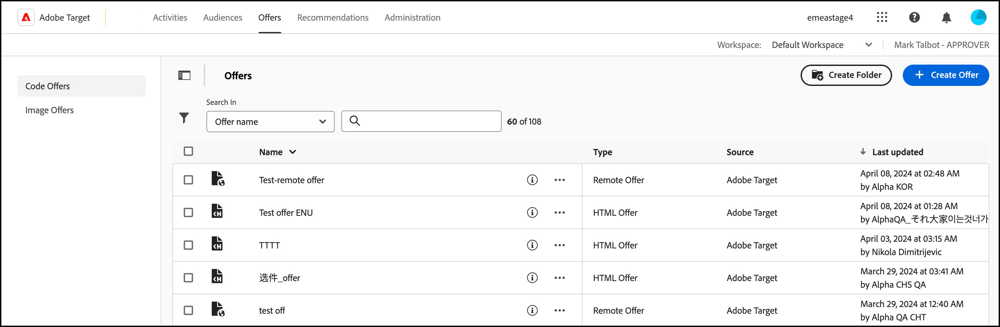

# Prise en main des offres

Découvrez comment gérer efficacement les offres de code et d’images à l’aide de la bibliothèque [!UICONTROL Offres] dans [!DNL Adobe Target].

Pour afficher la bibliothèque [!UICONTROL Offres], cliquez sur l’onglet **[!UICONTROL Offres]** en haut de l’interface utilisateur [!DNL Target].

La bibliothèque [!UICONTROL Offres] contient des offres qui ont été configurées via les API [!DNL Target Standard/Premium], [!DNL Target Classic], [!DNL Adobe Experience Manager] (AEM), [!DNL Adobe Mobile Services] (AMS) et . Les offres créées dans [!DNL Target Standard/Premium] ou d’autres solutions sont modifiables dans [!DNL Target Classic]. Les offres créées via l’API [!DNL Adobe Target] ou le serveur MCP [!DNL Adobe Target] peuvent également être modifiées dans l’interface utilisateur [!DNL Target].

La bibliothèque [!UICONTROL Offres] offre un aperçu de toutes les offres de code et d’image et vous permet d’effectuer diverses actions :

| Élément | Description |
|--- |--- |
| Rail de navigation de gauche | Basculez entre l’affichage de [!UICONTROL Offres de code] ou [!UICONTROL Offres d’image]. |
| [!UICONTROL Afficher Les Dossiers] / [!UICONTROL Masquer Les Dossiers]
 | Cliquez sur l’icône **[!UICONTROL Afficher les dossiers]** ou **[!UICONTROL Masquer les dossiers]** pour basculer entre l’affichage de la structure des dossiers de vos offres et l’affichage de la structure des dossiers.
Pour plus d’informations, voir [Créer des dossiers d’offres](/help/main/c-experiences/c-manage-content/create-content-folder.md). |
| [!UICONTROL Afficher l’icône Filtres]
 | Cliquez sur l’icône **[!UICONTROL Afficher les filtres]** pour filtrer les offres par [!UICONTROL type], [!UICONTROL Source] et [!UICONTROL type AEM].
Pour plus d’informations, voir [Appliquer des filtres à la liste Offres](#filters) ci-dessous. |
| Champs de recherche | Utilisez les champs **[!UICONTROL Rechercher dans]** pour trouver rapidement une offre ou pour réduire le nombre d’offres affichées dans la bibliothèque [!UICONTROL Offres]. Vous pouvez effectuer une recherche par [!UICONTROL nom de l’offre], [!UICONTROL chemins AEM] ou [!UICONTROL balises AEM]. Les options de recherche sont persistantes au niveau de la session. |
| [!UICONTROL Créer Un Dossier] | Cliquez sur **[!UICONTROL Créer un dossier]** pour créer des dossiers dans la bibliothèque [!UICONTROL Offre] afin de contenir des offres de code, des offres d’image, ainsi que d’autres dossiers pour créer une structure de sous-dossiers.
Pour plus d’informations, voir [Créer des dossiers d’offres](/help/main/c-experiences/c-manage-content/create-content-folder.md). |
| [!UICONTROL [!UICONTROL Création d’une offre]] | Cliquez sur **[!UICONTROL Créer une offre]** pour créer une offre.
Pour plus d&#39;informations sur la création des différents types d&#39;offres, voir : <ul><li>Offre HTML</li><li>[Offre JSON](/help/main/c-experiences/c-manage-content/create-json-offer.md)</li><li>[Offre De Redirection](/help/main/c-experiences/c-manage-content/offer-redirect.md)</li><li>[Offre À Distance](/help/main/c-experiences/c-manage-content/about-remote-offers.md)</li></ul> |
| Cases à cocher des opérations en bloc
 | Cochez les cases [!UICONTROL Opérations en bloc] pour effectuer des opérations en bloc sur toutes les offres ou sur les offres sélectionnées.
Pour obtenir la liste des actions disponibles (en fonction de vos autorisations et du statut de l&#39;offre), consultez [Exécuter des actions rapides](#quick-actions) ci-dessous. |
| [!UICONTROL Nom] | Le nom de chaque offre.
Cliquez sur l’icône **[!UICONTROL Informations rapides]** (  ) en regard de chaque nom d’offre pour afficher plus d’informations sur cette offre dans une carte pop-up, y compris l’identifiant de l’offre, le type, la date de la dernière modification de l’offre et par qui, etc.
Cliquez sur l’icône **[!UICONTROL Plus d’actions]** (  ) en regard de chaque nom d’offre pour ouvrir un menu qui vous permet d’effectuer des actions rapides sur une activité. Les actions suivantes sont disponibles (en fonction de vos autorisations et du statut de l&#39;offre) : [!UICONTROL Modifier], [!UICONTROL Copier], [!UICONTROL Supprimer] et [!UICONTROL Déplacer]. Pour plus d&#39;informations sur chaque action, consultez [Exécuter des actions rapides](#quick-actions) ci-dessous.
Cliquez sur l’en-tête du tableau pour trier la liste par ordre alphabétique croissant ou décroissant par nom. |
| [!UICONTROL Type] | Le type d’offre : [!UICONTROL Offres HTML], [[!UICONTROL Offres de redirection]](/help/main/c-experiences/c-manage-content/offer-redirect.md), [[!UICONTROL Offres distantes]](/help/main/c-experiences/c-manage-content/about-remote-offers.md) et [[!UICONTROL Offres JSON]](/help/main/c-experiences/c-manage-content/create-json-offer.md). |
| [!UICONTROL Source] | Indique l’emplacement de création de l’offre : [!DNL Adobe Target], [!DNL Adobe Target Classic] et [!DNL Adobe Experience Manager]. |
| [!UICONTROL Dernière mise à jour] | Affiche la date et l&#39;heure de la dernière modification de l&#39;offre et la personne qui les a effectuées.
Cliquez sur l’en-tête du tableau pour trier la liste par ordre croissant ou décroissant de date. |

## Application de filtres à la bibliothèque des offres {#filters}

Cliquez sur l’icône **[!UICONTROL Afficher les filtres]** () pour filtrer les offres par [!UICONTROL type], [!UICONTROL Source] et [!UICONTROL type AEM].

L&#39;icône **[!UICONTROL Afficher les filtres]** permet de filtrer les offres selon les catégories suivantes :

* **[!UICONTROL Type]** : [!UICONTROL Offre HTML], [[!UICONTROL Offre de redirection]](/help/main/c-experiences/c-manage-content/offer-redirect.md), [[!UICONTROL Offre distante]](/help/main/c-experiences/c-manage-content/about-remote-offers.md) et [[!UICONTROL Offre JSON]](/help/main/c-experiences/c-manage-content/create-json-offer.md).

* **[!UICONTROL Source]** : [!DNL Adobe Target], [!DNL Adobe Target Classic] et [!DNL Adobe Experience Manager].

* **Type AEM** : [Fragments de contenu](/help/main/c-integrating-target-with-mac/aem/content-fragments-aem.md) et [Fragments d’expérience](/help/main/c-integrating-target-with-mac/aem/experience-fragments-aem.md). Pour plus d’informations sur les différents types de fragments, consultez la [Présentation des fragments d’expérience et des fragments de contenu AEM](/help/main/c-integrating-target-with-mac/aem/aem-experience-and-content-fragments.md).

Les filtres sont persistants au niveau de la session.

## Exécution d’actions rapides {#quick-actions}

Vous pouvez effectuer les actions rapides suivantes en cliquant sur l’icône appropriée :

### Infos rapides

Cliquez sur l’icône **[!UICONTROL Informations rapides]** (  ) en regard de chaque nom d’offre pour afficher plus d’informations sur cette offre dans une carte pop-up, y compris l’identifiant de l’offre, le type, la date de la dernière modification de l’offre et par qui, etc. Les options disponibles dépendent du type d’offre : [!UICONTROL Offre HTML], [[!UICONTROL Offre JSON]](/help/main/c-experiences/c-manage-content/create-json-offer.md), [[!UICONTROL Offre de redirection]](/help/main/c-experiences/c-manage-content/offer-redirect.md), [[!UICONTROL Offre distante]](/help/main/c-experiences/c-manage-content/about-remote-offers.md).

### Autres actions

Les actions disponibles pour [!UICONTROL Offres de code] et pour [!UICONTROL Offres d’image] diffèrent légèrement. Les sections suivantes comprennent davantage d’informations :

#### [!UICONTROL Offre de code]

Cliquez sur l’icône **[!UICONTROL Plus d’actions]** (  ) en regard de chaque nom d’offre pour ouvrir un menu qui vous permet d’effectuer des actions rapides sur une activité.

Les actions suivantes sont disponibles (en fonction de vos autorisations et du statut de l&#39;offre) :

* [!UICONTROL Modifier]
* [!UICONTROL Copier]
* [!UICONTROL Supprimer]
* [!UICONTROL Déplacer] (par exemple, pour déplacer un ou plusieurs éléments dans un dossier, cliquez sur **[!UICONTROL Déplacer]** en regard de l’élément souhaité, cliquez sur le dossier souhaité, puis cliquez sur **[!UICONTROL Déplacer]**).

Selon vos autorisations, il se peut que vous ne voyiez pas d’icônes pour toutes les options. Par exemple, un utilisateur disposant des autorisations [!UICONTROL Observateur] ne dispose pas des droits d’utilisation de l’option [!UICONTROL Copier].

Pour plus d’informations sur les tâches que vous pouvez effectuer sur les offres et les dossiers, consultez [Utilisation du contenu de la bibliothèque de ressources](/help/main/c-experiences/c-manage-content/assets-working.md).

#### [!UICONTROL Offre Image]

Effectuez des tâches supplémentaires en pointant sur l’offre d’image ou le dossier de votre choix sur l’onglet [!UICONTROL Offres d’image], puis en cliquant sur l’icône de votre choix.

Les options incluent :

* [!UICONTROL Select]
* [!UICONTROL Téléchargement]
* [!UICONTROL Afficher les propriétés]
* [!UICONTROL Autres Actions]
* [!UICONTROL Modifier]
* [!UICONTROL Annoter]
* [!UICONTROL Copier]

Pour plus d’informations sur les tâches que vous pouvez effectuer sur les offres et les dossiers, consultez [Utilisation du contenu de la bibliothèque de ressources](/help/main/c-experiences/c-manage-content/assets-working.md).

>[!NOTE]
>
>Les offres d’image ne font pas partie du modèle [Autorisations des utilisateurs d’entreprise](/help/main/administrating-target/c-user-management/property-channel/property-channel.md).

## Affichage des définitions d&#39;offre {#section_6B059DD121434E6292CAB393507D010E}

Pour afficher les détails de la définition de l’offre sur une carte pop-up de la bibliothèque [!UICONTROL Offres] sans ouvrir l’offre, cliquez sur (  ).

Les informations suivantes sont disponibles :

* [!UICONTROL Nom]
* [!UICONTROL Identifiant de l’offre]
* [!UICONTROL Type]
* [!UICONTROL Dernière Modification]

Cliquez sur le lien [!UICONTROL Afficher tous les détails] pour afficher les attributs et les activités de l’offre qui font référence à une offre de code dans la carte pop-up de définition de chaque offre. Cette fonctionnalité ne s’applique pas aux offres d’image. Vous pouvez ainsi éviter toute répercussion sur les autres activités lorsque vous modifiez les offres. Les informations incluent des détails sur les [!UICONTROL Activités actives] et les [!UICONTROL Activités inactives].
