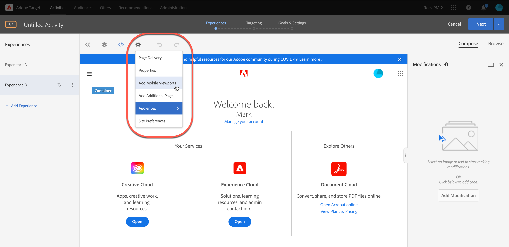
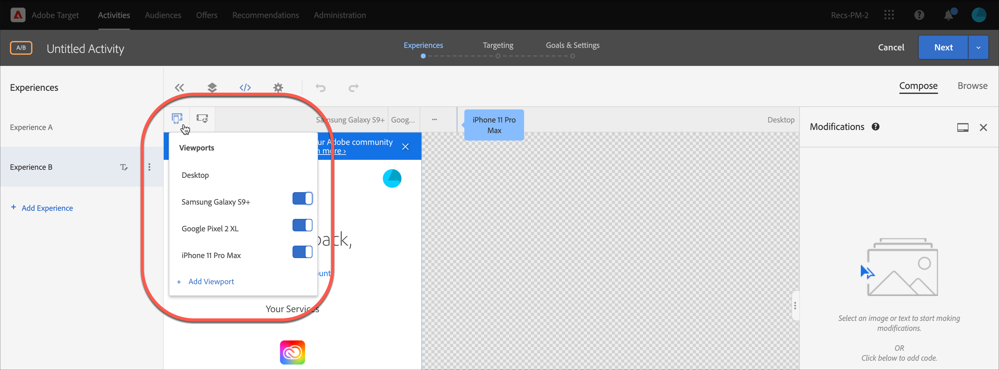

# Fenêtres d’affichage mobiles pour les expériences réactives {#mobile-viewports}

>[!BEGINSHADEBOX]

**Sur cette page :** Découvrez comment configurer les fenêtres d’affichage mobiles et les utiliser pour prévisualiser et créer des expériences pour des écrans de différentes tailles.

>[!ENDSHADEBOX]

Les fenêtres d’affichage mobiles affichent [!DNL Adobe Target] activités aux tailles d’écran de divers appareils. Ils sont conçus pour les sites réactifs, qui s’adaptent automatiquement aux ordinateurs de bureau, aux ordinateurs portables, aux tablettes et aux téléphones mobiles. Ils permettent de vérifier qu’une expérience s’affiche correctement sur chacun d’eux.

>[!NOTE]
>
> * Utilisez les fenêtres d’affichage mobiles lorsque le site est réactif et que la page mobile réutilise les éléments de la page du bureau avec une disposition différente. Lorsque le site mobile est distinct et possède sa propre structure, comme `m.mysite.com`, utilisez plutôt une [activité multipage](/help/main/c-experiences/c-visual-experience-composer/multipage-activity.md#multipage-activity).
>
>* Les fenêtres d’affichage mobiles ne sont pas disponibles lorsqu’une superposition d’offres de redirection les chevauche.

## Fenêtres d’affichage et points de rupture CSS

Une fenêtre d’affichage est la zone de l’écran qu’une page web remplit : la taille de la fenêtre du navigateur, moins les barres de défilement et les barres d’outils. Les navigateurs la mesurent en pixels CSS. Par conséquent, sur de nombreux appareils, tels que ceux dotés d’écrans Retina, la fenêtre d’affichage est plus petite que la résolution de l’appareil annoncée. Utilisez toujours la taille de la fenêtre d’affichage dans [!DNL Target]. Le tableau suivant répertorie les deux valeurs pour les appareils les plus courants.

+++ Fenêtres d’affichage et résolutions des appareils populaires

>[!NOTE]
>
>Plusieurs sites web répertorient les tailles de fenêtres d’affichage pour les appareils populaires. Pour obtenir un exemple, reportez-vous à la section `https://viewportsizer.com/devices/`. Consultez le site web du fabricant de l’appareil pour obtenir les informations les plus précises et les plus récentes.
>
>Tailles de fenêtre d’affichage marquées « est ». sont des estimations.

| Appareil | Taille de la fenêtre d’affichage (largeur x hauteur) | Résolution de l’appareil (largeur x hauteur) |
|---|---|---|
| iPhone 18 Pro Max | 440 x 956 | 1 320 x 2 868 |
| iPhone 18 Pro | 402 x 874 | 1 206 x 2 622 |
| iPhone 17 Pro Max | 440 x 956 | 1 320 x 2 868 |
| iPhone 17 Pro | 402 x 874 | 1 206 x 2 622 |
| iPhone Air | 420 x 912 | 1 260 x 2 736 |
| iPhone 17 | 402 x 874 | 1 206 x 2 622 |
| iPhone 16e | 390 x 844 | 1170 x 2532 |
| iPad (A16) | 820 x 1180 | 1 640 x 2 360 |
| iPad mini (A17 Pro) | 744 x 1133 | 1 488 x 2 266 |
| iPad Air 11″ (M3/M4) | 820 x 1180 | 1 640 x 2 360 |
| iPad Pro 11″ (M5) | 834 x 1210 | 1 668 x 2 420 |
| Google Pixel 11 | 412 x 924 (est.) | 1080 x 2424 |
| Google Pixel 11 Pro | 410 x 914 (est.) | 1 280 x 2 856 |
| Google Pixel 11 Pro XL | 448 x 997 (est.) | 1 344 x 2 992 |
| Google Pixel 10 | 412 x 924 | 1080 x 2424 |
| Google Pixel 10 Pro | 410 x 914 (est.) | 1 280 x 2 856 |
| Google Pixel 10 Pro XL | 448 x 997 (est.) | 1 344 x 2 992 |
| Samsung Galaxy S26 | 360 x 780 | 1080 x 2340 |
| Samsung Galaxy S26 Ultra | 412 x 891 | 1440 x 3120 |
| iPhone Duo (déplié) | 890 x 626 (est.) | 2670 x 1878 |
| iPhone Duo (plié) | 466 x 678 (est.) | 1398 x 2034 |
| Samsung Galaxy Z Fold 7 (plié) | 412 x 960 (est.) | 1080 x 2520 |
| Samsung Galaxy Z Flip 8 | 360 x 840 (est.) | 1080 x 2520 |
| Google Pixel 11 Pro Fold (déplié) | 791 x 820 (est.) | 2076 x 2152 |

+++

Un site réactif passe à une disposition différente pour des tailles d’écran spécifiques. Ces tailles sont appelées points de rupture CSS ou [requêtes multimédias](https://developer.mozilla.org/fr/docs/Web/CSS/Media_Queries/Using_media_queries). L’enregistrement des points de rupture CSS du site dans [!DNL Target] permet de prévisualiser chaque vue, et cliquer sur une fenêtre d’affichage en haut de l’affichage ouvre l’affichage pour cette taille d’écran.

Pour diffuser une activité sur un appareil particulier, sélectionnez l’audience de cet appareil dans le diagramme d’activité, puis modifiez la page de cet appareil dans le compositeur web mobile. Le même outil est utilisé pour afficher un site qui n’est pas réactif lorsque l’activité cible un appareil spécifique. Pour exécuter une activité sur tous les appareils, n’appliquez aucun ciblage et prévisualisez l’activité à chaque taille d’écran avec les fenêtres d’affichage mobiles.

>[!IMPORTANT]
>
>Vous pouvez modifier des expériences depuis les fenêtres d’affichage mobiles, mais les modifications s’appliquent à toutes les fenêtres d’affichage et à tous les appareils, et pas seulement à la fenêtre d’affichage utilisée. De même, la modification d’une expérience dans l’affichage de bureau modifie la page pour toutes les tailles d’écran. [!DNL Target] ne prend actuellement pas en charge les modifications de page spécifiques à la fenêtre d’affichage.

## Configuration des fenêtres d’affichage mobiles {#task_B4B161499DC0470584ED922A4D20FCAB}

Définissez les fenêtres d’affichage mobiles disponibles lors de la création d’expériences.

1. Cliquez sur **[!UICONTROL Administration]** > **[!UICONTROL Compositeur d’expérience visuelle]**.
1. Dans la section **[!UICONTROL Configuration des fenêtres d’affichage mobiles]**, cliquez sur **[!UICONTROL Ajouter]**.

   

   Ou

   Pour modifier la configuration d’une fenêtre d’affichage mobile existante, sélectionnez la fenêtre d’affichage puis cliquez sur l’icône **[!UICONTROL Modifier]** (crayon).

1. Saisissez un nom explicite pour la fenêtre d’affichage mobile. Le nom ne peut excéder 36 caractères.
1. Saisissez la taille de l’écran de l’appareil mobile. La largeur peut être comprise entre 150 et 968 pixels et la hauteur peut être comprise entre 150 et 1 280 pixels.
1. (Facultatif) Sélectionnez le système d’exploitation de l’appareil.

   Options :

   * Android
   * iOS
   * Windows
   * Symbian
   * BlackBerry

   Si le [compositeur d’expérience amélioré](/help/main/c-experiences/c-visual-experience-composer/experience-composer-best-practices.md#enable-eec) est activé et qu’un système d’exploitation est sélectionné, [!DNL Target] émule cet appareil lors de l’affichage de la page. Par exemple, si le site réactif a une apparence différente pour Android et pour iOS, [!DNL Target] reproduit ce comportement.

1. Cliquez sur **[!UICONTROL Enregistrer]**.

>[!NOTE]
>
>La tentative de suppression d’une fenêtre d’affichage mobile en cours d’utilisation affiche le message suivant : « Cette fenêtre d’affichage est actuellement associée à une ou plusieurs activités. Vous devez retirer la fenêtre d’affichage de ces activités avant de pouvoir la supprimer. »

## Créer une expérience réactive {#task_D6332438B5EE48CCA8AF199270F1CAEF}

Ajoutez des fenêtres d’affichage mobiles aux activités [!DNL Target] pour créer des expériences réactives pour les écrans mobiles.

1. Créez l’[activité souhaitée](/help/main/c-activities/activities.md).
1. Dans le **[!UICONTROL compositeur d’expérience visuelle]** (VEC), cliquez sur l’icône d’engrenage **[!UICONTROL Paramètres]**, puis sélectionnez **[!UICONTROL Ajouter des fenêtres d’affichage mobiles]**.

   

1. Cliquez sur l’icône **[!UICONTROL Appareils]**, puis activez chaque appareil qui doit disposer d’une fenêtre d’affichage mobile.

   

   Les fenêtres d’affichage mobiles sont répertoriées de la plus petite à la plus grande selon la largeur.

1. Modifiez l’expérience dans les fenêtres d’affichage mobiles selon les besoins. Toute modification s’applique à l’expérience sur tous les appareils, par exemple une modification du texte d’un en-tête. Pointez sur le nom d’une fenêtre d’affichage pour afficher la taille de la fenêtre d’affichage.

   

1. (Facultatif) Basculez entre les modes portrait et paysage en cliquant sur l’icône d’orientation.

   

## Vidéos de formation

Les vidéos suivantes contiennent des informations supplémentaires sur les fenêtres d’affichage mobiles.

### Compositeur d’expérience visuelle (2 de 2) (7:29) 

La vidéo de démonstration suivante contient des informations sur l’utilisation du compositeur d’expérience visuelle pour utiliser les fenêtres d’affichage mobiles :

* Attribution d’un nouveau nom à une expérience et duplication d’une expérience
* Création d’une expérience de redirection
* Ciblage d’une activité sur une URL unique ou un groupe d’URL
* Création d’une activité multipage
* Prévisualisation et création d’expérience pour des sites web réactifs
* Utilisation de superposition pour mettre en avant des types d’éléments

>[!VIDEO](https://video.tv.adobe.com/v/30142?captions=fre_fr)

### Préférences du compte dans Adobe Target 

Cette vidéo contient des informations sur la configuration des fenêtres d’affichage mobiles, à partir de la minute 4:40.

>[!VIDEO](https://video.tv.adobe.com/v/3507627?captions=fre_fr)
