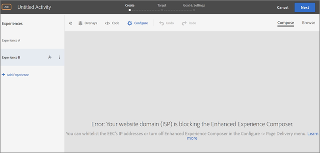

# Résolution des problèmes liés au [!UICONTROL compositeur d’expérience amélioré] {#eec-issues}

>[!BEGINSHADEBOX]

**Sur cette page :** Découvrez comment résoudre les problèmes qui affectent uniquement le **[!UICONTROL compositeur d’expérience amélioré]** (EEC), tels que les pages qui ne se chargent pas car les adresses IP du proxy EEC sont bloquées.

>[!ENDSHADEBOX]

Des problèmes d’affichage se produisent parfois dans le [!DNL Adobe Target] **[!UICONTROL Enhanced Experience Composer]** (EEC) sous certaines conditions. Les points suivants décrivent les problèmes qui affectent uniquement l&#39;EEC et comment les résoudre.

## les adresses IP du proxy CEE {#eec-ip-addresses}

L’EEC ne charge pas d’URL d’assurance qualité interne qui ne soit pas accessible sur une adresse IP publique. La Liste autorisée des adresses IP du serveur [!DNL Adobe] utilisé pour le proxy EEC résout ce problème. Ces adresses IP ne sont requises que pour la modification d’activités et les visiteurs et visiteuses du site n’en ont pas besoin. Demandez à l&#39;équipe informatique de placer sur la liste autorisée les adresses IP suivantes.

### États-Unis (va7)

```
40.70.154.136/29
52.254.106.240/28
52.254.106.160/28
52.254.107.16/28
20.186.185.181
20.22.83.112
20.186.185.227
52.254.106.192/28
52.254.106.0/28
52.254.107.128/28
52.254.107.80/28
52.254.106.176/28
52.254.107.32/28
52.254.105.192/28
52.254.107.64/28
52.254.106.208/28
52.254.107.0/28
52.254.106.224/28
20.14.241.153
20.186.185.239
4.152.211.251
52.254.107.144/28
52.254.106.144/28
```

### EMEA (nld2)

```
51.138.17.16/28
51.138.17.48/28
51.138.16.128/28
51.138.17.32/28
51.138.16.240/28
51.138.17.112/28
51.138.16.160/28
51.138.16.208/28
51.138.17.80/28
51.138.17.0/28
51.138.17.96/28
51.138.16.144/28
20.31.145.248
20.126.189.248
51.138.16.224/28
51.138.16.192/28
51.138.12.94
51.138.12.11
51.138.16.176/28
51.138.12.100
51.138.17.64/28
51.138.12.160/28
```

### APAC (aus)

```
20.43.104.160/28
20.227.35.177
20.40.188.227
20.43.104.112/28
20.43.104.128/28
20.43.104.144/28
20.40.188.166
20.53.206.128
20.43.104.80/28
20.43.104.16/28
20.43.105.48/28
20.43.104.96/28
20.43.104.48/28
20.40.188.194
20.43.104.32/28
20.40.191.224/28
20.43.105.16/28
20.40.191.96/28
20.43.104.176/28
20.40.191.240/28
20.43.104.64/28
20.43.105.32/28
20.43.104.192/28
20.43.105.0/28
20.43.104.0/28
```

### Adresses IP héritées

Les adresses IP héritées suivantes doivent continuer à être conservées jusqu&#39;à nouvel ordre.

```
34.254.77.200
54.73.207.147
54.229.152.123
3.224.194.242
54.90.51.39
34.228.136.112
54.150.116.11
18.178.142.8
54.199.107.77
99.80.139.221
54.78.56.224
54.247.179.246
54.80.219.243
34.201.235.54
54.196.224.236
35.75.212.45
52.199.184.130
18.180.161.176
```

+++ Le compositeur d’expérience visuelle affiche un message d’erreur indiquant que le domaine du site web le bloque

Le message d&#39;erreur suivant peut s&#39;afficher dans [!DNL Target] :

`Error: Your website domain (ISP) is blocking the Enhanced Experience Composer. You can allowlist the Enhanced Experience Composer's IP addresses or turn off Enhanced Experience Composer in Configure > Page Delivery menu.`



Ce message d’erreur peut avoir deux causes :

* Le domaine du site web (FAI) bloque l’EEC. Pour résoudre le problème, placez sur la liste autorisée les adresses IP répertoriées dans [et Placez sur la liste autorisée les adresses IP du proxy EEC](#eec-ip-addresses).
* Les adresses IP sont placées sur la liste autorisée, mais le site web ne prend pas en charge TLS 1.2. Pour résoudre ce problème, reportez-vous à l’élément suivant.

+++

+++ L’EEC ne se charge pas sur les pages sécurisées d’un site qui utilise TLS 1.0

Le message d’erreur décrit à l’élément précédent peut s’afficher lorsque les adresses IP sont placées sur la liste autorisée, mais que le site web ne prend pas en charge TLS 1.2. [!DNL Target] utilise actuellement la version 1.2 comme configuration par défaut. Avant [!DNL Target] 18.4.1 (25 avril 2018), la configuration par défaut prenait en charge TLS 1.0. Pour plus d’informations, voir [Modifications du chiffrement TLS (Transport Layer Security)](https://experienceleague.adobe.com/docs/target-dev/developer/implementation/tls-transport-layer-security-encryption.html?lang=fr){target=_blank}.

Pour vérifier la version TLS d’un site web dans Firefox (d’autres navigateurs appliquent des étapes similaires) :

1. Ouvrez le site web concerné dans Firefox.
1. Cliquez sur l&#39;icône **[!UICONTROL Afficher les informations du site]** dans la barre d&#39;adresse du navigateur.

   

1. Cliquez sur **[!UICONTROL Afficher les détails de la connexion]** > **[!UICONTROL Plus d’informations]**.

   

1. Consultez les informations de version du TLS sous **[!UICONTROL Détails techniques]**.

   

1. Si le site web affiche TLS 1.0, consultez [Modifications du chiffrement TLS (Transport Layer Security)](https://experienceleague.adobe.com/docs/target-dev/developer/implementation/tls-transport-layer-security-encryption.html?lang=fr){target=_blank} pour plus d’informations sur la politique de prise en charge du protocole TLS de [!DNL Target]. Pour remédier à la situation pour l’instant (valable jusqu’au 12 septembre 2018), contactez l’[Assistance clientèle](/help/main/cmp-resources-and-contact-information.md#reference_ACA3391A00EF467B87930A450050077C) pour la configuration avec la version TLS et le domaine.

+++

+++ Les dépassements de délai ou les erreurs « accès refusé » s’affichent lorsque les sites sont chargés avec le proxy activé

Assurez-vous que les adresses IP du proxy ne sont pas bloquées dans l’environnement. Les adresses sont répertoriées dans [les adresses IP du proxy EEC](#eec-ip-addresses).

+++
