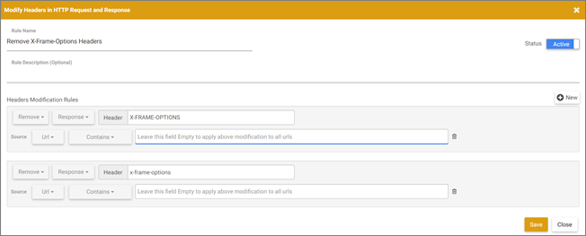

# Résolution des problèmes liés au [!UICONTROL compositeur d’expérience visuelle] {#vec-issues}

>[!BEGINSHADEBOX]

**Sur cette page :** Découvrez comment résoudre les problèmes qui affectent uniquement le **[!UICONTROL compositeur d’expérience visuelle]** (VEC).

>[!ENDSHADEBOX]

Des problèmes d’affichage se produisent parfois dans le [!DNL Adobe Target] **[!UICONTROL compositeur d’expérience visuelle]** (VEC) sous certaines conditions. Les éléments suivants décrivent les problèmes qui affectent uniquement le compositeur d’expérience visuelle et comment les résoudre.

+++ Les bibliothèques [!DNL Target] ne se chargent pas lorsque le site web est ouvert dans le VEC

Lorsqu’un site web est ouvert dans le **[!UICONTROL compositeur d’expérience visuelle]**, [!DNL Target] ajoute les paramètres `mboxEdit=1` et `mboxDisable=1` à l’URL.

Un site web qui tronque ou supprime ces paramètres lors de la navigation d’une page à une autre sans rechargement de page, en particulier une application monopage, rompt la fonctionnalité [!DNL Target] et les bibliothèques [!DNL Target] ne se chargent pas. Pour éviter ce problème, conservez les deux paramètres dans l’URL.

+++

+++ Une page ne s’ouvre pas dans le compositeur d’expérience visuelle ou se charge lentement, ou encore les activités et expériences se chargent lentement dans le compositeur d’expérience visuelle

Plusieurs problèmes peuvent affecter les performances des pages dans les compositeurs d’expérience [!DNL Target]. Les plus fréquents sont les suivants :

* La page ne comporte pas de mbox.
* Le site utilise le blocage de proxy, ce qui empêche l’ouverture de la page dans l’un ou l’autre des compositeurs d’expérience.
* Le site ne se permet pas d’être ouvert dans un iFrame.

Lorsqu’un problème se produit dans le **[!UICONTROL compositeur d’expérience amélioré]**, désactivez-le et utilisez le **[!UICONTROL compositeur d’expérience visuelle]** à la place. Pour ce faire, accédez à **[!UICONTROL Administration]** > **[!UICONTROL Compositeur d’expérience visuelle]** et désactivez l’option **[!UICONTROL Activer le compositeur d’expérience amélioré]**.

Le message d’erreur suivant peut s’afficher dans la console :

Lorsqu’aucun compositeur ne fonctionne, une extension de navigateur qui remplace l’en-tête X-Frame-Options du site, tel que [!DNL Requestly] ([!DNL Chrome] ou [!DNL Firefox]) ou Modifier les en-têtes de réponse ([!DNL Firefox]), permet au site de se charger dans les iFrames et active donc le compositeur d’expérience visuelle. Lorsque les extensions de navigateur ne peuvent pas être utilisées, utilisez le [compositeur d’expérience d’après les formulaires](/help/main/c-experiences/form-experience-composer.md). L’extension [[!DNL Adobe Target] **[!UICONTROL Visual Editing Helper ]**](/help/main/c-experiences/c-visual-experience-composer/r-troubleshoot-composer/visual-editing-helper-extension.md) pour [!DNL Google Chrome] peut également être utilisée, en plus des procédures qui suivent.

>[!NOTE]
>
>Ces extensions sont destinées uniquement à la modification du compositeur d’expérience visuelle (VEC).
>
>Avec [!DNL Requestly], lorsque des en-têtes doivent être supprimés, effectuez l’une des opérations suivantes :
>
>* Ajoutez des règles d’URL pour que l’URL s’ouvre dans le VEC, de sorte que les en-têtes soient supprimés pour ces URL uniquement.
>* Activez la règle lors de la modification dans le VEC et désactivez-la lorsque le VEC n’est pas en cours d’utilisation.
>
>Avec **[!UICONTROL Modifier les en-têtes de réponse]** ([!DNL Firefox]), les règles d’URL ne sont pas disponibles. Par conséquent, la règle doit être activée lors de la modification dans le VEC et désactivée lorsque le VEC n’est pas en cours d’utilisation.

Une fois une extension configurée, les pages se chargent dans le **[!UICONTROL compositeur d’expérience visuelle]** même lorsque le **[!UICONTROL compositeur d’expérience amélioré]** est désactivé.

+++

+++ Supprimez l’en-tête X-Frame-Options avec Requestly (Chrome ou Firefox)

1. Désactivez le **[!UICONTROL compositeur d’expérience amélioré]**.
1. Installez l’extension de navigateur [!DNL Requestly] sur [!DNL Chrome] ou [!DNL Firefox].
1. Ouvrez l’extension et sélectionnez **[!UICONTROL Modifier les en-têtes]**.
1. Saisissez un nom de règle.
1. Dans les règles de modification, créez une règle qui supprime l’en-tête :

   * Basculez de **[!UICONTROL Add]** vers **[!UICONTROL Remove]**.
   * Basculez de **[!UICONTROL Request]** vers **[!UICONTROL Response]**.
   * Saisissez X-Frame-Options en tant que nom d’en-tête.

1. Répétez l’étape précédente et saisissez « x-frame-options » comme nom de l’en-tête.

   >[!NOTE]
   >
   >Les en-têtes manipulés avec [!DNL Requestly] respectent la casse.

1. Remplacez **[!UICONTROL Est égal à]** par **[!UICONTROL Contient]** comme condition pour l’URL source et saisissez l’URL de l’activité à charger dans le VEC.

   

1. Cliquez sur **[!UICONTROL Enregistrer]**.

   

La page doit maintenant se charger rapidement dans le **[!UICONTROL compositeur d’expérience visuelle]**.

+++

+++ Supprimez l’en-tête X-Frame-Options avec Modifier les en-têtes de réponse (Firefox)

1. Installez l’extension [!DNL Modify Response Headers] sur [!DNL Firefox] et redémarrez le navigateur.
1. Dans les extensions [!DNL Firefox], sélectionnez l’extension [!DNL Modify Response Headers].
1. Cliquez sur **[!UICONTROL Preferences]**.
1. Sélectionnez **[!UICONTROL Filtrer]** dans la liste déroulante **[!UICONTROL Action]**.
1. Dans le champ **[!UICONTROL Nom de l&#39;en-tête]**, saisissez **[!UICONTROL X-Frame-Options]**.
1. Répétez les deux étapes précédentes pour ajouter un filtre avec **[!UICONTROL x-frame-options]**.
1. Cliquez sur **[!UICONTROL Ajouter]**.
1. Cliquez sur **[!UICONTROL Start]**.

+++

+++ Une page ne s’affiche pas dans le compositeur d’expérience visuelle

Vérifiez les causes suivantes :

* **Version de l’extension :** la dernière version de l’[[!DNL Adobe Experience Cloud] **[!UICONTROL extension Visual Editing Helper ]**](/help/main/c-experiences/c-visual-experience-composer/r-troubleshoot-composer/visual-editing-helper-extension.md) offre la meilleure compatibilité avec le VEC. Pour vérifier la version installée, accédez à**[!UICONTROL  Extensions ]**>**[!UICONTROL  Gérer les extensions ]**, puis cliquez sur**[!UICONTROL  Détails ]**.
* **Création de bibliothèques :** le compositeur d’expérience visuelle a besoin de bibliothèques de création pour modifier la page web. Ils sont incorporés dans la bibliothèque at.js, que l’extension télécharge à partir des serveurs [!DNL Adobe] chaque fois que le VEC est utilisé, qu’at.js ou le [!DNL Adobe Experience Platform Web SDK] soit déjà sur la page ou non. Vérifiez que les en-têtes at.js configurés dans **[!UICONTROL Administration]** > **[!UICONTROL Implémentation]** ne contiennent aucune modification non valide.
* **Requêtes bloquées :** la page ne doit pas bloquer les requêtes obligatoires pour le chargement lorsqu’elle est incorporée dans un iFrame. Ce blocage inclut `frame-ancestors` directives CSP, le code JavaScript personnalisé dans le site web, les balises meta HTML et l’en-tête `x-frame-options`.
* **Noms de fichiers réservés :** le JavaScript de la page ne doit pas interférer avec les bibliothèques de création. N’utilisez pas et n’incluez pas de fichiers portant les noms réservés suivants :

  * `target-vec-helper.js`
  * `target-vec.js`
  * `target.js`
  * `admin.css`
  * `sizzle.js`
  * `mixContentCheck.html`

  Le remplacement accidentel de variables ou d’événements définis dans ces fichiers peut également entraîner des problèmes avec le compositeur d’expérience visuelle.

* **Page non sécurisée sur un site sécurisé :** le navigateur bloque la page. Cliquez sur l&#39;icône à gauche de l&#39;URL dans la barre d&#39;adresse, puis sur **[!UICONTROL Désactiver la protection sur cette page]**.
* **URL non valide :** l&#39;URL saisie n&#39;est pas valide.
* **Cookies :** si le site web ne charge pas dans le VEC ou se comporte de manière inattendue, l’acceptation de ses cookies dans le navigateur avant de charger le site web dans [!DNL Target] peut résoudre le problème.

+++

+++ Le compositeur d’expérience visuelle semble endommagé en mode de navigation

En mode **[!UICONTROL Parcourir]**, le compositeur d’expérience visuelle semble endommagé à l’ouverture d’une URL qui ne contient pas les bibliothèques [!DNL Target] ([at.js](https://experienceleague.adobe.com/docs/target-dev/developer/client-side/at-js-implementation/overview.html?lang=fr){target=_blank} ou [Adobe Experience Platform Web SDK](https://experienceleague.corp.adobe.com/docs/target-dev/developer/client-side/aep-web-sdk.html?lang=fr){target=_blank}) ou qui contient un en-tête de frame-buster. Pour des raisons de sécurité du navigateur, [!DNL Target] ne peut pas accéder correctement à l’URL à laquelle vous avez accédé ou l’URL du compositeur d’expérience visuelle n’est pas mise à jour de manière cohérente au chargement de la page.

Le compositeur d’expérience visuelle charge la page web dans un `<iframe>` et les mécanismes de sécurité actuels des navigateurs empêchent l’interface utilisateur [!DNL Target] d’accéder aux éléments du cadre sous la politique de même origine. Les navigateurs bloquent les scripts qui tentent d&#39;accéder à une trame ayant une origine différente, y compris les informations telles que `location.href`.

Utilisez la nouvelle extension [Visual Editing Helper](/help/main/c-experiences/c-visual-experience-composer/r-troubleshoot-composer/visual-editing-helper-extension.md) pour injecter la bibliothèque [!DNL Target] dans les pages, afin que les pages puissent être parcourues de manière optimale.

+++

+++ Les problèmes sont causés par des conflits CSS dans le compositeur d’expérience visuelle

Vérifiez si des fichiers CSS affectent la visibilité lors du chargement de la page dans l’éditeur. Par exemple, la propriété `overflow: hidden` dans le corps de la page peut entraîner des problèmes de défilement ou déclencher des événements de clic qui interfèrent avec le menu de création.

+++
