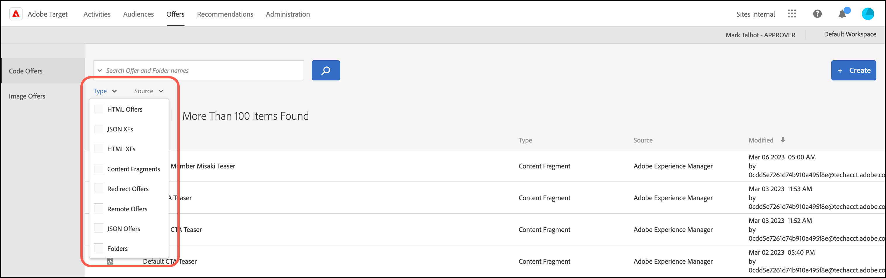
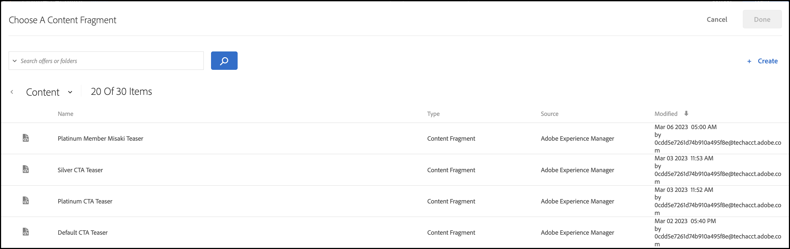

# [!UICONTROL Fragments De Contenu] D’AEM

Utilisez les [!UICONTROL fragments de contenu] (CF) créés dans [!DNL Adobe Experience Manager] (AEM) dans les activités [!DNL Target] pour faciliter la personnalisation et l’expérimentation découplées.

## Considérations

Tenez compte des points suivants lorsque vous utilisez les [!UICONTROL fragments de contenu] d’AEM dans [!DNL Target] :

* Cette fonctionnalité est réservée aux clientes et clients [!DNL Adobe Experience Manager as a Cloud Service]. Pour plus d’informations, voir [Conditions préalables](#section_AE6F0971E1574B3AA324003599B96E5A) ci-dessous.
* [!UICONTROL Les fragments d’expérience] et [!UICONTROL les fragments de contenu] sont disponibles pour les types d’activité suivants :

  * [[!UICONTROL Test A/B]](/help/main/c-activities/t-test-ab/test-ab.md)
  * [[!UICONTROL Affectation automatique]](/help/main/c-activities/automated-traffic-allocation/automated-traffic-allocation.md)
  * [[!UICONTROL ciblage automatique]](/help/main/c-activities/auto-target/auto-target-to-optimize.md)
  * [[!UICONTROL Automated Personalization] (AP)](/help/main/c-activities/t-automated-personalization/automated-personalization.md)
  * [[!UICONTROL Ciblage d’expérience] (XT)](/help/main/c-activities/t-experience-target/experience-target.md)

* Les [!UICONTROL fragments d’expérience] et les [!UICONTROL fragments de contenu] ne sont pas disponibles pour les types d’activité suivants :

  * [[!UICONTROL Test multivarié] (MVT)](/help/main/c-activities/c-multivariate-testing/multivariate-testing.md)
  * [[!UICONTROL Recommandations]](/help/main/c-recommendations/recommendations.md)

* Vous pouvez utiliser [!UICONTROL les fragments de contenu] dans les activités [!DNL Target] à l’aide du [compositeur d’expérience d’après les formulaires](/help/main/c-experiences/form-experience-composer.md) uniquement. Vous *ne pouvez pas* utiliser [!UICONTROL les fragments de contenu] dans les activités [!DNL Target] à l’aide du [!UICONTROL compositeur d’expérience visuelle] (VEC).

Pour en savoir plus sur les [!UICONTROL fragments de contenu] et les [!UICONTROL fragments d’expérience] d’AEM, consultez la [présentation des [!UICONTROL fragments d’expérience] et [!UICONTROL fragments de contenu] d’AEM](/help/main/c-integrating-target-with-mac/aem/aem-experience-and-content-fragments.md).

## Conditions {#requirements}

Vous devez utiliser [[!DNL AEM] as a Cloud Service](https://experienceleague.adobe.com/docs/experience-manager-cloud-service.html?lang=fr){target=_blank}. Votre gestionnaire de compte peut vous aider à vous assurer que vous répondez aux exigences requises pour utiliser cette fonction :

Contactez l’[Assistance clientèle d’Adobe Target](/help/main/cmp-resources-and-contact-information.md#reference_ACA3391A00EF467B87930A450050077C) pour qu’elle autorise l’intégration et vous fournisse les détails d’authentification.

## Configuration et utilisation de [!UICONTROL fragments de contenu] dans [!DNL AEM] {#section_745C8EFE29F547A2958FDBF61A5ADF7B}

Pour exporter les [!UICONTROL fragments de contenu] et les utiliser dans les activités [!DNL Target], vous devez effectuer quelques étapes préliminaires dans AEM. Pour plus d’informations, consultez [Exportation de fragments de contenu vers Adobe Target](https://experienceleague.adobe.com/docs/experience-manager-cloud-service/content/sites/integrations/content-fragments-target.html?lang=fr){target=_blank} dans la *documentation d’Experience Manager as a Cloud Service*.

Pour plus d’informations sur la conception, la création, l’organisation et la publication de [!UICONTROL fragments de contenu], voir [[!UICONTROL fragments de contenu]](https://experienceleague.adobe.com/docs/experience-manager-cloud-service/content/sites/authoring/fundamentals/content-fragments.html?lang=fr){target=_blank} et [utilisation de fragments de contenu](https://experienceleague.adobe.com/docs/experience-manager-cloud-service/content/sites/administering/content-fragments/content-fragments.html?lang=fr){target=_blank} dans la [documentation d’Experience Manager as a Cloud Service](https://experienceleague.adobe.com/docs/experience-manager-cloud-service/content/home.html?lang=fr){target=_blank}.

## Utilisation de [!UICONTROL fragments de contenu] dans les activités [!DNL Target] {#section_17CE4BE6B2B74CCEBAE0C68DEB84ABB9}

Après avoir effectué les tâches précédentes, le [!UICONTROL fragment de contenu] s’affiche sur la page [!UICONTROL Offres] de [!DNL Target].

[!DNL Target] recherche actuellement [!UICONTROL fragments de contenu] à importer toutes les dix minutes. Le [!UICONTROL fragment de contenu] importé doit être disponible dans [!DNL Target] dans les dix minutes qui suivent, mais cette période devrait être réduite à l’avenir.

Le [!UICONTROL fragment de contenu] est importé dans [!DNL Target] en tant qu’offre JSON. La version « principale » du fragment de contenu [!UICONTROL 1} reste dans [!DNL AEM]. ]Vous ne pouvez pas modifier le [!UICONTROL fragment de contenu] dans [!DNL Target].

Vous pouvez filtrer et rechercher par [!UICONTROL fragments d’expérience HTML], [!UICONTROL fragments d’expérience JSON] et [!UICONTROL fragments de contenu] pour vous aider à distinguer les différents types d’offres exportés vers [!DNL Target].

Vous pouvez pointer sur un [!UICONTROL fragment d’expérience] dans la liste, puis cliquer sur l’icône [!UICONTROL Afficher]  pour afficher des informations supplémentaires sur le [!UICONTROL fragment de contenu], y compris son [!UICONTROL Nom], son [!UICONTROL Type], son [!UICONTROL Identifiant de l’offre], son [!UICONTROL Chemin de l’offre] et des informations sur les dernières modifications. Cliquez sur [!UICONTROL [!UICONTROL Afficher tous les détails]] pour afficher les activités qui font référence à cette offre.

Vous pouvez utiliser [!UICONTROL les fragments de contenu] dans les activités [!DNL Target] à l’aide du [compositeur d’expérience d’après les formulaires](/help/main/c-experiences/form-experience-composer.md) uniquement. Vous *ne pouvez pas* utiliser [!UICONTROL les fragments de contenu] dans les activités [!DNL Target] à l’aide du [compositeur d’expérience visuelle](/help/main/c-experiences/c-visual-experience-composer/visual-experience-composer.md) (VEC). [!UICONTROL Les fragments de contenu] sont exportés au format JSON dans [!DNL Target] et ne peuvent pas être utilisés dans les activités créées à l’aide du compositeur d’expérience visuelle.

>[!TIP]
>
>Utilisez l’intelligence artificielle, le machine learning et les recommandations avec les [!UICONTROL fragments de contenu] :
>
>* Pour utiliser pleinement la fonctionnalité d’IA et de ML de [!DNL Target], vous pouvez sélectionner [Affectation automatique](/help/main/c-activities/automated-traffic-allocation/automated-traffic-allocation.md#auto-allocate-overview) ou [Ciblage automatique](/help/main/c-activities/auto-target/auto-target-to-optimize.md) lors de la création d’une activité [!UICONTROL Test A/B].
>
>* [!UICONTROL Les fragments de contenu] ne sont pas pris en charge dans les activités [!DNL Recommendations]. Toutefois, pour utiliser les [!UICONTROL fragments de contenu] pour les recommandations, vous pouvez créer une activité de [!UICONTROL test A/B] (incluant l’[!UICONTROL affectation automatique] et le [!UICONTROL ciblage automatique]) ou une activité de [!UICONTROL ciblage d’expérience] (XT) et [inclure des recommandations en tant qu’offre](/help/main/c-recommendations/recommendations-as-an-offer.md).

**Utiliser [!UICONTROL fragments de contenu] à l’aide du [!UICONTROL compositeur d’expérience d’après les formulaires] :**

1. Dans [!DNL Target], lors de la création ou de la modification d’une expérience dans le [Compositeur d’expérience d’après les formulaires](/help/main/c-experiences/form-experience-composer.md#task_FAC842A6535045B68B4C1AD3E657E56E), sélectionnez l’emplacement sur la page où vous souhaitez insérer du contenu [!DNL AEM], puis sélectionnez **[!UICONTROL Modifier le fragment de contenu]** pour afficher la liste [!UICONTROL Choisir un fragment de contenu].

   

   La liste [!UICONTROL Fragment de contenu] affiche le contenu créé dans [!DNL AEM] qui est désormais disponible en mode natif dans [!DNL Target].

1. Sélectionnez le [!UICONTROL fragment de contenu] souhaité, puis cliquez sur **[!UICONTROL Enregistrer]**.
1. Terminez la configuration de l’activité.

## Informations supplémentaires

* [!DNL Target] recherche actuellement [!UICONTROL fragments de contenu] à importer toutes les dix minutes. Le [!UICONTROL fragment de contenu] importé doit être disponible dans [!DNL Target] dans les dix minutes qui suivent, mais cette période devrait être réduite à l’avenir.
* Le [!UICONTROL fragment de contenu] est importé dans [!DNL Target] en tant qu’offre JSON. La version « principale » du fragment de contenu [!UICONTROL 1} reste dans [!DNL AEM]. ]Vous ne pouvez pas modifier le [!UICONTROL fragment de contenu] dans [!DNL Target].
* Vous ne pouvez pas créer de [!UICONTROL fragments de contenu] à l’aide de [!DNL Adobe I/O]. Créez [!UICONTROL des fragments de contenu] à l’aide d’AEM, comme expliqué ci-dessus.
* Si vous mettez à jour votre [!UICONTROL fragment de contenu] dans AEM, le [!UICONTROL fragment de contenu] doit être publié et exporté vers [!DNL Target] de nouveau, afin que [!DNL Target] puisse utiliser les dernières modifications.
