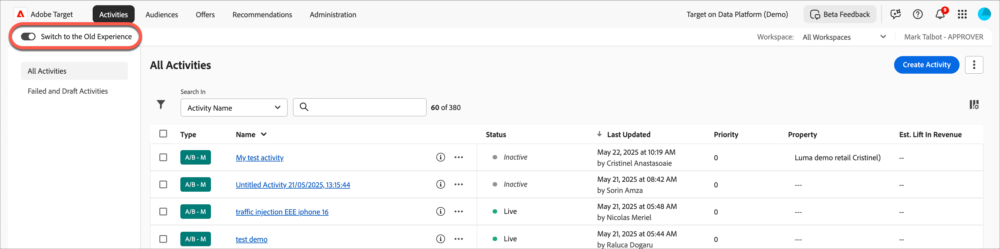
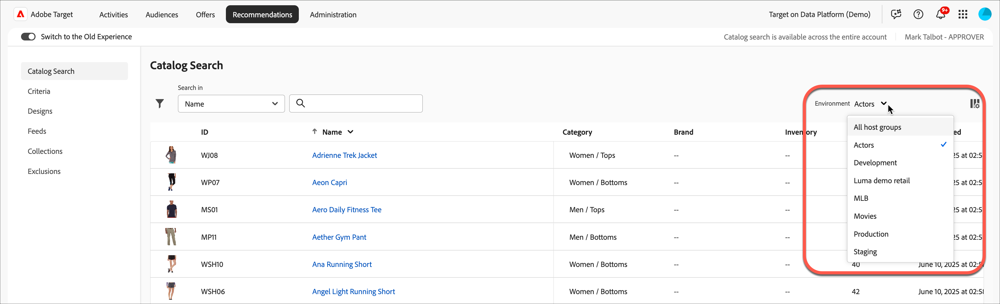

# FAQ sur la mise à jour de l’interface utilisateur [!DNL Target]

Nouveauté de 2025, l’interface utilisateur repensée [!DNL Adobe Target] offre une expérience plus épurée et plus intuitive pour tous les utilisateurs. Cette FAQ couvre les mises à jour clés de l’interface utilisateur [!DNL Target] et du [!UICONTROL compositeur d’expérience visuelle] (VEC), y compris les modifications de navigation, les emplacements de fonctionnalités et la suppression du bouton (bascule) temporaire de l’interface utilisateur. Que vous soyez spécialiste du marketing, développeur ou administrateur, il constitue votre guide pour une transition en douceur et des workflows plus intelligents.

## La chronologie de l’obsolescence du bouton (bascule) de la version de l’interface utilisateur Target a-t-elle été mise à jour ?

+++Afficher les détails
L’équipe [!DNL Target] propose une fonctionnalité temporaire qui vous permet de basculer entre l’interface utilisateur [!DNL Target] mise à jour et la version héritée à l’aide d’un bouton bascule. Cette option n’est disponible que pendant la phase finale du déploiement de l’interface utilisateur.

Une fois le déploiement terminé, le bouton (bascule) est supprimé et tous les utilisateurs passent définitivement à l’interface utilisateur mise à jour. [!DNL Adobe] vous recommande de planifier, car cette fonctionnalité sera bientôt supprimée.

### Chronologie de l’obsolescence

En raison de problèmes récents identifiés, principalement liés à des personnalisations client complexes, l’équipe [!DNL Target] a ajusté le calendrier d’obsolescence :

* **17 juin 2025** : toutes les organisations IMS ont été activées pour l’interface utilisateur [!DNL Target] mise à jour, soit pour des utilisateurs spécifiques, soit à l’échelle de l’organisation, afin de commencer à tester la nouvelle expérience.

* **30 juin 2025** : l’[interface utilisateur [!DNL Target] mise à jour](/help/main/c-intro/understand-the-target-ui.md) est devenue l’expérience par défaut pour toutes les organisations IMS qui ont activé le bouton (bascule) de version de l’interface utilisateur.

  * Les clients qui consultent actuellement l’interface utilisateur héritée, par défaut, voient désormais l’interface utilisateur mise à jour lors de la connexion.
  * Le bouton (bascule) de version de l’interface utilisateur reste disponible jusqu’à la fin juillet, ce qui permet aux utilisateurs et utilisatrices de revenir en arrière si nécessaire.

  >[!IMPORTANT]
  >
  > [!DNL Adobe] recommande vivement d’utiliser l’interface utilisateur [!DNL Target] mise à jour. Revenez à l’interface utilisateur héritée uniquement si un problème de blocage se produit, en raison des [limitations du comportement du bouton bascule](#limitations).

* **Du 15 au 30 juillet 2025** : le bouton (bascule) de version de l’interface utilisateur sera désactivé définitivement par phases. Les organisations IMS affectées ne peuvent plus revenir à l’interface utilisateur héritée.

  * Les exceptions sont examinées au cas par cas.
  * Les délais d’abandon du bouton (bascule) ne sont accordés que brièvement (quelques jours) pendant que les problèmes de blocage sont résolus.

Contactez l’[Assistance clientèle d’Adobe](/help/main/cmp-resources-and-contact-information.md#/help/main/cmp-resources-and-contact-information.md) pour toute question ou si vous prévoyez des problèmes au cours de cette transition.

### Limites du comportement du bouton (bascule) de l’interface utilisateur {#limitations}

Les informations suivantes décrivent les limites que vous devez connaître lorsque vous choisissez d’utiliser le bouton (bascule) de version :

* **Visibilité des nouvelles activités** : les activités créées dans l’interface utilisateur mise à jour ne seront pas visibles si vous revenez à l’interface utilisateur héritée.
* **Modification d’activités existantes** : les modifications apportées aux activités existantes (créées à l’origine dans l’interface utilisateur héritée) lors de l’utilisation de l’interface utilisateur mise à jour sont publiées sur votre site web. Toutefois, ces mises à jour ne sont pas visibles dans l’interface utilisateur héritée si vous revenez en arrière ; seules les dernières mises à jour effectuées à partir de l’interface utilisateur héritée y apparaissent.
* **Cohérence des détails de l’activité** : les modifications les plus récentes, quelle que soit l’interface utilisateur que vous utilisez, sont répercutées sur votre site web actif. Cependant, l’interface utilisateur héritée n’affiche que les dernières modifications apportées à partir de cette version. Cette situation peut prêter à confusion si les activités modifiées dans l’interface utilisateur mise à jour ont un aspect différent de celui de l’interface utilisateur héritée.

### Plus de ressources pour en savoir plus sur l’interface utilisateur mise à jour

* [[!DNL Target] FAQ sur la mise à jour de l’interface utilisateur](/help/main/c-intro/updated-ui-faq.md) : cette FAQ répond aux questions courantes sur la nouvelle interface utilisateur [!DNL Target] et le [!UICONTROL compositeur d’expérience visuelle] (VEC), y compris les modifications de navigation, l’emplacement des fonctionnalités et l’obsolescence du bouton (bascule) de la version temporaire de l’interface utilisateur. Que vous soyez spécialiste du marketing, développeur ou administrateur, cette FAQ vous aide à effectuer une transition en douceur et à tirer le meilleur parti de l’interface utilisateur mise à jour.
* [[!DNL Target Standard/Premium] 25.2.1 (17 février 2025) notes de mise à jour](/help/main/r-release-notes/release-notes-for-previous-releases.md#ui-update-2) : fournit un résumé des principales modifications de l’interface utilisateur dans [!DNL Target] pour [!UICONTROL les activités], [!UICONTROL les recommandations] et le [!UICONTROL compositeur d’expérience visuelle] (VEC).
* [[!DNL Target Standard/Premium] 25.1.1 (9 janvier 2025) notes de mise à jour](/help/main/r-release-notes/release-notes-for-previous-releases.md#ui-update-1) : fournit un résumé des principales modifications apportées à l’interface utilisateur dans [!DNL Target] pour la [!UICONTROL bibliothèque des offres].
* [Comprendre l [!DNL Target] interface utilisateur](/help/main/c-intro/understand-the-target-ui.md) : fournit un bref aperçu pour vous familiariser avec [!DNL Target] ainsi que des liens vers des informations plus détaillées et des instructions détaillées.
* [[!UICONTROL Modifications du compositeur d’expérience visuelle]](/help/main/c-experiences/c-visual-experience-composer/vec-changes.md) : la version [!DNL Adobe Target Standard/Premium] 25.2.1 (17 février 2015) introduit un [!UICONTROL compositeur d’expérience visuelle] (VEC) mis à jour. Cet article explique les différences entre les versions héritées et mises à jour du compositeur d’expérience visuelle.
* [[!UICONTROL Options du compositeur d’expérience visuelle]](/help/main/c-experiences/c-visual-experience-composer/viztarget-options.md) : cet article explique l’interface utilisateur du compositeur d’expérience visuelle mise à jour et ses options.

+++

## Où puis-je trouver plus d’informations sur l’interface utilisateur [!DNL Target] mise à jour ?

+++Détails
Les ressources suivantes fournissent des informations pour en savoir plus sur l’interface utilisateur [!DNL Target] mise à jour :

* [[!DNL Target Standard/Premium] 25.1.1 (9 janvier 2025) notes de mise à jour](/help/main/r-release-notes/release-notes-for-previous-releases.md#ui-update-1) : fournit un résumé des principales modifications apportées à l’interface utilisateur dans [!DNL Target] pour la [!UICONTROL bibliothèque des offres].

* [Comprendre l [!DNL Target] interface utilisateur](/help/main/c-intro/understand-the-target-ui.md) : fournit un bref aperçu pour vous familiariser avec [!DNL Target] ainsi que des liens vers des informations plus détaillées et des instructions détaillées.

* [[!UICONTROL Modifications du compositeur d’expérience visuelle]](/help/main/c-experiences/c-visual-experience-composer/vec-changes.md) : la version [!DNL Adobe Target Standard/Premium] 25.2.1 (17 février 2015) introduit un [!UICONTROL compositeur d’expérience visuelle] (VEC) mis à jour. Cet article explique les différences entre les versions héritées et mises à jour du compositeur d’expérience visuelle.

* [[!UICONTROL Options du compositeur d’expérience visuelle]](/help/main/c-experiences/c-visual-experience-composer/viztarget-options.md) : cet article explique l’interface utilisateur du compositeur d’expérience visuelle mise à jour et ses options.

+++

## L’interface utilisateur mise à jour est-elle disponible pour tous les clients [!DNL Target] actuels, [!UICONTROL Standard] et [!UICONTROL Premium] ?

+++Détails
L’interface utilisateur mise à jour est disponible pour tous les clients [!DNL Target], [!UICONTROL Standard] et [!UICONTROL Premium]. Aucune licence ou SKU mise à niveau n’est requise.

Pour plus d&#39;informations sur le déploiement et l&#39;obsolescence du bouton (bascule) de la version temporaire de l&#39;interface utilisateur, consultez [Mises à jour urgentes à connaître](/help/main/r-release-notes/release-notes.md#time-sensitive).

+++

## La liste actuelle des bugs sera-t-elle corrigée avant que l’ancienne interface utilisateur ne soit obsolète ?

+++Détails
L’équipe [!DNL Target] s’occupe activement des problèmes liés au nouveau déploiement de l’interface utilisateur. Les mises à jour et les améliorations continues sont présentées en détail dans les notes de mise à jour.

Pour plus d&#39;informations sur le déploiement et l&#39;obsolescence du bouton (bascule) de la version temporaire de l&#39;interface utilisateur, consultez [Mises à jour urgentes à connaître](/help/main/r-release-notes/release-notes.md#time-sensitive).

+++

## Les clients peuvent-ils demander que le bouton (bascule) de version de l’interface utilisateur soit conservé pour leurs comptes s’ils préfèrent conserver l’interface utilisateur héritée ?

+++Détails
Le bouton (bascule) de la version de l’interface utilisateur est une fonctionnalité temporaire qui vous permet de basculer entre l’interface utilisateur [!DNL Target] mise à jour et la version héritée à l’aide d’un bouton (bascule). Cette option n’est disponible que pendant la phase finale du déploiement de l’interface utilisateur. Une fois le déploiement terminé, le bouton (bascule) est supprimé et tous les utilisateurs passent définitivement à l’interface utilisateur mise à jour.

Le bouton (bascule) Utiliser la version de l’interface utilisateur présente plusieurs limites, notamment la visibilité des nouvelles activités, la modification des activités existantes et la cohérence des détails des activités.

Pour plus d&#39;informations, consultez [Mises à jour sensibles à l&#39;heure que vous devez connaître](/help/main/r-release-notes/release-notes.md#time-sensitive).

+++

## [!DNL Adobe] peut-il retarder notre migration vers l’interface utilisateur mise à jour jusqu’à ce que le déploiement complet soit terminé ?

+++Détails
[!DNL Target] n’offre pas la possibilité de retarder ou de personnaliser la durée des migrations de l’interface utilisateur. La transition des clients s’effectue par phases, et la planification du déploiement est gérée par [!DNL Adobe]. Pour connaître les dernières mises à jour, consultez les notes de mise à jour.

Le bouton (bascule) Utiliser la version de l’interface utilisateur présente plusieurs limites, notamment la visibilité des nouvelles activités, la modification des activités existantes et la cohérence des détails des activités.

Pour plus d&#39;informations, consultez [Mises à jour sensibles à l&#39;heure que vous devez connaître](/help/main/r-release-notes/release-notes.md#time-sensitive).

+++

## Comment le VEC mis à jour gère-t-il les options de réorganisation, de redimensionnement, de déplacement, de masquage et de suppression et en quoi ces options diffèrent-elles du VEC hérité ? {#options}

+++Détails
**[!UICONTROL Réorganiser*]* : dans le VEC hérité, l’option de réorganisation utilisait un recouvrement pour permettre aux utilisateurs de repositionner un élément dans son groupe frère. Le mouvement se limitait à modifier l’ordre entre les éléments frères.

Dans le compositeur d’expérience visuelle mis à jour, cette fonctionnalité est rationalisée grâce à des actions Avancer et Reculer. Ces commandes permettent d&#39;ajuster la position d&#39;un élément dans la mise en page, horizontalement et verticalement, en le déplaçant vers l&#39;avant ou vers l&#39;arrière dans l&#39;ordre d&#39;empilement.

**Resize** : la fonctionnalité [!UICONTROL Resize] se trouve dans le panneau [!UICONTROL Propriétés] sous la section [!UICONTROL Taille]. Les utilisateurs peuvent ajuster directement la largeur et la hauteur d’un élément. Les paramètres avancés sont les suivants :

* Commandes Largeur et Hauteur min./Max.
* Paramètres de comportement de débordement.
* Options d’ajustement d’objet pour les éléments multimédias

Ces outils permettent de contrôler précisément les dimensions des éléments et le comportement de la disposition.

**Déplacer** : l’option [!UICONTROL Déplacer] se trouve dans le panneau [!UICONTROL Propriétés] sous la section [!UICONTROL Position]. Cette option permet aux utilisateurs d’effectuer les opérations suivantes :

* Définissez la position de l’élément (par exemple, absolue, relative, fixe)
* Définir l’index z pour le calque
* Choisir un type de positionnement

Le rail [!UICONTROL Propriétés] mis à jour prend également en charge les styles intégrés personnalisés, ce qui offre une certaine flexibilité lorsque les options prédéfinies ne répondent pas aux besoins de mise en page.

**[!UICONTROL Masquer]** : la fonctionnalité [!UICONTROL Masquer] se trouve dans le panneau [!UICONTROL Propriétés]. Après avoir sélectionné un élément, cliquez sur [!UICONTROL Masquer l’élément] pour le supprimer de la vue sans le supprimer. Cela s’avère utile pour gérer la visibilité lors de la conception ou de la prévisualisation.

**[!UICONTROL Supprimer]** : la fonction [!UICONTROL Supprimer] est accessible via le panneau [!UICONTROL Propriétés]. Après avoir sélectionné un élément, cliquez sur Supprimer l’élément pour le supprimer de la page. Cette action supprime définitivement l’élément de la mise en page.

+++

## Puis-je réduire les rails [!UICONTROL Composants], [!UICONTROL Modifications] et [!UICONTROL Propriétés] afin de pouvoir agrandir le panneau [!UICONTROL Conception] ? {#collapse}

+++Détails

Oui, vous pouvez réduire ces rails pour vous permettre de développer la zone de travail [!UICONTROL Conception] afin de faciliter la modification. Procédez comme suit :

>[!NOTE]
>
>L’icône [!UICONTROL Afficher les composants] (  ) et l’icône [!UICONTROL Afficher les modifications] (  ) agissent comme des bascules pour afficher les options appropriées.

**Réduire le rail [!UICONTROL Composants]**

Pour réduire le rail [!UICONTROL Composants] et agrandir la zone de travail [!UICONTROL Conception], alors que le rail [!UICONTROL Composants] est ouvert, cliquez sur l’icône (  ).

**Réduire le rail [!UICONTROL Modifications]**

Pour réduire le rail [!UICONTROL Modifications] et agrandir la zone de travail [!UICONTROL Conception], alors que le rail [!UICONTROL Modifications] est ouvert, cliquez sur l’icône [!UICONTROL Afficher les modifications] (  ).

**Réduire le rail [!UICONTROL Propriétés]**

Pour réduire le rail [!UICONTROL Propriétés] et agrandir la zone de travail [!UICONTROL Conception], cliquez sur l’icône [!UICONTROL Afficher/masquer les propriétés] (  ) à droite du rail pour réduire ou afficher le rail [!UICONTROL Propriétés].

+++

## Les états [!UICONTROL Enregistrer en tant que brouillon] et [!UICONTROL Synchronisation] sont-ils toujours disponibles ?

+++Détails
Avec les dernières mises à jour de l’interface utilisateur, les états [!UICONTROL Enregistrer en tant que brouillon] et [!UICONTROL Synchronisation] ne sont plus disponibles. Pour plus d’informations, voir Statuts sous [Appliquer des filtres à la liste des activités](/help/main/c-activities/activities.md#filters) dans *[!UICONTROL Présentation des activités]*.

+++

## Comment puis-je savoir si une activité a été créée ou modifiée dans l’interface utilisateur héritée ou dans l’interface utilisateur mise à jour ?

+++Détails
Les activités créées ou modifiées dans l’interface utilisateur mise à jour suivent le même workflow guidé en trois étapes et peuvent inclure des métadonnées ou une mise en forme spécifiques à l’interface utilisateur qui ne sont pas présentes dans les activités créées héritées. Bien qu’il n’existe aucune balise ou libellé visible dans l’interface, des différences de disposition, de structure ou d’options disponibles (comme le ciblage amélioré ou les fonctions de prévisualisation) peuvent indiquer quelle interface utilisateur a été utilisée. Pour une identification détaillée, consultez l’historique des modifications de l’activité ou les journaux d’implémentation.

+++

## Quelles sont les différences entre la création d’offres dans l’interface utilisateur héritée et celle mise à jour ? Des attributs supplémentaires sont-ils requis ?

+++Détails
L’interface utilisateur de la [!UICONTROL bibliothèque des offres] nécessite des définitions d’attribut cohérentes pour toutes les offres. Lors de la création d’une offre d’activité uniquement (ad hoc), les utilisateurs doivent également spécifier un nom d’offre. Ces informations apparaissent dans le [!UICONTROL Compositeur d’expérience d’après les formulaires], ce qui facilite l’identification des offres sans vérifier le code ou le contenu.

+++

## Qu’est-il advenu des liens de prévisualisation des offres dans l’interface utilisateur mise à jour ?

+++Détails
Les liens d’aperçu du [!UICONTROL fragment d’expérience] sont disponibles dans la fenêtre contextuelle des [!UICONTROL informations rapides], qui s’affiche lorsque vous cliquez sur l’icône d’information ( ) correspondant au fragment sélectionné.

+++

## Je dois désactiver le [!UICONTROL compositeur d’expérience amélioré] lors de la modification des activités existantes avec l’interface utilisateur mise à jour. [!DNL Adobe] a-t-il observé un comportement similaire avec d’autres clients ?

+++Détails
Oui. Lors de l’utilisation du [!DNL Adobe Experience Cloud] [!DNL Visual Editing Helper extension], vous devrez peut-être désactiver le [!UICONTROL compositeur d’expérience amélioré] (EEC) .

Pour plus d’informations, consultez [Extension Assistant d’édition visuelle](/help/main/c-experiences/c-visual-experience-composer/r-troubleshoot-composer/visual-editing-helper-extension.md).

+++

## Pouvez-vous me donner les détails des nouvelles adresses IP pour la liste autorisée ?

+++Détails
Pour plus d’informations sur les adresses IP auxquelles vous pouvez placer sur la liste autorisée, consultez les articles suivants :

* **Enhanced Experience Composer (EEC)** : voir [L’EEC ne chargera pas d’URL d’assurance qualité interne non accessible sur l’adresse IP publique](/help/main/c-experiences/c-visual-experience-composer/r-troubleshoot-composer/troubleshooting-issues-related-to-the-enhanced-experience-composer-eec.md#eec-ip-addresses) dans *Résolution des problèmes liés au Compositeur d’expérience amélioré*
* **[!UICONTROL Recommandations]** : voir [Adresses IP utilisées par les serveurs de traitement de flux de Recommendations](/help/main/c-recommendations/c-recommendations-faq/ip-addresses-marketing-cloud.md).

+++

## L’environnement est-il réinitialisé à l’évaluation par défaut dans la nouvelle interface utilisateur de Recommendations ?

+++Détails
Les environnements utilisent désormais par défaut le dernier utilisé par le client. Pour changer d’environnement, utilisez le sélecteur [!UICONTROL Environnement] dans le coin supérieur droit de l’interface utilisateur de la [!UICONTROL Recherche catalogue].

+++

## À quel point est-il complexe de connecter [!DNL Adobe Analytics] ou [!DNL Customer Journey Analytics] à [!DNL Target] ?

+++Détails
L’intégration de [!DNL Adobe Analytics] (AA) ou [!DNL Customer Journey Analytics] (CJA) à [!DNL Target] peut nécessiter un effort modéré à avancé, selon votre configuration actuelle. Si vous utilisez [!DNL Adobe Experience Platform] et avez implémenté [!DNL Platform Web SDK], l’intégration est plus rationalisée. Toutefois, les implémentations héritées utilisant at.js ou AppMeasurement peuvent nécessiter une configuration supplémentaire, notamment :

* Activer l’intégration [Analytics for Target (A4T)](/help/main/c-integrating-target-with-mac/a4t/a4t.md)
* Intégrer les rapports [[!DNL Target] dans [!DNL Adobe Customer Journey Analytics]](/help/main/c-integrating-target-with-mac/cja/target-reporting-in-cja.md).
* Mapper des suites de rapports et des vues de données
* Assurer une résolution d’identité cohérente (ECID)
* Valider les paramètres de collecte de données et d’attribution

+++
