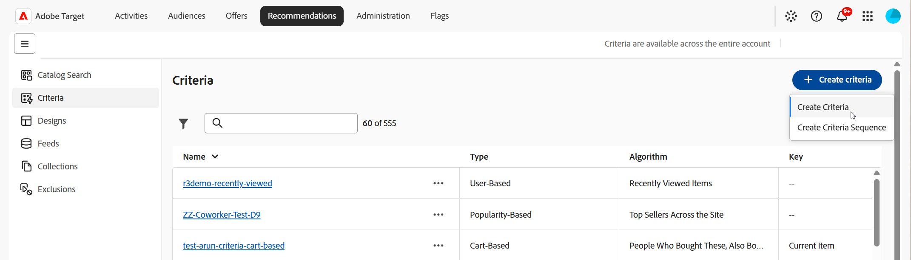
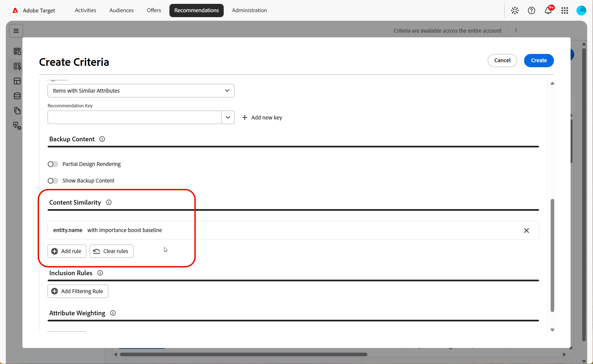

# Création de critères {#create-criteria}

>[!BEGINSHADEBOX]

**Sur cette page :** Découvrez comment créer des critères dans [!DNL Adobe Target Recommendations] et comment configurer chaque section d’un critère.

>[!ENDSHADEBOX]

Les critères de [!DNL Adobe Target] [!DNL Recommendations] contrôlent le contenu des activités [!DNL Recommendations]. Les critères utilisent les actions du visiteur ou de la visiteuse pour déterminer le contenu ou les produits à afficher, de sorte que les critères appropriés affichent les recommandations les plus appropriées pour l’activité.

## Accès à l’écran Créer des critères {#access-create-criteria}

Il existe plusieurs méthodes pour accéder à l’écran **[!UICONTROL Créer des critères]**. Certaines options d’écran varient selon la manière dont l’écran est atteint.

* Sur l’écran de la bibliothèque **[!UICONTROL Recommendations]** > **[!UICONTROL Critères]**, cliquez sur **[!UICONTROL Créer des critères]** > **[!UICONTROL Créer des critères]**. Les critères créés ici sont automatiquement rendus disponibles pour toutes les activités [!DNL Recommendations].

  

* Lors de la création d’une activité [!DNL Recommendations] à l’aide du **[!UICONTROL compositeur d’expérience visuelle]** (VEC), l’écran **[!UICONTROL Sélectionner les critères]** s’affiche immédiatement après la sélection d’un élément de la page et **[!UICONTROL Remplacer avec Recommendations]**, **[!UICONTROL Insérer des recommandations avant]** ou **[!UICONTROL Insérer des recommandations après]** lorsque l’utilisateur clique dessus. Sélectionnez un critère disponible ou cliquez sur **[!UICONTROL Créer un critère]**. Un nouveau critère peut être enregistré pour être utilisé avec d’autres activités [!DNL Recommendations]. Pour plus d’informations, voir [Créer une activité Recommendations](/help/main/c-recommendations/t-create-recs-activity/create-recs-activity.md).

  

* Lors de la modification d’une activité [!DNL Recommendations], cliquez dans une zone **[!UICONTROL Emplacement Recommendations]** de la page, puis sélectionnez **[!UICONTROL Modifier les critères]**. Sur l’écran **[!UICONTROL Sélectionner les critères]**, cliquez sur **[!UICONTROL Créer des critères]**. Les nouveaux critères peuvent être enregistrés pour être utilisés avec d’autres activités [!DNL Recommendations].

## [!UICONTROL Informations De Base] {#info}

Les informations de base identifient les critères et les classent pour les réutiliser dans d’autres activités.

1. Saisissez un **[!UICONTROL Nom du critère]**.

   Il s’agit du nom interne utilisé pour décrire les critères. Par exemple, un critère peut être nommé « Produits avec la marge la plus élevée » sans que ce titre ne s’affiche publiquement. Le titre destiné au public est défini à l’étape suivante.

1. Saisissez un **[!UICONTROL Titre d’affichage]** visible par le public qui apparaîtra sur la page pour toutes les recommandations qui utilisent ce critère.

   Par exemple, « Personnes ayant consulté ceci » ou « Produits similaires » peuvent être affichés lorsque ce critère est utilisé pour afficher des recommandations.

1. Saisissez une **[!UICONTROL Description]** courte des critères.

   La description devrait aider à identifier les critères et pourrait inclure des informations sur son objectif.

1. Sélectionnez un secteur industriel vertical en fonction des objectifs de l’activité Recommendations.

   | Secteur industriel vertical | Objectif |
   |--- |--- |
   | **[!UICONTROL Vente Au Détail/Ecommerce]** | Conversion entraînant un achat |
   | **[!UICONTROL Génération De Pistes/B2B/Services Financiers]** | Conversion sans achat |
   | **[!UICONTROL Média/Publication]** | Engagement |

   Les autres options de critères changent en fonction du secteur vertical sélectionné.

   

1. Sélectionnez un **[!UICONTROL type de page]**.

   Plusieurs types de page peuvent être sélectionnés. Ensemble, les types de page et verticaux du secteur permettent de classer les critères enregistrés, ce qui facilite la réutilisation des critères pour d’autres activités [!DNL Recommendations].

## [!UICONTROL Algorithme de recommandation] {#rec-algo}

L’algorithme détermine la manière dont les éléments pour les recommandations sont sélectionnés.

>[!CONTEXTUALHELP]
>id="target_recommendations_profile_attribute"
>title="Attribut de profil"
>abstract="Vous pouvez créer un attribut de profil à l’aide de scripts de profil."

1. Sélectionnez un **[!UICONTROL type d’algorithme]** et un **[!UICONTROL algorithme]** :

   

   | Type d&#39;algorithme | Quand utiliser/algorithmes disponibles |
   | --- | --- |
   | **[!UICONTROL Basé Sur Le Panier]** | Faites des recommandations en fonction du contenu du panier de l’utilisateur. <ul><li>**[!UICONTROL Les Personnes Qui Ont Consulté Ces/Ces Ont Également Consulté]** </li><li>**[!UICONTROL Les Personnes Qui Les Ont Consultés Ont Également Acheté]**</li><li>**[!UICONTROL Les Personnes Qui Ont Acheté Ces Ont Également Acheté]**</li></ul> |
   | **[!UICONTROL Basé Sur La Popularité]** | Faites des recommandations en fonction de la popularité globale d’un élément sur le site ou de la popularité des éléments dans la catégorie, la marque, le genre, la catégorie préférée ou la plus consultée, etc. de l’utilisateur. <ul><li>**[!UICONTROL Les plus consultés sur le site]**</li><li>**[!UICONTROL Les plus consultés par catégorie]**</li><li>**[!UICONTROL Éléments les plus consultés par attribut d&#39;élément]**</li><li>**[!UICONTROL Les plus consultés par attribut de profil]**</li><li>**[!UICONTROL Meilleurs vendeurs sur le site]**</li><li>**[!UICONTROL Meilleurs vendeurs par catégorie]**</li><li>**[!UICONTROL Meilleurs vendeurs par attribut d&#39;article]**</li><li>**[!UICONTROL Meilleurs vendeurs par attribut de profil]**</li><li>**[!UICONTROL Meilleure mesure par Analytics]**</li></ul> |
   | **[!UICONTROL Basé Sur Un Élément]** | Faites des recommandations basées sur des éléments similaires à un élément que l’utilisateur consulte actuellement ou a récemment consulté. <ul><li>**[!UICONTROL Les Personnes Qui Ont Consulté Ceci Ont Consulté Cela]**</li><li>**[!UICONTROL Les Personnes Qui Ont Consulté Ceci Ont Acheté Cela]**</li><li>**[!UICONTROL Les Personnes Qui Ont Acheté Ceci Ont Acheté Cela]**</li><li>**[!UICONTROL Éléments avec des attributs similaires]**</li></ul> |
   | **[!UICONTROL Basé Sur L&#39;Utilisateur]** | Faites des recommandations basées sur le comportement de l’utilisateur.<ul><li>**[!UICONTROL Éléments récemment consultés]**</li><li>**[!UICONTROL Recommandé]**</li></ul> |
   | **[!UICONTROL Critères Personnalisés]** | Émettez des recommandations basées sur un fichier personnalisé chargé.<ul><li>Algorithme personnalisé</li></ul> |

   >[!NOTE]
   >
   >Lorsque **[!UICONTROL Éléments]**/ **[!UICONTROL Média avec des attributs similaires]** est sélectionné, [règles de similarité de contenu](#similarity) peuvent être définies.

1. Configurez l’algorithme selon les besoins en sélectionnant une **[!UICONTROL clé de recommandation]**, une **[!UICONTROL clé de filtrage]**, une **[!UICONTROL base de co-occurrence]**, une **[!UICONTROL mesure Analytics]** et/ou un **[!UICONTROL attribut d’élément]** et un **[!UICONTROL attribut de profil à faire correspondre]**. Les options de configuration disponibles varient en fonction de l’algorithme sélectionné.

   Pour plus d’informations sur le choix d’une **[!UICONTROL clé de recommandation]**, voir [Baser la recommandation sur une clé de recommandation](/help/main/c-recommendations/c-algorithms/base-the-recommendation-on-a-recommendation-key.md).

1. (Conditionnel) Pour **[!UICONTROL Les plus consultés par attribut de profil]** ou **[!UICONTROL Meilleurs vendeurs par attribut de profil]**, sélectionnez un **[!UICONTROL attribut de profil]** pour regrouper les données d’interaction.

   Les attributs de profil proviennent d’un script de profil qui capture les caractéristiques d’un visiteur, telles que la région ou le pays. Le nom du script doit comporter le préfixe `recsAttribute`. Il est donc stocké sous la forme `user.recsAttribute<Name>`, par exemple `user.recsAttributeRegion`. Au moment de la diffusion, [!DNL Target] fournit à chaque visiteur la liste de classement qui correspond à sa propre valeur de cet attribut.

## [!UICONTROL Contenu De Sauvegarde] {#content}

Les règles **[!UICONTROL Sauvegarde du contenu]** déterminent ce qui se passe si le nombre d’éléments recommandés ne remplit pas la conception [recommendations](/help/main/c-recommendations/c-design-overview/design-overview.md). Les critères peuvent renvoyer moins de recommandations que ce que la conception appelle. Par exemple, si la conception comporte des emplacements pour quatre éléments, mais que le critère entraîne la recommandation de seulement deux éléments, les emplacements restants peuvent être laissés vides ou remplis de recommandations de sauvegarde, ou aucune recommandation ne peut être affichée.

1. (Facultatif) Activez l’option **[!UICONTROL Rendu de conception partiel]**.

   Un maximum d&#39;emplacements sont remplis, mais le modèle de conception peut inclure un espace vide pour les emplacements restants. Si cette option est désactivée et qu’il n’y a pas assez de contenu pour remplir tous les emplacements disponibles, les recommandations ne sont pas diffusées et le contenu par défaut s’affiche à la place.

   Activez cette option pour diffuser des recommandations avec des emplacements vides. Pour remplir les emplacements vides avec du contenu similaire ou populaire du site, utilisez les recommandations de sauvegarde, comme expliqué à l’étape suivante.

1. (Facultatif) Activez l’option **[!UICONTROL Afficher le contenu de sauvegarde]**.

   Les recommandations de sauvegarde remplissent tous les emplacements vides restants dans la conception avec une sélection aléatoire des produits les plus consultés sur le site, de sorte que la conception remplit toujours tous les emplacements disponibles. L’exemple suivant utilise une conception 4 x 1 :

   

   Si le critère entraîne la recommandation de seulement deux éléments et que l&#39;option **[!UICONTROL Rendu de conception partiel]** est activée, les deux premiers emplacements sont remplis et les deux autres restent vides. Si l’option **[!UICONTROL Afficher le contenu de sauvegarde]** est activée, les deux premiers emplacements sont remplis en fonction des critères spécifiés et les deux emplacements restants sont remplis en fonction des recommandations de sauvegarde.

   +++ Le tableau suivant présente le résultat de chaque combinaison des options **[!UICONTROL Rendu de conception partiel]** et **[!UICONTROL Contenu de sauvegarde]**

   | Rendu de conception partiel | Contenu de sauvegarde | Résultats |
   |--- |--- |--- |
   | Désactivé | Désactivé | Si un nombre inférieur de recommandations est renvoyé par rapport à celui attendu par la conception, cette dernière est remplacée par le contenu par défaut et aucune recommandation n’est affichée. |
   | Activé | Désactivé | La conception est rendue, mais peut inclure un espace vide si moins de recommandations sont renvoyées que ce que la conception appelle. |
   | Activé | Activé | Les recommandations de sauvegarde remplissent les « emplacements » de conception disponibles et effectuent le rendu complet de la conception. Si l’application des règles d’inclusion aux recommandations de sauvegarde limite le nombre de recommandations de sauvegarde incluses de sorte que la conception ne puisse pas être remplie, cette dernière est partiellement affichée. Si le critère ne renvoie aucune recommandation et si les règles d’inclusion limitent les recommandations de sauvegarde à zéro, la conception est remplacée par le contenu par défaut. |
   | Désactivé | Activé | Les recommandations de sauvegarde remplissent les « emplacements » de conception disponibles et effectuent le rendu complet de la conception. Si l’application des règles d’inclusion aux recommandations de sauvegarde limite le nombre de recommandations de sauvegarde incluses de sorte que la conception ne puisse pas être remplie, cette dernière est replacée par le contenu par défaut et aucune recommandation n’est affichée. |

   Pour plus d&#39;informations, voir [Utiliser une recommandation de sauvegarde](/help/main/c-recommendations/c-algorithms/backup-recs.md).
   +++

1. (Sous condition) Si **[!UICONTROL Afficher le contenu de sauvegarde]** est activé, **[!UICONTROL Appliquer des règles d’inclusion aux recommandations de sauvegarde]** peut également être activé.

   Les règles d’inclusion déterminent quels éléments sont inclus dans les recommandations. Les options disponibles dépendent du secteur.

   Pour plus d’informations, voir [Spécifier les règles d’inclusion](#inclusion) ci-dessous.

## [!UICONTROL Source De Données] {#data-source}

La source de données détermine les données comportementales que le critère utilise et la période de ces données.

1. Sélectionnez le **[!UICONTROL Source de données comportementales souhaité]** : **[!UICONTROL Adobe Target]** ou **[!UICONTROL Analytics]**.

   >[!NOTE]
   >
   >La section **[!UICONTROL Source des données comportementales]** s’affiche uniquement si l’implémentation utilise [Analytics for Target](/help/main/c-integrating-target-with-mac/a4t/a4t.md) (A4T).

   

   Pour **[!UICONTROL Analytics]**, sélectionnez la suite de rapports souhaitée.

   +++ Disponibilité des critères lorsqu’Analytics est la source de données

   Lorsque [!DNL Adobe Analytics] est la source de données comportementales, le temps jusqu’à ce qu’un nouveau critère soit disponible dépend de si la suite de rapports sélectionnée et l’intervalle de recherche en amont ont été utilisés pour d’autres critères :

   * **Configuration unique d’une suite de rapports** : la première fois qu’une suite de rapports est utilisée avec une fenêtre de recherche de plage de données spécifique, [!DNL Target Recommendations] peut prendre de deux à sept jours pour télécharger complètement les données comportementales de la suite de rapports sélectionnée depuis [!DNL Analytics]. Cette période dépend de la charge du système [!DNL Analytics].
   * **Critères nouveaux ou modifiés à l’aide d’une suite de rapports déjà disponible** : lors de la création d’un nouveau critère ou de la modification d’un critère existant, si la suite de rapports sélectionnée a déjà été utilisée avec [!DNL Target Recommendations], avec une plage de données égale ou supérieure à la plage de données sélectionnée, les données sont immédiatement disponibles et aucune configuration unique n’est requise. Dans ce cas ou si les paramètres d’un algorithme sont modifiés sans changer la suite de rapports ou la plage de données sélectionnée, l’algorithme s’exécute ou se réexécute dans les 12 heures.
   * **Exécutions d’algorithme en cours** : les données sont transmises quotidiennement d’[!DNL Analytics] à [!DNL Target Recommendations]. Par exemple, pour la recommandation **[!UICONTROL Affinité affichée]**, lorsqu’un utilisateur consulte un produit, un appel de suivi d’affichage de produit est transmis dans [!DNL Analytics] en temps quasi réel. Les données [!DNL Analytics] sont envoyées à [!DNL Target] tôt le lendemain matin et [!DNL Target] exécute l’algorithme en moins de 12 heures.

   Pour plus d’informations, voir [Utiliser Adobe Analytics avec Target Recommendations](/help/main/c-recommendations/c-algorithms/use-adobe-analytics-with-recommendations.md).

   +++

1. Définissez l’**[!UICONTROL intervalle de recherche en amont]** pour déterminer la période des données historiques de comportement des utilisateurs disponibles à utiliser lors de la détermination des recommandations à afficher. Cette option est disponible pour tous les algorithmes, à l’exception de **[!UICONTROL Éléments avec des attributs similaires]** et **[!UICONTROL Algorithmes personnalisés]**.

   Pour un site à trafic élevé où les comportements changent fréquemment, choisissez une fenêtre de données plus courte. Une fenêtre plus courte rend [!DNL Recommendations] plus réactif aux changements du marché et de l&#39;entreprise. Par exemple, [!DNL Recommendations] détecte ensuite les modifications du comportement des visiteurs lorsqu’ils commencent à faire des achats saisonniers, comme les achats de rentrée ou Noël, et recommande les articles appropriés à ces saisons d’achats.

   Si le site ne contient pas beaucoup de données ou si le comportement des visiteurs ne change pas fréquemment, sélectionnez une fenêtre plus longue. Toutefois, pour de nombreux sites, une fenêtre plus courte permet d’obtenir des recommandations de meilleure qualité.

   +++ Plages de données disponibles

   | Option Recherche en amont | Fréquence de mise à jour (affichée au survol) | Algorithmes pris en charge |
   | --- | --- | --- |
   | Six heures | L’algorithme s’exécute toutes les 3 à 6 heures | **[!UICONTROL Algorithmes basés sur la popularité]** lorsque le **[!UICONTROL Source de données comportementales]** sélectionné est [!DNL Adobe Target] |
   | Un jour | L’algorithme s’exécute toutes les 12 à 24 heures | **[!UICONTROL Algorithmes basés sur la popularité]** |
   | Deux jours | L’algorithme s’exécute toutes les 12 à 24 heures | <ul><li>**[!UICONTROL Algorithmes basés sur la popularité]**</li><li>**[!UICONTROL Algorithmes basés sur un élément]**</li><li>**[!UICONTROL Algorithmes basés sur l’utilisateur]**</li><li>**[!UICONTROL Algorithmes basés sur le panier]**</li></ul> |
   | Une semaine | L’algorithme s’exécute toutes les 24 à 48 heures | <ul><li>**[!UICONTROL Algorithmes basés sur la popularité]**</li><li>**[!UICONTROL Algorithmes basés sur un élément]**</li><li>**[!UICONTROL Algorithmes basés sur l’utilisateur]**</li><li>**[!UICONTROL Algorithmes basés sur le panier]**</li></ul> |
   | Deux semaines | L’algorithme s’exécute toutes les 24 à 48 heures | <ul><li>**[!UICONTROL Algorithmes basés sur la popularité]**</li><li>**[!UICONTROL Algorithmes basés sur un élément]**</li><li>Tous les algorithmes **[!UICONTROL Basés sur l&#39;utilisateur]**</li><li>**[!UICONTROL Algorithmes basés sur le panier]**</li></ul> |
   | Un mois (30 jours) | L’algorithme s’exécute toutes les 24 à 48 heures | <ul><li>**[!UICONTROL Algorithmes basés sur la popularité]**</li><li>**[!UICONTROL Algorithmes basés sur un élément]**</li><li>**[!UICONTROL Algorithmes basés sur l’utilisateur]**</li><li>**[!UICONTROL Algorithmes basés sur le panier]**</li></ul> |
   | Deux mois (61 jours) | L’algorithme s’exécute toutes les 24 à 48 heures | <ul><li>**[!UICONTROL Algorithmes basés sur la popularité]**</li><li>**[!UICONTROL Algorithmes basés sur un élément]**</li><li>**[!UICONTROL Algorithmes basés sur l’utilisateur]**</li><li>**[!UICONTROL Algorithmes basés sur le panier]**</li></ul> |

   +++

## Similarité de contenu {#similarity}

Utilisez les règles de **[!UICONTROL similarité de contenu]** pour effectuer des recommandations en fonction des attributs d’élément ou de média.

La similarité de contenu compare des mots-clés d’attributs d’éléments et effectue des recommandations basées sur le nombre de mots-clés que différents éléments ont en commun. Les recommandations basées sur la similarité de contenu ne nécessitent pas de données antérieures.

La similarité de contenu est effective pour les nouveaux éléments, qui ne sont pas susceptibles d’apparaître dans les recommandations utilisant *Personnes qui ont consulté ceci, également consulté* et toute autre logique basée sur le comportement passé. Il peut également générer des recommandations pour les nouveaux visiteurs et visiteuses qui n’ont aucun achat précédent ou autre donnée historique.

Lorsque **[!UICONTROL Basé sur un élément]**/ **[!UICONTROL Élément avec des attributs similaires]** est sélectionné, des règles peuvent être créées pour augmenter ou diminuer l’importance d’attributs d’élément spécifiques dans la détermination des recommandations. Pour des éléments tels que les livres, l’importance d’attributs tels que *genre*, *author*, *series*, etc. peut être renforcée pour recommander des livres similaires.

La similarité de contenu utilise des mots-clés pour comparer des éléments. De ce fait, certains attributs, tels que *message* ou *description*, peuvent introduire du « bruit » dans la comparaison. Des règles peuvent être créées pour ignorer ces attributs.

Par défaut, tous les attributs sont définis sur *De base*. Une règle n’est nécessaire que pour modifier ce paramètre.

>[!NOTE]
>
>L’algorithme de similarité de contenu peut utiliser un échantillonnage aléatoire pour calculer la similarité entre les éléments. Par conséquent, les évaluations de similarité entre les éléments peuvent varier entre les exécutions d’algorithme.

## Règles d’inclusion {#inclusion}

Les règles d’inclusion limitent les éléments qui s’affichent dans les recommandations. Ils peuvent être utilisés lors de la création de critères ou de promotions. Les règles d’inclusion sont facultatives. Cependant, la définition de ces détails permet de mieux contrôler les éléments qui apparaissent dans les recommandations. Chaque détail configuré réduit davantage les critères d’affichage.

Par exemple, seules les chaussures pour femmes dont le stock est supérieur à 50 et dont le prix se situe entre 25 $ et 45 $ peuvent être exposées. Chaque attribut peut également être pondéré de sorte que les éléments les plus importants pour l’entreprise soient les plus susceptibles d’apparaître. Autre exemple : les offres d’emploi ne peuvent être affichées que pour les visiteurs de certaines villes qui visitent le site et qui possèdent les diplômes universitaires requis.

Les options de règle d’inclusion varient selon le secteur industriel vertical. Par défaut, les règles d’inclusion sont appliquées aux recommandations de sauvegarde. Les règles d’inclusion sont jointes à un AND, de sorte que toutes les règles doivent être respectées pour inclure un élément dans une recommandation.

>[!IMPORTANT]
>
>Utilisez les règles d’inclusion avec précaution. Elles sont utiles si, par exemple, l’organisation a des règles qui exigent qu’une marque ne soit pas recommandée pendant qu’une autre marque est affichée. Cependant, cette fonctionnalité présente un coût d’opportunité : la restriction des éléments que les critères d’activité afficheraient normalement pourrait perdre un pourcentage d’effet élévateur.

Les étapes suivantes créent une règle d’inclusion simple qui affiche uniquement les chaussures pour femmes dont le stock est supérieur à 50 et dont le prix se situe entre 25 et 45 $ :

1. (Conditionnel) Activez **[!UICONTROL Autoriser les articles récemment achetés à être recommandés]**.

   Ce paramètre est basé sur `productPurchasedId`. Le comportement par défaut est de ne pas recommander des articles précédemment achetés. Dans la plupart des cas, les articles qu’un client a récemment achetés ne doivent pas faire l’objet de promotions. Ce paramètre est utile pour les articles que les gens n’achètent généralement qu’une seule fois, comme les kayaks. Pour les articles que les personnes achètent à plusieurs reprises, tels que le shampooing ou d’autres articles personnels, activez cette option.

1. Définissez une plage de prix pour les produits à recommander.

1. Définissez le montant minimal du stock pour les produits à recommander.

1. Configurez la recommandation de manière à afficher uniquement les éléments qui répondent à certains critères.

   Les éléments ne peuvent être inclus que si l’un des attributs de la liste remplit ou ne correspond pas à une ou plusieurs conditions spécifiées.

   Les évaluateurs disponibles dépendent de la valeur choisie dans la première liste déroulante. Plusieurs éléments peuvent être répertoriés et ils sont évalués avec OU. Plusieurs règles sont associées à l’aide de l’opérateur ET.

   >[!NOTE]
   >
   >Cette option limite les éléments affichés dans la recommandation. Elle n’affecte pas les pages sur lesquelles la recommandation est affichée. Pour limiter l’emplacement d’affichage de la recommandation, sélectionnez les pages dans le compositeur d’expérience.

Pour plus d’informations, voir [Utilisation de règles d’inclusion dynamiques et statiques](/help/main/c-recommendations/c-algorithms/use-dynamic-and-static-inclusion-rules.md).

## Pondération d’attribut {#weighting}

Plusieurs règles peuvent être ajoutées pour « déplacer » l’algorithme en fonction d’informations ou de métadonnées importantes relatives au catalogue de contenu, de sorte que certains éléments soient plus susceptibles d’être affichés.

Par exemple, une pondération plus élevée peut être appliquée aux articles en vente afin qu’ils apparaissent plus souvent dans la recommandation. Les articles non soldés ne sont pas complètement exclus, mais ils apparaîtront moins souvent. Plusieurs attributs pondérés peuvent être appliqués au même algorithme et les attributs pondérés peuvent être testés dans un trafic partagé dans la recommandation.

1. Sélectionnez une valeur.

   La valeur détermine le type d’élément le plus susceptible de s’afficher, selon l’un des critères disponibles.

1. Sélectionnez un évaluateur.

1. Saisissez le mot clé pour compléter les attributs de règle.

   Par exemple, la règle complète peut être « La catégorie contient des chaussures sous-chaîne ».

1. Sélectionnez le poids à assigner à la règle.

   Les options sont comprises entre 0 et 100, avec des incréments de 25.

1. Ajoutez d’autres règles si nécessaire.

Lorsque vous avez terminé, cliquez sur **[!UICONTROL Créer]**.

Lorsqu’une nouvelle activité **[!UICONTROL Recommendations]** est créée ou qu’une activité existante est modifiée, la case à cocher **[!UICONTROL Enregistrer les critères pour plus tard]** est sélectionnée par défaut. Pour empêcher l’utilisation des critères dans d’autres activités, décochez la case avant d’enregistrer.
