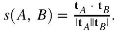

# La science derrière les algorithmes de recommandations de Target {#recommendations-algorithms}

>[!BEGINSHADEBOX]

**Sur cette page :** Découvrez le fonctionnement des algorithmes dans [!DNL Adobe Target Recommendations], y compris la logique et les détails mathématiques de la formation des modèles et de la diffusion des modèles.

>[!ENDSHADEBOX]

L&#39;apprentissage des modèles est le processus par lequel les algorithmes d&#39;apprentissage [!DNL Adobe Target] génèrent des recommandations. La diffusion de modèles, également appelée diffusion de contenu, permet à [!DNL Target] de fournir ces recommandations aux visiteurs du site.

[!DNL Target] propose les types d’algorithmes suivants dans [!DNL Recommendations] :

* **Algorithmes basés sur un élément** : suivez la logique « Les personnes qui ont consulté/acheté cet élément ont également consulté/acheté ces éléments ». Ces algorithmes sont regroupés sous le terme de filtrage collaboratif article par article. Ce type inclut également les algorithmes **[!UICONTROL Éléments avec des attributs similaires]**.

* **Algorithmes basés sur l&#39;utilisateur** : incluez les **[!UICONTROL éléments récemment consultés]** et **[!UICONTROL algorithmes recommandés pour vous]**.

* **Algorithmes basés sur la popularité** : renvoyez les articles les plus consultés ou les plus achetés sur le site web, ou par catégorie ou attribut d’article.

* **Algorithmes basés sur le panier** : faites des recommandations multi-articles avec la logique « les personnes qui ont consulté/acheté ces articles ont également consulté/acheté ces articles ».

* **Critères personnalisés** : utilisez des fichiers personnalisés chargés sur [!DNL Target] comme source de recommandations.

Pour plus d&#39;informations sur chaque type d&#39;algorithme et ses algorithmes, consultez [Baser la recommandation sur une clé de recommandation](/help/main/c-recommendations/c-algorithms/base-the-recommendation-on-a-recommendation-key.md).

La plupart de ces algorithmes reposent sur une ou plusieurs clés que [!DNL Target] utilise au moment de la diffusion du contenu (lorsque des recommandations sont faites) pour récupérer des éléments similaires. Les clés spécifiées par le client peuvent être l’élément actuel que le visiteur consulte, le dernier élément consulté ou acheté, l’élément le plus consulté, la catégorie actuelle ou la catégorie préférée du visiteur. D’autres algorithmes, tels que les algorithmes basés sur le panier et ceux basés sur l’utilisateur, utilisent des clés implicites qui ne peuvent pas être configurées par le client. Pour plus d&#39;informations, voir [Clés de recommandation](/help/main/c-recommendations/c-algorithms/base-the-recommendation-on-a-recommendation-key.md#keys).

Les clés s’appliquent uniquement au moment de la diffusion du modèle (diffusion de contenu). Ils n’affectent pas la logique d’entraînement du modèle hors ligne.

Les sections suivantes regroupent les algorithmes en fonction de la similarité de leur logique d’entraînement du modèle. Les groupes diffèrent donc légèrement des types ci-dessus.

## Filtrage collaboratif article-article

Les algorithmes incluent :

* **[!UICONTROL Les Personnes Qui Ont Consulté Ceci Ont Consulté Cela]**
* **[!UICONTROL Les Personnes Qui Ont Consulté Ceci Ont Acheté Cela]**
* **[!UICONTROL Les Personnes Qui Ont Acheté Ceci Ont Acheté Cela]**

Les algorithmes de filtrage collaboratif d’élément à élément utilisent les modèles comportementaux de nombreux utilisateurs (d’où le filtrage collaboratif) pour recommander des éléments liés à un élément donné, ce qui filtre le catalogue d’éléments possibles. De nombreux algorithmes différents relèvent du filtrage collaboratif et tous utilisent des données comportementales comme entrée. Dans [!DNL Target Recommendations], ces entrées sont les affichages et les achats uniques d&#39;articles par les utilisateurs.

Pour les algorithmes « Les personnes qui ont consulté/acheté cet élément ont également consulté/acheté ces éléments », l’objectif est de calculer une similarité s(A, B) entre toutes les paires d’éléments. Pour un élément A donné, les principales recommandations sont les éléments triés par leur similarité s(A,B).

Un exemple de similarité est la co-occurrence entre les éléments : décompte des utilisateurs qui ont acheté les deux éléments. Cette mesure est intuitive mais naïve, car elle est biaisée en faveur de la recommandation d&#39;articles populaires. Par exemple, dans une épicerie où la plupart des gens achètent du pain, le pain a une forte présence avec tous les articles, mais ce n&#39;est pas nécessairement une bonne recommandation. [!DNL Target] utilise à la place le rapport de vraisemblance du journal (LLR). Cette quantité est importante lorsque la probabilité que deux articles, A et B, coexistent est très différente de la probabilité qu&#39;ils ne coexistent pas. Par exemple, avec l’algorithme **[!UICONTROL Personnes ayant consulté ceci, acheté cela]**, la similarité du LLR est importante lorsque la probabilité qu’une personne ait acheté B est *non* indépendamment du fait qu’elle ait consulté A ou non.

L’élément B n’est pas recommandé avec l’élément A lorsque les conditions suivantes sont remplies :

Pour plus d’informations sur le calcul de similarité du ratio de vraisemblance du journal, consultez [ce PDF](/help/main/c-recommendations/c-algorithms/assets/log-likelihood-ratios-recommendation-algorithms.pdf).

Le schéma suivant illustre le flux logique de l’implémentation de l’algorithme :

Les étapes sont les suivantes :

* **Données d’entrée** : données comportementales sous la forme d’achats et d’affichages des visiteurs, collectées lorsque vous [implémentez Target](https://experienceleague.adobe.com/docs/target-dev/developer/recommendations.html){target=_blank} ou à partir de [Adobe Analytics](/help/main/c-recommendations/c-algorithms/use-adobe-analytics-with-recommendations.md){target=_blank}.

* **Modèle de formation** :

  * **Nettoyage et échantillonnage des données** : pour les algorithmes avec une recherche en amont de N jours, les données comportementales sont d’abord filtrées pour inclure uniquement ces N jours de données. Les règles de collection et les exclusions globales sont ensuite appliquées pour supprimer tous les éléments qui ne doivent pas être recommandés. Enfin, les données d’utilisation de tout visiteur ayant interagi avec plus de 1 000 éléments sont échantillonnées jusqu’à 1 000 éléments.
  * **Calcul de similarité d’élément** : étape de calcul principale. [!DNL Target] calcule la similarité du rapport de vraisemblance journal entre toutes les paires d&#39;éléments candidats et classe les paires en fonction de ce score.
  * **Filtrage hors ligne** : tous les autres filtres dynamiques applicables sont appliqués (par exemple, les exclusions de catégories dynamiques). Les recommandations précalculées sont ensuite mises en cache globalement, prêtes à être diffusées.

* **Service de modèles** : les recommandations sont diffusées à partir du [réseau « Edge » global](/help/main/c-intro/how-target-works.md#concept_0AE2ED8E9DE64288A8B30FCBF1040934) sur [!DNL Target]. Lorsqu’une requête de mbox est envoyée à [!DNL Target] et qu’il est déterminé que le contenu des recommandations doit être diffusé sur la page, la [clé d’élément](/help/main/c-recommendations/c-algorithms/base-the-recommendation-on-a-recommendation-key.md#keys) dont l’algorithme a besoin est analysée à partir de la requête ou recherchée à partir du profil du visiteur. [!DNL Target] utilise cette clé pour récupérer les recommandations calculées lors des étapes précédentes, applique d’autres filtres dynamiques, puis effectue le rendu de la [conception](/help/main/c-recommendations/c-design-overview/create-design.md) appropriée.

## Similarité de contenu

Algorithme inclus :

* **[!UICONTROL Éléments avec des attributs similaires]**

Avec cet algorithme, deux éléments sont liés si leurs noms et descriptions textuelles sont sémantiquement similaires. Contrairement à la plupart des algorithmes de recommandations qui nécessitent des données comportementales, les algorithmes de similarité de contenu exploitent la similarité entre les éléments des métadonnées du catalogue de produits. [!DNL Target] peut donc faire des recommandations dans les scénarios dits de « démarrage à froid », où aucune donnée comportementale n’a encore été collectée (par exemple, au début d’une activité [!DNL Target]).

La diffusion de modèles et la diffusion de contenu pour les algorithmes de similarité de contenu sont identiques à celles des autres algorithmes basés sur les éléments. La formation des modèles est très différente : elle implique une série d’étapes de traitement et de prétraitement du langage naturel, comme illustré dans le diagramme suivant. Le cœur du calcul de similarité est la similarité cosinus des vecteurs tf-idf modifiés qui représentent chaque élément du catalogue.

Les étapes sont les suivantes :

* **Données d’entrée** : cet algorithme utilise uniquement les données de catalogue, ingérées dans [!DNL Target] par le biais d’un [flux de catalogue, de l’API Entities ou de mises à jour sur la page](https://experienceleague.adobe.com/docs/target-dev/developer/recommendations.html){target=_blank}.

* **Modèle de formation** :

  * **Extraction des attributs** : après l’application de filtres statiques, de règles de catalogue et d’exclusions globales, l’algorithme extrait les champs de texte pertinents du schéma d’entité. [!DNL Target] utilise automatiquement les champs nom, message et catégorie des attributs d&#39;entité. Il tente également d’extraire des champs de chaîne à partir des [attributs d’entité](/help/main/c-recommendations/c-products/entity-attributes.md) personnalisés. Un champ est traité comme un champ de chaîne lorsque la majorité de ses valeurs ne peuvent pas être analysées sous forme de nombre, de date ou de valeur booléenne.
  * **Suppression de la terminaison et des mots vides** : pour rendre la correspondance de similarité de texte plus précise, [!DNL Target] supprime les mots vides très courants qui ne modifient pas de manière significative la signification d’un élément (par exemple, « était », « est » et « et »). Le terme de chaîne réduit les mots dont les suffixes sont différents à leur mot racine, qui a une signification identique (par exemple, « connect », « connect » et « connection » ont tous le mot racine « connect »). [!DNL Target] utilise l&#39;horodateur Snowball. Il effectue d&#39;abord la détection automatique de la langue, et peut supprimer les mots d&#39;arrêt pour jusqu&#39;à 50 langues et effectuer le bourrage pour 18 langues.
  * **n-gram création** : après les étapes précédentes, chaque mot est traité comme un jeton. La combinaison de séquences contiguës de jetons en un seul jeton est appelée création n-gramme. [!DNL Target] considère jusqu&#39;à 2 grammes.
  * **calcul tf-idf** : l’étape suivante crée des vecteurs tf-idf qui reflètent l’importance relative des jetons dans la description de l’élément. Pour chaque jeton ou terme t d&#39;un élément i, dans un catalogue D avec |D| éléments, [!DNL Target] calcule d&#39;abord la fréquence du terme TF(t, i), qui est le nombre de fois que le terme apparaît dans l&#39;élément i, et la fréquence du document DF(t, D), qui est le nombre d&#39;éléments dans lesquels le jeton t existe. La mesure tf-idf est alors:

    

    [!DNL Target] utilise l’implémentation de la fonctionnalité *tf-idf* d’Apache Spark, qui hache chaque jeton dans un espace de 218 jetons. Au cours de cette étape, l’amplification et l’enfouissement des attributs spécifiés dans les [critères](/help/main/c-recommendations/c-algorithms/create-new-algorithm.md#similarity) sont également appliqués, en ajustant les fréquences du terme dans chaque vecteur.

  * **Calcul de la similarité d’élément** : la similarité d’élément finale est calculée avec une similarité cosinus approximative. Pour deux éléments, *A* et *B*, avec les vecteurs tA et tB, la similarité cosinus est définie comme suit :

    

    Pour éviter la complexité significative du calcul des similitudes entre tous les N x N éléments, le vecteur *tf-idf* est tronqué à ses 500 entrées les plus grandes, et les similitudes cosinus entre les éléments sont calculées à partir de cette représentation tronquée. Cette approche est plus robuste pour les calculs de similarité de vecteurs épars que d’autres techniques de voisinage proche approximatif (ANN), telles que le hachage sensible à la localité.

* **Service de modèles** : ce processus est identique à celui du filtrage collaboratif élément par élément, décrit dans la section précédente.

## Recommandations à plusieurs clés

Les algorithmes incluent :

* Recommandations basées sur le panier
* **[!UICONTROL Recommandé]**

**[!UICONTROL Recommandé]** et les algorithmes basés sur le panier utilisent des techniques de filtrage collaboratif pour former des recommandations individuelles basées sur les éléments. Au moment du service, plusieurs éléments sont ensuite utilisés comme clés pour récupérer ces recommandations basées sur les éléments : les éléments de l’historique de navigation du visiteur (pour **[!UICONTROL Recommandé pour vous]**) ou dans le panier actuel du visiteur (pour les recommandations basées sur le panier). Les recommandations récupérées sont fusionnées pour former la liste finale. Grâce à un algorithme à plusieurs clés, les recommandations sont disponibles dès qu’un visiteur possède un historique de navigation. Elles sont mises à jour pour refléter le dernier comportement du visiteur.

Ces algorithmes s’appuient sur les techniques de filtrage collaboratif décrites dans la section recommandations basées sur les éléments et utilisent également l’optimisation des hyperparamètres pour déterminer la mesure de similarité optimale entre les éléments. L&#39;algorithme divise les données comportementales de chaque utilisateur de manière chronologique et entraîne des modèles de recommandation sur les données antérieures, tout en essayant de prédire les articles que l&#39;utilisateur consulte ou achète ultérieurement. La mesure de similarité avec la meilleure précision moyenne moyenne est ensuite choisie.

Le diagramme suivant illustre la logique des étapes d’entraînement et de notation du modèle :

Les étapes sont les suivantes :

* **Données d’entrée** : identique aux méthodes de filtrage collaboratif (CF) élément-élément. Les algorithmes **[!UICONTROL Recommandé pour vous]** et Basé sur le panier utilisent tous deux des données comportementales sous la forme d’affichages et d’achats des utilisateurs, collectées lorsque vous [implémentez Target](https://experienceleague.adobe.com/docs/target-dev/developer/recommendations.html){target=_blank} ou à partir d’[Adobe Analytics](/help/main/c-recommendations/c-algorithms/use-adobe-analytics-with-recommendations.md){target=_blank}.

* **Modèle de formation** :

  * **Nettoyage et échantillonnage des données** : identique à celui des méthodes de filtrage collaboratif. L’intervalle de recherche en amont filtre les données comportementales sur une période appropriée. Les règles de catalogue et les exclusions globales sont ensuite appliquées. Pour les visiteurs et visiteuses qui ont interagi avec plus de 1 000 éléments, seules les 1 000 utilisations les plus récentes sont prises en compte.
  * **Répartition du test d’entraînement** : les utilisations de chaque utilisateur sont réparties chronologiquement. Les 80 % premiers sont affectés aux données de formation et les 20 % restants aux données de test.
  * **Apprentissage du modèle de similarité d’élément** : le calcul de similarité d’élément principal diffère entre **[!UICONTROL Recommandé pour vous]** et Basé sur le panier en ce qui concerne la construction des vecteurs d’élément candidats. Pour **[!UICONTROL Recommandé pour Vous]**, les vecteurs d&#39;élément ont des NUsers de dimension, et chaque entrée est la somme des évaluations implicites que l&#39;utilisateur a attribuées à l&#39;élément. Les achats ont un poids de 2 fois celui des vues. Pour les recommandations basées sur le panier, les vecteurs d’élément comportent des entrées binaires. Si seul le comportement intra-session est pris en compte, il y a une entrée pour chaque session. Sinon, il y a une entrée pour chaque visiteur.

    L&#39;étape d&#39;apprentissage calcule plusieurs types de similitudes vectorielles : la similarité LLR ([voir le PDF](/help/main/c-recommendations/c-algorithms/assets/log-likelihood-ratios-recommendation-algorithms.pdf)), la similarité cosinus (définie précédemment) et une similarité L2 normalisée, définie comme :

    

  * **Évaluation du modèle de similarité d’élément** : les recommandations générées à l’étape précédente sont évaluées en effectuant des prédictions sur le jeu de données de test. La phase de notation en ligne est simulée en ordonnant de manière chronologique les utilisations d’articles de chaque utilisateur dans le jeu de données de test, puis en effectuant 100 recommandations pour des sous-ensembles d’articles ordonnés afin de prédire les vues et achats ultérieurs. La qualité de ces recommandations est évaluée avec la précision moyenne moyenne, une mesure de récupération des informations. Cette mesure prend en compte l’ordre des recommandations et favorise les éléments pertinents plus haut dans la liste, ce qui est une propriété importante pour les systèmes de classement.
  * **Sélection du modèle** : après l’évaluation hors ligne, le modèle présentant la précision moyenne la plus élevée est sélectionné et toutes les recommandations individuelles d’élément sont calculées pour lui.
  * **Filtrage hors ligne** : la dernière étape de l’entraînement du modèle applique tous les filtres dynamiques applicables. Les recommandations précalculées sont ensuite mises en cache globalement, prêtes à être diffusées.

* **Service de modèles** : contrairement aux algorithmes précédents, qui spécifient une seule clé pour la récupération, puis appliquent des règles métier, **[!UICONTROL Recommandé pour vous]** et Basé sur le panier utilisent un processus d’exécution plus complexe :

  * **Récupération et fusion de plusieurs clés** : pour les recommandations basées sur le panier, jusqu’à dix éléments transmis dans le panier sont utilisés comme clés pour la récupération et les recommandations de chaque clé sont pondérées de manière égale. Pour **[!UICONTROL Recommandé pour vous]**, jusqu&#39;aux cinq derniers éléments consultés uniques et les cinq derniers éléments achetés uniques sont utilisés comme clés, et les recommandations des éléments achetés sont pondérées deux fois plus que celles des éléments consultés. Lorsque les recommandations sont fusionnées, les scores de similarité pondérés d’un élément qui apparaît dans plusieurs listes sont ajoutés. Le résultat est la liste fusionnée de recommandations répondérées, classées par ordre décroissant.
  * **Filtrage** : les règles de filtrage, telles que la suppression d’éléments précédemment consultés ou achetés, et d’autres règles métier dynamiques sont ensuite appliquées.

L’image suivante illustre ces processus pour un visiteur qui a consulté l’élément A et qui a acheté l’élément B. Les recommandations individuelles sont récupérées avec les scores de similarité hors ligne affichés sous chaque libellé d’élément, puis fusionnées avec les scores de similarité pondérés additionnés. Enfin, lorsque le client a spécifié que les articles précédemment consultés et achetés doivent être filtrés, l’étape de filtrage supprime les éléments A et B de la liste des recommandations.

## Basé Sur La Popularité

Les algorithmes incluent :

* **[!UICONTROL Les plus consultés sur le site]**
* **[!UICONTROL Les plus consultés par catégorie]**
* **[!UICONTROL Éléments les plus consultés par attribut d&#39;élément]**
* **[!UICONTROL Les plus consultés par attribut de profil]**
* **[!UICONTROL Meilleurs vendeurs sur le site]**
* **[!UICONTROL Meilleurs vendeurs par catégorie]**
* **[!UICONTROL Meilleurs vendeurs par attribut d&#39;article]**
* **[!UICONTROL Meilleurs vendeurs par attribut de profil]**

[!DNL Target] fournit des algorithmes basés sur la popularité pour les articles les plus consultés et pour les articles les plus vendus, sur le site web ou répartis par attribut ou catégorie d&#39;article. Ces algorithmes classent les éléments en fonction du nombre de sessions au cours desquelles ils ont été consultés ou achetés au cours d’une période donnée.

Tous ces algorithmes combinent des données comportementales agrégées qui enregistrent le nombre total de sessions au cours desquelles des éléments ont été affichés et achetés, à la fois à des résolutions horaires et quotidiennes. Chaque algorithme trouve ensuite les articles les plus consultés ou les plus achetés pour l’intervalle de recherche en amont configuré par le client.

Les algorithmes diffèrent comme suit :

* **[!UICONTROL Les plus consultés sur le site]** et **[!UICONTROL les meilleurs vendeurs sur le site]** classent les articles en fonction du nombre total de sessions au cours desquelles ils ont été consultés ou achetés, respectivement. La sortie est une liste unique (sans clé) d’éléments recommandés.
* Les plus consultés et les meilleurs vendeurs par catégorie ou attribut d&#39;article classent également les articles en fonction du nombre total de sessions, mais les regroupent par catégorie d&#39;article ou par attribut d&#39;article spécifique. La sortie consiste en des listes d’éléments recommandés, indexées par les valeurs des catégories ou des attributs d’élément.
* **[!UICONTROL Les plus consultés par attribut de profil]** et **[!UICONTROL les meilleurs vendeurs par attribut de profil]** classent également les articles par nombre d&#39;achats ou de vues agrégées, mais ils sont regroupés par attribut de profil du visiteur, tel que le pays, la région ou le niveau d&#39;adhésion, au lieu d&#39;une propriété d&#39;article. Le nombre de chaque session est attribué à la valeur de profil que le visiteur détenait au moment de l’interaction, et non à un attribut de l’élément. Le résultat est un ensemble de listes de recommandations indexées par les valeurs distinctes de cet attribut de profil.

## Récemment consultés

L’algorithme « récemment consulté » fournit une personnalisation des recommandations en session. Aucune formation de modèle hors ligne n’est requise. Au lieu de cela, [!DNL Target] utilise le [profil du visiteur unique](/help/main/c-target/c-visitor-profile/visitor-profile.md) pour gérer une liste en cours des éléments consultés au cours d’une session et peut faire apparaître ces éléments dans des activités Recommendations. Cela permet de mettre à jour en temps réel les recommandations et de personnaliser la page suivante.

## Critères personnalisés

Les critères personnalisés permettent aux clients de [&#x200B; charger leurs propres recommandations dans Target](/help/main/c-recommendations/c-algorithms/recommendations-csv.md), ce qui offre une certaine flexibilité et permet d’« apporter votre propre modèle ». Les critères personnalisés remplacent la partie formation hors ligne des recommandations **[!UICONTROL Basées sur un élément]**. Lors de la diffusion de contenu en ligne, ils se comportent comme les algorithmes basés sur les éléments : une seule clé est utilisée pour récupérer les recommandations et les règles et filtres métier sont ensuite appliqués.
