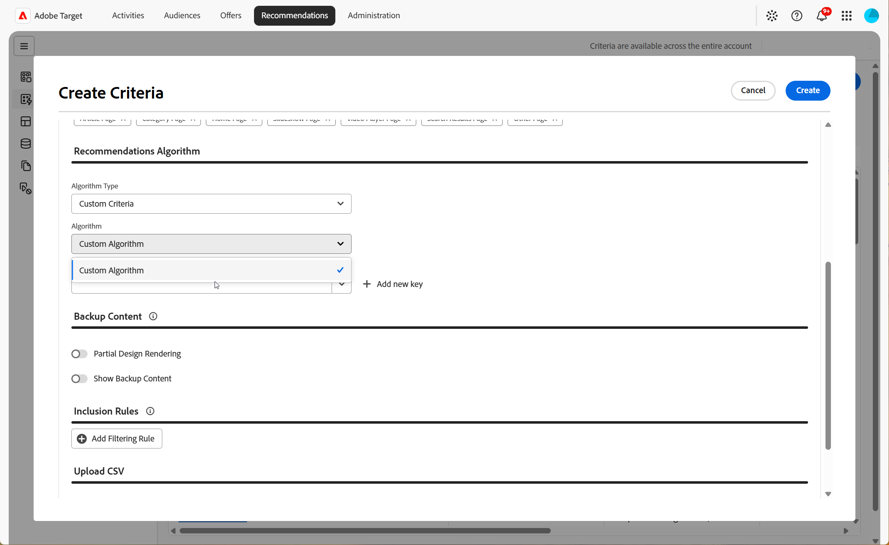

# Téléchargement de critères personnalisés {#upload-custom-criteria}

>[!BEGINSHADEBOX]

**Sur cette page :** Découvrez comment télécharger un fichier CSV de recommandations pour créer des critères personnalisés dans [!DNL Adobe Target Recommendations].

>[!ENDSHADEBOX]

Les critères personnalisés utilisent un fichier CSV de recommandations chargé dans [!DNL Target]. Cela permet de diffuser les recommandations calculées en dehors de [!DNL Target] dans les activités [!DNL Recommendations]. Pour plus d’informations sur le fonctionnement des critères personnalisés, consultez [Les algorithmes de recommandations de Target](/help/main/c-recommendations/c-algorithms/recommendations-algorithms.md).

Les critères personnalisés sont créés à partir de l’écran **[!UICONTROL Créer de nouveaux critères]**. Pour connaître les moyens d’accéder à cet écran, consultez [Accès à l’écran Créer de nouveaux critères](/help/main/c-recommendations/c-algorithms/create-new-algorithm.md#access-create-criteria). Les étapes suivantes commencent à partir de l’écran de bibliothèque **[!UICONTROL Recommendations]** > **[!UICONTROL Critères]**.

1. Cliquez Sur **[!UICONTROL Recommandations]** > **[!UICONTROL Critères]**.

1. Cliquez Sur **[!UICONTROL Créer Des Critères]** > **[!UICONTROL Créer Des Critères]**.

   

1. Renseignez les informations de la section [Informations de base](/help/main/c-recommendations/c-algorithms/create-new-algorithm.md#info).

1. Dans la liste déroulante **[!UICONTROL Sélectionner le type d’algorithme]**, sélectionnez **[!UICONTROL Critères personnalisés]**. Dans la liste déroulante **[!UICONTROL Algorithme]**, sélectionnez **[!UICONTROL Algorithme personnalisé]**.

   

1. (Conditionnel) Renseignez les informations dans les sections [Contenu de sauvegarde](/help/main/c-recommendations/c-algorithms/create-new-algorithm.md#content) et [Règles d’inclusion](/help/main/c-recommendations/c-algorithms/create-new-algorithm.md#inclusion).

1. Dans la section **[!UICONTROL Charger le fichier CSV]**, sélectionnez l’**[!UICONTROL emplacement]** du fichier CSV.

   Le fichier CSV doit être correctement formaté pour pouvoir être téléchargé. Pour obtenir un fichier CSV correctement formaté, cliquez sur **[!UICONTROL Télécharger le modèle CSV]**.

   Les options d’emplacement suivantes sont disponibles :

   * **FTP** : pour charger le fichier CSV à partir d’un serveur FTP, sélectionnez **[!UICONTROL FTP]**, puis saisissez les informations requises. SSL peut être utilisé, ce qui utilise le protocole FTPS pour transférer le fichier CSV en toute sécurité.

   * **SFTP** : pour charger le fichier CSV à partir d’un serveur SFTP, sélectionnez **[!UICONTROL SFTP]**, puis saisissez le nom d’hôte ou l’adresse IP, le port (22 par défaut), le nom d’utilisateur, un mot de passe et/ou une clé privée SSH, le répertoire et le nom de fichier. Pour plus d&#39;informations, voir [Paramètres de serveur SFTP pris en charge](/help/main/c-recommendations/c-products/feeds.md#steps).

     SFTP ne modifie pas le format CSV basé sur des critères personnalisés. Utiliser le format `# Key,Recommendation_1,...`. Un fichier CSV au format d’un type de flux différent entraîne l’échec de l’importation.

   * **URL** : pour charger le fichier CSV à partir d’une URL, sélectionnez **[!UICONTROL URL]**, puis saisissez une URL de flux.

     

1. Cliquez sur **[!UICONTROL Créer]**.

## Considérations

* Les entités de critères personnalisés (lignes) peuvent comporter jusqu’à 1 000 éléments recommandés (colonnes).

* Les mises à jour des critères personnalisés sont « cumulatives » par défaut. Les nouvelles paires clé-valeur du fichier de chargement CSV remplacent les paires clé-valeur existantes. Les paires clé-valeur existantes dont les clés ne figurent pas dans le fichier CSV chargé restent disponibles pour la diffusion et expirent 31 jours après leur dernier chargement dans le cadre du fichier CSV.

  Pour ignorer les résultats existants qui ne sont pas inclus dans le prochain chargement de fichier CSV, contactez l’assistance clientèle afin d’activer le paramètre correspondant. Lorsque ce paramètre est activé, seules les clés présentes dans le fichier de flux CSV personnalisé sont disponibles pour la diffusion. Ce paramètre s’applique à tous les critères personnalisés.

* Les flux de critères personnalisés sont mis à jour une fois toutes les 24 heures.

  Le statut de chargement et de synchronisation de chaque chargement de critère personnalisé s’affiche sur la page **[!UICONTROL Recommendations]** > **[!UICONTROL Critères]**. Le statut s’affiche également dans la boîte de dialogue **[!UICONTROL Modifier]** lorsque des critères personnalisés sont modifiés.

* Le flux d’un chargement sans erreur est **[!UICONTROL Planifié]** > **[!UICONTROL Téléchargement du fichier de flux]** > **[!UICONTROL Importation]** > **[!UICONTROL Réussite]**.

* Si [!DNL Target] rencontre un problème avec le chargement, les messages d’erreur suivants sont possibles :

  | Message d’erreur | Détails |
  |--- |--- |
  | Erreur inconnue | Indique une erreur technique interne. |
  | Erreur d’analyse | Indique probablement un problème de format du fichier du flux. Corrigez le format du fichier et enregistrez à nouveau l’algorithme, ce qui relance le processus de téléchargement du fichier. |
  | Serveur introuvable | Fournissez une adresse IP ou un nom d’hôte visible sur Internet. |
  | Erreur d’informations d’identification | Fournissez un nom d’utilisateur et un mot de passe valides pour un compte actif sur le serveur. |
  | Répertoire introuvable | Fournissez un répertoire qui existe sur le serveur. |
  | Fichier introuvable | Indiquez le nom d’un fichier qui existe sur le serveur dans le répertoire spécifié. |
