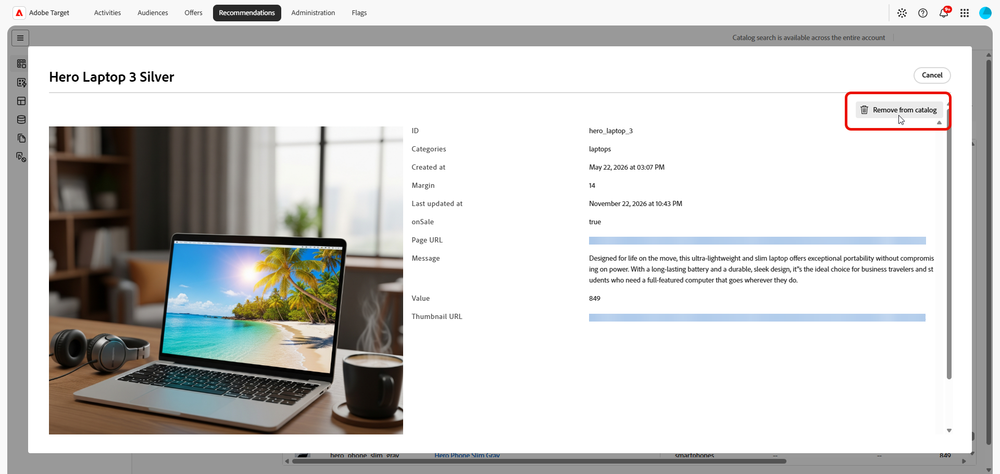

# [!UICONTROL Recherche catalogue] {#catalog-search}

>[!BEGINSHADEBOX]

**Sur cette page :** Découvrez comment effectuer une recherche dans le catalogue de [!DNL Adobe Recommendations] pour localiser des produits ou du contenu, et comment filtrer, afficher et supprimer des éléments.

>[!ENDSHADEBOX]

La page **[!UICONTROL Recherche catalogue]** dans [!DNL Adobe Recommendations] est utilisée pour localiser les produits ou le contenu du catalogue. La tâche la plus simple sur cette page consiste à rechercher un élément. La page permet également de modifier l’environnement, de filtrer les facettes, de modifier les colonnes du tableau, etc.

Le catalogue représente l’ensemble des produits (entités). Il peut contenir de nombreuses collections, qui organisent les produits en groupes logiques.

L&#39;index du catalogue est créé automatiquement lors du chargement du premier flux et actualisé selon le [planning spécifié](/help/main/c-recommendations/c-products/feeds.md#steps).

Le catalogue est automatiquement actualisé lorsque des mises à jour sont reçues par le biais de fichiers de flux, de l’API ou de mises à jour de mbox. Les mises à jour sont généralement terminées en une heure. Si des mises à jour sont en cours, l’heure de début de la mise à jour la plus récente s’affiche. Si aucune mise à jour n’est en cours, l’heure de début et de fin de la mise à jour la plus récente s’affiche.

## Recherche dans le catalogue

Utilisez les résultats de la recherche pour passer en revue les éléments du catalogue et, si nécessaire, en supprimer.

1. Cliquez Sur **[!UICONTROL Recommendations]** > **[!UICONTROL Recherche Catalogue]**.

1. (Facultatif) Pour filtrer les résultats, cliquez sur l’icône **[!UICONTROL Afficher les filtres]** (  ), puis sélectionnez les filtres à appliquer. Les filtres disponibles sont **[!UICONTROL Environnement]**, **[!UICONTROL Collections]**, **[!UICONTROL Catégorie]**, **[!UICONTROL Marque]**, **[!UICONTROL Inventaire]** et **[!UICONTROL Valeur]**.

   [Environnements](/help/main/administrating-target/environments.md) organisent les sites et les environnements de pré-production pour la gestion et la création de rapports séparés. Pour modifier l’environnement, sélectionnez l’environnement de votre choix dans la liste déroulante **[!UICONTROL Environnement]**.

   

1. Saisissez un terme de recherche dans le champ **[!UICONTROL Rechercher dans]**.

1. (Facultatif) Affinez la recherche en sélectionnant une option de recherche dans le menu d’options, qui s’ouvre à partir de la flèche vers le bas dans le champ **[!UICONTROL Rechercher dans]**.

   Les options de recherche disponibles sont les suivantes :

   * ID
   * Nom
   * Message

1. Cliquez sur l’icône **[!UICONTROL Personnaliser le tableau]** (  ) pour modifier les colonnes actives de la page **[!UICONTROL Recherche catalogue]**.

   

1. Parcourez les éléments dans les résultats de recherche pour afficher les miniatures et d’autres informations sur les produits.

   >[!NOTE]
   >
   >Dans une recherche catalogue sur un attribut personnalisé doté d’une valeur numérique, les résultats traitent l’attribut personnalisé comme un type de chaîne plutôt que comme une valeur numérique.
   >
   >Le type d’un attribut ne peut actuellement pas être modifié. Pour demander une modification, [ouvrez un problème client](/help/main/cmp-resources-and-contact-information.md#reference_ACA3391A00EF467B87930A450050077C) en référençant les attributs dont le type doit passer de chaîne à numérique.

1. Cliquez sur un élément dans les résultats de la recherche pour afficher ses détails, notamment son identifiant, son nom, son message, sa catégorie, etc.

   

1. Pour supprimer l&#39;élément du catalogue, cliquez sur **[!UICONTROL Supprimer du catalogue]**.

   Toutes les informations sur cet élément sont alors supprimées de l’index du catalogue. L’élément est à nouveau inclus dans le catalogue uniquement s’il est ajouté à nouveau dans un flux de données. Un élément supprimé doit également être supprimé séparément des flux .

   

<!--
### Perform an advanced search {#advanced-search}

You can use [!UICONTROL Advanced Search] to further refine your search results or to save your search results as a [collection](/help/main/c-recommendations/c-products/collections.md) or [exclusion](/help/main/c-recommendations/c-products/exclusions.md).

1. Click the **[!UICONTROL Advanced Search]** link.

   

1. Use the drop-down lists to specify the parameter, operator, and values for your search.

1. (Optional) Click **[!UICONTROL Add Rule]** to add an additional search rule.

   Each additional search rule is joined with the AND operator.

1. Click **[!UICONTROL Search]**.

1. (Optional) Click **[!UICONTROL Save As]**, then click **[!UICONTROL Collection]** or **[!UICONTROL Exclusion]**.

   

   For more information, see [Create a collection or exclusion based on Advanced Search](#save-as) below.
-->

<!--
## Modify the Catalog Search page (filters and columns)

You can temporarily modify the available filters and columns on the [!UICONTROL Catalog Search] page for the current session.

### Modify filters

You can add additional filter facets to the [!UICONTROL Catalog Search] page.

1. In the **[!UICONTROL Filters]** panel, click **[!UICONTROL Modify]**.

   

1. Select the desired search facets (ID, name, message, etc.), then click **[!UICONTROL Save]**.

   

Keep in mind that the additional filter facets are available in the current session only.
-->

<!--
## Create a collection or exclusion based on Advanced Search {#save-as}

You can create [collections](/help/main/c-recommendations/c-products/collections.md) or [exclusions](/help/main/c-recommendations/c-products/exclusions.md) using [!UICONTROL Advanced Search] on the [!UICONTROL Catalog Search] page ([!UICONTROL Recommendations] > [!UICONTROL Catalog Search] > [!UICONTROL Advanced Search]).

1. Perform an [advanced search](#advanced-search).

1. Click **[!UICONTROL Save As]**, then click **[!UICONTROL Collection]** or **[!UICONTROL Exclusion]**.

   

   >[!IMPORTANT]
   >
   >The [!UICONTROL Advanced Search] functionality is case-insensitive; however, products returned at the time of delivery are based on case-sensitive search. This mismatch might lead to confusion. Ensure that you consider case-sensitivity when you create collections or exclusions based on results using the [!UICONTROL Advanced Search] functionality. For example, if you perform a search for "Holiday," that initial search lists results containing "Holiday" and "holiday." If you then create a catalog with the intent to return products containing "holiday," only products containing "holiday" are returned. Products containing "Holiday" are not returned. Exclusions are handled in a similar fashion.
-->
