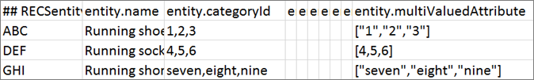

# Attributs d’entité personnalisés {#custom-entity-attributes}

>[!BEGINSHADEBOX]

**Sur cette page :** Découvrez comment définir, envoyer et utiliser des attributs d&#39;entité personnalisés à une et plusieurs valeurs qui décrivent les éléments de votre catalogue [!DNL Adobe Target Recommendations].

>[!ENDSHADEBOX]

Utilisez des attributs d&#39;entité personnalisés à une et plusieurs valeurs dans [!DNL Adobe Target Recommendations] pour définir des informations supplémentaires sur les éléments de votre catalogue. Ces informations peuvent ensuite être utilisées dans les règles d’inclusion d’algorithme, les règles de catalogue et les règles d’exclusion, et elles peuvent être affichées dans les conceptions.

## Limites {#limits}

Vous pouvez inclure jusqu’à 100 attributs d’entité personnalisés pour définir des informations supplémentaires sur les éléments de votre catalogue. Par exemple, vous pouvez créer un attribut personnalisé appelé `entity.genre` pour définir un livre ou un film. Ou, un vendeur de billets peut créer des attributs pour le lieu d’un événement pour inclure un interprète secondaire ; par exemple, pour une équipe en déplacement dans le cas d’un événement sportif ou une première partie dans le cas d’un concert.

La longueur maximale des attributs personnalisés d’entité à valeur unique est de 15 000 caractères (pour les langues codées UTF-8 à un et deux octets, telles que l’anglais et les autres langues en alphabet latin) ou de 10 000 caractères (pour les langues codées UTF-8 à trois octets, telles que le chinois, le japonais et le coréen).

Les attributs personnalisés d’entité à plusieurs valeurs ne peuvent pas contenir plus de 500 valeurs. Chaque valeur individuelle est limitée à 100 caractères. Le nombre total de caractères sur toutes les valeurs doit être conforme aux limites de longueur maximale des attributs personnalisés d’entité à une seule valeur (voir ci-dessus).

## Valeurs d’attribut d’entité personnalisées {#section_313331A9F8194A89B5EDD89363018651}

Les attributs d’entité personnalisés peuvent contenir une seule ou plusieurs valeurs. Les valeurs d’attribut d’entité s’affichent dans la vue du produit.


Un attribut d’entité personnalisé avec une seule valeur est formé de la même manière qu’un attribut d’entité prédéfini à une valeur :

`entity.genre=genre1`

Un attribut d’entité personnalisé à plusieurs valeurs doit être envoyé en tant que tableau JSON valide :

`entity.genre=["genre1", "genre2"]`

Exemples de tableaux JSON valides pris en charge par [!DNL Recommendations]:

* `["AB","BC"]` toutes les valeurs sont des chaînes
* `[1,2]` toutes les valeurs sont des chiffres

>[!NOTE]
>
>[!DNL Recommendations] ne prend pas en charge différents types de valeurs dans les attributs d’entité à plusieurs valeurs. Par exemple, `["AB",1,true, [1,2,3]]` est un tableau JSON valide, mais il n’est pas pris en charge dans [!DNL Recommendations], car il inclut des types de valeurs mixtes (chaîne, chiffre, opérateur booléen, objet).

Une fois qu’un attribut personnalisé est envoyé en tant que tableau JSON valide, l’attribut est traité comme un attribut à plusieurs valeurs pour tous les produits du catalogue.

>[!NOTE]
>
>Pour modifier un attribut de plusieurs à une seule valeur, vous devez supprimer votre catalogue et télécharger les données de produit corrigées. La suppression du catalogue ne supprime pas les données historiques associées à vos ID de produit. Pour plus d’informations, reportez-vous à la section [Suppression de tous les éléments du système](/help/main/assets/adobe-recommendations-classic.pdf) dans la documentation d’*Adobe Recommendations Classic*.

**Restrictions** :

* Vous ne pouvez pas utiliser de noms d’attributs d’entité prédéfinis pour les attributs d’entité personnalisés. (Consultez les [Attributs d’entité](/help/main/c-recommendations/c-products/entity-attributes.md#entity-attributes)).
* L’attribut `entity.environment` est réservé par le système et ne peut pas être utilisé pour les attributs d’entité personnalisés. Toute tentative de transférer `entity.environment` à l’aide de `targetPageParams`, de flux ou d’API sera ignorée.
* Les tableaux doivent contenir un type de valeur unique. Les tableaux à valeurs mixtes (`["AB",1,true]`) ne sont pas pris en charge.
* Un attribut à plusieurs valeurs incluant un tableau JSON imbriqué (`[10,12,[1,2,3]]`) est traité comme un attribut à une seule valeur.

## Implémentation d’attributs à plusieurs valeurs {#section_80FEFE49E8AF415D99B739AA3CBA2A14}

Les attributs d’entité personnalisés à plusieurs valeurs sont pris en charge lors de l’utilisation de flux (CSV), `targetPageParams` et de l’API de diffusion pour charger des produits. Les nouvelles valeurs remplacent les valeurs actuelles ; elles ne sont pas ajoutées. Les tableaux vides ( [] ) sont traités comme n’ayant aucune valeur.

Les guillemets doubles doivent être précédés d’un caractère d’échappement. Par exemple, `"[""test"", ""value""]"` est un tableau JSON valide qui peut être utilisé dans le fichier CSV.

### Utilisation de targetPageParams

L’exemple suivant montre comment utiliser `targetPageParams` :

```javascript
function targetPageParams() { 
  return { 
    'entity.id':                   '123', 
    'entity.categoryId':            '["A", "A:B", "A:B:C", "A:B:C:D"]',        
    'entity.MultiValueAttribute':   '["X", "Y", "Z"]', 
    'entity.event.detailsOnly':     'true', 
    'excludedIds':                  '[123, 3232, 2323, 4344]', 
    'orderId':                      '123456', 
    'orderTotal':                   '195.32', 
    'productPurchaseId':            '[001,002,003]' 
  }; 
}
```

### Utilisation de CSV

Vous pouvez gérer vos fichiers CSV à l’état brut en utilisant un éditeur de texte ou vous pouvez utiliser un logiciel de feuille de calcul.

Le fichier CSV brut ressemblera à ceci :


Le même catalogue ressemblera à ceci dans une feuille de calcul :



Lors de la conversion au format .csv, le logiciel de feuille de calcul encadre le contenu de la cellule avec des guillemets doubles pour éviter que les apostrophes présentes dans la cellule n’agissent comme séparateurs de colonne. Il fait de même avec les valeurs de chaîne JSON que vous incluez dans des attributs personnalisés à plusieurs valeurs. Le fait de travailler directement avec le fichier à l’état brut peut dès lors s’avérer peu commode. Par exemple :

* Feuille de calcul : `["1","2","3"]`
* Brut : `"[""1"",""2"",""3""]"`

Soyez vigilant lorsque vous éditez directement un fichier CSV de catalogue à l’état brut.

### Utilisation des API

Vous pouvez transmettre des attributs à plusieurs valeurs à l’aide de l’API de diffusion dans un paramètre mbox sous la forme d’une valeur de chaîne contenant un tableau JSON avec échappement.

```javascript
"execute": {
    "mboxes": [
      {
        "index": 0,
        "name": "first-mbox",
        "parameters": {
          "entity.id": "32323",
          "entity.categoryId": "My Category",
          "entity.MultiValueAttribute": "[\"X\", \"Y\", \"Z\"]"
        }
      }
    ]
  }
```

Consultez la [documentation de l’API Adobe Recommendations](https://experienceleague.adobe.com/docs/target-dev/developer/recommendations.html){target=_blank} pour plus d’informations sur l’utilisation des API Delivery et Save entities.

## Utilisation d’opérateurs avec des attributs à plusieurs valeurs {#section_83C2288A805242D9A02EBC4F07DEE945}

Lorsque vous appliquez des opérateurs à des attributs personnalisés à plusieurs valeurs dans des règles d’inclusion d’algorithme, des règles de catalogue et des règles d’exclusion, le résultat sera *true* si au moins une valeur de la liste transfère l’opération (opérateur booléen *ou*).

Dans l&#39;exemple suivant, la règle est `message contains abc`.

* Cas 1 : `entity.genre = ["ab", "bc", "de"]`. Le résultat est false car aucune valeur ne contient `abc`.
* Cas 2 : `entity.genre = ["abcde","de","ef"]`. Le résultat est true car une valeur contient `abc`.

Pour les opérateurs négatifs, toutes les valeurs d’attribut doivent être transmises (opérateur booléen *et*). Par exemple, si l’opérateur est `notEquals`, le résultat sera *false* si l’une des valeurs correspond.

Le tableau suivant résume le comportement de chaque opérateur et donne les cas de chaque exemple de règle.

| Opérateur | Le résultat est vrai lorsque | Exemple de règle | Valeur d’attribut | Résultat | Raison |
|---|---|---|---|---|---|
| Est égal | Toute valeur d’attribut est égale à la valeur d’entrée. | `genre equals abc` | `["ab", "bc", "de"]` | Faux | Aucune valeur n&#39;est égale à `abc`. |
|  |  |  | `["abc", "de", "ef"]` | Vrai | Une valeur est égale à `abc`. |
|  |  |  | `["abcde", "de", "ef"]` | Faux | `abc` n&#39;est égal à aucun élément de la liste. |
| N’est pas égal à | Aucune valeur d’attribut n’est égale à la valeur d’entrée. | `genre not equals abc` | `["ab", "bc", "de"]` | Vrai | Aucune valeur n&#39;est égale à `abc`. |
|  |  |  | `["abc", "de", "ef"]` | Faux | Une valeur est égale à `abc`. |
|  |  |  | `["abcde", "de", "ef"]` | Vrai | `abc` n&#39;est égal à aucun élément de la liste. |
| Contient | Toute valeur d’attribut contient la valeur d’entrée. | `genre contains abc` | `["ab", "bc", "de"]` | Faux | Aucune valeur ne contient `abc`. |
|  |  |  | `["abcde", "de", "ef"]` | Vrai | Une valeur contient `abc`. |
| Ne contient pas | Aucune valeur d’attribut ne contient la valeur d’entrée. | `genre does not contain abc` | `["ab", "bc", "de"]` | Vrai | Aucune valeur ne contient `abc`. |
|  |  |  | `["abcde", "de", "ef"]` | Faux | Une valeur contient `abc`. |
| Commence par | Toute valeur d’attribut commence par la valeur d’entrée. | `genre starts with abc` | `["ab", "bc", "de"]` | Faux | Aucune valeur ne commence par `abc`. |
|  |  |  | `["abcde", "de", "ef"]` | Vrai | Une valeur commence par `abc`. |
|  |  |  | `["ab", "de", "abc"]` | Vrai | Une valeur commence par `abc` (pas nécessairement le premier élément de la liste). |
| Se termine par | Toute valeur d’attribut se termine par la valeur d’entrée. | `genre ends with abc` | `["ab", "bc", "de"]` | Faux | Aucune valeur ne se termine par `abc`. |
|  |  |  | `["deabc", "de", "ef"]` | Vrai | Une valeur se termine par `abc`. |
| Supérieur ou égal à (valeurs numériques uniquement) | Toute valeur d’attribut est supérieure ou égale à la valeur d’entrée. Chaque valeur est convertie en double et les valeurs qui ne peuvent pas être converties sont ignorées pendant l’exécution de la règle. | `price greater than or equal to 100` | `["10", "20", "45", "de"]` | Faux | Aucune valeur n’est supérieure ou égale à 100. La valeur `de` est ignorée car elle ne peut pas être convertie en double. |
|  |  |  | `["100", "101", "90", "80"]` | Vrai | Deux valeurs sont supérieures ou égales à 100. |
| Inférieur ou égal à (valeurs numériques uniquement) | Toute valeur d’attribut est inférieure ou égale à la valeur d’entrée. Chaque valeur est convertie en double et les valeurs qui ne peuvent pas être converties sont ignorées pendant l’exécution de la règle. | `price less than or equal to 100` | `["101", "200", "141", "de"]` | Faux | Aucune valeur n’est inférieure ou égale à 100. La valeur `de` est ignorée car elle ne peut pas être convertie en double. |
|  |  |  | `["100", "101", "90", "80"]` | Vrai | Deux valeurs sont inférieures ou égales à 100. |
| Correspond de manière dynamique (uniquement disponible dans les algorithmes basés sur un élément) | Toute valeur d’attribut correspond à la valeur d’entrée. | `genre matches abc` | `["ab", "bc", "de"]` | Faux | Aucune valeur ne correspond à `abc`. |
|  |  |  | `["abc", "de", "ef"]` | Vrai | Une valeur correspond à `abc`. |
| Ne correspond pas de manière dynamique (uniquement disponible dans les algorithmes basés sur un élément) | Aucune valeur d’attribut ne correspond à la valeur d’entrée. Le résultat est faux si une valeur d’attribut correspond. | `genre does not match abc` | `["ab", "bc", "de"]` | Vrai | Aucune valeur ne correspond à `abc`. |
|  |  |  | `["abc", "de", "ef"]` | Faux | Une valeur correspond à `abc`. |
| Se trouve dynamiquement dans la plage (uniquement disponible dans les algorithmes basés sur un élément, valeurs numériques uniquement) | Toute valeur d’attribut numérique se trouve dans la plage spécifiée. | `price dynamically ranges in 80% to 120% of 100` | `["101", "200", "125", "de"]` | Vrai | `101` est compris entre 80 % et 120 % sur 100. La valeur `de` est ignorée car elle ne peut pas être convertie en double. |
|  |  |  | `["130", "191", "60", "75"]` | Faux | Aucune valeur n’est comprise entre 80 % et 120 % sur 100. |

>[!NOTE]
>
>*La* double est un type de données Java. Pour les opérateurs qui requièrent des valeurs numériques, la conversion en double élimine les valeurs non numériques du calcul des résultats.

## Attributs à plusieurs valeurs dans les conceptions {#section_F672E4F6E1D44B3196B7ADE89334ED4A}

Les attributs à plusieurs valeurs apparaissent sous la forme d’une liste séparée par des virgules lorsqu’ils sont référencés dans une conception.

Exemple :

Lorsque `entity.genre=["genre1","genre2"]` est référencé dans une conception sous la forme `$entity<N>.genre`, le résultat est `genre1, genre2`.

## Rubriques connexes

* [Attributs d’entité](/help/main/c-recommendations/c-products/entity-attributes.md#entity-attributes)
