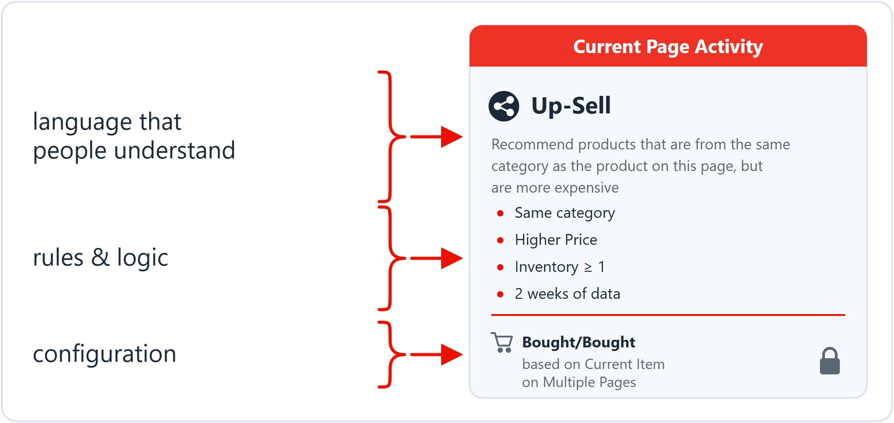

# Différences entre Recommendations Classic et les activités Recommendations dans [!DNL Target] Premium {#classic-versus-activities}

>[!BEGINSHADEBOX]

**Sur cette page :** Découvrez en quoi [!DNL Recommendations Classic] diffère des [!DNL Recommendations] activités de [!DNL Target Premium], pour choisir entre elles.

>[!ENDSHADEBOX]

>[!NOTE]
>
>Les activités [!DNL Recommendations] sont disponibles dans le cadre de la solution [!DNL Target Premium]. Elles ne sont pas disponibles dans [!DNL Target Standard] sans une licence [!DNL Target Premium].

Dans [!DNL Recommendations] Classic, les recommandations s’affichaient en créant une mbox de collecte de données sur une page, puis en ajoutant une mbox d’affichage dans un emplacement spécifique de la page. L’activité [!DNL Recommendations] dans [!DNL Target Premium] collecte des informations sur les visiteurs et crée les recommandations n’importe où sur la page, sans mbox pour chaque emplacement où des produits ou du contenu sont recommandés. Une référence JavaScript dans l’en-tête de la page active des recommandations n’importe où sur la page. Cette référence transmet les clés, telles que les clés `entity.id` et `entity.categoryId`, à la mbox globale [!DNL Target].

[!DNL Recommendations Classic] apparaît sous la forme d’une carte dans l’interface utilisateur de [!DNL Experience Cloud]. Une activité [!DNL Recommendations] est disponible depuis le workflow [!DNL Target Premium].

Les utilisateurs [!DNL Recommendations Classic] peuvent continuer à utiliser leurs mbox [!DNL Recommendations] dans [!DNL Target Recommendations]. Les approches classique et [!DNL Target] peuvent également être combinées, en conservant les mbox et en utilisant le code JavaScript dans l’en-tête pour activer la fonctionnalité [!DNL Recommendations] pour les autres éléments de la page. Pour obtenir toutes les fonctionnalités [!DNL Target], cependant, les utilisateurs [!DNL Recommendations Classic] peuvent préférer supprimer l’ancienne mbox et se fier uniquement à [!DNL Target Recommendations].

L’activité [!DNL Recommendations] dans [!DNL Target] s’améliore par rapport à [!DNL Recommendations Classic] dans les domaines principaux suivants.

## Recommandations en tant qu’offre {#recs-as-offer}

Les recommandations peuvent être incluses dans les activités de [!UICONTROL test A/B] (y compris les activités d’[!UICONTROL affectation automatique] et de [!UICONTROL ciblage automatique]) et de [!UICONTROL ciblage d’expérience] (XT). Cela permet, entre autres fonctionnalités, de tester et de cibler le contenu recommandé et non recommandé au sein de la même activité. Pour plus d’informations, voir [Recommandations en tant qu’offre](/help/main/c-recommendations/recommendations-as-an-offer.md).

## Critères {#criteria-comparison}

[!DNL Target Recommendations] comprend une bibliothèque de critères avec des ensembles précompilés de règles et de configurations. Dans [!DNL Recommendations Classic], chaque recommandation a été créée manuellement en remplissant un formulaire et en choisissant parmi une grande liste de règles. Lorsqu&#39;une activité [!DNL Recommendations] est créée, un ensemble de critères préconfigurés est choisi. Il est toujours possible de créer des recommandations personnalisées, mais la bibliothèque de critères contient la plupart des configurations les plus courantes, préconfigurées pour simplifier le processus et utilisant un langage que les gens comprennent. Les critères précompilés peuvent être utilisés tels quels ou copiés et modifiés selon vos besoins.

Les critères sont préconfigurés et triés par secteur industriel vertical, par type de page et par mise en œuvre. Par exemple, les critères qui s’appliquent à la vente verticale au détail peuvent être utilisés sur une page de produits, qui affiche les produits d’une catégorie particulière (telle que définie par le paramètre `entity.categoryID`).

Pour plus d’informations sur l’utilisation et la création de critères, voir [Critères](/help/main/c-recommendations/c-algorithms/algorithms.md).

## Workflow {#workflow-comparison}

Le workflow [!DNL Recommendations] est simplifié. Au lieu de formulaires complexes, un workflow visuel vous guide tout au long des étapes suivantes :

1. sélectionner des critères ;
1. Sélectionnez une [conception](/help/main/c-recommendations/c-design-overview/create-design.md#create-design) préconfigurée.
1. prévisualiser les recommandations obtenues.

## Aperçu visuel {#visual-preview}

Vous pouvez prévisualiser les recommandations une fois qu’elles ont été configurées et apporter les modifications nécessaires sans créer de recommandations sur la page, puis les tester. Des aperçus sont disponibles dans [!DNL Target].

## Ciblage {#targeting-comparison}

[!DNL Recommendations Classic] avait six options de ciblage. Les activités [!DNL Recommendations] utilisent l’ensemble des options de ciblage [!DNL Target]. Une audience est définie à l’aide de [!DNL Target] ou d’autres audiences [!DNL Adobe Experience Cloud] (telles que [!DNL Audience Manager] et [!DNL Analytics]). Le pourcentage de participants à l&#39;activité qui voient chaque conception et le pourcentage qui voient le contrôle sont alors sélectionnés.

## Création de rapports {#reporting-comparison}

Dans [!DNL Target], [!DNL Recommendations] fournit une création de rapports améliorée qui tire parti des fonctionnalités de [!DNL Target] et de [!DNL Experience Cloud]. Au lieu d’afficher uniquement l’effet élévateur fourni par [!DNL Recommendations] par rapport aux résultats sans ces derniers, les rapports affichent des informations complètes sur l’activité [!DNL Recommendations].

