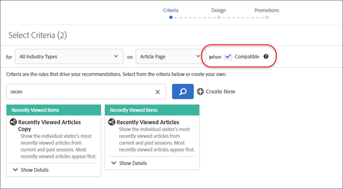
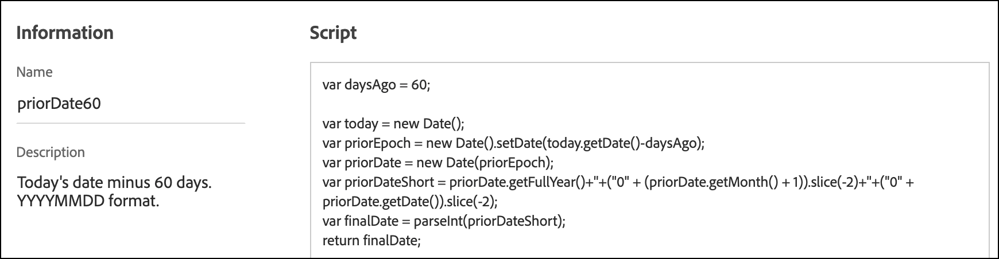

# Forum aux questions (FAQ) de Recommandations {#recommendations-faq}

>[!BEGINSHADEBOX]

**Sur cette page :** Trouvez des réponses aux questions fréquentes sur les activités [!DNL Adobe Target] [!DNL Recommendations].

>[!ENDSHADEBOX]

## Données et API {#data-and-apis}

+++ Les objets [!DNL Recommendations] créés via l’API s’affichent-ils dans l’interface utilisateur [!DNL Target] ?

Oui. [!UICONTROL Les objets Recommendations] (**[!UICONTROL Critères]**, **[!UICONTROL Conceptions]**, **[!UICONTROL Collections]** et **[!UICONTROL Exclusions]**) créés via l’API sont disponibles dans l’interface utilisateur et peuvent être modifiés via l’API ou l’interface utilisateur [!DNL Target].

+++

+++ Les offres visuelles créées dans l’interface utilisateur [!DNL Target] peuvent-elles être gérées avec les API [!DNL Target] ?

Non. Les activités [!DNL Recommendations] avec des offres visuelles créées dans l’interface utilisateur [!DNL Target] ne peuvent pas être gérées avec les API [!DNL Target]. Ces activités s’affichent dans la liste **[!UICONTROL Activités]**, mais elles ne peuvent pas être lues ni mises à jour (avec GET ou PUT).

+++

+++ Quelle est la limite de taille d’un appel API pour insérer ou mettre à jour des produits ? Est-il possible de mettre à jour 50 000 produits en un seul appel au lieu d’un flux ?

[!DNL Target] impose une limite de 50 Mo au niveau de l’application, mais uniquement lorsque l’en-tête de type de contenu `application/x-www-form-urlencoded` est transmis.

Un seul appel avec 50 000 produits peut être tenté. Si l’appel échoue, il peut être divisé en lots. Adobe recommande des lots de 5 000 ou 10 000 produits pour réduire la probabilité d’un délai d’expiration en raison de la charge du système.

+++

+++ Quelle est la taille maximale d’un fichier CSV pour un chargement de flux ?

Le nombre de lignes ou la taille de fichier pour le chargement d’un flux de fichier CSV sont illimités. Adobe recommande de limiter le fichier CSV à 1 Go afin d’éviter les échecs lors du chargement. Un fichier de plus de 1 Go peut idéalement être divisé en plusieurs fichiers de flux.

Le nombre maximal de colonnes d’attributs personnalisés est de 100, et les attributs personnalisés sont limités à 4 096 caractères. D’autres limites sur la longueur des colonnes obligatoires sont disponibles sur la page [[!DNL Target] Limitations](/help/main/r-troubleshooting-target/target-limits.md).

+++

+++ Pourquoi la **[!UICONTROL recherche catalogue]** n’affiche-t-elle pas les bons résultats lors de la recherche d’un attribut personnalisé avec une valeur numérique ?

Lorsqu’une recherche catalogue est effectuée sur un attribut personnalisé avec une valeur numérique, les résultats traitent l’attribut comme une chaîne plutôt que comme une valeur numérique.

Aucune fonctionnalité actuellement disponible ne permet aux clients de modifier le type d’un attribut. Pour apporter une modification, [ouvrez un problème client](/help/main/cmp-resources-and-contact-information.md#reference_ACA3391A00EF467B87930A450050077C) qui fait référence aux attributs dont le type doit passer de chaîne à numérique.

+++

## Calendrier de mise à jour {#update-timing}

+++ Combien de temps faut-il pour que les mises à jour des éléments du catalogue soient répercutées sur le site ?

La période et les résultats varient en fonction du mode de mise à jour des éléments.

| Mise à jour | Recommandations | Recherche catalogue |
| --- | --- | --- |
| Attributs d’élément mis à jour via une mbox ou l’API | Dans les 15 minutes | Après l’index de catalogue (3-8 heures) |
| Attributs d’élément mis à jour par le biais d’un flux | Après l&#39;ingestion du repas (2-8 heures) | Après l’ingestion du flux (2-8 heures) et l’index de catalogue suivant (3-8 heures), dans les 5-16 heures au total |
| Élément supprimé du catalogue via l’interface utilisateur ou l’API [!DNL Target] | Dans les 15 minutes | Après l’index de catalogue (3-8 heures) |
| Élément ajouté au catalogue par le biais d’une mbox ou de l’API | Après la prochaine exécution de l’algorithme. Les exécutions d’algorithmes sont planifiées toutes les 12 heures pour les algorithmes de 1 à 2 jours et toutes les 24 heures pour ceux de plus de 7 jours | Après l’index de catalogue (3-8 heures) |
| Élément ajouté au catalogue par le biais d’un flux | Après l’ingestion du flux (2 à 8 heures) et l’exécution de l’algorithme suivant, planifiés toutes les 12 heures pour les algorithmes de 1 à 2 jours et toutes les 24 heures pour les algorithmes de plus de 7 jours, dans un délai total de 2 à 32 heures | Après l’ingestion du flux (2-8 heures) et de l’index de catalogue (3-8 heures), dans les 5-16 heures au total |

Tant que les mises à jour ne sont pas disponibles, le contenu suivant s’affiche :

* Pour les éléments mis à jour ou supprimés, les recommandations et les attributs d’élément existants s’affichent.
* Pour un élément ajouté, les recommandations existantes s’affichent si l’élément ajouté n’est pas une clé demandée. Les recommandations de sauvegarde s’affichent si l’élément ajouté est une clé demandée.

Après l’importation d’un fichier de flux ou la réception des mises à jour d’entité par le biais de l’API ou d’une mbox, les modifications suivantes sont répercutées en moins de 60 minutes :

* Si un élément qui a été exclu doit maintenant être inclus, il l’est lors de la prochaine exécution de l’algorithme (12-24 heures).

  Cette situation se produit, car [!DNL Target] applique des exclusions en ligne et hors ligne. Lorsqu’un élément a été récemment exclu, l’exclusion en ligne s’applique rapidement. Lorsqu’un élément vient d’être inclus, l’exclusion en ligne disparaît rapidement, mais l’exclusion hors ligne ne disparaît que lors de la prochaine exécution de l’algorithme.

* Si un élément qui a été inclus précédemment doit maintenant être exclu, il l’est selon les chronologies du tableau, selon la source : 15 minutes via une mbox ou l’API, ou 12 à 24 heures via un flux.

Les modifications suivantes ne sont pas répercutées tant que l’exécution suivante de l’algorithme n’a pas eu lieu (dans les 12 à 24 heures) :

* Attributs d&#39;article utilisés dans les règles de collecte de l&#39;activité.
* Attributs d’article utilisés dans une promotion basée sur un attribut ou sur une collection associée à l’activité.
* Catégorie d&#39;articles dans laquelle l&#39;article apparaît pour une « Catégorie actuelle » ou une « Catégorie préférée » dans l&#39;algorithme **[!UICONTROL Meilleurs vendeurs]** ou **[!UICONTROL Les plus consultés]**.
* Le classement des éléments recommandés, lorsque l’attribut modifié est un attribut personnalisé utilisé comme clé personnalisée pour un algorithme.
* Le classement des éléments recommandés en fonction d’un ou de plusieurs attributs modifiés, lorsque la logique de recommandation est « Éléments avec des attributs similaires » ou lorsque des facteurs « Similarité de contenu » ou « Pondération d’attribut » sont utilisés.

>[!NOTE]
>
>Un fichier de flux est considéré comme importé lorsque son état passe de « Importation des éléments » à « Préparation des mises à jour de l’index de recherche ». Les mises à jour peuvent prendre plus de 60 minutes dans l’interface utilisateur de la **[!UICONTROL recherche catalogue]**. **[!UICONTROL La recherche catalogue]** est à jour lorsque le statut du flux passe à « Mises à jour terminées ». Même si la **[!UICONTROL recherche catalogue]** n’est pas encore à jour, le site reflète les mises à jour dans les délais répertoriés ci-dessus. L’heure de mise à jour de l’index de **[!UICONTROL Recherche catalogue]** la plus récente s’affiche sur la page **[!UICONTROL Recherche catalogue]**.

+++

+++ Combien de temps faut-il pour qu’une modification apportée à la configuration d’une activité, d’une offre, de promotions ou de paramètres de critères [!UICONTROL Recommendations] soit prise en compte sur le site ?

* La prise en compte d’une modification des paramètres de promotion sur le site peut prendre jusqu’à cinq heures.
* Dans le cas des autres paramètres de critères, il se peut que la modification ne soit pas prise en compte avant la prochaine exécution de l’algorithme :

  * Certains paramètres de critères, par exemple l’ajout d’une règle d’inclusion dynamique, sont immédiatement pris en compte.
  * D’autres paramètres, par exemple la suppression d’une règle d’inclusion dynamique ou une modification de l’intervalle de recherche en amont, ne peuvent pas être incorporés avant la prochaine exécution de l’algorithme.
  * Ces modifications déclenchent l’exécution d’un algorithme, ce qui peut prendre jusqu’à 24 heures. Les algorithmes s’exécutent également selon un planning, toutes les 12 à 24 heures.

+++

+++ Combien de temps faut-il pour que le comportement d’un utilisateur (par exemple, cliquer sur le produit A et acheter le produit B) se reflète dans les recommandations qu’il reçoit ?

* Le produit ou le contenu actuellement consulté ou acheté influence les recommandations que l’utilisateur reçoit sur la même page vue ou demande de contenu [!DNL Target].
* Le comportement historique de l’utilisateur, tel que « dernier produit consulté » et « produit le plus consulté », ainsi que l’historique global d’affichage et d’achat, sont mis à jour avec cette requête. Cela influence les recommandations que l’utilisateur reçoit lors de la page vue suivante ou de la requête de contenu. Par exemple, les algorithmes **[!UICONTROL Éléments récemment consultés]** et **[!UICONTROL Recommandé pour vous]** sont mis à jour avec chaque consultation de produit ou achat, et la mise à jour est répercutée sur la demande de contenu suivante.

+++

+++ Combien de temps faut-il pour que le comportement d’un utilisateur se reflète dans les recommandations que les autres utilisateurs reçoivent ?

Le comportement global des utilisateurs est intégré au traitement de l’algorithme hors ligne. Ce traitement se produit à chaque exécution d’algorithme, toutes les 12 à 24 heures.

+++

+++ Les recommandations basées sur les éléments récemment consultés persistent-elles sur plusieurs appareils pour un seul visiteur ?

Lorsqu’un visiteur lance une session, l’ID de session est lié à une seule machine Edge et un cache de profil temporaire est stocké sur cette machine. Les requêtes suivantes en provenance de la même session lisent ce cache de profil, y compris les éléments récemment consultés.

Lorsque la session se termine (généralement lorsqu’elle expire après 30 minutes d’absence d’activité), l’état de la session, y compris les éléments récemment consultés, est conservé dans un stockage de profil plus permanent dans la même zone géographique. Les sessions suivantes provenant de différents appareils peuvent alors accéder à ces éléments récemment consultés, à condition que la nouvelle session soit liée au profil client par le même Marketing Cloud ID (MCID), Experience Cloud ID (ECID) ou CustomerID ou `mbox3rdPartyId`.

Si un visiteur possède deux sessions actives simultanées, les éléments récemment consultés sur un appareil ne mettent pas à jour ceux consultés sur l’autre appareil, sauf si les appareils sont obligés de partager l’ID de session. Il existe une solution de contournement potentielle, mais [!DNL Target] ne prend pas directement en charge le partage d’un ID de session sur plusieurs appareils. Le client ou la cliente doit gérer ce partage d’ID.

Ce comportement se produit également lorsqu’un visiteur est actif sur un appareil et devient actif sur l’autre appareil quelques minutes plus tard. La session du premier appareil n’expire pas avant 30 minutes, et jusqu’à cinq minutes de délai peuvent s’écouler avant que l’état du profil ne soit écrit dans l’état permanent et traité. Lors du test de ce comportement, attendez 35 minutes que la session expire et que le profil soit stocké.

Si le visiteur ne possède pas deux sessions actives simultanées, les éléments récemment consultés sur un appareil mettent à jour ceux consultés sur l’autre appareil, à condition que la session soit terminée. Lors du test de ce comportement, attendez 35 minutes que la session expire.

+++

## Critères, conceptions et promotions {#criteria-designs-promotions}

+++ Pourquoi tous les critères, y compris les critères personnalisés, ne sont-ils pas disponibles pour sélection lors de la création d’une activité [!DNL Recommendations] ?

Les critères disponibles dépendent de la catégorie actuelle. Lorsque des offres de recommandations sont créées, le sélecteur d’algorithmes affiche les critères en fonction de l’identifiant de catégorie. Si l’emplacement où le critère est appliqué ne contient pas l’identifiant de catégorie, certains critères ne sont pas disponibles dans le sélecteur d’algorithmes. Si un emplacement où l’ID de catégorie est présent dans la mbox est utilisé, le sélecteur de critères contient tous les critères applicables.

[!DNL Target] comporte un paramètre [Filtrer les critères incompatibles](https://experienceleague.adobe.com/docs/target-dev/developer/recommendations.html?lang=fr){target=_blank} qui contrôle le filtrage intelligent du sélecteur d’algorithmes. Pour accéder au paramètre **[!UICONTROL Filtrer les critères incompatibles]**, cliquez sur **[!UICONTROL Administration]** > **[!UICONTROL Recommandations]**.


* Si le paramètre **[!UICONTROL Filtrer les critères incompatibles]** n’est pas activé, [!DNL Target] ne filtre pas les algorithmes dans le sélecteur d’algorithmes et tous les algorithmes s’affichent.
* Si le paramètre est activé, dans les activités [!UICONTROL Compositeur d’expérience visuelle] (VEC), [!DNL Target] lit l’entityId et l’ID de catégorie à partir de l’emplacement sélectionné. Il affiche ensuite des algorithmes basés sur `currentItem|currentCategory`, si les valeurs respectives sont présentes à cet emplacement. Par conséquent, seuls les algorithmes compatibles avec l’emplacement sélectionné s’affichent par défaut dans le sélecteur d’algorithmes. Il est toujours possible de consulter les algorithmes non compatibles en désactivant la case à cocher **[!UICONTROL Compatible]** lors de la sélection de critères.

  

[!DNL Target] n&#39;affiche pas la case à cocher **[!UICONTROL Compatible]** dans les cas spéciaux suivants :

* Les paramètres entityId et categoryId sont présents à l’emplacement, donc rien n’est filtré.
* La version 55 ou antérieure de [!DNL mbox.js] est utilisée.
* Aucun appel de mbox n&#39;est déclenché depuis la page (`!config.isAutoCreateGlobalMbox && !config.isRegionalMbox`).
* Les paramètres de [!DNL Target] ne sont pas définis.

>[!NOTE]
>
>Le paramètre **[!UICONTROL Filtrer les critères incompatibles]** s’applique uniquement aux activités créées dans le [!UICONTROL Compositeur d’expérience visuelle] (VEC). Ce paramètre ne s’applique pas aux activités créées dans le **[!UICONTROL compositeur d’expérience d’après les formulaires]**, car [!DNL Target] ne dispose pas de contexte d’emplacement.

+++

+++ Quelle est la différence entre la pondération générale des attributs et la pondération des attributs spécifiques à la similarité de contenu ?

La pondération des attributs existe sous deux formes : « pondération standard des attributs » et « pondération des attributs de similarité de contenu ».

* La « pondération standard des attributs » s’applique à la plupart des types de critères, et pas seulement à **[!UICONTROL la similarité de contenu]**. Ce type de pondération donne plus de poids à certaines valeurs d’attribut. Dans l’exemple suivant, les produits Nike sont favorisés dans les recommandations de sortie.

  

* La « pondération des attributs de similarité de contenu » s’applique uniquement aux critères de **[!UICONTROL similarité de contenu]**. Ce type de pondération est plus dynamique et repose sur la « clé de recommandation » actuelle (l’élément actuellement consulté). Dans l&#39;exemple suivant (marque x 16), un visiteur qui consulte les baskets Nike est plus susceptible de se voir recommander d&#39;autres produits Nike (pas nécessairement uniquement des baskets) que les baskets de ses concurrents. Un visiteur qui regarde des baskets Adidas est plus susceptible de se voir recommander des produits Adidas.

  

+++

+++ Le nom de la mbox doit-il être spécifié lors de la création de règles de test de critère, de promotion ou de modèle [!DNL Recommendations] ?

Lorsqu’une règle de test de critère, de promotion ou de modèle [!DNL Recommendations] est créée en fonction d’un paramètre de mbox, `mboxParameter` n’invite plus `mboxName`. Le nom de la mbox est à présent facultatif. Cette modification permet d’utiliser des paramètres provenant de plusieurs mbox ou une référence à un paramètre qui n’a pas encore été enregistré sur le serveur Edge.

Pour sélectionner le paramètre souhaité, utilisez l’une des méthodes suivantes :

* Lors de la création d’une règle de test de critère, de promotion ou de modèle, sélectionnez un nom de paramètre dans la liste. Commencez par saisir les premiers caractères du nom du paramètre ou saisissez le nom complet.
* Si le nom de la mbox est connu mais pas celui du paramètre, utilisez la case à cocher pour filtrer une mbox connue qui transmet le paramètre souhaité.

Quelle que soit la méthode employée, il n’existe aucun lien entre la mbox et le paramètre . La règle de test de critère, de promotion ou de modèle fonctionne en fonction du paramètre dans toutes les mbox qui transmettent ce paramètre.

Lorsqu’une règle de test de critère, de promotion ou de modèle existante est modifiée, le filtrage affiche le nom de la mbox fourni lors de la création.

+++

+++ Que peut-on faire lorsque des caractères spéciaux rompent un tableau ?

Utilisez des valeurs échappées dans JavaScript. Les guillemets ( &quot; ) peuvent rompre la matrice. Le fragment de code suivant est un exemple de valeurs échappées :

```
#set($String='') 
#set($escaper=$String.class.forName('org.apache.commons.lang.StringEscapeUtils')) 
<script type="text/javascript"> 
console.log("$escaper.escapeJavaScript($entity1.name)") 
console.log("$escaper.escapeJavaScript($entity2.name)") 
console.log('$escaper.escapeJavaScript($entity3.name)') 
names.push("$escaper.escapeJavaScript($entity4.name)") 
</script>
```

+++

+++ Une entité peut-elle être exclue dynamiquement ?

Oui. Les identifiants des entités à exclure des recommandations peuvent être transmis dans la chaîne de requête. Par exemple, les articles déjà présents dans le panier peuvent être exclus.

Pour activer la fonctionnalité d’exclusion, utilisez le paramètre mbox `excludedIds`. Ce paramètre pointe vers une liste d’identifiants d’entité séparés par des virgules, par exemple `mboxCreate(..., "excludedIds=1,2,3,4,5")`. La valeur est envoyée lorsque les recommandations sont demandées.

L&#39;exclusion est effectuée pour l&#39;appel [!DNL Target] en cours uniquement. Les éléments ne sont pas exclus lors des appels [!DNL Target] suivants, sauf si la valeur `excludedIds` est transmise à nouveau. Pour exclure les éléments du panier des recommandations sur chaque page, continuez à transmettre la valeur `excludedIds` sur chaque page.

Pour exclure `entityIds`, ajoutez le jeton `&excludes=${mbox.excludedIds}` à l&#39;URL du contenu de l&#39;offre. Lorsque l’URL de contenu est extraite, les paramètres requis sont remplacés par les paramètres de requête de mbox actuels.

Par défaut, cette fonctionnalité est activée pour les recommandations nouvellement créées. Les recommandations existantes doivent être enregistrées pour prendre en charge les entités exclues dynamiquement.

>[!NOTE]
>
>Si un trop grand nombre d’entités sont exclues, les recommandations se comportent comme s’il n’y avait pas assez d’entités pour remplir le modèle de recommandation.

+++

+++ Pourquoi une activité [!DNL Recommendations] héritée ne peut-elle pas être enregistrée après la définition d’une nouvelle audience ?

Assurez-vous que le nom de l’audience est unique. Si l’audience porte le même nom qu’une audience existante, l’activité héritée [!DNL Recommendations] (une activité [!DNL Recommendations] créée avant octobre 2016) ne peut pas être enregistrée.

+++

+++ Un algorithme créé dans [!DNL Adobe Recommendations Classic] peut-il être utilisé dans [!DNL Recommendations Premium] ?

[!DNL Recommendations Premium] ne prend pas en charge les algorithmes créés dans [!DNL Recommendations Classic]. L’algorithme hérité peut être utilisable dans [!DNL Target Premium], mais il peut créer des problèmes de synchronisation lorsque l’activité est désactivée ou supprimée dans l’interface utilisateur [!DNL Target Premium]. Pour plus d’informations sur les différences entre les deux solutions, voir [[!DNL Recommendations Classic] activités versus [!DNL Recommendations] dans [!DNL Target Premium]](/help/main/c-recommendations/c-recommendations-faq/recommendations-classic-versus-recommendations-activities-target-premium.md).

+++

+++ Comment recommander uniquement de nouveaux articles ou vidéos ?

Les clients du secteur des médias et de la publication souhaitent souvent que les éléments recommandés n’incluent que les articles ou vidéos les plus récents. Par exemple, un client [!DNL Target] a utilisé l’approche suivante pour recommander des articles datant de moins de 60 jours :

1. Transmettez la date de publication de l’article, au format AAAAMMJJ, en tant qu’attribut d’entité personnalisé. Par exemple :

   | Attribut d’entité | Exemple |
   | --- | --- |
   | issueDate | 2021218 |
   | lastViewDate | 2021701 |
   | parentCategory | commentaire |
   | publishDate | 20210113 |
   | publishDateDisplay | 13 janvier 2021 |

1. Créez un script de profil qui renvoie la date du jour moins 60 jours, également au format AAAAMMJJ.

   

1. Utilisez une règle d’inclusion dynamique dans les critères afin que `publish date > today's date minus 60 days`.

   

Cet exemple peut également être réalisé avec la correspondance des paramètres, en transmettant la valeur `priorDate60` en tant que paramètre mbox.

+++

## Résolution des problèmes {#troubleshooting}

+++ Pourquoi [!DNL Target] n’affiche-t-il pas de recommandations dans certains cas ?

[!DNL Target] ne peut parfois pas afficher de recommandations en raison du faible nombre de recommandations disponibles.

Le nombre de valeurs générées pour chaque critère est égal à trois fois le nombre d’entités spécifié dans la conception. Le filtrage d’exécution (par exemple, la correspondance d’attributs inventaire ou mbox) est appliqué une fois les valeurs générées 3 fois, de sorte qu’il puisse rester moins de 3 fois les valeurs au moment de la diffusion. Pour pallier cette situation, augmentez le nombre d’entités dans la conception en masquant les autres entités.

Le JavaScript suivant peut être utilisé au début de la conception pour augmenter le nombre d’entités demandées. Dans cet exemple, le nombre d’entités demandées est de 30 (3x10).

```
#foreach($entity in $entities) 
 #if( $foreach.count > 10 ) 
  #break 
 #end 
 #set ($foo = $entity.id) 
#end 
```

+++

+++ Que signifie la réponse NO_CONTENT parfois renvoyée dans la trace de contenu [!DNL Recommendations] ?

NO_CONTENT est renvoyé lorsque les recommandations ne sont pas disponibles pour la combinaison entre l’algorithme et la clé demandée. Cette situation se produit généralement lorsque les sauvegardes sont désactivées pour l’algorithme et qu’une ou plusieurs des conditions suivantes sont également vraies :

* Les résultats ne sont pas encore prêts.

  Cette situation se produit généralement lors du premier enregistrement d’une activité nouvellement créée ou après que des modifications de configuration sont apportées à la collection, aux critères ou aux promotions utilisés dans l’activité.

* Les résultats sont prêts, mais pas encore mis en cache sur le serveur Edge le plus proche pour la combinaison d’algorithme et de clé demandée.

  La requête initie une opération de mise en cache. Par conséquent, ce problème est résolu après quelques rechargements de page ou quelques minutes.

* Les résultats sont prêts, mais pas disponibles pour la valeur de clé fournie.

  Cette situation se produit généralement lorsque des recommandations sont demandées pour un élément ajouté au catalogue après l’exécution de l’algorithme le plus récent. Il est résolu après la prochaine exécution de l’algorithme.

* Le rendu partiel du modèle est désactivé et les résultats disponibles ne sont pas suffisants pour remplir le modèle.

  Cette situation se produit généralement avec une règle d’inclusion dynamique qui filtre agressivement de nombreux éléments à partir des résultats possibles. Pour éviter cette situation, activez les sauvegardes et n’appliquez pas la règle d’inclusion aux sauvegardes, ou utilisez les critères de séquence avec un critère filtré moins agressif.

+++

+++ Que doit-on faire lorsqu&#39;une collection dans [!DNL Recommendations] atteint zéro (0) ?

Tenez compte des points suivants lorsqu’une collection qui n’était pas auparavant à zéro atteint zéro :

* Réenregistrez la collection et vérifiez si le nombre est mis à jour. L’enregistrement réexécute tous les algorithmes qui utilisent cette collection.
* Vérifiez que l’environnement approprié s’affiche. Cliquez sur **[!UICONTROL Administration]** > **[!UICONTROL Recommandations]**, puis vérifiez le paramètre **[!UICONTROL Groupe d’hôtes par défaut]** dans la section **[!UICONTROL Catalogue de produits]**.

  

* Vérifiez que l’index est à jour. Cliquez sur **[!UICONTROL Recommendations]** > **[!UICONTROL Recherche catalogue]** et vérifiez le nombre d’heures de l’index depuis sa création (par exemple, « Indexé il y a 3 heures »). L’index peut être actualisé si nécessaire.
* Vérifiez si quelque chose a changé dans le flux ou la couche de données qui a eu pour conséquence que les entités ne correspondent plus aux règles de collecte. Vérifiez que la casse correspond (les règles sont sensibles à la casse).
* Vérifiez si le flux s’est exécuté correctement ou si quelqu’un a modifié le répertoire FTP, le mot de passe, etc.
* [!DNL Target] met à jour la diffusion (sur la page ou l’application du client) aussi rapidement que possible et doit également fournir une représentation dans l’interface utilisateur pour le marketeur. [!DNL Target] ne retarde pas les mises à jour de diffusion en attendant que celles de l’interface utilisateur soient synchronisées. Utilisez [mboxTrace](/help/main/c-activities/c-troubleshooting-activities/content-trouble.md) pour voir ce qui se trouve dans le système au moment où une demande arrive.

+++

+++ Pourquoi l’action **[!UICONTROL Télécharger les données]** échoue-t-elle dans une activité [!DNL Recommendations] ?

Lorsque l’utilisateur clique sur **[!UICONTROL Télécharger les données]** sur la page **[!UICONTROL Aperçu de l’activité]** d’une activité [!DNL Recommendations], l’interface utilisateur [!DNL Target] peut afficher l’erreur `Error while fetching recommendation data file.`

Cette erreur se produit généralement lorsque l’activité a un jeu de résultats très volumineux. Le fichier CSV généré dépasse la taille de réponse qui peut être renvoyée par l’interface utilisateur dans un seul téléchargement. Les données de recommandation elles-mêmes sont intactes. Seul le chemin de téléchargement intégré au navigateur ne peut pas diffuser un fichier de cette taille.

+++

## Problèmes connus {#known-issues}

Les problèmes suivants sont des problèmes connus des activités [!UICONTROL Recommendations] :

* Lorsque [!DNL Target] renvoie une offre JSON avec `getOffer()`, il renvoie un type de JSON. Toutefois, une conception JSON [!DNL Recommendations] renvoie un type d’HTML.
* Les entités expirées expirent correctement après 60 jours de non réception des mises à jour par un flux ou l’API. Toutefois, les entités expirées ne sont pas supprimées de l’index **[!UICONTROL Recherche catalogue]** après expiration. Les entités supprimées par le biais d’un flux ou de l’API ne sont pas non plus actuellement supprimées de l’index **[!UICONTROL Recherche catalogue]**. (IRI-857)
* Les [!DNL Recommendations] offres des activités A/B et de ciblage d’expérience n’affichent pas de prévisualisation visuelle de la barre d’état [!DNL Recommendations]. (TGT-33426)
* Le statut du flux Critères personnalisés affiché dans la vue Liste de critères (carte) est actualisé toutes les dix minutes et peut, dans de rares cas, être dépassé de plus de dix minutes. L’état affiché dans la vue Modification des Critères personnalisés est récupéré en temps réel et est constamment à jour. (TGT-35896, TGT-36173)
