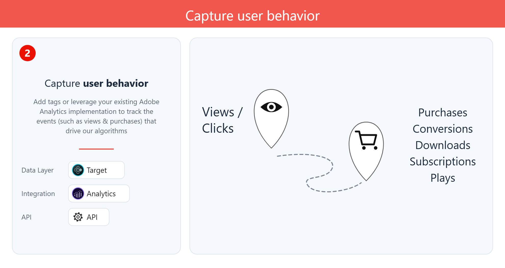

# Présentation des recommandations {#introduction-to-recommendations}

>[!BEGINSHADEBOX]

**Sur cette page :** Découvrez comment les activités [!DNL Recommendations] dans [!DNL Adobe Target] affichent les produits ou contenus pertinents aux visiteurs et comment planifier et créer une implémentation et une activité [!DNL Recommendations].

>[!ENDSHADEBOX]

Cette page est basée sur le webinaire *Présentation de Recommendations*. Une activité [!DNL Recommendations] affiche automatiquement les produits ou le contenu susceptibles d’intéresser les clients en optimisant les suggestions en temps réel basées sur les visites précédentes. La page décrit également comment créer une activité [!DNL Recommendations] dans l’interface utilisateur [!DNL Target].

## Introduction

Les clients attendent de plus en plus des recommandations et les utilisent comme point de départ pour explorer d’autres options disponibles. Presque tout le monde a acheté un produit qu&#39;il a vu pour la première fois dans une recommandation, que ce soit dans un magasin ou sur une propriété numérique.

La façon dont les gens consomment les médias et le contenu est de plus en plus guidée par des recommandations personnalisées. Les marques qui privilégient le numérique, comme Netflix, Spotify et YouTube, commencent l&#39;expérience client par des recommandations. Comme de plus en plus d’alternatives sont disponibles, il est essentiel d’identifier le contenu le plus pertinent pour un client au point d’interaction.

Les marketeurs utilisent [!DNL Adobe Target] pour proposer des expériences personnalisées dans divers secteurs et canaux et pour différents types de clients. Le tableau suivant répertorie quelques exemples de la manière dont les clients utilisent [!DNL Target] pour fournir des recommandations personnalisées.

| Cas d’utilisation | Exemple |
|---|---|
| Publication | Les éditeurs web utilisent [!DNL Target Recommendations] pour recommander des articles aux visiteurs du site et stimuler l’engagement. |
| Tutoriels vidéo | [!DNL Adobe Creative Cloud] utilise [!DNL Target] pour recommander des tutoriels vidéo aux utilisateurs de Photoshop dans l’application Photoshop. |
| Jeu | Les sociétés de jeux utilisent [!DNL Target] pour recommander des jeux et du contenu aux utilisateurs sur leurs consoles. |
| Ventes B2B | Les entreprises de business-to-business utilisent [!DNL Target] pour recommander des vidéos, des articles techniques et des articles de blog aux prospects B2B, proposer des téléchargements et fournir une aide aux clients existants. |
| Voyage | Une agence de voyages allemande utilise [!DNL Target] pour recommander des hôtels et d&#39;autres services aux voyageurs. Pour plus d’informations, consultez la [session Adobe Summit](https://2017.summit.adobe.com/na/sessions/summit-online/online-2017/#17608){target=_blank}. |
| Distribution | Un retailer B2B de premier plan utilise [!DNL Target] pour recommander des catégories et des produits aux visiteurs récurrents dans le navigateur et son application mobile. |

## Éléments de grandes recommandations

Les bonnes recommandations sont pertinentes et personnalisées. Trois éléments favorisent la pertinence et la personnalisation :

* **Le marketeur contrôle** pour déterminer la pertinence des éléments recommandés. Les marketeurs savent quels attributs de leurs produits ou contenus un modèle de recommandations doit prendre en compte. Par exemple, sur un site de vidéo, les utilisateurs peuvent être intéressés par des films du même réalisateur, mais probablement pas par des films du même studio. [!DNL Target] fournit des contrôles pour améliorer les algorithmes avec cette connaissance de domaine.
* **Modèles sophistiqués** pour donner un sens à des millions d’éléments de catalogue et d’événements d’interaction. [!DNL Target] dispose de capacités de machine learning créées au cours d’une décennie d’expérience et gère des milliards de recommandations par an.
* **Contexte utilisateur** pour s’assurer que les recommandations sont opportunes et pertinentes. Par exemple, les recommandations ne doivent pas inclure la vidéo que quelqu’un vient de regarder ou la chemise que quelqu’un vient d’ajouter à son panier. Le profil utilisateur [!DNL Target] peut être utilisé dans Recommendations pour garantir la personnalisation.

## Implémentation de [!DNL Target] Recommandations

Commencez par une stratégie qui définit les points suivants :

* **Éléments à recommander** : produits, vidéos ou contenu.
* **Emplacements pour les recommandations** : canaux (web, mobile, en magasin, kiosque, etc.), parties du parcours client et pages de votre site contenant des recommandations.
* **Mesure de succès** : comment déterminer si les recommandations ont du succès, par exemple, en comparant une expérience sans recommandations à une expérience avec recommandations, ou en comparant deux types de recommandations différents. Certaines mesures, telles que l’impact sur la valeur de durée de vie du client, sont difficiles à mesurer directement. Il est donc souvent plus facile d’utiliser une mesure plus concrète, comme le chiffre d’affaires par visite, la valeur moyenne des commandes ou le nombre de clics. Dans certains cas, l’objectif est de réduire une mesure, par exemple le nombre d’appels à l’assistance.

Une fois la stratégie définie, la mise en œuvre de [!DNL Target Recommendations] implique trois grandes étapes :

### Enseigner à [!DNL Target] votre contenu ou vos produits

Lorsque vous commencez avec [!DNL Recommendations], vous transmettez des informations sur chaque élément que vous souhaitez recommander.

La méthode la plus simple et la plus fréquemment utilisée consiste à envoyer un fichier CSV tous les jours ou toutes les semaines à partir d’un système de gestion des informations produit ou d’un système de gestion de contenu. D’autres options consistent à transmettre des informations sur la couche de données à partir de votre page à l’aide de la bibliothèque JavaScript [!DNL Adobe Target], à utiliser les API pour transmettre des informations directement à partir de votre système source ou à utiliser l’intégration [!DNL Adobe Analytics] si vous transmettez déjà des données de catalogue à [!DNL Analytics]. Vous pouvez utiliser plusieurs options ensemble, par exemple, transmettre la plupart des données quotidiennement via un fichier CSV et transmettre plus fréquemment les mises à jour d’inventaire via une API. Le service informatique est généralement impliqué dans la configuration de cette étape.

Quelle que soit la méthode choisie, incluez des métadonnées sur chaque élément dans trois catégories :

* **Données que vous souhaitez afficher à l&#39;utilisateur recevant la recommandation.** (le nom du film et une URL d’image miniature, par exemple).
* **Données utiles à l&#39;application de contrôles marketing et de marchandisage.** (classement du film pour ne pas recommander des films interdits au moins de 16 ans, par exemple).
* **Données utiles pour déterminer la similarité des éléments avec d&#39;autres éléments.** (le genre du film ou les acteurs qui jouent dans le film, par exemple).

### Capture du comportement des utilisateurs

Ajoutez des balises ou utilisez votre implémentation [!DNL Analytics] existante afin que [!DNL Target] prenne en compte les éléments que vos utilisateurs consultent et achètent. Si les achats ne sont pas pertinents, effectuez le suivi d’un autre type d’événement de conversion, par exemple le téléchargement d’un PDF, le remplissage d’un questionnaire, l’abonnement à une newsletter ou le visionnage d’une vidéo.

Si vous utilisez déjà [!DNL Target] pour exécuter des activités de test A/B sur votre site, il se peut que vous ayez déjà terminé cette étape. Si vous utilisez déjà [!DNL Adobe Analytics] pour créer des rapports sur les visites sur le site et le comportement de conversion, vous pouvez utiliser [!DNL Analytics] comme source de données comportementales. Sinon, l’option la plus simple consiste à configurer ce paramètre avec un gestionnaire de balises tel que les balises dans [[!DNL Adobe Experience Platform]](https://experienceleague.adobe.com/docs/target-dev/developer/client-side/at-js-implementation/deploy-at-js/implement-target-using-adobe-launch.html?lang=fr){target=_blank}. Les interactions hors ligne ou in-app peuvent également être envoyées à [!DNL Target] via l’API en temps réel.

### Obtention de recommandations avec le contexte approprié

Outre le comportement global de l&#39;utilisateur, [!DNL Target] a besoin du contexte spécifique dans lequel les recommandations sont affichées, qui inclut des informations sur la page et des informations provenant du profil utilisateur. [!DNL Target] utilise ces informations pour filtrer les éléments et améliorer la personnalisation des recommandations.

## Création de votre première activité Recommandations

Une activité [!DNL Recommendations] combine une audience, des critères et une conception. [!DNL Target] comprend 14 audiences intégrées, 42 critères intégrés et 10 modèles de conception intégrés. Vous pouvez personnaliser chacun de ces éléments ou ajouter les vôtres.

[!DNL Target] utilise le concept de carte de critères, qui est comme une recette de personnalisation. Le choix ou la création des critères appropriés est important pour obtenir les résultats de personnalisation prévus. Une carte de critères fonctionne comme une funnel qui vous emmène de l’ensemble de votre catalogue à votre ensemble final de recommandations.

Les sections suivantes décrivent les parties de ce funnel et leur fonctionnement dans [!DNL Target].

### Filtres statiques (collections et exclusions)

Les filtres statiques sont des règles applicables en général liées aux attributs de catalogue que vous ne prévoyez pas de modifier fréquemment, afin que vous puissiez les utiliser dans plusieurs recommandations.

### Algorithme (clé et logique de recommandation)

L’étape suivante consiste à choisir une clé de recommandation et une logique, qui constituent la base de votre recommandation. La clé de recommandation correspond à ce que vous recherchez pour choisir la recommandation.

[!DNL Target] comprend un portfolio d’algorithmes.

### Règles métier en ligne

La dernière étape consiste à appliquer des règles métier en ligne, qui améliorent vos algorithmes grâce à la connaissance du domaine et au contexte actuel, en fonction de ce que le visiteur fait sur votre propriété numérique.

