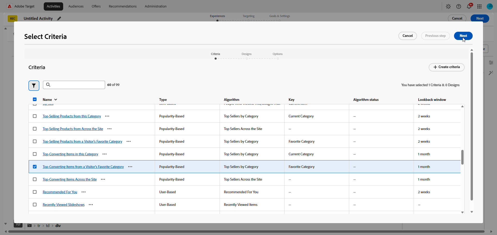

# Créer une activité [!DNL Recommendations] {#create-recs-activity}

>[!BEGINSHADEBOX]

**Sur cette page :** Découvrez comment créer une activité [!DNL Recommendations] dans le [!DNL Target] **[!UICONTROL compositeur d’expérience visuelle]** (VEC), de la sélection de l’emplacement à la configuration de l’activité.

>[!ENDSHADEBOX]

Une activité [!DNL Recommendations] affiche les éléments recommandés sur une page. La création de l’activité dans le [!DNL Target] **[!UICONTROL compositeur d’expérience visuelle]** (VEC) permet de placer les recommandations directement sur une page compatible avec [!DNL Target], à l’emplacement exact où les visiteurs doivent les voir.

## Créez l’activité et sélectionnez son emplacement {#create-activity}

L’URL de l’activité et l’emplacement définissent la page et la zone de cette page où s’affichent les recommandations.

1. Dans le menu **[!UICONTROL Activités]**, cliquez sur **[!UICONTROL Créer une activité]** > **[!UICONTROL Recommandations]**.

   

1. Sélectionnez **[!UICONTROL Visuel]**, si nécessaire.

   Pour utiliser le **[!UICONTROL compositeur d’expérience d’après les formulaires]** à la place, sélectionnez **[!UICONTROL Formulaire]**. Voir [Compositeur d’expérience d’après les formulaires](/help/main/c-experiences/form-experience-composer.md). Pour une comparaison des compositeurs, y compris le compositeur d’expérience visuelle d’application monopage **&#x200B;**, consultez [Expériences et offres](/help/main/c-experiences/experiences.md). Pour les problèmes du compositeur d’expérience visuelle, consultez [Dépannage du compositeur d’expérience visuelle](/help/main/c-experiences/c-visual-experience-composer/r-troubleshoot-composer/troubleshoot-composer.md).

1. (Conditionnel) Choisissez un [espace de travail](/help/main/administrating-target/c-user-management/property-channel/property-channel.md).

1. Spécifiez l&#39;URL de l&#39;activité, puis cliquez sur **[!UICONTROL Créer]**.

   L’URL de l’activité correspond à la page sur laquelle s’affichent les recommandations. [!DNL Target] ne fait pas de distinction entre les protocoles d&#39;URL ([!DNL https] et [!DNL http]), de sorte que `http://www.adobe.com/fr` et `https://www.adobe.com/fr` correspondent.

   Le compositeur d’expérience visuelle s’ouvre et affiche la page.

1. Cliquez sur l’élément où les recommandations doivent s’afficher et sélectionnez **[!UICONTROL Remplacer le contenu]** > **[!UICONTROL Recommandation]**.

   <!--
   * **[!UICONTROL Replace w/ Recommendations]**: Deletes the current content of the element and replaces it with the recommendations.
   * **[!UICONTROL Insert Recommendations Before]**: Places the recommendations before the element, above or to the left of it, depending on the page construction.
   * **[!UICONTROL Insert Recommendations After]**: Places the recommendations after the element, below or to the right of it, depending on the page construction.

   

   Use **[!UICONTROL Expand Selection]** to expand the selection to the parent container, so that it includes the desired page elements.
   -->

   Les visiteurs éligibles à la recommandation voient les éléments recommandés dans la zone spécifiée. Le contenu par défaut s’affiche pour les visiteurs qui ne remplissent pas les critères.

   >[!NOTE]
   >
   >Les activités **[!UICONTROL Recommendations]** ne prennent en charge qu’une seule modification ou recommandation à la fois. Pour afficher plusieurs recommandations, créez plusieurs activités [!DNL Recommendations] ou utilisez des tests A/B ou XT.

   

<!--
1. Select a page type: Cart Page, Category Page, Home Page, Landing Page, Product Page, Search Results Page, Thank You Page, or Other.

   

   The page type determines which criteria are suggested in the next section.
-->

1. Accédez au menu **[!UICONTROL Afficher les propriétés]** et cliquez sur **[!UICONTROL Sélectionner une recommandation]**.

   

## Sélectionner les critères {#select-criteria}

Les critères déterminent quels éléments sont recommandés et comment ils sont choisis pour chaque visiteur.

1. Cochez la case d&#39;un ou plusieurs [critères](/help/main/c-recommendations/c-algorithms/algorithms.md).

   

   Lorsque plusieurs critères sont sélectionnés, le trafic est réparti de manière égale entre eux et les pourcentages ne peuvent pas être modifiés pour chaque critère. Par exemple, si deux critères sont sélectionnés et que l’activité affiche le contenu par défaut sur 20 % des participants, 40 % des participants verront les recommandations de chaque critère.

   >[!NOTE]
   >
   >Tous les critères ne s’exécutent pas correctement sur chaque page. Pour que les recommandations d’élément actuel ou de catégorie actuelle soient compatibles, la page ou la mbox doit transmettre `entity.id` ou `entity.categoryId`. Il est préférable d’afficher uniquement les critères compatibles. Pour rendre disponibles des critères incompatibles pour l&#39;activité, décochez la case **[!UICONTROL Compatible]**. Cette case à cocher peut ne pas s’afficher, selon le paramètre **[!UICONTROL Administration]** > **[!UICONTROL Recommandations]** > **[!UICONTROL Filtrer les critères incompatibles]**. Pour plus d’informations, voir [Paramètres](https://experienceleague.adobe.com/docs/target-dev/developer/recommendations.html?lang=fr){target=_blank}.

1. Vous pouvez éventuellement rechercher ou créer des critères :

   * Pour rechercher un critère existant lorsque la liste est longue, saisissez dans le champ de recherche jusqu’à ce que le critère souhaité apparaisse. Certains critères sont fournis avec [!DNL Recommendations] et l’équipe peut également créer des critères personnalisés.
   * Pour créer un nouveau critère, cliquez sur **[!UICONTROL Créer un critère]**, puis saisissez les informations pour le nouveau critère. Voir [Créer des critères](/help/main/c-recommendations/c-algorithms/create-new-algorithm.md).
   * Pour regrouper des critères dans une séquence, créez une séquence de critères. Voir [Création de séquences de critères](/help/main/c-recommendations/c-algorithms/create-criteria-sequence.md).

1. Cliquez sur **[!UICONTROL Suivant]**.

## Sélection de la conception et des promotions {#select-design}

Une conception est un modèle qui détermine l’aspect des recommandations à l’emplacement sélectionné et une collection détermine les éléments pouvant apparaître. Vous pouvez éventuellement ajouter des promotions aux recommandations.

1. Sélectionnez une [conception](/help/main/c-recommendations/c-design-overview/design-overview.md).

   

   * Pour utiliser des conceptions existantes, cochez la case d&#39;une ou de plusieurs conceptions, puis cliquez sur **[!UICONTROL Suivant]**. Une seule conception peut être sélectionnée lorsque plusieurs critères ont été sélectionnés.
   * Pour créer une conception personnalisée, cliquez sur **[!UICONTROL Créer une conception]** et saisissez le nom et le code de la nouvelle conception. Cliquez sur **[!UICONTROL Suivant]**, sélectionnez ou chargez une image, puis cliquez sur **[!UICONTROL Terminé]** > **[!UICONTROL Terminé]**.

   [!DNL Target] comprend plusieurs conceptions préconfigurées. Pour plus d’informations sur les conceptions personnalisées, voir [Créer une conception](/help/main/c-recommendations/c-design-overview/create-design.md#create-design) et [Personnaliser une conception à l’aide de Velocity](/help/main/c-recommendations/c-design-overview/customizing-a-template.md#customize-design).

1. Cliquez sur **[!UICONTROL Suivant]**.

1. Sur la page **[!UICONTROL Options]**, sélectionnez la collection.

   La collection détermine les éléments pouvant apparaître dans les recommandations. Pour plus d&#39;informations, notamment sur la création d&#39;une collection, consultez [Utiliser une collection dans une activité](/help/main/c-recommendations/c-products/collections.md#use-collection).

1. (Facultatif) Ajoutez des promotions au recto et au verso aux recommandations. Voir [Ajouter des promotions](/help/main/c-recommendations/t-create-recs-activity/adding-promotions.md#add-promotions).

1. Cliquez sur **[!UICONTROL Enregistrer]**.

   L’écran du compositeur d’expérience visuelle affiche la conception de recommandation sur la page.

## Vérifier et terminer l’activité {#complete-activity}

Examiner les recommandations et le flux d’activité avant d’enregistrer permet de confirmer que l’audience, les critères et la conception appropriés sont en place.

1. (Facultatif) Cliquez sur **[!UICONTROL Aperçu]** pour voir l’apparence de l’activité pour les visiteurs. Ce mode permet d’interagir avec les recommandations, comme un visiteur le ferait avec elles. Cliquez sur **[!UICONTROL Composer]** pour revenir au compositeur d’expérience visuelle.

1. Vérifiez la recommandation dans le VEC, puis cliquez sur **[!UICONTROL Suivant]**.

1. Passez en revue l’activité dans le diagramme de flux et apportez les modifications nécessaires. Lorsque vous avez terminé, cliquez sur **[!UICONTROL Suivant]**.

   

   Le diagramme de flux couvre l’audience de l’activité, les expériences et les mesures de succès. Les modifications suivantes peuvent être apportées à partir du diagramme :

   * **Audience** : tous les visiteurs voient les recommandations par défaut, mais il est possible de sélectionner une audience existante à la place. Au lieu de créer une audience, vous pouvez créer une [audience d’activité unique](/help/main/c-target/creating-activity-only-audience.md#concept_A6BADCF530ED4AE1852E677FEBE68483) ou [plusieurs audiences](/help/main/c-target/combining-multiple-audiences.md#section_2F1CE9434CC04174B4BA2BFC89B85D77) pour créer une audience ad hoc.
   * **Critères** : affichez les critères ou modifiez la collection (en regard du libellé **[!UICONTROL Critères]**).
   * **Population témoin** : modifiez le pourcentage de participants qui voient l’expérience de contrôle. Dans une activité [!DNL Recommendations], la population témoin voit la page sans aucune recommandation.
   * **Conception** : affichez le code de conception ou modifiez ou supprimez la conception.

1. Spécifiez les paramètres de l’activité, par exemple un nom (obligatoire) et un objectif (facultatif). Pour les paramètres, y compris les règles pour le nom de l’activité, voir [Paramètres d’activité Recommendations](/help/main/c-recommendations/t-create-recs-activity/recs-activity-settings.md#recs-activity-settings).

1. Cliquez sur **[!UICONTROL Enregistrer et fermer]**.

## Gestion de l’activité {#manage-activity}

Une fois l’activité enregistrée, la page **[!UICONTROL Aperçu]** affiche un résumé de l’activité. Les actions suivantes sont disponibles à partir de cette page :

* Activer, modifier ou contrôler la qualité de l’activité.
* Partagez l’activité avec le flux Experience Cloud.
* Affichez les URL d’expérience et téléchargez les données.
* modifier le pourcentage de participants à l’activité qui voient l’expérience de contrôle ;
* Affichez ou masquez les détails des critères et affichez le code des conceptions.

Deux pages supplémentaires sont disponibles à partir de l’activité :

* **[!UICONTROL Rapports]** : affiche le rapport sur les performances de l’activité [!DNL Recommendations].
* **[!UICONTROL Collisions]** : affiche les [collisions d’activité](/help/main/c-experiences/c-visual-experience-composer/activity-collisions.md) susceptibles de se produire. Les collisions se produisent lorsque plusieurs activités diffusent du contenu sur la même page et peuvent entraîner l’affichage de contenu inattendu.

## Vidéo de formation : créer une activité Recommendations (7:15) 

>[!VIDEO](https://video.tv.adobe.com/v/27688)
