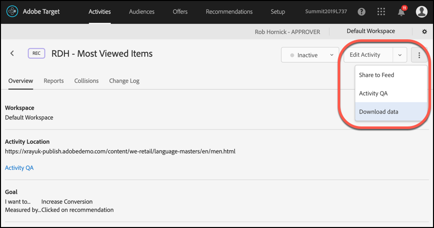

# Prévisualisation et lancement de votre activité Recommandations {#preview-launch-recs-activity}

>[!BEGINSHADEBOX]

**Sur cette page :** Découvrez comment vérifier le statut de l’algorithme, prévisualiser les recommandations et activer une activité [!DNL Recommendations].

>[!ENDSHADEBOX]

La prévisualisation des recommandations avant le lancement d’une activité confirme la disponibilité des résultats. Cela s’applique aux activités de [!UICONTROL ciblage d’expérience] (XT) de [Recommendations], de [!UICONTROL test A/B] et de [!UICONTROL recommandations](/help/main/c-recommendations/recommendations-as-an-offer.md). [!DNL Target Recommendations] offre plusieurs façons de prévisualiser les recommandations.

## Vérifier le statut de l’algorithme {#check-status}

Une fois une activité créée, [!DNL Recommendations] exécute un algorithme pour générer les recommandations. L’exécution de cet algorithme peut prendre quelques heures.

Le statut de l’algorithme est répertorié avec les critères dans le diagramme d’activité sur la page **[!UICONTROL Aperçu]** de l’activité [!DNL Recommendations].

Le statut peut être l’un des suivants :

* **[!UICONTROL Résultats prêts]** : l&#39;algorithme a renvoyé des résultats.
* **[!UICONTROL Résultats non prêts]** : l&#39;exécution de l&#39;algorithme n&#39;est pas terminée.
* **[!UICONTROL Échec du flux]** : impossible de récupérer le fichier de flux des critères personnalisés.

Boîte de dialogue 

## Estimation du temps d’exécution de l’algorithme {#algorithm-run-time}

Une fois qu&#39;une activité contenant un critère est enregistrée, [!DNL Target] calcule les recommandations en fonction de la collection, des critères, de la conception et des promotions sélectionnés. Le temps nécessaire dépend de la logique de recommandation, de la plage de données, du nombre d’éléments dans le catalogue, de la quantité de données comportementales générées par les clients et de la source de données comportementales. La source de données comportementales a le plus grand impact sur le temps de traitement.

### mbox

Lorsque les mbox sont la source de données comportementales, le critère s’exécute immédiatement après sa création. Selon la quantité de données comportementales et la taille du catalogue, l’exécution de l’algorithme peut prendre jusqu’à 12 heures.

Les modifications apportées à la configuration des critères entraînent généralement la réexécution de l’algorithme. Selon la modification apportée, les recommandations calculées précédemment peuvent ne pas être disponibles tant que la nouvelle exécution n’est pas terminée. Pour les modifications plus importantes, seule la sauvegarde ou le contenu par défaut est disponible jusqu’à ce que la réexécution soit terminée.

Un algorithme qui n&#39;est pas modifié est réexécuté automatiquement par [!DNL Target] toutes les 12-48 heures, en fonction de la plage de données sélectionnée.

### [!DNL Adobe Analytics]

Lorsque [!DNL Adobe Analytics] est la source de données comportementales, le temps jusqu’à ce que le critère soit disponible dépend de si la suite de rapports sélectionnée et l’intervalle de recherche en amont ont déjà été utilisés pour un autre critère. La première fois qu&#39;une suite de rapports est utilisée avec un intervalle de recherche en amont donné, [!DNL Target Recommendations] peut prendre de deux à sept jours pour télécharger les données comportementales de [!DNL Analytics].

Pour connaître la durée des critères nouveaux ou modifiés et des exécutions d’algorithmes en cours, consultez la liste déroulante **Disponibilité des critères lorsqu’Analytics est la source de données** dans [Source de données](/help/main/c-recommendations/c-algorithms/create-new-algorithm.md#data-source).

>[!NOTE]
>
>**[!UICONTROL Éléments récemment consultés]** ne nécessitent pas d&#39;exécution d&#39;algorithme hors ligne et les résultats sont disponibles instantanément. Les algorithmes **[!UICONTROL Meilleurs vendeurs]** et **[!UICONTROL Meilleurs vendeurs]** basés sur les données de mbox produisent généralement des résultats très rapidement, car le calcul est plus simple. Ces algorithmes sont de bonnes options pour prévisualiser un changement de conception ou confirmer que les données comportementales sont collectées correctement.

## Aperçu avec un lien d’assurance qualité {#preview-qa-link}

Une fois que l’algorithme a les résultats prêts, il est possible de prévisualiser les résultats avec la fonctionnalité [Lien d’assurance qualité](/help/main/c-activities/c-activity-qa/activity-qa.md) de [!DNL Adobe Target]. Des liens d’assurance qualité sont disponibles dans la section **[!UICONTROL Emplacement de l’activité]** de la page d’aperçu de l’**[!UICONTROL activité]** et affichent les recommandations sur cette page.

>[!NOTE]
>
>Par défaut, [!DNL Target] ajoute automatiquement l’utilisateur à l’audience requise pour le lien d’assurance qualité. Si ce paramètre est désactivé et que l’activité comporte des règles de ciblage, le profil utilisateur doit respecter ces règles de ciblage pour voir l’expérience qui contient des recommandations.

Le mode assurance qualité présente les comportements suivants :

* Le mode AQ [!DNL Target] est enregistré dans un cookie et persiste sur plusieurs pages. Si le mode QA n’est pas désactivé, les résultats de l’assurance qualité continuent de s’afficher sur l’ensemble du site. Pour quitter le mode assurance qualité, utilisez le [signet](/help/main/c-activities/c-activity-qa/activity-qa-bookmark.md).
* En mode assurance qualité, la navigation sur le site n’affecte pas les **[!UICONTROL éléments récemment consultés]** ou les **[!UICONTROL éléments récemment achetés]** du profil. Ce comportement est intentionnel, afin d’éviter la pollution involontaire des données comportementales de production. Pour prévisualiser les résultats d’un critère **[!UICONTROL Éléments récemment consultés]** ou **[!UICONTROL Recommandations basées sur l’utilisateur]**, parcourez d’abord le site en dehors du mode assurance qualité, puis utilisez la même session pour ouvrir un lien de mode assurance qualité.

## Aperçu avec téléchargement du fichier CSV {#preview-csv}

Le téléchargement des résultats permet d’auditer les éléments recommandés spécifiques. Cela s’avère particulièrement utile pour les algorithmes tels que **[!UICONTROL Personnes qui ont consulté ceci ou cela]**, où les éléments recommandés dépendent de l’élément que le visiteur consulte actuellement et où le catalogue peut contenir des milliers ou des millions d’éléments différents.

1. Patientez jusqu’à ce qu’un statut **[!UICONTROL Prêt pour les résultats]** s’affiche pour au moins un algorithme dans l’activité. Les résultats ne peuvent pas être téléchargés avant cette date.

1. Sur la page d’aperçu de l’**[!UICONTROL activité]**, cliquez sur l’icône de menu dans le coin supérieur droit, puis cliquez sur **[!UICONTROL Télécharger les données]**.

   

1. Ouvrez le fichier CSV téléchargé pour afficher les éléments recommandés.

   

Le fichier répertorie les éléments recommandés de gauche à droite. Dans cet exemple, il s’agit des éléments les plus consultés. Les recommandations sont séparées par environnement. Dans cet exemple, seul l’environnement de production dispose de recommandations.

Une ligne commençant par un astérisque (*) répertorie [éléments de sauvegarde](/help/main/c-recommendations/c-algorithms/backup-recs.md). Les éléments de sauvegarde s’affichent lorsque les éléments recommandés de l’algorithme (critères) ne peuvent pas remplir tous les emplacements d’une conception.

Pour les algorithmes basés sur une valeur de clé, comme **[!UICONTROL Personnes qui ont consulté ceci, qui ont consulté cela]**, les valeurs de clé (les éléments « This ») se trouvent dans la colonne la plus à gauche. Les éléments recommandés (les éléments « Que ») sont répertoriés de gauche à droite dans les colonnes Recommendation_X.

Pour les activités avec des jeux de résultats très volumineux, l’option **[!UICONTROL Télécharger les données]** peut échouer avec l’erreur `Error while fetching recommendation data file.`. Cela se produit lorsque le fichier CSV généré dépasse la taille de réponse que l’interface utilisateur peut renvoyer dans un seul téléchargement.

>[!NOTE]
>
>Les téléchargements de résultats ne sont pas disponibles pour les activités qui contiennent un algorithme **[!UICONTROL Recommandations basées sur l’utilisateur]** ou pour les critères qui utilisent la logique de recommandation **[!UICONTROL Éléments récemment consultés]**.

### Format de téléchargement CSV pour les algorithmes basés sur la popularité et les clés {#format}

Le fichier de téléchargement CSV reflète de manière cohérente les résultats générés après l’exécution des critères du serveur principal.

* **Algorithmes basés sur la popularité (non basés sur la clé)** : le fichier comprend :

  * Une ligne de recommandations de sauvegarde précédée d’un astérisque (*)
  * Une ligne distincte répertoriant les recommandations en fonction des paramètres de l’algorithme

* **Algorithmes basés sur les clés** : le fichier comprend :

  * Une ligne de sauvegarde, comme pour les algorithmes basés sur la popularité
  * Plusieurs lignes au format clé-valeur, où la première entrée est l’ID de produit de la clé, suivie des ID de produit séparés par des virgules qui représentent les candidats à la recommandation

## activer l’activité ; {#activate-activity}

L’activation de l’activité la lance et son statut passe à **[!UICONTROL Actif]**.

Dans l’onglet **[!UICONTROL Aperçu de l’activité]**, cliquez sur la flèche déroulante **[!UICONTROL Statut]**, puis sélectionnez **[!UICONTROL Activer]**. Si l’activité est actuellement à l’état **[!UICONTROL Inactive]**, la liste déroulante est intitulée **[!UICONTROL Inactive]**. Après quelques secondes à quelques minutes, le statut passe à **[!UICONTROL Actif]**.

La même liste déroulante peut également être utilisée pour désactiver ou archiver l’activité.

## Éviter les perturbations lors de la modification des paramètres {#avoid-disruptions}

La modification de [!DNL Recommendations] collections, critères, promotions ou paramètres de conception dans une activité active peut invalider les résultats de l’algorithme et modifier le statut d’un algorithme en **[!UICONTROL Résultats non prêts]**.

Pour éviter de perturber une activité active, l’approche recommandée consiste à modifier une copie de l’activité, puis à remplacer l’original :

1. Dupliquez l’activité d’origine (activité 1) et les critères à modifier afin de créer une nouvelle activité (activité 2).
1. Apportez les modifications à l’activité dupliquée (activité 2) et à ses critères, puis attendez que l’algorithme génère des résultats.
1. Prévisualisez l’activité modifiée (activité 2) et vérifiez que les résultats sont corrects.
1. Activer la nouvelle activité (activité 2).
1. Désactivez l’activité d’origine (activité 1).

Lorsque les résultats des rapports historiques doivent être conservés dans la même activité, une autre approche est possible. Cette approche peut provoquer une interruption temporaire de la disponibilité des recommandations :

1. Dupliquez l’activité d’origine (activité 1) et les critères à modifier afin de créer une nouvelle activité (activité 2).
1. Apportez les modifications à l’activité dupliquée (activité 2) et à ses critères, puis attendez que l’algorithme génère des résultats.
1. Prévisualisez l’activité modifiée (activité 2) et vérifiez que les résultats sont corrects.
1. Mettre en pause l’activité modifiée (activité 2) et remplacer les paramètres et les critères par l’activité d’origine (activité 1).
1. Prévisualisez l’activité d’origine (activité 1) et confirmez que les résultats sont ceux souhaités.
1. Réactivez l’activité originale (activité 1).
