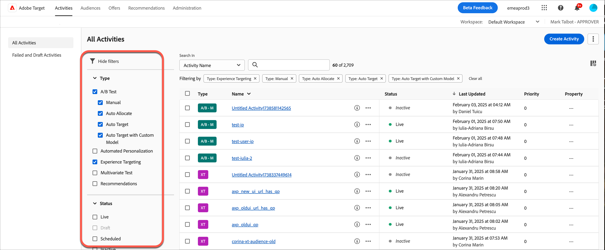
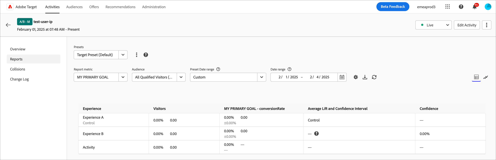

# Prise en main des rapports

Les rapports fournissent des informations sur la progression et les résultats de vos activités [!DNL Adobe Target] et vous aident à prendre des décisions basées sur les données. Les données des rapports peuvent vous aider à décider à quel moment terminer une activité, vous montrer quelle expérience ou offre est gagnante et fournir des informations ou des enseignements dont vous avez besoin pour déterminer les actions suivantes.

## Affichage d’un rapport {#section_C4591A32F6D04C95A1AD5A377C27C28B}

1. Cliquez sur **[!UICONTROL Activités]**, puis sélectionnez l’activité souhaitée dans la liste.

   Si vous avez de nombreuses activités, vous pouvez cliquer sur l’icône de filtre (  ) pour filtrer la liste en sélectionnant des options dans les listes [!UICONTROL Type], [!UICONTROL État], [!UICONTROL Reporting Source], [!UICONTROL Experience Composer], [!UICONTROL Type de mesures], [!UICONTROL Méthode de prise de décision] et [!UICONTROL Activity Source].

   Par exemple, vous pouvez sélectionner [!UICONTROL Test A/B] et [!UICONTROL Ciblage d’expérience] dans la liste déroulante [!UICONTROL Type] et [!UICONTROL Actif] dans la liste déroulante [!UICONTROL Statut] pour afficher uniquement les activités [!UICONTROL Test A/B] et [!UICONTROL Ciblage d’expérience] à l’état actif.

   L’illustration suivante présente la liste déroulante [!UICONTROL Type] avec deux types sélectionnés : [!UICONTROL Test A/B] et [!UICONTROL Ciblage d’expérience]. Notez que les trois types de tests A/B (Manuel, [Affectation automatique](/help/main/c-activities/automated-traffic-allocation/automated-traffic-allocation.md) et [Ciblage automatique](/help/main/c-activities/auto-target/auto-target-to-optimize.md)) sont sélectionnés par défaut. Vous pouvez désélectionner un ou plusieurs types si nécessaire.

   

1. Cliquez sur l’activité souhaitée dans la liste pour afficher sa page [!UICONTROL Aperçu].

1. Cliquez sur l’onglet **[!UICONTROL Rapports]** dans le rail de gauche.

   

   Chaque rapport contient une légende qui permet de comprendre le rapport.

   La légende contient les informations suivantes :

   * État de l’activité, notamment la période d’exécution de celle-ci.
   * [expérience gagnante prévue](/help/main/c-activities/automated-traffic-allocation/determine-winner.md) (si disponible).

   >[!NOTE]
   >
   >Les résultats de l’expérience apparaissent une fois qu’au moins un participant a vu l’expérience.

1. (Facultatif) [Configurez le rapport](/help/main/c-reports/c-report-settings/report-settings.md#concept_4BB6A7FDAB6F4806A632F9CD989B8BFA) en cliquant sur l’icône Paramètres de rapport (  ).
1. (Facultatif) Cliquez sur l’icône Télécharger les rapports (  ) pour [télécharger le rapport au format CSV](/help/main/c-reports/c-report-settings/downloading-data-in-csv-file.md) à des fins d’analyse dans Excel et d’autres outils.

   Les options disponibles sont les suivantes :

   * [!UICONTROL Exportation du rapport au format CSV]
   * [!UICONTROL Exportation des détails des commandes au format CSV]

1. (Facultatif) Cliquez sur les icônes **[!UICONTROL Vue Tableau]** (  ) et **[!UICONTROL Vue Graphique]** (  ) pour basculer entre les formats de rapports.

   Selon le type de rapport sélectionné, d&#39;autres vues et rapports peuvent être disponibles :

   | Type de rapport | Affichage |
   | --- | --- |
   | [[!UICONTROL ciblage automatique]](/help/main/c-activities/auto-target/auto-target-to-optimize.md) | Cliquez sur les icônes **[!UICONTROL Segments automatisés]** (  ) ou **[!UICONTROL Attributs importants]** (  ).<ul><li>Le rapport [[!UICONTROL Segments automatisés]](/help/main/c-reports/c-personalization-insights-reports/automated-segments-report.md) montre comment différents visiteurs réagissent différemment aux offres et aux expériences dans votre activité de [!UICONTROL ciblage automatique] ou [!UICONTROL ciblage automatique]. Ce rapport montre comment différents segments automatisés définis par les modèles de personnalisation [!DNL Target] ont répondu aux offres et aux expériences dans l’activité.</li><li>Le rapport [[!UICONTROL Attributs importants]](/help/main/c-reports/c-personalization-insights-reports/important-attributes-report.md) montre comment, dans différentes activités, les différents attributs sont plus (ou moins) importants quant à la manière dont le modèle décide d’être personnalisé. Ce rapport indique les attributs principaux qui ont influencé le modèle et leur importance relative.</li></ul> |
   | [[!UICONTROL Automated Personalization]](/help/main/c-activities/t-automated-personalization/automated-personalization.md) (AP) | Outre les rapports [[!UICONTROL Résumé Automated Personalization]](/help/main/c-reports/personalization-reports/reports-ap.md), vous pouvez cliquer sur les icônes **[!UICONTROL Segments automatisés]** (  ) ou **[!UICONTROL Attributs importants]** (  ).<ul><li>Le rapport [[!UICONTROL Segments automatisés]](/help/main/c-reports/c-personalization-insights-reports/automated-segments-report.md) montre comment différents visiteurs réagissent différemment aux offres et aux expériences dans votre activité de [!UICONTROL ciblage automatique] ou [!UICONTROL ciblage automatique]. Ce rapport montre comment différents segments automatisés définis par les modèles de personnalisation [!DNL Target] ont répondu aux offres et aux expériences dans l’activité.</li><li>Le rapport [[!UICONTROL Attributs importants]](/help/main/c-reports/c-personalization-insights-reports/important-attributes-report.md) montre comment, dans différentes activités, les différents attributs sont plus (ou moins) importants quant à la manière dont le modèle décide d’être personnalisé. Ce rapport indique les attributs principaux qui ont influencé le modèle et leur importance relative.</li></ul> |
   | [[!UICONTROL Test multivarié]](/help/main/c-activities/c-multivariate-testing/multivariate-testing.md) (MVT) | Outre le rapport [[!UICONTROL Performances de l’expérience]](/help/main/c-reports/multivariate-test-reports/experience-performance-report.md), vous pouvez cliquer sur l’icône [[!UICONTROL Contribution de l’emplacement]](/help/main/c-reports/multivariate-test-reports/location-contribution-report.md) (  ) pour changer le rapport et afficher la contribution par emplacement. |

## Informations de reporting supplémentaires pour des types d’activité spécifiques {#section_DFE037B9E1C345D3B3BDFCB3AC0359CA}

Outre les informations générales sur les rapports figurant dans cette rubrique et ses sous-rubriques, des informations supplémentaires spécifiques aux différents types d’activité sont disponibles à d’autres endroits de ce guide :

| Type d’activité | Détails |
|--- |--- |
| [[!UICONTROL Test A/B]](/help/main/c-activities/t-test-ab/test-ab.md) | Pour comprendre l’effet élévateur et le degré de confiance, ainsi que les différentes approches statistiques utilisées dans [!DNL Target], voir [Planification d’un test A/B](/help/main/c-activities/t-test-ab/sample-size-determination.md). |
| [Interpréter les [!UICONTROL rapports d’affectation automatique]](/help/main/c-activities/automated-traffic-allocation/determine-winner.md) | Interprétez les résultats d’une activité A/B [!UICONTROL Affectation automatique] en examinant des indicateurs importants, y compris l’effet élévateur et le degré de confiance, dans l’interface utilisateur [!DNL Target]. |
| [[!UICONTROL Ciblage automatique]](/help/main/c-activities/auto-target/auto-target-to-optimize.md) (AT) | Informations sur le rapport [!UICONTROL Résumé] pour les activités AT. Pour plus d’informations, consultez [[!UICONTROL Rapport de synthèse de ciblage automatique]](/help/main/c-reports/personalization-reports/auto-target-summary-report.md). Informations sur les deux rapports [!UICONTROL Personalization Insights] pour les activités AT et AP : [!UICONTROL Rapport de segments automatisés] et [!UICONTROL Rapport d’attributs importants]. Pour plus d’informations, voir [Rapports Informations sur la personnalisation](/help/main/c-reports/c-personalization-insights-reports/personalization-insights-reports.md). |
| [[!UICONTROL Automated Personalization]](/help/main/c-activities/t-automated-personalization/automated-personalization.md) (AP) | Informations sur les deux rapports [!UICONTROL Résumé Automated Personalization] pour les activités AP : rapport [!UICONTROL Niveau d’activité] et rapport [!UICONTROL Niveau d’offre]. Pour plus d’informations, voir [Rapports récapitulatifs Automated Personalization](/help/main/c-reports/personalization-reports/reports-ap.md). Informations sur les deux [!UICONTROL rapports Personalization Insights] pour les activités AT et AP : [!UICONTROL rapport Segments automatisés] et [!UICONTROL rapport Attributs importants]. Pour plus d’informations, voir [Rapports Informations sur la personnalisation](/help/main/c-reports/c-personalization-insights-reports/personalization-insights-reports.md). |
| [[!UICONTROL Test multivarié]](/help/main/c-activities/c-multivariate-testing/multivariate-testing.md) (MVT) | Informations sur les deux rapports pour les activités MVT : rapport [!UICONTROL Performance de l’expérience] et rapport [!UICONTROL Contribution de l’emplacement]. Pour plus d’informations, consultez les sections [Rapport de performances d’expérience](/help/main/c-reports/multivariate-test-reports/experience-performance-report.md) (MVT) et [Rapport de contribution de l’emplacement](/help/main/c-reports/multivariate-test-reports/location-contribution-report.md) (MVT). |
| [[!DNL Adobe Analytics] comme Source de création de rapports pour Adobe Target](/help/main/c-integrating-target-with-mac/a4t/a4t.md) (A4T) | Informations sur l’utilisation de [!DNL Adobe Analytics] comme source de création de rapports pour [!DNL Target] (A4T). A4T vous donne accès aux rapports [!DNL Analytics] pour vos activités [!DNL Target]. Pour plus d’informations, voir [Rapports Analytics for Target (A4T)](/help/main/c-reports/analytics-for-target-a4t-reporting.md). |
| [[!DNL Target] création de rapports dans  [!DNL Adobe Customer Journey Analytics]](/help/main/c-integrating-target-with-mac/cja/target-reporting-in-cja.md) | Informations sur l’intégration entre [Adobe Customer Journey Analytics](https://experienceleague.adobe.com/fr/docs/customer-journey-analytics){target=_blank} et [!DNL Target] qui fournit de puissants outils d’analyse et de gain de temps pour votre programme d’optimisation. |

## Bloquer les données de rapport des adresses IP spécifiées

Vous pouvez empêcher le décompte dans les rapports de visiteurs provenant d’adresses IP spécifiées. Cette option s’avère utile, par exemple, pour bloquer les données de rapport de vos visiteurs internes.

[Contactez le service clientèle](/help/main/cmp-resources-and-contact-information.md#reference_ACA3391A00EF467B87930A450050077C) pour configurer des filtres IP. Ce filtrage ne s’applique pas lors de l’utilisation de [Analytics for Target](/help/main/c-integrating-target-with-mac/a4t/a4t.md#concept_7540C8C04259434AB6EE33B09F47A1DE) (A4T) comme source de création de rapports.
